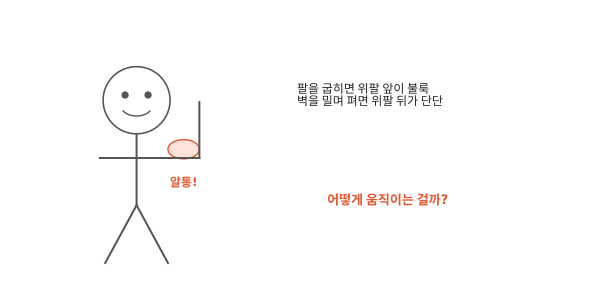
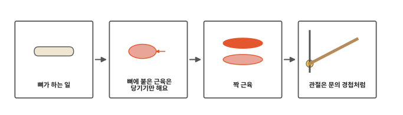
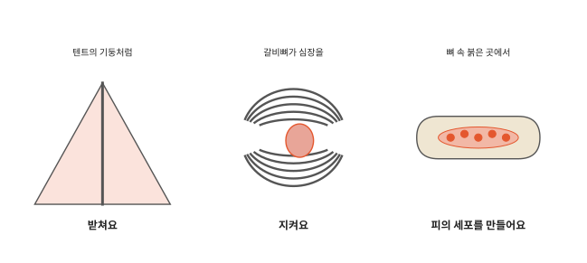
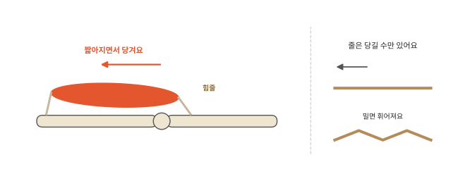
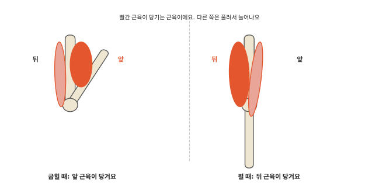

# 뼈와 근육은 어떻게 몸을 움직일까요?

## 알통 만들기

팔꿈치 위쪽을 위팔, 아래쪽을 아래팔이라고 해요. 주먹을 쥐고 팔을 힘껏 굽혀 알통을 만들어 보세요. 다른 손으로 위팔 앞쪽을 만지면 불룩하고 단단해요. 이번에는 손바닥으로 벽을 밀면서 팔을 펴 보세요. 위팔 앞은 말랑해지고 뒤쪽이 단단해져요.

팔이 굽고 펴질 때 몸속에서는 무슨 일이 일어날까요?

## 뼈가 하는 일에서 관절까지

인체 아홉 번째 편이에요. 뼈가 하는 일에서 시작해서 근육, 짝 근육, 관절까지 차례로 알아봐요.

## 뼈가 하는 일

뼈가 없으면 우리 몸은 어떻게 될까요? 기둥 없는 텐트처럼 털썩 주저앉고 말 거예요. 뼈는 몸을 받쳐서 모양을 지켜 줘요.

뼈는 몸속 중요한 것도 지켜요. 머리뼈는 뇌를 단단하게 감싸요. 가슴의 갈비뼈는 새장처럼 둘러서 심장과 폐를 지켜요.

어떤 뼈 속에는 붉고 말랑한 곳이 있어요. 여기에서 [4편](04-blood.md)의 빨간 세포, [6편](06-clotting.md)의 혈소판 같은 피 속 세포와 조각이 만들어져요.

그런데 뼈는 혼자서는 움직이지 못해요. 뼈를 움직이는 것은 근육이에요.

## 뼈에 붙은 근육은 당기기만 해요

[1편](01-cells.md)에서 근육 세포는 길쭉하다고 했어요. 근육은 이런 길쭉한 세포가 다발로 모인 거예요. 근육 끝은 질긴 줄로 뼈에 붙어 있어요. 이 줄을 **힘줄**이라고 해요.

근육은 짧아지면서 힘줄로 붙은 뼈를 당겨요. 근육이 일을 마치면 힘이 풀려 말랑해져요. 하지만 힘을 풀어도 스스로 길어지지는 못해요. 뼈를 밀지도 못해요.

줄다리기 줄을 떠올려 보세요. 줄을 잡아당기면 저쪽 끝이 끌려와요. 그런데 줄로 밀면 줄이 휘어질 뿐 아무것도 밀리지 않아요. 근육도 당길 수만 있어요. 줄은 사람이 당겨야 하지만 근육은 [8편](08-nails-hair.md)에서 본 신경으로 뇌의 알림이 오면 줄어들면서 당겨요.

근육이 짧아지려면 힘이 들어요. 그 힘은 [2편](02-breathing.md)의 산소와 [3편](03-digestion.md)의 영양으로 근육 세포가 만들어요.

## 짝 근육

근육이 당기기만 한다면 굽힌 팔은 어떻게 다시 펼까요?

위팔 앞쪽에는 팔을 굽히는 큰 근육이, 뒤쪽에는 팔을 펴는 큰 근육이 있어요. 앞 근육이 짧아지면 아래팔을 당겨서 팔이 굽어요. 앞 근육은 짧아지면 두꺼워져요. 알통이 불룩한 게 그 모습이에요. 그동안 뒤 근육은 힘을 풀고 늘어나요.

팔을 펼 때는 거꾸로예요. 뒤 근육이 짧아지면서 아래팔을 반대쪽으로 당겨요. 그러면 앞 근육이 힘을 풀고 늘어나요.

줄다리기에서 두 편이 줄을 반대로 당기듯 위팔 앞과 뒤 근육도 반대로 당겨요. 이렇게 짝을 이룬 근육을 이 편에서는 짝 근육이라고 불러요. 다리에도, 손가락에도 이런 짝이 있어요.

그런데 팔은 어디에서 접히고 펴질까요?

## 관절은 문의 경첩처럼

뼈와 뼈가 만나 움직이는 곳을 **관절**이라고 해요. 팔꿈치, 무릎, 손가락 마디가 모두 관절이에요.

문을 떠올려 보세요. 문은 벽에 붙은 경첩을 중심으로 돌아요. 팔꿈치도 경첩처럼 일해요. 아래팔뼈는 팔꿈치를 중심으로 도는 문짝과 같아요.

문을 열 때 경첩 바로 옆을 밀면 조금만 밀어도 문 끝은 크게 움직여요. 대신 손잡이 쪽을 밀 때보다 힘이 훨씬 많이 들지요. 위팔 앞 근육은 팔꿈치 바로 가까이에 붙어 있어요. 그래서 근육이 조금만 짧아져도 손은 크게 움직여요. 그 대신 근육은 힘을 많이 내야 해요.

근육은 신경으로 뇌의 알림이 와야 당겨요. 뇌는 언제 알림을 보낼지 정하려고 바깥에서 오는 소식도 받아요. 그 소식을 가장 많이 보내는 곳이 눈이에요. 다음 편에서 눈을 볼게요.

## 정리

- 뼈는 몸을 받치고 속을 지키며, 뼈 속에서 피의 세포가 만들어져요.
- 힘줄: 근육을 뼈에 붙이는 질긴 줄이에요. 뼈에 붙은 근육은 짧아지면서 힘줄로 뼈를 당기기만 해요. 그래서 반대로 당기는 짝 근육이 있어요.
- 관절: 뼈와 뼈가 만나 움직이는 곳이에요. 뼈는 관절을 중심으로 문짝처럼 돌아요.

## 해 보기: 짝 근육 찾기

1. 한 팔을 쭉 펴고 다른 손으로 위팔 앞과 뒤를 잡아 보세요.
2. 주먹을 쥐고 팔을 힘껏 굽혀 보세요. 어느 쪽이 단단해지나요?
3. 팔꿈치를 굽혀 아래팔을 책상 밑에 넣고 손바닥으로 책상 밑면을 위로 꾹 밀어 보세요. 위팔 앞과 뒤 중 어느 쪽이 단단해지나요?
4. 이번에는 같은 자세로 책상 위에 손바닥을 얹고 같은 힘으로 아래로 꾹 눌러 보세요. 이번에는 어느 쪽이 단단해지나요?
5. 의자에 앉아 다리를 앞으로 쭉 들어 올릴 때와 발을 의자 밑으로 끌어당길 때 허벅지 앞과 뒤를 만져 보세요.

## 확인 문제

??? question "1. 근육이 할 수 있는 일"
    근육은 뼈를 밀 수 있을까요?

    **풀이**: 아니요. 뼈에 붙은 근육은 짧아지면서 당기기만 해요. 일을 마치면 풀려서 말랑해져요.

??? question "2. 굽힌 팔을 펴려면"
    팔을 굽히는 근육은 위팔 앞에 있어요. 굽힌 팔은 무엇이 펴 줄까요?

    **풀이**: 위팔 뒤에 있는 짝 근육이 짧아지면서 아래팔을 반대쪽으로 당겨서 펴요.

??? question "3. 관절"
    몸에서 관절을 세 군데 찾아보세요.

    **풀이**: 팔꿈치, 무릎, 손가락 마디 같은 곳이에요. 손목, 어깨, 발목도 관절이에요. 뼈와 뼈가 만나 움직이는 곳이면 돼요.

!!! abstract "어른을 위한 정리 (건너뛰어도 돼요)"
    - 뼈대는 몸을 받쳐요. 머리뼈가 뇌를, 갈비뼈가 폐와 심장을 감싸 보호해요. 뼈 바탕질은 칼슘과 인을 저장해요. 붉은골수에서 적혈구, 백혈구, 혈소판이 만들어져요. 노란골수에는 지방이 있어요. 역학적으로 뼈는 지렛대, 관절은 받침점이에요.[^func] 어른 뼈대는 206개 뼈로 되어 있어요(몸통뼈대 80, 팔다리뼈대 126).[^div]
    - 골격근은 근섬유 속 마이오신 머리가 액틴 필라멘트를 당기면서 짧아져요. 이완하면 장력이 사라져요. 수축에는 ATP가 꼭 필요해요.[^contract] 본문의 "스스로 길어지지 못하고 밀지도 못해요"는 이 수축 방식을 풀어 쓴 말이에요. 이 편의 이야기는 뼈에 붙어 뼈를 움직이는 근육이에요. 얼굴 근육이나 가로막처럼 뼈를 당기지 않는 골격근도 있어요. 심장근은 따로 일해요.[^lever]
    - 힘줄은 근육을 뼈에 잇는 치밀한 결합조직이에요. 한 동작의 주된 근육을 주동근, 반대 동작을 하는 근육을 길항근(대항근)이라 해요. 본문의 "짝 근육"이 주동근과 길항근의 짝이에요. 위팔두갈래근(이두근)은 아래팔을 굽히고 위팔세갈래근(삼두근)은 펴요.[^lever] 해 보기 3·4번은 같은 자세에서 미는 방향만 바꿔 짝 근육이 번갈아 쓰이는 것을 느끼게 하려는 활동이에요(위로 밀면 대개 위팔 앞, 아래로 누르면 위팔 뒤가 단단해져요).
    - 일반 역학으로 보면 팔꿈치 굽히기처럼 힘을 주는 곳(근육 부착점)이 받침점 가까이 있고 하중(손)이 먼 지렛대는, 힘은 많이 들지만 움직이는 거리와 속도를 크게 해요. 본문은 이를 문 경첩 가까이를 미는 경험에 빗대었어요.

## 더 깊이

??? info "아기는 어른보다 뼈가 많을까"
    아기 때는 나중에 하나로 붙을 뼈들이 아직 따로 떨어져 있어요. 머리뼈가 그런 예예요. 자라면서 여러 뼈가 붙어 하나가 돼요. 그래서 아기의 뼈 조각 수는 어른보다 많아요.

??? info "심장도 근육일까"
    [5편](05-heart.md)에서 본 심장도 근육으로 되어 있어요. 다만 팔다리 근육과 달리 우리가 생각하지 않아도 스스로 박자에 맞춰 짜요.

[^func]: OpenStax, *Anatomy and Physiology 2e*, 6.1 ["The Functions of the Skeletal System"](https://openstax.org/books/anatomy-and-physiology-2e/pages/6-1-the-functions-of-the-skeletal-system).
[^div]: OpenStax, *Anatomy and Physiology 2e*, 7.1 ["Divisions of the Skeletal System"](https://openstax.org/books/anatomy-and-physiology-2e/pages/7-1-divisions-of-the-skeletal-system).
[^contract]: OpenStax, *Anatomy and Physiology 2e*, 10.3 ["Muscle Fiber Contraction and Relaxation"](https://openstax.org/books/anatomy-and-physiology-2e/pages/10-3-muscle-fiber-contraction-and-relaxation).
[^lever]: OpenStax, *Anatomy and Physiology 2e*, 11.1 ["Interactions of Skeletal Muscles, Their Fascicle Arrangement, and Their Lever Systems"](https://openstax.org/books/anatomy-and-physiology-2e/pages/11-1-interactions-of-skeletal-muscles-their-fascicle-arrangement-and-their-lever-systems).
