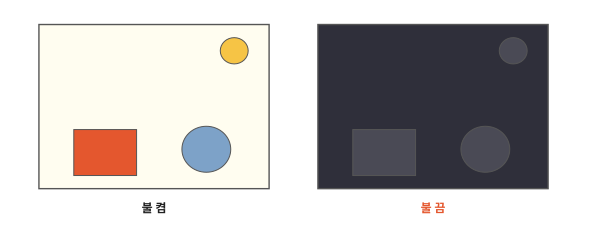
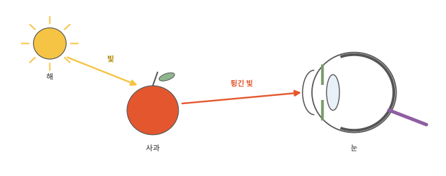
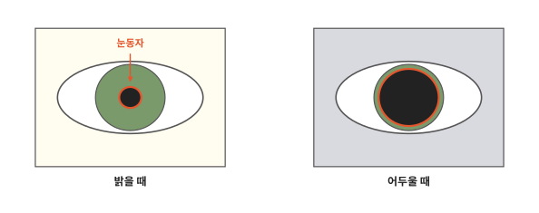
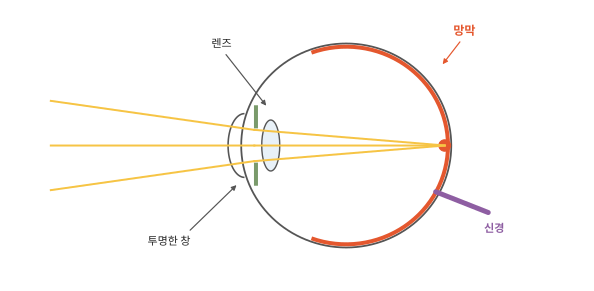
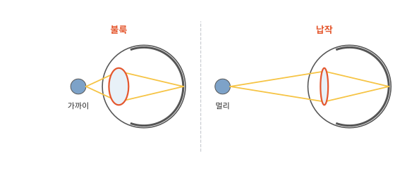
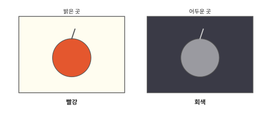
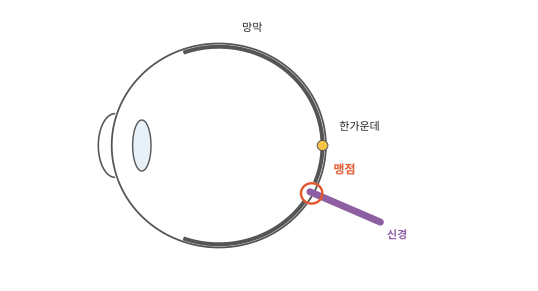
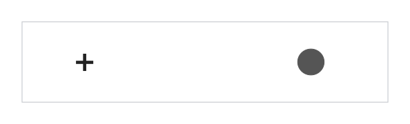
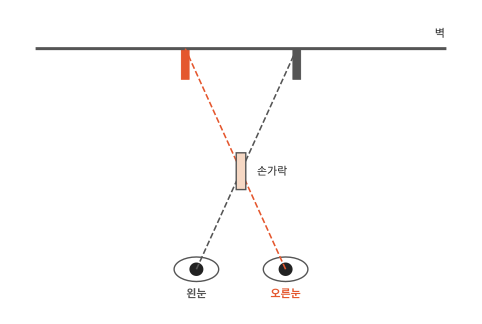

# 눈이 보는 방법: 빛에서 뇌까지

밤에 방 불을 끄면 갑자기 아무것도 안 보여요. 장난감도 책상도 그 자리에 그대로 있는데요. 그런데 잠깐 기다리면 물건이 희미하게 보이기 시작해요. 이 글을 읽고 나면 빛이 눈으로 들어와 뇌까지 가는 길을 알게 돼요. 그 길을 따라가면 불을 끈 방에서 처음엔 안 보이다가 조금 지나면 회색으로 보이는 까닭이 풀려요.

!!! abstract "이 글에서 알게 되는 것"
    1. 눈은 물건에 닿아 튕긴 빛을 받아서 봐요. 눈동자는 밝으면 작아지고 어두우면 커져서 들어오는 빛의 양을 맞춰요.
    2. 투명한 창과 렌즈가 빛을 꺾어 눈 뒤쪽 망막에 모아요. 망막의 세포가 빛을 알림으로 바꿔 신경으로 보내면 그 알림을 읽고 무엇인지 알아차리는 건 뇌예요.
    3. 망막에는 밝은 곳에서 색깔을 보는 세포와 어두운 곳에서 빛을 느끼는 세포가 있어요. 신경이 빠져나가는 자리에는 이런 세포가 없어서 맹점이 생겨요.

## 1. 눈은 물건에 닿아 튕긴 빛을 받아요

[9편](09-bones-muscles.md) 끝에서 뇌는 바깥에서 오는 소식을 받는다고 했어요. 그 소식을 가장 많이 보내는 곳이 눈이에요. 그런데 불을 끄면 눈은 왜 갑자기 소식을 못 보낼까요?

아래 그림에서 두 방의 물건을 비교해 보세요.

**그림 1.** 물건은 그대로인데 불을 끄면 거의 보이지 않아요.
{ .fig-cap }

두 방에서 달라진 건 빛 하나예요. 무엇을 보려면 빛이 있어야 해요. 해나 전등에서 나온 빛이 사과에 닿으면 튕겨 나와요. 그 빛의 일부가 우리 눈으로 들어와요. 아래 그림에서 빨간 화살표를 따라가 보세요.

**그림 2.** 해에서 나온 빛이 사과에 닿아 튕긴 다음 눈으로 들어와요.
{ .fig-cap }

눈은 이렇게 물건에서 튕겨 들어온 빛을 받아요. 불을 끈 방에는 물건에 닿아 튕길 빛이 거의 없어요. 눈으로 들어오는 빛도 거의 없으니 처음에는 아무것도 안 보여요.

## 2. 눈동자는 들어오는 빛의 양을 맞춰요

빛은 아무 데로나 들어가지 않아요. 거울로 눈을 보면 가운데에 검은 동그라미가 있어요. 이게 **눈동자**예요. 빛은 이 눈동자를 지나 눈 속으로 들어가요.

눈동자 둘레의 색깔 있는 부분이 눈동자 크기를 바꿔요. 아래 그림에서 빨간 테두리를 두른 눈동자 크기를 비교해 보세요.

**그림 3.** 밝을 때는 눈동자가 작고 어두울 때는 커요.
{ .fig-cap }

밝은 곳에서는 눈동자를 작게 줄여서 빛이 너무 많이 들어오지 않게 해요. 어두운 곳에서는 눈동자를 크게 열어서 빛을 조금이라도 더 받아들여요.

거울 하나로 확인할 수 있어요. 방 불을 켠 채 거울로 눈동자 크기를 봐 두세요. 어른이 불을 잠깐 끄고 열을 센 다음 다시 켜 주면 그 순간 눈동자를 보세요. 손전등으로 눈을 비추지는 않아요.

불을 끈 방에 들어가면 눈동자는 금방 커져요. 그래도 물건이 희미하게라도 보이려면 조금 더 기다려야 해요. 그 까닭은 4절에서 풀려요.

## 3. 투명한 창과 렌즈가 빛을 망막에 모아요

눈동자를 지난 빛은 어디로 갈까요? 눈을 옆에서 잘라 보면 알 수 있어요. 아래 그림에서 노란 빛 세 줄이 어디서 만나는지 보세요.

**그림 4.** 빛 세 줄이 창과 렌즈에서 꺾여 눈 뒤쪽 망막의 한 점에 모여요. 크기는 실제와 다르게 그렸어요.
{ .fig-cap }

눈 맨 앞에는 투명한 창이 있고 그 뒤에 말랑한 렌즈가 있어요. 창과 렌즈는 들어온 빛을 꺾어서 눈 뒤쪽 한곳에 모아요. 돋보기가 빛을 꺾어 모으는 것과 비슷해요. 눈 안쪽 맨 뒤 벽에는 얇은 막이 깔려 있어요. 빛이 모이는 이 막을 **망막**이라고 해요.

돋보기는 두께가 정해져 있지만 눈의 렌즈는 두께가 조금씩 바뀌어요. 아래 그림에서 빨간 렌즈의 두께를 비교해 보세요.

**그림 5.** 가까운 것을 볼 때는 렌즈가 불룩해지고 먼 것을 볼 때는 납작해져요.
{ .fig-cap }

렌즈가 이렇게 두께를 바꿔서 가까운 것도 먼 것도 빛이 망막에 모여요. 그래서 둘 다 또렷하게 보여요.

## 4. 망막의 세포가 빛을 알림으로 바꿔요

망막에는 빛을 느끼는 세포가 가득 늘어서 있어요. 빛이 닿으면 이 세포들이 빛을 알림으로 바꿔요. [8편](08-nails-hair.md)에서 신경은 알림이 다니는 가는 줄이라고 했어요. 몸속 알림은 신경을 타고 가는 아주 작은 전기 신호예요.

빛을 느끼는 세포는 두 가지예요. 한 가지는 밝은 곳에서 색깔을 알아봐요. 다른 한 가지는 어두운 곳에서도 빛을 느끼는데 색깔은 구별하지 못해요. 그리고 어둠 속에서 제대로 일하기까지 시간이 조금 걸려요.

이제 처음의 불 끈 방으로 돌아가 볼게요. 불을 끄면 색깔을 보는 세포는 빛이 모자라서 일을 못 해요. 어두운 곳에서 일하는 세포는 준비하는 데 시간이 걸려요. 그래서 처음엔 아무것도 안 보이다가 조금 기다리면 점점 보여요. 이때 보이는 물건은 색깔이 없어요. 아래 그림에서 같은 사과의 색깔을 비교해 보세요.

**그림 6.** 같은 사과가 밝은 곳에서는 빨갛게, 어두운 곳에서는 회색으로 보여요.
{ .fig-cap }

어두운 곳에서 사과가 회색으로 보이는 건 색깔을 구별하지 못하는 세포가 혼자 일하기 때문이에요.

## 5. 보는 일은 뇌가 하고 맹점은 뇌가 채워요

망막의 세포가 만든 알림은 신경을 타고 뇌로 가요. 뇌는 이 알림을 받아 "빨갛고 동그란 사과가 있구나" 하고 알아차려요. 눈은 빛을 모아 알림으로 바꾸고 그 알림으로 보는 일은 뇌가 해요.

신경이 눈을 빠져나가는 자리를 다시 보세요. 아래 그림에서 빨간 동그라미를 친 곳이에요.

**그림 7.** 신경이 빠져나가는 자리는 빛이 모이는 한가운데에서 조금 떨어져 있어요.
{ .fig-cap }

이 자리에는 빛을 느끼는 세포가 없어요. 그래서 여기 닿는 빛은 알림이 되지 못해요. 이 자리를 **맹점**이라고 해요.

맹점은 직접 찾아볼 수 있어요. 어른과 함께 해 보세요. 아래 그림을 화면이나 종이에 크게 띄워요. 왼쪽 눈을 감고 오른쪽 눈으로 + 표시만 봐요. 팔을 쭉 뻗은 만큼 떨어진 데서 시작해서 얼굴을 천천히 그림 쪽으로 가까이 가져가요.

**그림 8.** 오른쪽 눈으로 +만 보며 다가가면 어느 순간 검은 동그라미가 사라져요.
{ .fig-cap }

검은 동그라미가 사라지는 순간이 있어요. 그때 동그라미에서 온 빛이 맹점에 닿은 거예요.

평소에는 맹점을 알아채지 못해요. 두 눈의 맹점은 서로 다른 곳을 향해서 한쪽 눈이 다른 쪽 눈의 빈 곳을 봐 줘요. 한쪽 눈으로 볼 때도 뇌가 둘레의 모습으로 빈 곳을 채워요.[^psy]

## 6. 두 눈이 보는 차이로 거리를 짐작해요

5절에서 두 눈이 서로 빈 곳을 봐 준다고 했어요. 눈이 둘이라서 생기는 일이 하나 더 있어요.

눈은 두 개이고 조금 떨어져 있어요. 그래서 두 눈은 같은 물건을 조금씩 다른 쪽에서 봐요. 얼굴 앞에 손가락 하나를 세우고 한쪽 눈씩 번갈아 감아 보세요. 손가락이 조금씩 옮겨 가 보여요. 아래 그림에서 두 점선이 벽에 닿는 자리를 보세요.

**그림 9.** 같은 손가락이 왼눈에는 벽 오른쪽에, 오른눈에는 벽 왼쪽에 겹쳐 보여요.
{ .fig-cap }

뇌는 두 눈이 보는 이 차이를 써서 물건이 가까운지 먼지 짐작해요.

연필로도 해 볼 수 있어요. 친구가 연필을 세워 들고 팔을 앞으로 뻗어요. 나도 연필을 들고 친구 연필 끝에 내 연필 끝을 위에서 맞대 보세요. 이번에는 한쪽 눈을 감고 해 보세요. 한쪽 눈으로 하면 조금 더 어려울 수 있어요. 사람마다 차이가 크지 않을 수도 있어요.

??? info "더 알아보기: 어른이 쓰는 이름"
    - 투명한 창은 각막, 렌즈는 수정체, 눈동자는 동공, 눈동자 둘레의 색깔 있는 부분은 홍채예요. 수정체가 가까운 것과 먼 것에 맞춰 초점을 다시 맞추는 일을 조절이라고 해요.[^sense][^bio]
    - 어두운 곳에서 빛을 느끼는 세포는 막대세포, 밝은 곳에서 색깔을 보는 세포는 원뿔세포예요. 망막 한가운데 원뿔세포가 촘촘한 곳을 중심오목이라고 하고 가장 또렷하게 보는 곳이에요.[^sense]
    - 신경이 빠져나가는 자리는 시신경원판이에요. 알림은 시신경을 따라 뇌 뒤쪽의 시각겉질로 가요.[^sense] 두 눈이 보는 차이는 양안 시차라고 해요. 한 눈으로도 쓸 수 있는 거리 단서도 많아요.[^psy]

## 정리

눈은 물건에 닿아 튕긴 빛을 받아서 봐요. 불을 끈 방에서 처음에 아무것도 안 보이는 건 눈으로 들어오는 빛이 거의 없어서예요. 눈동자는 밝으면 작아지고 어두우면 커져서 들어오는 빛의 양을 맞춰요.

투명한 창과 렌즈는 빛을 꺾어 눈 뒤쪽 망막에 모아요. 렌즈는 가까운 것을 볼 때 불룩해지고 먼 것을 볼 때 납작해져요. 망막의 세포는 빛을 알림으로 바꿔 신경으로 뇌에 보내요. 밝은 곳에서는 색깔을 보는 세포가 일하고 어두운 곳에서는 색깔을 못 보는 세포가 시간을 들여 일해요. 그래서 불 끈 방에서 기다리면 물건이 회색으로 보여요.

보는 일은 뇌가 해요. 신경이 빠져나가는 맹점에는 빛을 느끼는 세포가 없지만 뇌가 빈 곳을 채워서 평소엔 알아채지 못해요. 뇌는 두 눈이 보는 차이로 물건이 가까운지 먼지도 짐작해요.

뇌는 눈에서 받은 알림을 읽고 나면 몸에 무엇을 할지 정해요. [11편](11-brain.md)에서 뇌가 몸에 어떻게 명령하는지 볼게요.

### 새로 나온 말

- **눈동자**: 눈 가운데의 검은 동그라미. 빛이 이곳을 지나 눈 속으로 들어가요. 어두우면 커지고 밝으면 작아져요.
- **망막**: 눈 안쪽 맨 뒤 벽의 얇은 막. 빛을 느끼는 세포가 가득해서 사과에서 온 빛을 알림으로 바꿔요.
- **맹점**: 신경이 눈을 빠져나가는 자리. 빛을 느끼는 세포가 없어서 맹점 찾기 그림의 검은 동그라미가 사라져요.

[^sense]: OpenStax, *Anatomy and Physiology 2e*, 14.1 ["Sensory Perception"](https://openstax.org/books/anatomy-and-physiology-2e/pages/14-1-sensory-perception).
[^bio]: OpenStax, *Biology 2e*, 36.5 ["Vision"](https://openstax.org/books/biology-2e/pages/36-5-vision).
[^psy]: OpenStax, *Psychology 2e*, 5.3 ["Vision"](https://openstax.org/books/psychology-2e/pages/5-3-vision).
