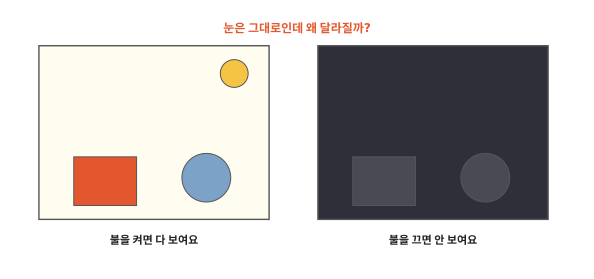
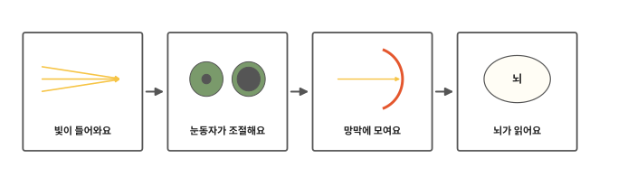
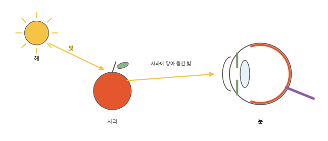
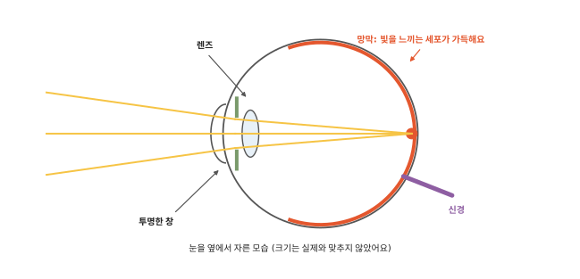
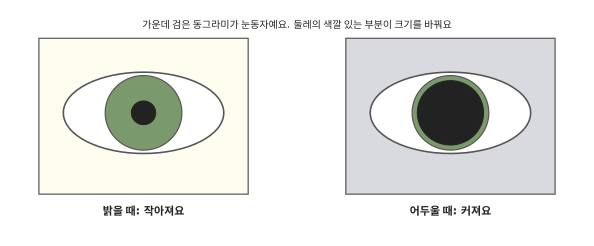
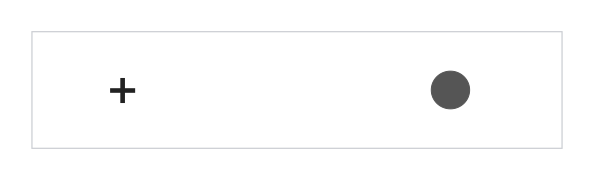

# 눈은 어떻게 볼까요?

## 불을 끈 방

밤에 방 불을 끄면 갑자기 아무것도 안 보여요. 장난감도 책상도 그 자리에 그대로 있는데 말이에요. 불을 다시 켜면 모든 게 또렷이 보여요.

[9편](09-bones-muscles.md) 끝에서 뇌는 바깥에서 오는 소식을 받는다고 했어요. 그 소식을 가장 많이 보내는 곳이 눈이에요. 그런데 불을 끄면 눈은 왜 갑자기 소식을 못 보낼까요?

## 빛이 들어와요에서 뇌가 읽어요까지

인체 열 번째 편이에요. 빛이 눈으로 들어와서 뇌까지 가는 길을 차례로 따라가 봐요.

## 빛이 들어와요

무엇을 보려면 빛이 있어야 해요. 해나 전등에서 나온 빛이 사과에 닿으면 튕겨 나와요. 그 빛의 일부가 우리 눈으로 들어와요. 눈은 이렇게 들어온 빛을 받아요.

불을 끈 방에서는 물건에 닿아 튕길 빛이 거의 없어요. 눈으로 들어오는 빛이 거의 없으니 처음에는 아무것도 안 보여요.

눈 맨 앞에는 투명한 창(각막)이 있어요. 그 뒤에는 말랑한 렌즈(수정체)가 있어요. 창과 렌즈는 들어온 빛을 꺾어서 눈 뒤쪽 한곳에 모아요. 돋보기가 빛을 꺾어 모으는 것과 비슷해요.

돋보기는 두께가 정해져 있지만 눈의 렌즈는 두께가 조금씩 바뀌어요. 가까운 것을 볼 때는 렌즈가 더 불룩해지고 먼 것을 볼 때는 납작해져요. 그래서 가까운 것도 먼 것도 또렷하게 보여요.

그런데 렌즈는 빛을 모을 뿐 들어오는 빛의 양은 조절하지 못해요. 그 일은 눈동자가 해요.

## 눈동자가 조절해요

거울로 눈을 보면 가운데에 검은 동그라미가 있어요. 이게 눈동자예요. 빛은 이 눈동자를 지나 눈 속으로 들어가요.

눈동자 둘레의 색깔 있는 부분이 눈동자 크기를 바꿔요. 밝은 곳에서는 눈동자를 작게 줄여서 빛이 너무 많이 들어오지 않게 해요. 어두운 곳에서는 눈동자를 크게 열어서 빛을 조금이라도 더 받아들여요.

불을 끈 방에 들어가면 눈동자는 금방 커져요. 그래도 물건이 희미하게라도 보이려면 조금 더 기다려야 해요. 그 까닭은 다음 절에 있어요.

## 망막에 모여요

눈 안쪽 맨 뒤 벽에는 얇은 막이 깔려 있어요. 이 막을 **망막**이라고 해요. 창과 렌즈가 모은 빛은 망막에 닿아요.

망막에는 빛을 느끼는 세포가 가득 늘어서 있어요. 빛이 닿으면 이 세포들이 빛을 알림으로 바꿔요. [8편](08-nails-hair.md)에서 신경은 알림이 다니는 가는 줄이라고 했어요. 몸속 알림은 신경을 타고 가는 아주 작은 전기 신호예요.

빛을 느끼는 세포는 두 가지예요. 한 가지는 밝은 곳에서 색깔을 알아봐요. 다른 한 가지는 어두운 곳에서도 빛을 느껴요. 대신 색깔은 구별하지 못해요. 이 세포는 어둠 속에서 제대로 일하기까지 시간이 조금 걸려요. 불을 끈 방에서 기다리면 점점 보이는 것도, 그때 물건이 회색빛으로 보이는 것도 이 세포 덕분이에요.

## 뇌가 읽어요

망막의 세포가 만든 알림은 신경을 타고 뇌로 가요. 뇌는 이 알림을 받아 "빨갛고 동그란 사과가 있구나" 하고 알아차려요. 눈이 빛을 모아 알림으로 바꾸면 그 알림으로 보는 일은 뇌가 해요.

눈 그림에서 보라색 신경이 눈 뒤로 빠져나가는 자리를 보세요. 빛이 모이는 한가운데와는 조금 떨어진 곳이에요. 그 자리에는 빛을 느끼는 세포가 없어요. 그래서 이 자리에 닿는 빛은 알림이 되지 못해요. 이 자리를 **맹점**이라고 해요.

평소에는 맹점을 알아채지 못해요. 두 눈의 맹점은 서로 다른 곳을 향해서 한쪽 눈이 다른 쪽 눈의 빈 곳을 봐 줘요. 한쪽 눈으로 볼 때도 뇌가 둘레의 모습으로 빈 곳을 채워요.[^psy]

눈은 두 개이고 조금 떨어져 있어요. 그래서 두 눈은 같은 물건을 조금씩 다른 쪽에서 봐요. 앞에 손가락을 세우고 한쪽 눈씩 번갈아 감아 보면 손가락이 조금씩 옮겨 가 보여요. 뇌는 이 차이를 써서 물건이 가까운지 먼지 짐작해요.

다음 편에서는 알림을 받은 뇌가 몸에 어떻게 명령하는지 볼게요.

## 정리

- 눈은 물건에 닿아 튕긴 빛을 받아서 봐요. 빛이 없으면 보이지 않아요.
- 눈동자는 밝으면 작아지고 어두우면 커져서 들어오는 빛을 조절해요.
- 망막: 눈 안쪽 맨 뒤 벽의 얇은 막이에요. 빛을 느끼는 세포가 빛을 알림으로 바꿔 신경으로 뇌에 보내요. 그 알림으로 보는 일은 뇌가 해요.
- 맹점: 신경이 눈을 빠져나가는 자리예요. 빛을 느끼는 세포가 없어요.

## 해 보기: 눈 실험 세 가지

1. 눈동자 보기: 거울 앞에서 방 불을 켠 채 눈동자 크기를 봐요. 어른이 불을 잠깐 끄고 열을 센 뒤 다시 켜 주면 그 순간 눈동자를 보세요. 손전등으로 눈을 직접 비추지는 않아요.
2. 연필 끝 맞대기: 친구가 연필을 세워 들고 팔을 앞으로 뻗어요. 나도 연필을 들고 친구 연필 끝에 내 연필 끝을 위에서 맞대 보세요. 이번에는 한쪽 눈을 감고 해 보세요. 어느 쪽이 더 어렵나요? 사람마다 차이가 크지 않을 수도 있어요.
3. 맹점 찾기: 어른과 함께 해요.
    - 아래 그림을 화면이나 종이에 크게 띄워요.
    - 왼쪽 눈을 감고 오른쪽 눈으로 + 표시만 보세요.
    - 팔을 쭉 뻗은 만큼 떨어진 데서 시작해서 얼굴을 천천히 그림 쪽으로 가까이 가져가 보세요.
    - 어느 순간 오른쪽 검은 동그라미가 사라지면 그 빛이 맹점에 닿은 거예요.

## 확인 문제

??? question "1. 불을 끄면"
    불을 끈 방에서 물건이 안 보이는 까닭은 무엇일까요?

    **풀이**: 물건에 닿아 튕겨서 눈으로 들어오는 빛이 거의 없어서예요. 눈은 들어온 빛을 받아야 볼 수 있어요. 조금 기다리면 어둠에서 일하는 세포 덕분에 희미하게 보이기 시작해요.

??? question "2. 눈동자 크기"
    어두운 곳에 들어가면 눈동자는 어떻게 될까요? 왜 그럴까요?

    **풀이**: 커져요. 빛을 조금이라도 더 많이 받아들이려고요.

??? question "3. 정말로 보는 곳"
    눈과 뇌 가운데 "보았다"고 알아차리는 곳은 어디일까요?

    **풀이**: 뇌예요. 눈의 망막이 빛을 알림으로 바꿔 신경으로 보내면 뇌가 그 알림을 읽어서 알아차려요.

!!! abstract "어른을 위한 정리 (건너뛰어도 돼요)"
    - 본문의 "투명한 창"은 각막, "렌즈"는 수정체, "눈동자 둘레의 색깔 있는 부분"은 홍채예요. 각막은 빛이 들어오게 하고 수정체와 함께 빛을 망막에 모아요. 홍채는 밝은 빛에 동공을 좁히고 어두운 빛에 넓혀요.[^sense] 수정체는 가까운 것과 먼 것을 볼 때 초점을 다시 맞춰요(조절).[^bio]
    - 망막의 광수용세포 가운데 막대세포는 어두운 곳에서 민감하지만 색을 구별하지 못해요. 원뿔세포는 밝은 곳에서 일하며 세 종류의 옵신으로 색을 구별해요. 망막 한가운데 중심오목(fovea)은 원뿔세포가 촘촘하고 앞을 가리는 다른 세포와 혈관이 비켜나 있어 가장 또렷하게 보는 곳이에요. 막대세포가 어둠에 적응하는 데는 시간이 걸려요.[^sense]
    - 망막 신경절세포의 축삭이 시신경원판에 모여 시신경으로 나가요. 이 자리에는 광수용세포가 없어 맹점이 생겨요. 시신경원판은 중심오목에서 코 쪽으로 떨어져 있어요. 신호는 시각 경로를 따라 뒤통수엽의 시각겉질로 가서 지각이 일어나요.[^sense]
    - 깊이 지각에는 두 눈이 받는 장면이 조금 다른 양안 시차 같은 양안 단서가 쓰여요. 한 눈으로도 쓸 수 있는 단안 단서도 많아요.[^psy] 두 눈의 맹점이 시야에서 겹치지 않고 뇌가 빈 곳을 채워서 평소 맹점을 느끼지 못해요.[^psy] 해 보기 2번은 한 눈을 감아 양안 단서를 줄였을 때 차이가 있을 수 있음을 보는 활동이에요. 맹점 찾기는 + 와 점 사이 간격의 3~4배쯤 떨어진 거리에서 점이 사라져요.
    - 해 보기 1번은 밝기 변화에 따른 동공 반응을 보는 관찰이에요. 강한 빛을 눈에 직접 비추지 않도록 했어요.

## 더 깊이

??? info "고양이 눈은 왜 밤에 빛날까"
    고양이처럼 밤에 움직이는 동물은 망막 뒤에 빛을 되비추는 층이 있어요. 덕분에 망막을 지나간 빛을 한 번 더 쓸 수 있어요. 밤에 불빛을 받으면 이 층이 빛을 되비춰서 눈이 반짝여 보여요.

??? info "눈을 깜빡이는 까닭"
    눈을 깜빡이면 눈물이 눈 앞의 투명한 창을 고르게 적셔 줘요. 투명한 창이 마르지 않아야 빛이 잘 들어와요.

[^sense]: OpenStax, *Anatomy and Physiology 2e*, 14.1 ["Sensory Perception"](https://openstax.org/books/anatomy-and-physiology-2e/pages/14-1-sensory-perception).
[^bio]: OpenStax, *Biology 2e*, 36.5 ["Vision"](https://openstax.org/books/biology-2e/pages/36-5-vision).
[^psy]: OpenStax, *Psychology 2e*, 5.3 ["Vision"](https://openstax.org/books/psychology-2e/pages/5-3-vision).
