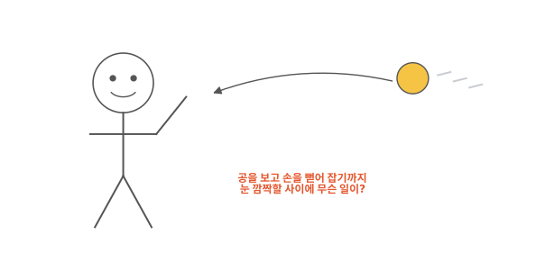
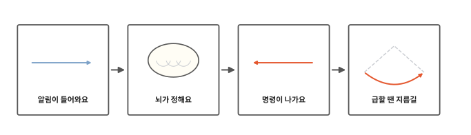
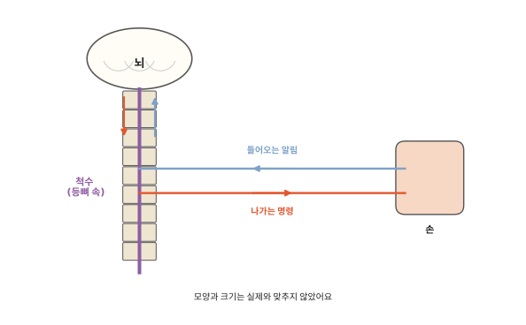
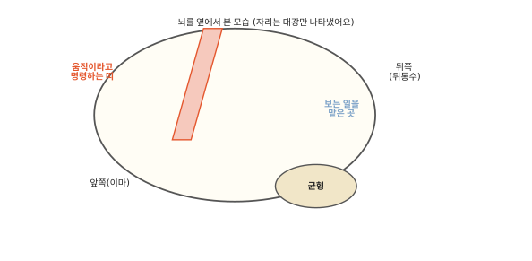
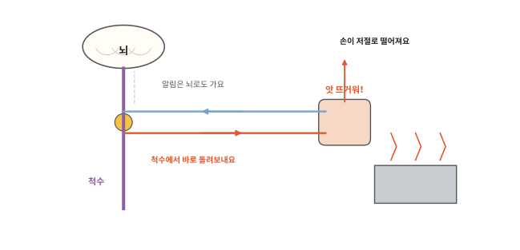
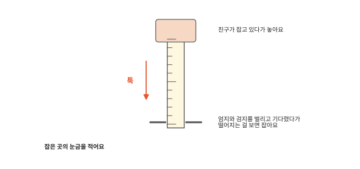

# 뇌는 어떻게 몸에 명령할까요?

## 날아오는 공

친구가 공을 던졌어요. 공이 날아오는 걸 보고 손을 뻗어 탁 잡아요. 눈 깜짝할 사이에 일어나는 일이에요.

[10편](10-eyes.md)에서 눈이 본 것은 알림이 되어 뇌로 간다고 했어요. 알림을 받은 뇌는 어떻게 손을 움직이게 할까요?

## 알림에서 지름길까지

인체 열한 번째 편이에요. 알림이 뇌로 들어와서 명령이 되어 근육으로 나가기까지 따라가 봐요. 마지막으로 뇌를 거치지 않는 지름길도 봐요.

## 알림이 들어와요

[8편](08-nails-hair.md)에서 신경은 알림이 다니는 가는 줄이라고 했어요. 눈, 귀, 피부처럼 바깥을 느끼는 곳에서 알림이 만들어져 신경을 타고 들어와요. 몸속 근육과 관절도 팔다리가 지금 어디 있는지 알림을 보내요.

팔, 다리, 몸통의 신경은 등 한가운데로 모여요. 등뼈 속에는 신경 여러 가닥이 전선 묶음처럼 모인 굵은 줄이 뇌 바로 아래에서 허리까지 길게 이어져요. 이것을 **척수**라고 해요. 등뼈가 단단한 관처럼 척수를 감싸 지켜 줘요.

손에서 온 알림은 척수를 타고 올라가 뇌에 닿아요. 그림에서는 들어오는 알림을 파란 줄, 나가는 명령을 빨간 줄로 나눠 그렸어요. 실제로는 한 신경 안에 두 방향 길이 함께 들어 있어요. 눈과 귀의 알림은 척수를 거치지 않고 바로 뇌로 가요.

## 뇌가 정해요

뇌는 여러 곳에서 온 알림을 모아요. "공이 오른쪽 위에서 날아오고 있어", "내 팔은 지금 아래에 있어" 같은 알림이에요. 뇌는 이것들을 한꺼번에 살펴서 무엇을 할지 정해요. "손을 오른쪽 위로 뻗자!"

뇌는 한 덩어리처럼 보이지만 곳마다 맡은 일이 달라요. 10편에서 눈의 알림을 뇌가 읽는다고 했지요. 그 알림을 읽는 곳은 뇌 뒤쪽이에요. 머리 위쪽, 이마와 정수리 사이에는 몸을 움직이라고 명령을 내보내는 좁은 띠가 있어요. 뒤쪽 아래에 붙은 작은 덩어리는 움직임이 비틀거리지 않게 균형을 맞춰요.

학교 방송실을 떠올려 보세요. 학교 곳곳의 소식이 방송실로 모여요. 방송실에서는 안내 방송이 나가요. 뇌도 여기저기서 소식을 받아 할 일을 정해요. 다만 방송실은 한 방이지만 뇌는 일을 나눠 맡은 곳이 여럿이에요. 또 안내 방송은 모두에게 들리지만 뇌의 명령은 움직일 근육에만 가요.

## 명령이 나가요

뇌가 정한 명령은 이번에는 거꾸로 가요. 뇌에서 척수를 타고 내려가 팔로 가는 신경으로 나가요. 명령이 팔 근육에 닿으면 [9편](09-bones-muscles.md)에서 본 것처럼 근육이 짧아지며 뼈를 당겨요. 팔이 뻗어 나가요.

눈은 손이 공에 가까워지는 동안에도 계속 알림을 보내요. 뇌는 그 알림을 받아 손의 방향을 조금씩 고쳐요. 그렇게 고치는 사이에 손이 공에 닿아요.

## 급할 땐 지름길

뜨거운 냄비에 손이 닿으면 "앗!" 하고 생각하기도 전에 손이 먼저 떨어져요. 이때 알림은 척수에 닿자마자 그 자리에서 팔 근육으로 가는 명령으로 이어져 돌아와요. 뇌가 정할 때까지 기다리지 않으니 훨씬 빨라요. 방송실을 거치지 않고 교실에서 바로 처리하는 것과 같아서 방송실 비유와는 달라요.

그림의 노란 동그라미가 척수 안에서 들어온 알림을 나가는 명령으로 바로 이어 주는 곳이에요. 이렇게 뇌가 정하기 전에 척수에서 먼저 일어나는 저절로 움직임을 **반사**라고 해요.

그럼 뜨거운 건 못 느낄까요? 느껴요. 알림은 척수를 지나 뇌로도 올라가요. 다만 척수의 명령이 먼저 돌아와서 손이 먼저 떨어져요. 뇌는 그다음에 "뜨거웠구나" 하고 느껴요.

무릎 아래를 톡 치면 다리가 저절로 차올라가는 것도 반사예요. 내가 다리를 들려고 마음먹지 않았는데도 움직여요.

바깥에서는 눈에 안 보이는 아주 작은 침입자도 몸으로 들어와요. 몸이 그것을 어떻게 막는지는 마지막 편에서 볼게요.

## 정리

- 척수: 등뼈 속을 지나는 굵은 신경 줄이에요. 팔, 다리, 몸통과 뇌 사이를 알림과 명령이 오가요.
- 뇌가 명령하는 길: 알림이 신경을 타고 뇌로 들어와요. 뇌가 무엇을 할지 정해요. 명령이 척수와 신경을 타고 근육으로 나가요.
- 반사: 뇌가 정하기 전에 척수가 먼저 명령을 돌려보내는 저절로 움직임이에요. 알림은 뇌에도 가지만 손이 먼저 움직여요.

## 해 보기: 자 떨어뜨려 잡기, 무릎 반사

1. 친구나 어른이 30센티미터 플라스틱 자의 위쪽 끝을 잡고 세로로 들어요. 0이 적힌 쪽이 아래로 오게 해요.
2. 나는 자의 맨 아래 눈금 높이에서 엄지와 검지를 조금 벌리고 기다려요. 자에 손가락이 닿으면 안 돼요.
3. 친구가 말없이 자를 놓으면 보자마자 손가락을 오므려 잡아요. 잡은 곳의 눈금을 적어요.
4. 다섯 번 해 보세요. 숫자가 작을수록 빨리 잡은 거예요. 친구와 겨루려는 게 아니에요. 몇 번 하다 보면 놓는 때를 짐작하게 돼서 숫자가 달라질 수도 있어요.
5. 무릎 반사: 높은 의자 가장자리에 앉아 발이 바닥에 닿지 않게 다리를 늘어뜨려요. 어른이 손바닥 가장자리로 무릎뼈 바로 아래 말랑한 곳을 살짝 톡 쳐 줘요. 단단한 물건으로는 치지 않아요. 마음먹지 않았는데 다리가 올라가는지 봐요. 안 움직여도 괜찮아요.

자 잡기는 눈에서 뇌를 거쳐 손 근육까지 가는 길을 모두 지나요. 그래서 반사보다 느려요.

## 확인 문제

??? question "1. 척수는 어디에"
    척수는 몸 어디에 있을까요? 무슨 일을 할까요?

    **풀이**: 등뼈 속에 있어요. 팔, 다리, 몸통에서 오는 알림과 뇌에서 나가는 명령이 지나가요.

??? question "2. 공을 잡을 때"
    날아오는 공을 잡을 때 알림과 명령은 어떤 순서로 다닐까요?

    **풀이**: 눈에서 알림이 뇌로 가요. 뇌가 손을 뻗자고 정해요. 명령이 척수와 신경을 타고 팔 근육으로 가요.

??? question "3. 뜨거운 냄비"
    뜨거운 냄비에 닿은 손이 생각하기도 전에 떨어지는 까닭은 무엇일까요?

    **풀이**: 반사라서요. 알림이 척수에서 바로 근육으로 가는 명령이 되어 돌아와요. 뇌가 정하기를 기다리지 않아서 빨라요.

!!! abstract "어른을 위한 정리 (건너뛰어도 돼요)"
    - 중추신경계는 뇌와 척수예요. 그 밖의 신경과 신경절이 말초신경계예요. 신경계의 기본 일은 감각, 통합, 반응이에요. 말초에서 축삭 다발을 신경이라 하고, 중추 안에서는 신경로라 해요.[^nervous] 본문의 "알림이 들어와요, 뇌가 정해요, 명령이 나가요"가 감각, 통합, 반응이에요.
    - 수의 운동의 명령은 이마엽 중심앞이랑의 일차운동겉질에서 나와 척수의 아래운동신경세포를 거쳐 근육으로 가요. 소뇌는 움직임의 협응과 균형에 중요해요.[^motor] 본문의 "이마와 정수리 사이 좁은 띠"는 일차운동겉질이에요. 움직임의 계획에는 다른 겉질도 함께 일해요. "뒤쪽 아래 작은 덩어리"는 소뇌예요. 시각겉질은 뒤통수엽에 있어요.[^sense]
    - 뜨거운 것에서 손을 떼는 굽힘 반사(회피 반사)는 감각신경세포의 신호가 척수의 사이신경세포를 거쳐 운동신경세포로 바로 이어져요. 단순한 체성 반사에는 의식적·수의적 움직임을 맡는 상위 중추가 끼지 않아요. 무릎 반사(무릎힘줄 반사)는 근육이 늘어난 것을 감지한 신호가 같은 근육을 바로 수축시키는 신장 반사의 예예요.[^motor] 감각 신호는 척수 안에서 반사 회로로 이어지는 동시에 위로도 올라가 뇌에 닿아요. 본문의 "뇌는 그다음에 느껴요"는 반사 운동이 의식적 통증 지각을 기다리지 않는다는 점을 단순화한 말이에요(지각이 반드시 반사 뒤라는 정밀한 시간 주장은 아니에요). 본문은 척수를 "신경 줄"이라 불렀지만 엄밀히 중추 안의 다발은 신경로예요.
    - 자 잡기는 시각 → 판단 → 운동이 모두 끼는 반응 시간 활동이에요. 결과로 능력을 평가하지 않도록 했어요.

## 더 깊이

??? info "왜 하품은 옮을까"
    다른 사람이 하품하는 걸 보면 나도 하품이 나곤 해요. 왜 옮는지는 아직 확실히 밝혀지지 않았어요.

??? info "자는 동안에도 뇌는 일할까"
    잠든 동안에도 뇌는 쉬지 않아요. [2편](02-breathing.md)에서 다 쓴 숨이 쌓이면 뇌가 숨을 쉬게 한다고 했지요. 잠든 동안에도 그 일을 해요. [5편](05-heart.md)에서 본 것처럼 심장이 뛰는 빠르기를 알맞게 맞추는 일도 해요.

[^nervous]: OpenStax, *Anatomy and Physiology 2e*, 12.1 ["Basic Structure and Function of the Nervous System"](https://openstax.org/books/anatomy-and-physiology-2e/pages/12-1-basic-structure-and-function-of-the-nervous-system).
[^motor]: OpenStax, *Anatomy and Physiology 2e*, 14.3 ["Motor Responses"](https://openstax.org/books/anatomy-and-physiology-2e/pages/14-3-motor-responses).
[^sense]: OpenStax, *Anatomy and Physiology 2e*, 14.1 ["Sensory Perception"](https://openstax.org/books/anatomy-and-physiology-2e/pages/14-1-sensory-perception).
