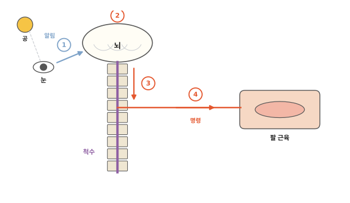
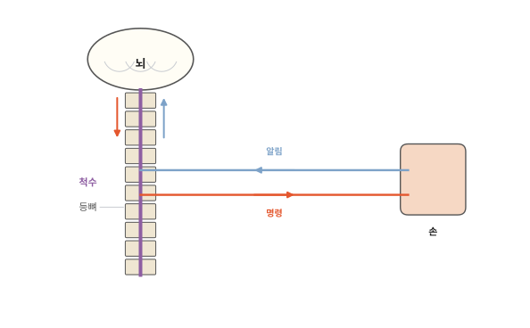
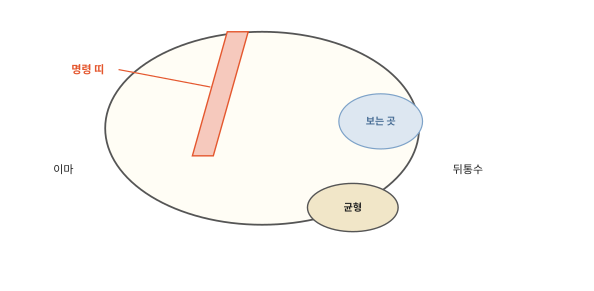
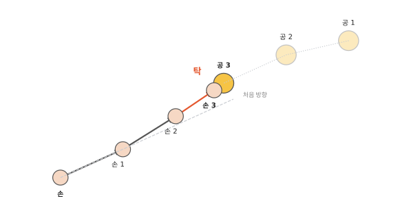
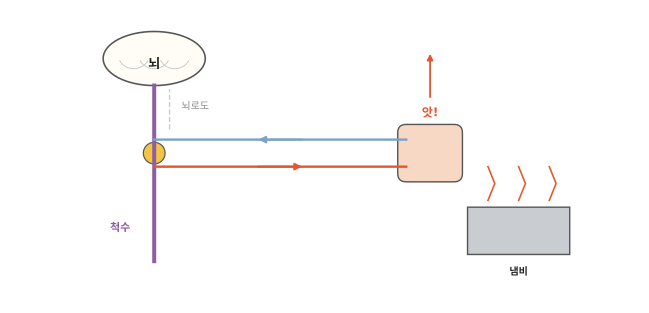
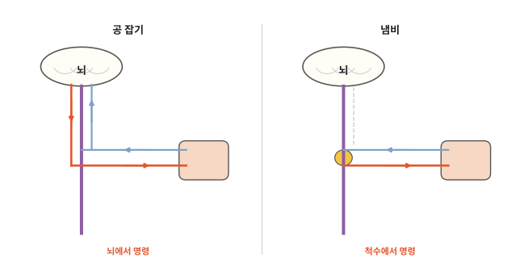
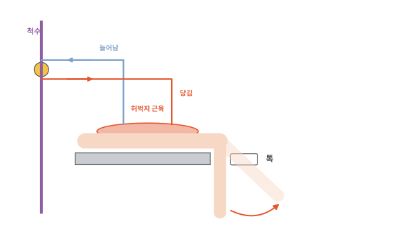
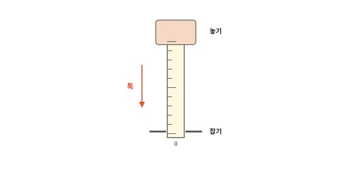

# 뇌와 척수: 알림을 받아 몸에 명령하는 길

친구가 던진 공이 날아와요. 보자마자 손을 뻗어 탁 잡아요. 눈 깜짝할 사이지만 그동안 몸 안에서는 알림이 뇌로 들어가고 명령이 손으로 나와요. 이 글을 읽고 나면 알림과 명령이 어떤 길로 다니는지 알게 돼요. 그 길을 알면 뜨거운 냄비에서 손이 생각보다 먼저 떨어지는 까닭도 보여요.

!!! abstract "이 글에서 알게 되는 것"
    1. 몸에서 생긴 알림은 신경을 타고 뇌로 들어가요. 뇌가 할 일을 정하면 명령이 신경을 타고 근육으로 나가요.
    2. 팔, 다리, 몸통의 알림과 명령은 등뼈 속 굵은 신경 줄인 척수를 지나요. 뇌 안에는 보는 곳, 명령하는 곳, 균형을 잡는 곳이 따로 있어요.
    3. 뜨거운 것에 닿으면 척수가 뇌를 기다리지 않고 명령을 바로 돌려보내요. 이렇게 저절로 일어나는 움직임을 반사라고 해요.

## 1. 공을 잡는 동안 알림이 들어가고 명령이 나와요

[10편](10-eyes.md)에서 눈이 본 것은 알림이 되어 뇌로 간다고 했어요. 공을 잡는 일도 여기서 시작해요.

공이 오른쪽 위에서 날아와요. 눈은 "공이 오른쪽 위에 있어" 하는 알림을 뇌로 보내요. 팔은 "나는 지금 아래로 내려와 있어" 하는 알림을 보내요. 뇌는 두 알림을 한꺼번에 살펴서 할 일을 정해요. "손을 오른쪽 위로 뻗자." 이 명령이 팔 근육에 닿으면 팔이 올라가요.

아래 그림에서 번호를 1부터 따라가 보세요.

**그림 1.** 눈의 알림이 뇌로 가고(1, 2) 뇌의 명령은 척수를 지나 팔 근육으로 가요(3, 4).
{ .fig-cap }

알림과 명령이 다니는 길은 [8편](08-nails-hair.md)에서 본 신경이에요. 신경은 알림이 다니는 가는 줄이에요. 눈, 귀, 피부처럼 바깥을 느끼는 곳은 알림을 만들어 신경으로 보내요. 팔다리의 근육과 관절도 자기가 지금 어디 있는지 알림을 보내요.

공 잡기는 세 걸음이에요. 알림이 들어가요. 뇌가 정해요. 명령이 나와요. 다음 절부터 한 걸음씩 따라가 볼게요.

## 2. 팔과 손의 알림은 척수를 타고 뇌로 가요

먼저 들어가는 길이에요. 그림 1에서 눈의 알림은 뇌로 곧장 갔어요. 눈과 귀는 머리에 있어서 신경이 척수를 거치지 않고 뇌로 이어지거든요. 그럼 머리에서 먼 손의 알림은 어떤 길로 갈까요?

팔, 다리, 몸통의 신경은 등 한가운데로 모여요. 등뼈 속에는 신경 여러 가닥이 전선 묶음처럼 모인 굵은 줄이 있어요. 뇌 바로 아래에서 허리까지 길게 이어진 이 줄을 **척수**라고 해요. 등뼈 마디가 단단한 관처럼 척수를 감싸서 지켜 줘요.

아래 그림에서 손과 척수 사이 두 줄의 화살표가 어느 쪽을 가리키는지 보세요.

**그림 2.** 손의 알림은 파란 줄로 척수에 들어가 뇌로 올라가요. 명령은 빨간 줄로 내려와 손으로 나가요.
{ .fig-cap }

그림에서는 알림과 명령을 두 줄로 나눠 그렸어요. 실제로는 신경 하나 안에 두 방향 길이 함께 들어 있어요. 모양과 크기도 실제와 다르게 단순하게 그렸어요.

## 3. 뇌는 곳마다 맡은 일이 달라요

알림이 뇌에 닿았어요. 이제 뇌가 할 일을 정할 차례예요. 뇌는 한 덩어리처럼 보이지만 곳마다 맡은 일이 달라요.

아래 그림은 뇌를 옆에서 본 모습이에요. 왼쪽이 이마 쪽이에요. 빨간 띠가 어디 있는지 보세요.

**그림 3.** 움직이라는 명령은 머리 위쪽 좁은 띠에서 나가요. 눈의 알림은 뒤쪽에서 읽어요.
{ .fig-cap }

눈의 알림을 읽는 곳은 뒤통수 쪽이에요. 공이 어디 있는지 여기서 알아봐요. 머리 위쪽, 이마와 정수리 사이에는 좁은 띠가 있어요. 몸을 움직이라는 명령이 이 띠에서 나가요. 뒤쪽 아래에 붙은 작은 덩어리는 움직임이 비틀거리지 않게 균형을 맞춰요.

그림에 그린 자리는 대강이에요. 손을 뻗을 때는 이 세 곳 말고도 뇌의 여러 곳이 함께 일해요.

## 4. 명령은 척수를 타고 내려가 근육을 당겨요

뇌가 "손을 오른쪽 위로 뻗자"고 정했어요. 이 명령은 알림이 들어온 길을 거꾸로 가요. 뇌에서 척수를 타고 내려가다가 팔로 가는 신경으로 빠져나가요. 명령이 팔 근육에 닿으면 [9편](09-bones-muscles.md)에서 본 것처럼 근육이 짧아지면서 뼈를 당겨요. 그래서 팔이 올라가요.

그런데 공은 날아오는 동안 자리가 계속 바뀌어요. 처음 정한 방향으로만 손을 뻗으면 빗나가겠죠. 그래서 눈은 손이 공에 다가가는 동안에도 알림을 계속 보내요. 뇌는 새 알림을 받을 때마다 손의 방향을 조금씩 고쳐요.

아래 그림에서 손이 지나간 자리 셋과 회색 점선을 보세요.

**그림 4.** 처음 방향 그대로 갔다면 공 아래로 지나갔을 거예요. 뇌가 방향을 고쳐서 손 3이 공에 닿아요.
{ .fig-cap }

## 5. 뜨거운 냄비에서는 척수가 먼저 손을 떼게 해요

공을 잡을 때는 알림이 뇌까지 갔다가 명령이 되어 돌아왔어요. 이번에는 같은 손이 뜨거운 냄비에 닿았다고 해 볼게요.

"앗!" 하고 생각하기도 전에 손이 먼저 떨어져요. 이때 손의 알림은 뇌의 결정을 기다리지 않아요. 알림이 척수에 닿으면 척수 안에서 팔 근육으로 가는 명령으로 곧장 이어져요. 아래 그림에서 노란 동그라미를 보세요.

**그림 5.** 노란 동그라미에서 들어온 알림이 나가는 명령으로 곧장 이어져요.
{ .fig-cap }

노란 동그라미는 척수 안에서 알림과 명령을 이어 주는 곳이에요. 알림이 뇌까지 갔다 오지 않으니 길이 짧아서 빨라요. 이렇게 뇌가 정하기 전에 척수에서 먼저 저절로 일어나는 움직임을 **반사**라고 해요.

두 길을 나란히 놓고 보면 차이가 잘 보여요. 아래 그림에서 빨간 줄이 어디서 시작하는지 보세요.

**그림 6.** 공을 잡을 때는 명령이 뇌에서 나와요. 냄비에서 손을 뗄 때는 척수에서 나와요.
{ .fig-cap }

여기서 이런 생각이 들 거예요. 뇌를 거치지 않으면 뜨거운 줄도 모르지 않을까요? 느껴요. 그림 5의 회색 점선처럼 알림은 척수를 지나 뇌로도 올라가요. 다만 척수가 돌려보낸 명령이 먼저 손에 닿아서 손이 먼저 떨어져요. "뜨거웠구나" 하고 느끼는 건 그다음이에요.

## 6. 무릎 반사와 자 잡기로 두 길을 느껴 봐요

반사는 손에만 있지 않아요. 높은 의자에 앉아 다리를 늘어뜨리고 무릎뼈 바로 아래를 톡 치면 다리가 저절로 올라가요. 다리를 들려고 마음먹지 않았는데도 움직여요.

아래 그림에서 허벅지 근육과 척수 사이를 오가는 두 줄을 보세요.

**그림 7.** 무릎 아래를 치면 허벅지 근육이 살짝 늘어나요. 척수가 그 근육에 당기라는 명령을 돌려보내서 다리가 올라가요.
{ .fig-cap }

무릎 아래를 치면 허벅지 앞 근육이 살짝 늘어나요. 근육이 늘어났다는 알림이 척수에 닿으면 척수는 그 근육에 당기라는 명령을 바로 돌려보내요. 허벅지 근육이 짧아지면서 다리가 앞으로 올라가요.

반사가 아닌 움직임은 자 잡기로 느껴 볼 수 있어요. 자 잡기는 눈에서 뇌를 거쳐 손 근육까지 가는 긴 길을 지나요.

**그림 8.** 친구가 자를 놓으면 떨어지는 자를 보고 엄지와 검지로 잡아요.
{ .fig-cap }

!!! example "해 보기"
    **자 떨어뜨려 잡기**

    1. 친구나 어른이 30센티미터 플라스틱 자의 위쪽 끝을 잡고 세로로 들어요. 0이 적힌 쪽이 아래로 오게 해요.
    2. 나는 자의 맨 아래 눈금 높이에서 엄지와 검지를 조금 벌리고 기다려요. 손가락이 자에 닿으면 안 돼요.
    3. 친구가 말없이 자를 놓으면 보자마자 손가락을 오므려 잡아요. 잡은 곳의 눈금을 적어요.
    4. 다섯 번 해 봐요. 숫자가 작을수록 빨리 잡은 거예요. 친구와 겨루려는 놀이는 아니에요. 몇 번 하다 보면 놓는 때를 짐작하게 돼서 숫자가 달라지기도 해요.

    **무릎 반사**

    높은 의자 가장자리에 앉아 발이 바닥에 닿지 않게 다리를 늘어뜨려요. 어른이 손바닥 가장자리로 무릎뼈 바로 아래 말랑한 곳을 살짝 톡 쳐 줘요. 단단한 물건으로는 치지 않아요. 마음먹지 않았는데 다리가 올라가는지 봐요. 안 움직여도 괜찮아요.

자가 떨어지는 동안 알림은 눈에서 뇌로 가고 명령은 뇌에서 척수를 거쳐 손으로 가요. 무릎 반사는 척수에서 돌아오는 짧은 길이라서 자 잡기보다 빨라요.

??? info "어른을 위한 짚어 두기"
    - 뇌와 척수를 중추신경계, 그 밖의 신경을 말초신경계라고 해요. 본문의 "알림이 들어가요, 뇌가 정해요, 명령이 나와요"가 신경계의 기본 일인 감각, 통합, 반응이에요. 중추 안의 신경 다발은 엄밀히 신경로라고 불러요.[^nervous]
    - "명령 띠"는 이마엽 중심앞이랑의 일차운동겉질, "균형을 맞추는 작은 덩어리"는 소뇌, "보는 곳"은 뒤통수엽의 시각겉질이에요. 움직임을 계획할 때는 다른 겉질도 함께 일해요.[^motor][^sense]
    - 뜨거운 것에서 손을 떼는 굽힘 반사는 감각신경세포의 신호가 척수의 사이신경세포(그림의 노란 동그라미)를 거쳐 운동신경세포로 이어져요. 무릎 반사는 늘어난 근육이 그 근육을 바로 수축시키는 신장 반사예요. 감각 신호는 반사 회로로 이어지는 동시에 뇌로도 올라가요.[^motor] "느끼는 건 그다음"은 반사 운동이 의식적인 통증 지각을 기다리지 않는다는 뜻을 단순하게 말한 거예요.

## 정리

공을 잡을 때 눈과 팔의 알림이 신경을 타고 뇌로 들어가요. 뇌는 알림을 모아 할 일을 정하고 명령을 내보내요. 명령이 팔 근육에 닿으면 근육이 짧아지면서 팔이 올라가요. 손이 공에 다가가는 동안에도 눈은 알림을 보내고 뇌는 손의 방향을 고쳐요.

팔, 다리, 몸통의 알림과 명령은 등뼈 속 척수를 지나요. 뇌 안에서는 뒤쪽이 눈의 알림을 읽고 위쪽 좁은 띠가 움직이라는 명령을 내보내요. 뒤쪽 아래 작은 덩어리는 균형을 맞춰요.

뜨거운 냄비에 손이 닿으면 척수가 뇌를 기다리지 않고 명령을 돌려보내서 손이 먼저 떨어져요. 이런 저절로 일어나는 움직임이 반사예요. 알림은 뇌로도 올라가서 뜨거운 건 조금 늦게 느껴요.

몸 바깥에서는 눈에 안 보이는 아주 작은 침입자도 들어와요. [12편](12-immune.md)에서는 몸이 그 침입자를 어떻게 막고 물리치는지 볼게요.

### 새로 나온 말

- **척수**: 등뼈 속을 지나는 굵은 신경 줄. 손의 알림은 척수를 타고 뇌로 올라가고 뇌의 명령은 척수를 타고 손으로 내려와요.
- **반사**: 뇌가 정하기 전에 척수가 먼저 명령을 돌려보내서 일어나는 저절로 일어나는 움직임. 뜨거운 냄비에서 손이 먼저 떨어지는 것과 무릎을 치면 다리가 올라가는 것이 반사예요.

[^nervous]: OpenStax, *Anatomy and Physiology 2e*, 12.1 ["Basic Structure and Function of the Nervous System"](https://openstax.org/books/anatomy-and-physiology-2e/pages/12-1-basic-structure-and-function-of-the-nervous-system).
[^motor]: OpenStax, *Anatomy and Physiology 2e*, 14.3 ["Motor Responses"](https://openstax.org/books/anatomy-and-physiology-2e/pages/14-3-motor-responses).
[^sense]: OpenStax, *Anatomy and Physiology 2e*, 14.1 ["Sensory Perception"](https://openstax.org/books/anatomy-and-physiology-2e/pages/14-1-sensory-perception).
