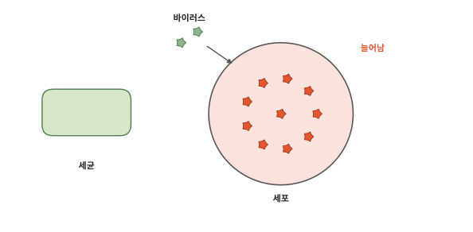
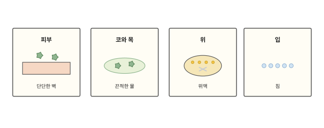
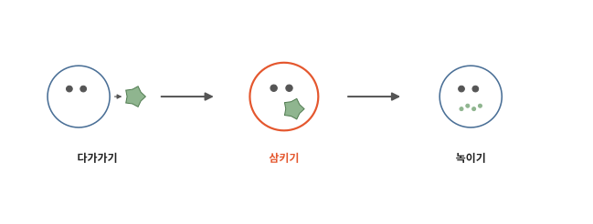
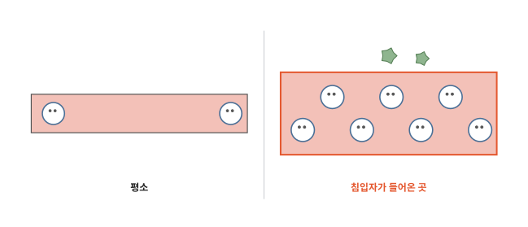
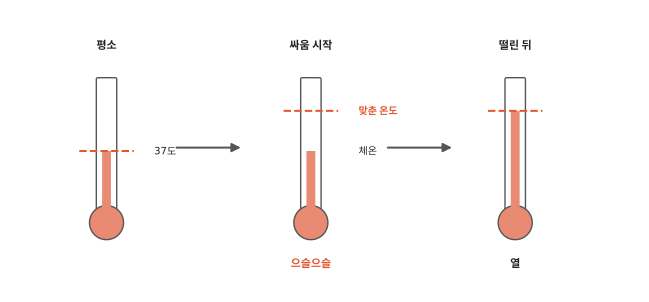
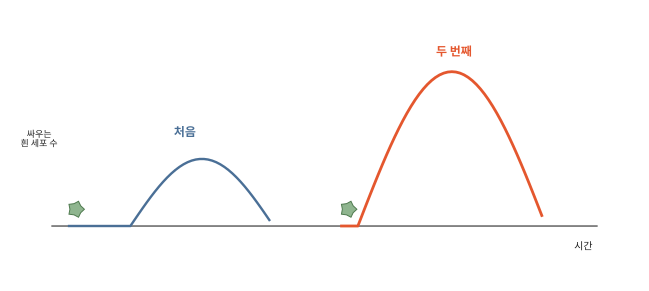
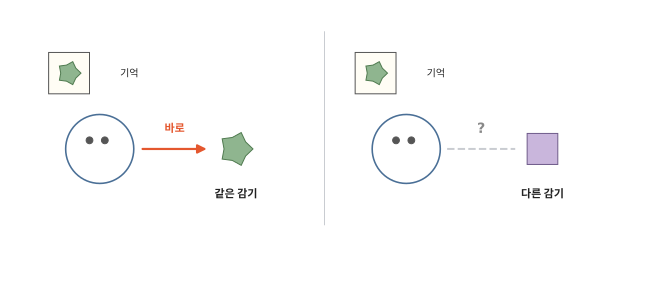
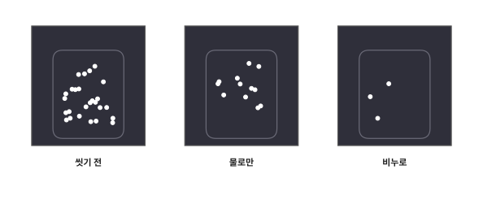

# 면역: 몸이 감기를 막고 물리치는 방법

감기에 걸리면 콧물이 줄줄 흐르고 기침이 나요. 몸이 뜨거워지기도 해요. 그래도 며칠 지나면 대개 괜찮아지죠. 이 글을 읽고 나면 그 며칠 동안 몸이 감기를 일으킨 침입자를 어떻게 막고 물리치는지 알게 돼요. 콧물과 열이 나는 까닭과 감기에 자꾸 걸리는 까닭도 함께 보여요.

!!! abstract "이 글에서 알게 되는 것"
    1. 감기는 아주 작은 바이러스가 코와 목에 들어와서 걸려요. 몸이 이런 침입자를 알아보고 막고 없애는 일을 면역이라고 해요.
    2. 피부, 콧속의 끈적한 물, 위액, 침이 먼저 막아요. 그래도 넘어온 침입자는 피 속의 흰 세포가 삼켜서 없애요.
    3. 열은 뇌가 맞춰 둔 온도를 올려서 나요. 기억하는 흰 세포는 한 번 만난 침입자를 알아보지만 감기 바이러스는 종류가 많아서 감기에는 여러 번 걸려요.

## 1. 감기는 아주 작은 바이러스가 코와 목에 들어와서 걸려요

[11편](11-brain.md) 끝에서 눈에 안 보이는 아주 작은 침입자가 몸에 들어온다고 했어요. 감기도 그런 침입자 때문에 걸려요.

몸에 들어오는 침입자에는 세균과 바이러스가 있어요. 세균은 혼자 사는 아주 작은 생물이에요. 바이러스는 세균보다 훨씬 작아요. 그리고 혼자서는 늘어나지 못하고 세포 안에 들어가야 늘어나요.

아래 그림에서 세포 안의 빨간 바이러스를 보세요.

**그림 1.** 바이러스 둘이 세포 안으로 들어가서 여럿으로 늘어나요. 크기는 실제와 다르게 그렸어요.
{ .fig-cap }

감기는 바이러스가 코와 목에 들어와서 생겨요. 몸은 이 바이러스를 그냥 두지 않아요. 몸이 침입자를 알아보고 막고 없애는 일을 **면역**이라고 해요. 몸을 성 하나라고 생각해 볼게요. 성에는 성벽이 있고 성 안을 도는 병사가 있어요. 지난번에 쳐들어온 적을 적어 둔 기록도 있어요. 몸에도 이 셋이 다 있어요.

## 2. 피부와 끈적한 물과 위액이 먼저 막아요

감기 바이러스가 코로 들어왔어요. 몸은 먼저 침입자가 몸 안으로 들어오지 못하게 막아요. 성벽이 하는 일이에요.

아래 그림에서 네 칸이 저마다 무엇으로 막는지 보세요.

**그림 2.** 피부, 코와 목, 위, 입이 저마다 다른 것으로 침입자를 막아요.
{ .fig-cap }

가장 큰 벽은 피부예요. 피부가 몸 전체를 빈틈없이 덮고 있어서 침입자가 쉽게 뚫고 들어오지 못해요. [6편](06-clotting.md)에서 상처를 서둘러 막고 메운 것도 이 벽을 다시 세우는 일이에요.

숨 쉬는 길에도 벽이 있어요. [2편](02-breathing.md)에서 콧속의 털과 끈적한 물이 먼지를 붙잡는다고 했죠. 감기 바이러스도 여기에 붙잡혀요. 감기에 걸리면 콧물이 더 많이 나와요. 콧물은 붙잡힌 침입자를 밖으로 내보내는 데 도움이 될 수 있어요. 기침도 목에 걸린 것을 밖으로 밀어내요.

밥과 함께 들어온 침입자는 [3편](03-digestion.md)에서 본 시큼한 위액을 만나요. 위액은 많은 세균을 없애요. 침에도 세균을 녹이는 것이 들어 있어요.

## 3. 넘어 들어온 침입자는 흰 세포가 삼켜요

성벽이 튼튼해도 틈은 있어요. 콧속의 끈적한 물을 빠져나간 바이러스도 있어요. 이제 성 안을 도는 병사가 나설 차례예요.

[4편](04-blood.md)에서 피를 기계로 돌리면 아주 얇은 흰 층이 생긴다고 했어요. 그 흰 층에 몸을 지키는 **흰 세포**가 있어요. 빨간 세포가 산소를 나른다면 흰 세포는 침입자와 싸워요. 흰 세포는 피를 타고 돌거나 몸 곳곳에 머물러요. 크게 두 무리가 있는데 먼저 삼키는 흰 세포부터 볼게요.

아래 그림에서 가운데 빨간 테두리 흰 세포를 보세요.

**그림 3.** 삼키는 흰 세포가 침입자를 감싸서 통째로 삼킨 다음 안에서 녹여 없애요.
{ .fig-cap }

침입자가 들어온 곳에서는 흰 세포를 더 불러 모아요. 그곳의 핏줄이 넓어져서 피가 많이 몰려와요. 피를 타고 흰 세포도 많이 와요. 아래 그림에서 두 핏줄 속 흰 세포 수를 비교해 보세요.

**그림 4.** 침입자가 들어온 곳은 핏줄이 넓어져서 흰 세포가 많이 몰려와요.
{ .fig-cap }

모기에 물린 곳이나 긁힌 곳이 빨갛게 붓고 따끈해지는 것도 피가 이렇게 많이 몰려서예요. [7편](07-sweat.md)에서 더울 때 핏줄이 넓어져 얼굴이 빨개진다고 했죠. 핏줄이 넓어지는 모습은 비슷하지만 여기서는 흰 세포를 불러 모으려고 넓어져요.

## 4. 열은 뇌가 맞춰 둔 온도를 올려서 나요

감기에 걸리면 열이 나기도 해요. 열도 몸이 침입자와 싸우는 방법 가운데 하나예요.

[7편](07-sweat.md)에서 뇌의 온도 지킴이가 체온을 37도쯤에 맞춰 둔다고 했어요. 흰 세포는 침입자와 싸우면서 뇌에 신호를 보내요. 신호를 받은 온도 지킴이는 맞춰 둔 온도를 37도보다 높게 올려요.

에어컨 온도를 높게 바꿔도 방이 곧바로 따뜻해지지는 않죠. 몸도 맞춰 둔 온도는 올라갔는데 체온은 아직 37도쯤이에요. 아래 그림에서 가운데 온도계의 빨간 점선과 체온 사이를 보세요.

**그림 5.** 맞춘 온도가 먼저 오르고 체온은 떨림으로 뒤따라 올라가요.
{ .fig-cap }

체온이 맞춘 온도보다 낮으니 몸은 춥다고 느껴요. 그래서 으슬으슬 떨려요. 떨리는 근육이 열을 만들어서 체온이 새로 맞춘 온도까지 올라가요. 이게 열이 나는 거예요.

체온이 조금 높아지면 어떤 침입자는 잘 자라지 못하고 흰 세포는 더 잘 싸워요. 열은 몸이 싸우는 중이라는 신호예요. 열이 나거나 몸이 아프면 어른에게 바로 말해요.

## 5. 기억하는 흰 세포는 한 번 만난 침입자를 알아봐요

삼키는 흰 세포는 어떤 침입자든 같은 방법으로 싸워요. 흰 세포의 두 번째 무리는 달라요. 침입자마다 겉모습이 다른데 이 흰 세포는 그 겉모습을 알아보고 그 침입자에게만 맞춘 방법으로 싸워요. 그리고 한 번 만난 침입자를 기억해요. 그래서 이 글에서는 기억하는 흰 세포라고 부를게요. 과학자들은 **림프구**라고 불러요.

기억하는 흰 세포는 처음 보는 침입자를 만나면 준비하는 데 시간이 걸려요. 그동안 침입자가 몸속에서 늘어날 수 있어요. 싸움이 끝나도 이 흰 세포 일부는 몸에 남아서 그 침입자를 기억해요. 성에 지난번 적의 모습을 적어 둔 기록이 남는 것과 비슷해요.

같은 침입자가 다시 들어오면 어떻게 될까요? 아래 그림에서 두 언덕의 높이와 시작하는 때를 비교해 보세요.

**그림 6.** 두 번째 만났을 때는 기억하는 흰 세포가 더 빨리, 더 많이 싸워요. 선의 높이는 대강만 그렸어요.
{ .fig-cap }

기억하던 흰 세포가 침입자를 바로 알아보고 처음보다 빨리 싸워요. 그래서 두 번째에는 앓지 않고 지나가기도 해요.

## 6. 감기 바이러스는 종류가 많아서 여러 번 걸려요

그럼 이런 생각이 들 거예요. 기억하는 흰 세포가 있다면 감기에는 한 번만 걸려야 하지 않을까요?

감기를 일으키는 바이러스는 종류가 아주 많아요. 종류가 다르면 겉모습도 달라요. 아래 그림에서 오른쪽 칸의 네모 바이러스를 보세요.

**그림 7.** 기억한 모습과 같은 바이러스는 바로 알아봐요. 겉모습이 다른 바이러스는 알아보지 못해요.
{ .fig-cap }

다른 종류가 들어오면 기억하는 흰 세포는 처음부터 다시 준비해야 해요. 그래서 감기에는 여러 번 걸려요. 같은 바이러스도 겉모습이 조금씩 바뀌기도 해요. 그러면 기억하던 모습과 달라져서 알아보기 어려워져요.

성벽과 흰 세포가 막기 전에 침입자가 덜 들어오게 할 수도 있어요. 손에 묻은 침입자는 손으로 코나 입을 만질 때 몸으로 들어오기도 하거든요. 아래 해 보기에서 손을 씻으면 손에 묻은 것이 얼마나 줄어드는지 봐요.

**그림 8.** 검은 종이에 찍은 밀가루 손 도장의 한 예예요. 결과는 집집마다 다를 수 있어요.
{ .fig-cap }

!!! example "해 보기: 밀가루 손 도장"
    밀가루를 침입자라고 생각하고 손을 씻으면 어떻게 되는지 봐요. 진짜 침입자는 눈에 안 보이지만 밀가루는 보여요. 밀가루는 아주 조금만 써요. 입김으로 불거나 눈을 비비지 않아요.

    1. 손바닥에 밀가루를 조금 묻혀 비벼요. 검은 종이에 손바닥을 꾹 찍어 봐요.
    2. 다시 밀가루를 묻힌 다음 물로만 스물을 셀 동안 문질러 헹궈요. 손을 말리고 새 검은 종이에 찍어 봐요.
    3. 또 밀가루를 묻힌 다음 이번에는 비누 거품을 내서 똑같이 스물을 셀 동안 문지르고 헹궈요. 손을 말리고 찍어 봐요.
    4. 세 장을 나란히 놓고 비교해 봐요. 어느 쪽이 덜 남았나요? 손톱 밑이나 손가락 사이에는 밀가루가 남았나요?

??? info "어른을 위한 짚어 두기"
    - 첫 장벽은 피부예요. 호흡기 점막의 섬모 상피는 오염된 점액을 입 쪽으로 올려 보내 삼키게 해요. 위의 산성 환경은 많은 병원체에 치명적이고 침에는 세균 세포벽을 분해하는 라이소자임이 있어요.[^innate]
    - "흰 세포"는 백혈구, "삼키는 흰 세포"는 대식세포, 호중구, 가지세포 같은 식세포예요. 대식세포는 주로 조직에 머물고 호중구는 피를 타고 와요. 붓고 빨개지는 것은 염증으로, 히스타민이 국소 혈관을 넓혀 혈류가 늘어서 생겨요.[^innate]
    - 발열물질(pyrogen)이 시상하부의 온도 설정을 올리고 시상하부가 근육 떨림을 일으켜 체온을 올려요. 높아진 체온은 많은 병원체의 증식을 억제하고 백혈구의 일을 도와요.[^fever] 본문은 해열이나 진료 판단에 대한 조언은 하지 않았어요.
    - "기억하는 흰 세포"는 림프구예요. 적응 면역은 특이적이고 기억이 있어요. B·T 림프구의 수용체가 항원을 알아봐요. 같은 병원체를 다시 만나면 더 강하고 빠른 2차 반응이 일어나요.[^adaptive][^bcell]
    - 비누와 물로 씻는 것은 대부분의 상황에서 세균을 없애는 가장 좋은 방법이에요. 적어도 20초 문지르라고 안내돼요.[^cdc]

## 정리

감기는 아주 작은 바이러스가 코와 목에 들어와서 걸려요. 바이러스는 세포 안에 들어가야 늘어나요. 몸이 이런 침입자를 알아보고 막고 없애는 일이 면역이에요.

먼저 피부, 콧속의 끈적한 물, 위액, 침이 성벽처럼 막아요. 콧물과 기침은 붙잡힌 침입자를 밖으로 내보내요. 성벽을 넘어온 침입자는 흰 세포가 삼켜서 녹여요. 침입자가 들어온 곳은 핏줄이 넓어져 흰 세포가 몰려와요. 그래서 빨갛게 붓고 따끈해요.

열은 뇌의 온도 지킴이가 맞춰 둔 온도를 올려서 나요. 몸은 떨면서 체온을 올리고 높아진 체온에서 흰 세포는 더 잘 싸워요. 기억하는 흰 세포는 한 번 만난 침입자를 알아봐서 두 번째에는 더 빨리 싸워요. 다만 감기 바이러스는 종류가 많아서 감기에는 여러 번 걸려요.

이 편으로 인체 갈래를 마쳐요. [1편](01-cells.md)에서 우리 몸은 아주 작은 세포가 모여 만들어졌다고 했어요. 숨 쉬는 일부터 몸을 지키는 일까지 이 갈래에서 본 일은 모두 그 세포들이 함께 해내는 일이에요.

### 새로 나온 말

- **세균**: 혼자 사는 아주 작은 생물. 위액이 많은 세균을 없애요.
- **바이러스**: 세균보다 훨씬 작은 침입자. 세포 안에 들어가야 늘어나요. 감기는 바이러스가 코와 목에 들어와서 걸려요.
- **면역**: 몸이 침입자를 알아보고 막고 없애는 일. 피부가 막는 것도, 흰 세포가 삼키는 것도, 열이 나는 것도 면역이에요.
- **흰 세포**: 피 속에서 침입자와 싸우는 세포. 피를 기계로 돌리면 아주 얇은 흰 층에 모여요. 과학자들은 백혈구라고 불러요.
- **림프구**: 침입자의 겉모습을 알아보고 맞춘 방법으로 싸우는 흰 세포. 이 글에서는 기억하는 흰 세포라고 불렀어요. 한 번 만난 침입자를 기억해요.

[^innate]: OpenStax, *Anatomy and Physiology 2e*, 21.2 ["Barrier Defenses and the Innate Immune Response"](https://openstax.org/books/anatomy-and-physiology-2e/pages/21-2-barrier-defenses-and-the-innate-immune-response).
[^bcell]: OpenStax, *Anatomy and Physiology 2e*, 21.4 ["The Adaptive Immune Response: B-lymphocytes and Antibodies"](https://openstax.org/books/anatomy-and-physiology-2e/pages/21-4-the-adaptive-immune-response-b-lymphocytes-and-antibodies).
[^adaptive]: OpenStax, *Anatomy and Physiology 2e*, 21.3 ["The Adaptive Immune Response: T lymphocytes and Their Functional Types"](https://openstax.org/books/anatomy-and-physiology-2e/pages/21-3-the-adaptive-immune-response-t-lymphocytes-and-their-functional-types).
[^fever]: OpenStax, *Microbiology*, 17.5 ["Inflammation and Fever"](https://openstax.org/books/microbiology/pages/17-5-inflammation-and-fever).
[^cdc]: U.S. Centers for Disease Control and Prevention, ["About Handwashing"](https://www.cdc.gov/clean-hands/about/index.html).
