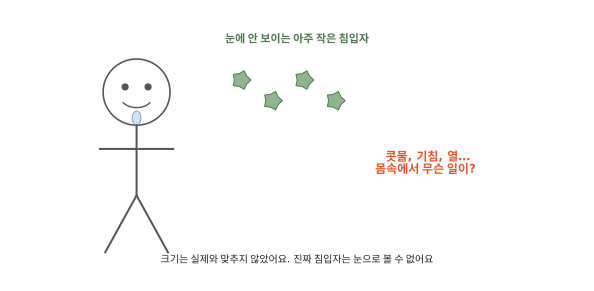
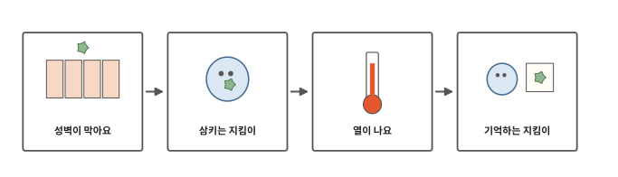
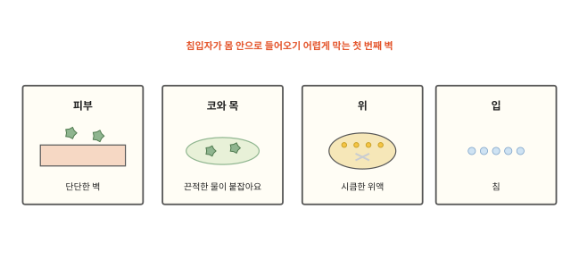
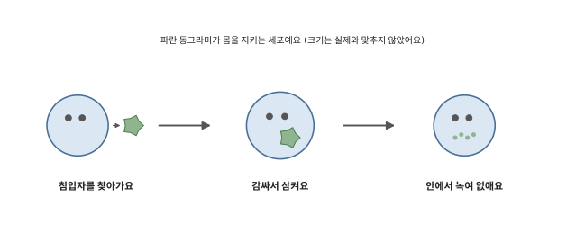
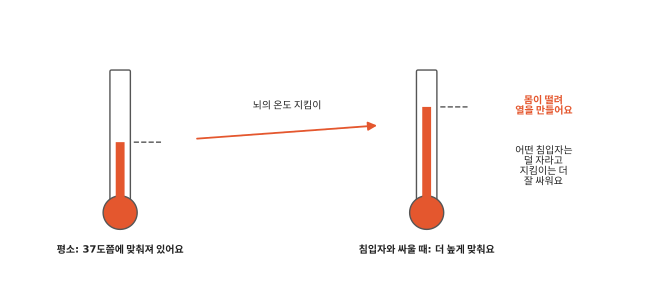
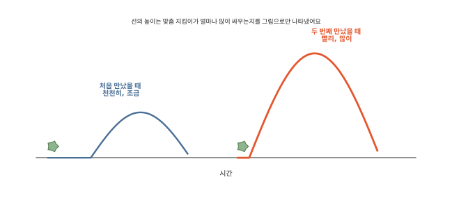
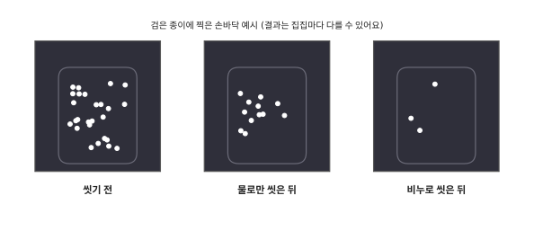

# 감기에 걸리면 몸은 어떻게 싸울까요?

## 콧물, 기침, 열

감기에 걸리면 콧물이 줄줄 흐르고 기침이 나요. 몸이 뜨거워지기도 해요. 며칠 지나면 대개 다시 괜찮아져요.

[11편](11-brain.md) 끝에서 눈에 안 보이는 아주 작은 침입자가 몸에 들어온다고 했어요. 침입자에는 세균과 바이러스가 있어요. 세균은 혼자 사는 아주 작은 생물이에요. 바이러스는 그보다 훨씬 작아서 세포 안에 들어가야 늘어나요. 감기는 바이러스가 코와 목에 들어와서 생겨요. 몸은 이 침입자와 어떻게 싸울까요?

## 성벽에서 기억하는 지킴이까지

인체 마지막 편이에요. 몸을 성에 빗대어 볼게요. 성에는 성벽과 성 안을 도는 지킴이, 지난번 적을 적어 둔 기록이 있어요. 몸에도 그런 것들이 있어요.

## 성벽이 막아요

몸이 침입자를 알아보고 막고 없애는 일을 **면역**이라고 해요. 면역은 먼저 침입자가 아예 들어오지 못하게 막아요.

가장 큰 벽은 피부예요. 피부가 몸 전체를 빈틈없이 덮고 있어서 침입자가 쉽게 뚫고 들어오지 못해요. 그래서 [6편](06-clotting.md)에서 본 것처럼 몸은 상처가 나면 서둘러 막고 메워요.

숨을 쉬는 길에도 벽이 있어요. [2편](02-breathing.md)에서 콧속의 털과 끈적한 물이 먼지를 붙잡는다고 했지요. 침입자도 여기에 붙잡혀요. 감기에 걸리면 콧물이 더 많이 나와요. 콧물은 붙잡힌 침입자를 내보내는 데 도움이 될 수 있어요. 기침도 목에 걸린 것을 밖으로 밀어내요.

밥과 함께 들어온 침입자는 [3편](03-digestion.md)에서 본, 위에서 나오는 시큼한 물(위액)을 만나요. 위액은 많은 세균을 없애요. 침에도 세균을 녹이는 것이 들어 있어요.

성벽이 튼튼해도 틈은 있어요. 성벽은 무너지면 사람이 고쳐야 하지만 피부는 스스로 메워요. 그래도 그사이 넘어 들어온 침입자는 누가 막을까요?

## 삼키는 지킴이

[4편](04-blood.md)에서 피를 기계로 돌리면 아주 얇은 흰 층이 생긴다고 했어요. 그 안에 몸을 지키는 세포가 있어요. 이 지킴이 세포들은 피를 타고 돌거나 몸 곳곳에 머물러요. 지킴이 세포는 크게 두 무리예요. 먼저 삼키는 지킴이부터 봐요.

어떤 지킴이는 침입자를 만나면 몸으로 감싸서 통째로 삼켜요. 그리고 안에서 녹여 없애요.

침입자가 들어온 곳에서는 지킴이를 더 불러 모아요. 그곳의 핏줄이 넓어져서 피가 많이 몰려와요. 피를 타고 지킴이도 많이 와요. 그래서 모기에 물린 곳이나 긁힌 곳이 빨갛게 붓고 따끈해져요. [7편](07-sweat.md)에서 더울 때 핏줄이 넓어져 얼굴이 빨개진다고 했지요. 핏줄이 넓어지는 모습은 비슷하지만 여기서는 지킴이를 불러 모으려고 넓어져요.

## 열이 나요

감기에 걸리면 열이 나기도 해요. [7편](07-sweat.md)에서 뇌의 온도 지킴이가 체온을 37도쯤에 맞춰 둔다고 했어요. 침입자와 싸울 때는 뇌의 온도 지킴이가 "몸을 더 따뜻하게 하자" 하고 맞춰 둔 온도를 37도보다 높게 올려요. 지킴이 세포가 뇌에 보낸 신호를 받고 그렇게 해요.

집에서 에어컨 온도를 높게 바꾸면 방이 금방 따뜻해지지 않지요. 몸도 맞춰 둔 온도는 올라갔는데 아직 37도쯤이에요. 그래서 몸은 춥다고 느껴 으슬으슬 떨려요. 떨리는 근육이 열을 만들어 체온이 새로 맞춘 온도까지 올라가요.

체온이 조금 높아지면 어떤 침입자는 잘 자라지 못하고 지킴이 세포는 더 열심히 싸워요. 열은 몸이 싸우는 중이라는 신호 가운데 하나예요. 열이 나거나 몸이 아프면 어른에게 바로 말해요.

## 기억하는 지킴이

삼키는 지킴이는 누구에게나 같은 방법으로 싸워요. 지킴이 세포의 두 번째 무리는 맞춤 지킴이예요. 이 지킴이는 침입자마다 다른 겉모습을 알아보고 그 침입자에게만 맞춘 방법으로 싸워요.

맞춤 지킴이는 처음 보는 침입자를 만나면 준비하는 데 시간이 걸려요. 그동안 침입자가 몸속에서 늘어날 수 있어요.

싸움이 끝나도 맞춤 지킴이 일부는 몸에 남아 그 침입자를 기억해요. 성에 지난번 적의 모습을 적어 둔 기록이 남는 것과 비슷해요. 같은 침입자가 다시 들어오면 기억하던 지킴이가 바로 알아보고 더 빨리, 더 세게 싸워요. 그래서 두 번째에는 앓지 않고 지나가기도 해요. 그런데 감기를 일으키는 바이러스는 종류가 아주 많아요. 다른 종류가 들어오면 맞춤 지킴이는 다시 처음부터 준비해야 해서 감기에는 여러 번 걸려요. 과학자들은 맞춤 지킴이를 림프구라고 불러요.

성 이야기와 다른 점도 있어요. 성의 경비병은 사람이 뽑아서 세우지만 몸의 지킴이는 스스로 생겨나고 스스로 침입자를 알아봐요.

[1편](01-cells.md)에서 우리 몸은 아주 작은 세포가 모여 만들어졌다고 했어요. 숨 쉬는 일부터 몸을 지키는 일까지, 그동안 본 일은 모두 이 세포들이 함께 해내는 일이에요.

## 정리

- 면역: 몸이 침입자를 알아보고 막고 없애는 일이에요.
- 성벽: 피부, 콧속의 끈적한 물, 위액, 침이 침입자를 막아요.
- 지킴이: 피 속 지킴이 세포가 침입자를 삼켜 없애요. 맞춤 지킴이는 침입자를 기억해 다음에 더 빨리 싸워요.
- 열: 뇌의 온도 지킴이가 맞춰 둔 온도를 올려요. 몸이 싸우고 있다는 신호예요.

## 해 보기: 밀가루 손 도장

손에 묻은 침입자는 손으로 코나 입을 만질 때 몸으로 들어오기도 해요. 밀가루를 침입자라고 생각하고 손을 씻으면 어떻게 되는지 봐요. 진짜 침입자는 눈에 안 보이지만 밀가루는 보여요. 밀가루는 아주 조금만 써요. 입김으로 불거나 눈을 비비지 않아요.

1. 손바닥에 밀가루를 조금 묻혀 비벼요. 검은 종이에 손바닥을 꾹 찍어 봐요.
2. 다시 밀가루를 묻힌 뒤 물로만 스물을 셀 동안 문질러 헹궈요. 손을 말리고 새 검은 종이에 찍어 봐요.
3. 또 밀가루를 묻힌 뒤 이번에는 비누 거품을 내서 똑같이 스물을 셀 동안 문지르고 헹궈요. 손을 말리고 찍어 봐요.
4. 세 장을 나란히 놓고 비교해 봐요. 어느 쪽이 덜 남았나요? 손톱 밑이나 손가락 사이에는 밀가루가 남았나요? 결과는 집집마다 다를 수 있어요.

## 확인 문제

??? question "1. 첫 번째 벽"
    침입자가 몸 안으로 들어오지 못하게 막는 벽에는 무엇이 있을까요? 두 가지를 말해 보세요.

    **풀이**: 피부, 콧속의 끈적한 물, 위액, 침 가운데 두 가지면 돼요.

??? question "2. 빨갛게 붓는 까닭"
    모기에 물린 곳이 빨갛게 붓고 따끈해지는 것은 왜일까요?

    **풀이**: 그곳의 핏줄이 넓어져서 피가 많이 몰려와요. 피를 타고 지킴이 세포도 많이 와서 침입자와 싸워요.

??? question "3. 두 번째에는"
    한 번 싸워 본 침입자가 다시 들어오면 몸은 어떻게 싸울까요?

    **풀이**: 기억하던 맞춤 지킴이가 바로 알아보고 처음보다 더 빨리, 더 세게 싸워요.

!!! abstract "어른을 위한 정리 (건너뛰어도 돼요)"
    - 미생물이 몸에 들어오는 것을 막는 첫 장벽은 피부예요. 호흡기 점막의 섬모 상피는 오염된 점액을 입 쪽으로 올려 보내 삼키게 해요. 위의 산성 환경은 많은 병원체에 치명적이에요. 침에는 세균 세포벽을 분해하는 라이소자임이 있어요.[^innate]
    - 대식세포, 호중구, 가지세포가 주요 식세포예요. 식세포는 병원체를 식포로 삼켜 리소좀과 합쳐 분해해요. 염증의 네 가지 특징은 열감, 발적, 통증, 부종이에요. 히스타민이 국소 혈관을 넓혀 혈류가 늘어나면서 열감과 발적이 생겨요.[^innate] 본문의 "삼키는 지킴이"는 식세포, "지킴이 세포"는 백혈구예요. 대식세포는 주로 조직에 머물고 호중구는 피를 타고 와요.
    - 발열물질(pyrogen)은 시상하부의 "온도 설정"을 바꿔 체온을 올려요. 시상하부는 근육 떨림을 일으켜 열을 만들어요. 높아진 체온은 많은 병원체의 증식을 억제할 수 있어요. 또 백혈구가 병원체를 죽이는 일을 도와 선천 면역을 강화해요.[^fever] 본문은 열을 "싸우고 있다는 신호"로만 설명하고, 해열이나 진료 판단에 대한 조언은 하지 않았어요.
    - 적응 면역은 특이적이고 기억이 있어요. B·T 림프구의 수용체가 항원을 알아봐요. 처음 반응은 효과가 나기까지 시간이 걸려서 첫 감염 때 증상이 더 심한 편이에요. 같은 병원체를 다시 만나면 더 강하고 빠른 2차 반응이 일어나요. 이것이 면역 기억의 바탕이에요.[^adaptive] 본문의 "맞춤 지킴이"가 림프구예요.[^bcell]
    - 손 씻기에서 비누와 물로 씻는 것은 대부분의 상황에서 세균을 없애는 가장 좋은 방법이에요. 적어도 20초 문지르라고 안내돼요.[^cdc] 해 보기는 밀가루로 이 차이를 눈으로 보는 활동이에요.

## 더 깊이

??? info "바이러스는 모양이 바뀌기도 해요"
    바이러스는 모양이 조금씩 바뀌기도 해요. 그러면 맞춤 지킴이가 기억하던 모습과 달라져서 알아보기 어려워져요.

[^innate]: OpenStax, *Anatomy and Physiology 2e*, 21.2 ["Barrier Defenses and the Innate Immune Response"](https://openstax.org/books/anatomy-and-physiology-2e/pages/21-2-barrier-defenses-and-the-innate-immune-response).
[^bcell]: OpenStax, *Anatomy and Physiology 2e*, 21.4 ["The Adaptive Immune Response: B-lymphocytes and Antibodies"](https://openstax.org/books/anatomy-and-physiology-2e/pages/21-4-the-adaptive-immune-response-b-lymphocytes-and-antibodies).
[^adaptive]: OpenStax, *Anatomy and Physiology 2e*, 21.3 ["The Adaptive Immune Response: T lymphocytes and Their Functional Types"](https://openstax.org/books/anatomy-and-physiology-2e/pages/21-3-the-adaptive-immune-response-t-lymphocytes-and-their-functional-types).
[^fever]: OpenStax, *Microbiology*, 17.5 ["Inflammation and Fever"](https://openstax.org/books/microbiology/pages/17-5-inflammation-and-fever).
[^cdc]: U.S. Centers for Disease Control and Prevention, ["About Handwashing"](https://www.cdc.gov/clean-hands/about/index.html).
