# 컴퓨터는 무엇을 할 줄 아나요?

## 새 기록은 어떻게 알았을까요

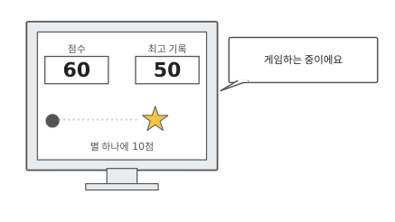

게임을 하고 있어요. 지금 내 점수는 60이고 최고 기록은 50이에요. 별을 하나 먹으면 10점이에요.

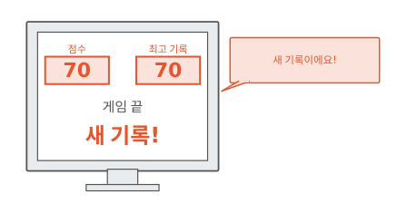

별을 하나 더 먹고 게임이 끝났어요. 화면에 "새 기록!"이 떴어요. 컴퓨터는 이걸 어떻게 알았을까요?

## 세 가지 일로 나눠 봐요

방금 컴퓨터가 한 일을 천천히 나눠 보면 세 가지예요.

1. 별을 먹으면 점수를 더해요.
2. 게임이 끝나면 내 점수와 최고 기록 중에 어느 쪽이 큰지 봐요.
3. 내 점수가 더 크면 최고 기록을 바꿔 적어요.

## 별을 먹으면 점수를 더해요

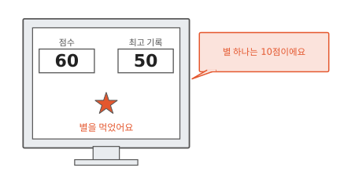

게임이 끝나기 조금 전 내 점수는 60이었어요. 그때 별을 하나 먹었어요.

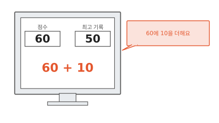

별 하나는 10점이라서 컴퓨터는 60에 10을 더해요.

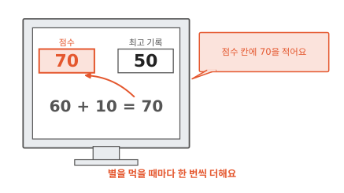

그래서 점수가 70이 됐어요. 별을 먹을 때마다 컴퓨터는 이렇게 한 번씩 더해요. 별을 다섯 개 먹으면 더하기도 다섯 번 해요.

## 게임이 끝나면 두 수를 비교해요

게임이 끝나면 컴퓨터는 내 점수와 최고 기록을 나란히 봐요. 내 점수는 70이고 최고 기록은 50이에요.

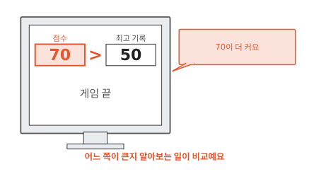

70이 더 커요.

둘 중에 어느 쪽이 큰지 알아보는 일을 **비교**라고 해요.

## 더 크면 최고 기록을 바꿔 적어요

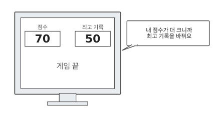

비교해 보니 내 점수가 더 컸어요. 이제 최고 기록을 바꿔 적을 차례예요.

컴퓨터는 손도 연필도 없는데 어떻게 적을까요? 컴퓨터 속에는 최고 기록을 적어 두는 칸이 있어요.

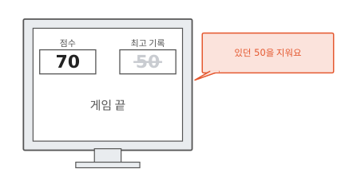

컴퓨터는 그 칸에 있던 50을 지워요.

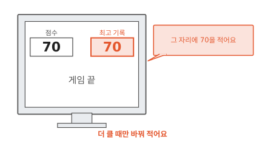

그리고 그 자리에 70을 적어요.

내 점수가 더 작았다면 어떨까요? 그때는 아무것도 바꾸지 않아요. 똑같을 때도 바꾸지 않아요. 더 클 때만 바꿔 적어요.

## 컴퓨터가 스스로 생각한 걸까요

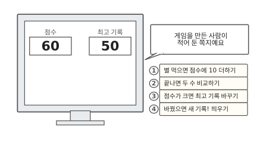

아니에요. 게임을 만든 사람이 미리 쪽지를 적어 두었어요. 쪽지에는 컴퓨터가 할 일이 적혀 있어요.

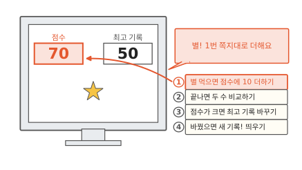

내가 별을 먹을 때마다 컴퓨터는 1번 쪽지에 적힌 대로 해요.

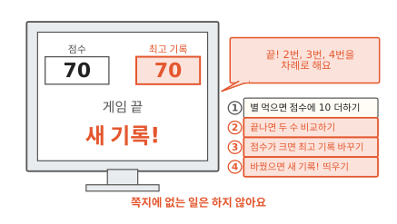

게임이 끝나면 2번, 3번, 4번 쪽지에 적힌 대로 해요. 쪽지에 없는 일은 하지 않아요.

명령은 "이거 해" 하고 시키는 말이에요. 그래서 컴퓨터에게 시키는 말을 적은 쪽지 한 장 한 장을 **명령어**라고 해요. 진짜 게임에는 명령어가 훨씬 많아요.

## 쉬운 일만 하는데 왜 똑똑해 보일까요

더하기, 비교, 바꿔 적기는 모두 쉬운 일이에요. 게임 속 움직임도, 화면의 그림도 이런 쉬운 명령어를 아주 많이 이어서 한 거예요. 그리고 컴퓨터는 명령어에 적힌 대로 아주 빨리 해요.

사람이 더하기를 한 번 하는 동안, 컴퓨터는 셀 수 없이 많이 더해요. 컴퓨터가 1초 동안 해낸 더하기를 나도 해 본다면 어떨까요? 잠도 안 자고 더하기만 해요. 그래도 할머니 할아버지가 될 때까지 다 못 끝내요.

??? note "어른과 함께 계산해 보기: 할머니 할아버지가 될 때까지는 어떻게 나왔을까"
    답은 79년쯤이에요. 지금 여덟 살이면 여든일곱 살, 아홉 살이면 여든여덟 살이 될 때까지예요.

    계산은 이렇게 해요. 컴퓨터 속에는 아주 빨리 똑딱이는 시계가 있어요. 요즘 컴퓨터는 1초에 25억 번쯤 똑딱여요. 한 번 똑딱일 때 명령어를 하나쯤 해요.[^ghz]

    - 사람이 1초에 더하기를 한 번 하면 25억 번은 25억 초가 걸려요.
    - 하루는 86,400초, 1년은 365일이니 1년은 31,536,000초예요.
    - 25억 초를 1년 초로 나누면 79년쯤이에요.

## 다시 처음 화면으로 가 볼게요

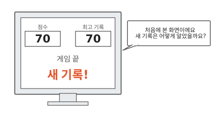

처음에 본 화면으로 돌아왔어요. 이제 "새 기록!"이 어떻게 떴는지 말할 수 있어요.

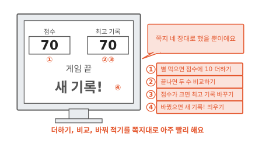

점수 70은 1번 쪽지대로 더한 거예요. 최고 기록 70은 2번 쪽지대로 비교하고 3번 쪽지대로 바꿔 적은 거예요. "새 기록!"은 4번 쪽지대로 띄웠어요. 컴퓨터가 하는 다른 일도 이런 쪽지를 아주 많이 이어서 해요.

### 이 편에서 줄여 그린 것

그림을 쉽게 하려고 실제와 다르게 줄인 곳이 두 군데 있어요.

1. 쪽지에 우리말로 적은 것처럼 그렸어요. 진짜 명령어는 숫자로 적혀 있어요. "10 더하기"도 숫자 몇 개로 바뀌어 들어가요. 그림과 글자를 숫자로 바꾸는 이야기는 [2편](02-how-computers-keep-pictures.md)과 [3편](03-how-computers-keep-letters.md)에서 해요.
2. 최고 기록 칸을 화면 위에 그렸어요. 진짜 칸은 컴퓨터 속에 있고 화면은 그 칸에 적힌 수를 보여 줄 뿐이에요. 수를 적어 두는 곳은 메모리라고 하고 [5편](05-where-computers-remember.md)에서 봐요.

### 이 편에서 새로 나온 말

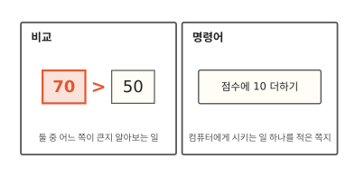

## 해 보기: 컴퓨터 놀이

친구 한 명과 해요. 한 명은 게임을 하는 사람, 한 명은 컴퓨터예요.

종이에 "점수 60", "최고 기록 50"이라고 적어요. 그리고 쪽지 네 장을 만들어 컴퓨터에게 줘요.

- 1번: 별 먹으면 점수에 10 더하기
- 2번: 끝나면 두 수 비교하기
- 3번: 점수가 크면 최고 기록 바꾸기
- 4번: 바꿨으면 "새 기록!" 외치기

놀이 방법:

1. 게임 하는 사람이 "별!"이라고 말해요. 컴퓨터는 1번 쪽지대로 해요.
2. 게임 하는 사람이 "끝!"이라고 말해요. 컴퓨터는 2번, 3번, 4번 쪽지대로 해요.

컴퓨터를 맡은 사람은 쪽지에 없는 일을 하면 안 돼요. 웃어도 안 돼요. 박수를 쳐도 안 돼요.

## 확인 문제

??? question "1. 컴퓨터는 스스로 생각할까요?"
    친구가 "컴퓨터는 똑똑해서 스스로 생각해"라고 해요. 친구에게 뭐라고 말해 줄까요?

    **풀이**: 컴퓨터는 사람이 적어 둔 명령어에 적힌 대로 해요. 아주 빨라서 똑똑해 보이는 거예요.

??? question "2. 점수와 최고 기록이 똑같으면?"
    최고 기록이 70이에요. 이번 점수도 70이에요. 컴퓨터는 최고 기록을 바꿔 적을까요?

    **풀이**: 바꾸지 않아요. 3번 쪽지에는 "점수가 크면" 바꾸라고 적혀 있어요. 70은 70보다 크지 않아요. 그래서 컴퓨터는 쪽지대로 아무것도 바꾸지 않아요.

??? question "3. 별을 두 개 먹으면"
    점수가 60일 때 별을 두 개 먹었어요. 컴퓨터는 더하기를 몇 번 할까요? 점수는 몇이 될까요?

    **풀이**: 별을 먹을 때마다 한 번씩 더하니까 두 번 해요. 60에 10을 더해 70, 70에 10을 더해 80이에요.

!!! abstract "어른을 위한 정리 (건너뛰어도 돼요)"
    - 컴퓨터가 "생각한다"고 느껴지는 일도 작은 명령어를 빠르게 이어 한 결과예요. 아이가 "컴퓨터가 알아서 했어"라고 하면 "누가 순서를 적어 뒀을까?"라고 되물어 주세요.
    - 빠르다고 뭐든 금방 끝나지는 않아요. 할 일의 개수가 늘면 시간도 늘어요. 이 이야기는 알고리즘 주제의 [첫 편](../algorithms/01-why-big-o.md)에서 이어져요.

## 더 깊이

??? info "1초에 몇 번일까"
    컴퓨터 속 시계가 1초에 몇 번 똑딱이는지를 기가헤르츠(GHz)로 적어요. 2.5GHz면 1초에 25억 번이에요. 요즘 컴퓨터는 한 번 똑딱일 때 명령어를 여러 개 처리하기도 해요. 그래서 실제로는 이보다 더 많이 해요.

??? info "계산기와 컴퓨터는 무엇이 다를까"
    계산기도 더하고 비교해요. 하지만 계산기로 게임을 할 수는 없지요. 컴퓨터는 명령어만 바꿔 넣으면 게임도 하고 그림도 그려요.

[^ghz]: 예를 들어 Intel Core i5-12400의 공식 사양은 기본 2.50GHz예요. [Intel 사양 페이지](https://www.intel.com/content/www/us/en/products/sku/134586/intel-core-i512400-processor-18m-cache-up-to-4-40-ghz/specifications.html).
