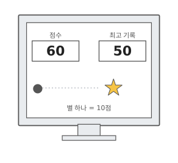
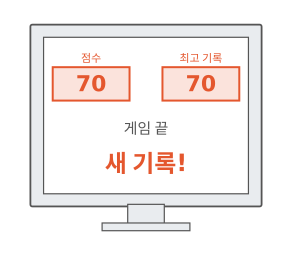
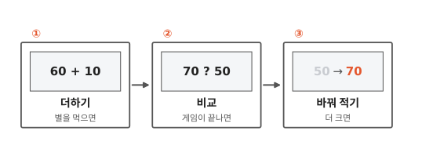
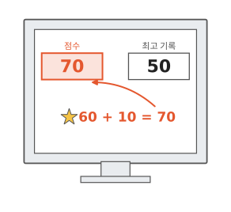
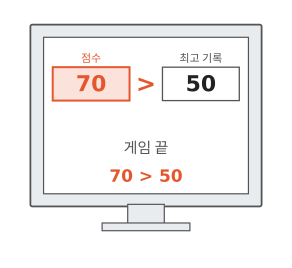
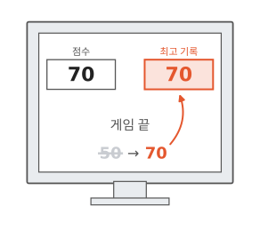
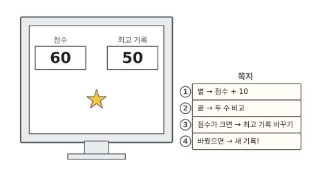
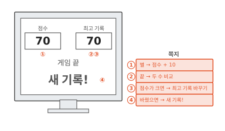
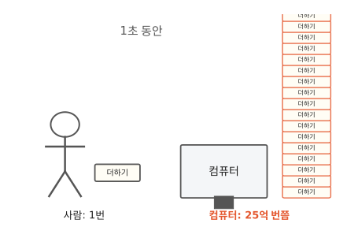

# 컴퓨터가 하는 일: 더하기, 비교, 바꿔 적기

게임이 끝났는데 화면에 "새 기록!"이 떴어요. 컴퓨터는 내 점수가 새 기록인지 어떻게 알았을까요? 이 글에서는 그 짧은 순간에 컴퓨터가 한 일을 하나씩 나눠 봐요. 나눠 보면 컴퓨터가 할 줄 아는 일이 생각보다 쉽다는 게 보여요.

!!! abstract "이 글에서 알게 되는 것"
    1. 컴퓨터가 하는 일은 더하기, 두 수 비교하기, 칸에 수를 바꿔 적기처럼 아주 쉬운 일이에요.
    2. 컴퓨터는 사람이 미리 적어 둔 명령어대로만 해요. 명령어에 없는 일은 하지 않아요.
    3. 쉬운 일만 하는데도 똑똑해 보이는 건 명령어를 아주 많이, 아주 빨리 해내기 때문이에요.

## 1. 새 기록이 뜨기까지 컴퓨터는 세 가지 일을 해요

게임을 하고 있어요. 아래 그림에서 화면 위쪽 두 칸을 보세요.

**그림 1.** 지금 점수는 60, 최고 기록은 50이에요. 별 하나를 먹으면 10점이에요.
{ .fig-cap }

별을 하나 먹고 게임이 끝났어요. 이번에는 두 칸의 숫자를 보세요.

**그림 2.** 점수도 최고 기록도 70이 됐고 "새 기록!"이 떴어요.
{ .fig-cap }

컴퓨터가 한 일을 천천히 나눠 보면 세 가지예요. 별을 먹으면 점수를 더해요. 게임이 끝나면 내 점수와 최고 기록 가운데 어느 쪽이 큰지 봐요. 내 점수가 더 크면 최고 기록을 바꿔 적어요.

아래 그림은 이 세 가지를 차례로 늘어놓은 거예요.

**그림 3.** 더하기, 비교, 바꿔 적기를 차례로 하면 새 기록이 떠요.
{ .fig-cap }

이제 하나씩 들여다볼게요.

## 2. 별을 먹으면 점수에 10을 더해요

게임이 끝나기 조금 전 점수는 60이었어요. 그때 별을 하나 먹었어요. 별 하나는 10점이라서 컴퓨터는 60에 10을 더해요. 아래 그림에서 빨간 화살표가 어디로 가는지 보세요.

**그림 4.** 60에 10을 더한 70이 점수 칸에 들어갔어요.
{ .fig-cap }

점수가 70이 됐어요. 최고 기록 칸은 아직 50 그대로예요. 컴퓨터는 별을 먹을 때마다 이렇게 한 번씩 더해요. 별을 다섯 개 먹으면 더하기도 다섯 번 해요.

## 3. 게임이 끝나면 두 수를 비교해요

이제 점수는 70이고 최고 기록은 50이에요. 게임이 끝나면 컴퓨터는 두 칸의 수를 나란히 놓고 어느 쪽이 큰지 봐요. 아래 그림에서 두 칸 사이의 빨간 표시를 보세요.

**그림 5.** 70이 50보다 커요.
{ .fig-cap }

두 수 가운데 어느 쪽이 큰지 알아보는 일을 **비교**라고 해요. 컴퓨터가 알아낸 건 "70이 더 크다"는 것 하나예요.

## 4. 내 점수가 더 크면 최고 기록을 바꿔 적어요

비교해 보니 내 점수가 더 컸어요. 그러면 최고 기록을 바꿔 적어야 해요.

여기서 이런 생각이 들 거예요. 컴퓨터는 손도 연필도 없는데 어떻게 적지? 컴퓨터 속에는 수를 적어 두는 칸이 있어요. 최고 기록도 그런 칸 하나에 적혀 있어요. 화면은 그 칸에 적힌 수를 보여 줄 뿐이에요. 수를 적어 두는 칸 이야기는 [5편](05-where-computers-remember.md)에서 더 해요.

컴퓨터는 최고 기록 칸에 있던 50을 지우고 그 자리에 70을 적어요. 아래 그림에서 회색 50과 빨간 70을 보세요.

**그림 6.** 최고 기록 칸의 50이 지워지고 70이 적혔어요.
{ .fig-cap }

내 점수가 더 작았다면 어땠을까요? 그때는 아무것도 바꾸지 않아요. 점수와 최고 기록이 똑같을 때도 바꾸지 않아요. 더 클 때만 바꿔 적어요.

## 5. 컴퓨터는 사람이 적어 둔 명령어대로만 해요

더하기, 비교, 바꿔 적기. 컴퓨터가 이걸 스스로 생각해 낸 걸까요? 그렇지 않아요. 게임을 만든 사람이 할 일을 쪽지에 미리 적어 두었어요. 아래 그림 오른쪽의 쪽지 네 장을 보세요.

**그림 7.** 게임을 만든 사람이 할 일을 쪽지 네 장에 적어 두었어요.
{ .fig-cap }

별을 먹을 때마다 컴퓨터는 1번 쪽지에 적힌 대로 점수에 10을 더해요. 게임이 끝나면 2번, 3번, 4번 쪽지를 차례로 해요. 쪽지에 없는 일은 하지 않아요.

"이거 해" 하고 시키는 말을 명령이라고 하죠. 그래서 컴퓨터에게 시킬 일 하나를 적은 쪽지를 **명령어**라고 해요. 진짜 게임에는 명령어가 훨씬 많아요. 진짜 명령어는 숫자로 적혀 있어요. 그림에서는 알아보기 쉽게 우리말로 적었어요. 그림과 글자를 숫자로 바꾸는 이야기는 [2편](02-how-computers-keep-pictures.md)과 [3편](03-how-computers-keep-letters.md)에서 해요.

이제 처음에 본 화면을 쪽지 번호로 다시 볼게요. 아래 그림에서 빨간 번호가 어느 쪽지와 짝인지 보세요.

**그림 8.** 점수 70은 1번, 최고 기록 70은 2번과 3번, "새 기록!"은 4번 쪽지대로 한 일이에요.
{ .fig-cap }

컴퓨터는 새 기록인지 스스로 알아챈 게 아니에요. 2번 쪽지대로 비교하고 3번 쪽지대로 바꿔 적었더니 새 기록이 된 거예요.

## 6. 쉬운 일을 아주 빨리 해서 똑똑해 보여요

더하기, 비교, 바꿔 적기는 모두 쉬운 일이에요. 그런데 컴퓨터는 왜 그렇게 똑똑해 보일까요? 게임 속 움직임도 화면의 그림도 이런 쉬운 명령어를 아주 많이 이어서 만든 거예요. 그리고 컴퓨터는 그 명령어를 아주 빨리 해요.

요즘 컴퓨터 속에는 1초에 25억 번쯤 똑딱이는 시계가 있어요. 한 번 똑딱일 때 명령어를 하나쯤 해요.[^ghz] 아래 그림에서 사람과 컴퓨터 옆의 쪽지를 비교해 보세요.

**그림 9.** 사람이 더하기를 한 번 하는 1초 동안 컴퓨터는 25억 번쯤 해요.
{ .fig-cap }

컴퓨터가 1초 동안 한 더하기를 내가 1초에 한 번씩 따라 한다고 해 볼게요. 잠도 안 자고 더하기만 해도 79년쯤 걸려요. 할머니 할아버지가 될 때까지 해야 끝나요.

??? note "어른과 함께 계산해 보기: 79년은 어떻게 나왔을까"
    - 1초에 한 번씩 25억 번 더하려면 25억 초가 걸려요.
    - 하루는 86,400초예요. 1년을 365일로 치면 1년은 31,536,000초예요.
    - 25억을 31,536,000으로 나누면 79쯤이에요. 그래서 79년쯤이에요.

??? question "확인 문제: 점수와 최고 기록이 똑같으면?"
    최고 기록이 70이에요. 이번 점수도 70이에요. 컴퓨터는 최고 기록을 바꿔 적을까요?

    **풀이**: 바꾸지 않아요. 3번 쪽지에는 "점수가 크면" 바꾸라고 적혀 있어요. 70은 70보다 크지 않아요.

??? question "확인 문제: 별을 두 개 먹으면?"
    점수가 60일 때 별을 두 개 먹었어요. 컴퓨터는 더하기를 몇 번 할까요? 점수는 몇이 될까요?

    **풀이**: 별을 먹을 때마다 한 번씩 더하니까 두 번 해요. 60에 10을 더해 70, 70에 10을 더해 80이에요.

## 정리

게임에서 "새 기록!"이 뜨기까지 컴퓨터는 세 가지 일을 했어요. 별을 먹었을 때 60에 10을 더했어요. 게임이 끝나자 70과 50을 비교했어요. 70이 더 커서 최고 기록 칸의 50을 70으로 바꿔 적었어요.

컴퓨터가 이 일을 스스로 생각해 낸 건 아니에요. 게임을 만든 사람이 명령어를 적어 두었고 컴퓨터는 거기 적힌 대로만 했어요. 하는 일은 쉽지만 1초에 25억 번쯤 해낼 만큼 빨라서 똑똑해 보여요.

다음 편에서는 컴퓨터가 그림을 숫자로 바꿔 기억하는 방법을 봐요.

### 새로 나온 말

- **비교**: 두 수 가운데 어느 쪽이 큰지 알아보는 일. 게임이 끝나자 컴퓨터는 70과 50을 비교했어요.
- **명령어**: 컴퓨터에게 시킬 일 하나를 적은 쪽지. "별 → 점수 + 10"이 1번 명령어였어요.

[^ghz]: 예를 들어 Intel Core i5-12400의 공식 사양은 기본 2.50GHz예요. 1GHz(기가헤르츠)는 1초에 10억 번 똑딱인다는 뜻이라서 2.50GHz는 1초에 25억 번이에요. [Intel 사양 페이지](https://www.intel.com/content/www/us/en/products/sku/134586/intel-core-i512400-processor-18m-cache-up-to-4-40-ghz/specifications.html).
