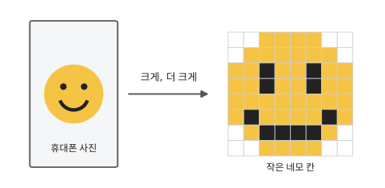
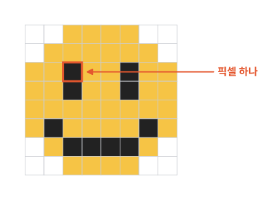
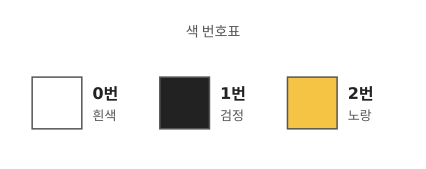
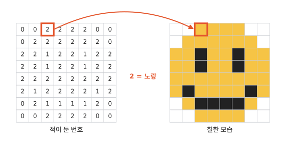
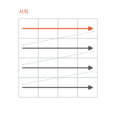
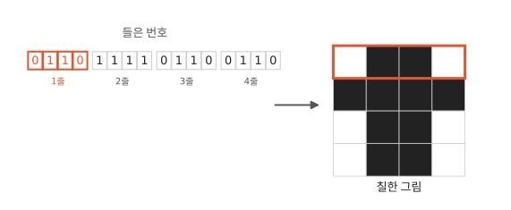
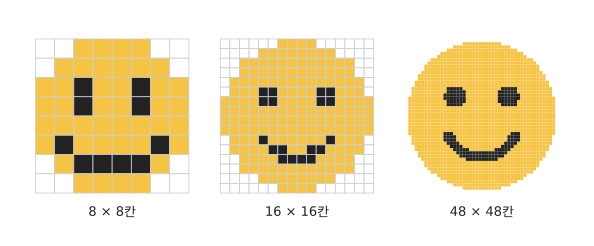

# 사진을 숫자로 기억하기: 픽셀과 색 번호

휴대폰으로 사진을 보다가 두 손가락으로 벌려 크게 키워 본 적 있죠? 계속 키우면 끝에는 작은 네모 칸이 보여요. 이 글을 읽고 나면 컴퓨터가 그 네모 칸에 숫자를 적어서 사진을 기억한다는 걸 알게 돼요. [1편](01-what-computers-do.md)에서 컴퓨터는 숫자를 더하고 비교하고 바꿔 적는 일만 한다고 했어요. 그런 컴퓨터가 사진을 어떻게 다루는지 여기서 보여요.

!!! abstract "이 글에서 알게 되는 것"
    1. 사진을 끝까지 키우면 보이는 작은 네모 칸 하나를 픽셀이라고 해요. 픽셀 하나에는 색이 하나만 들어가요.
    2. 컴퓨터는 색마다 번호를 정해 두고 칸마다 그 번호를 적어서 사진을 기억해요. 번호만 있으면 같은 그림을 다시 칠할 수 있어요.
    3. 진짜 사진은 칸이 아주 많고 칸 하나가 아주 작아서 부드럽게 보여요.

## 1. 사진을 끝까지 키우면 작은 네모 칸이 보여요

휴대폰에 웃는 얼굴 사진이 있어요. 이 사진을 크게, 더 크게 키워요. 아래 그림 오른쪽을 보세요.

**그림 1.** 동그란 얼굴을 끝까지 키우면 네모 칸이 모인 모양이에요.
{ .fig-cap }

동그랗던 얼굴이 네모 칸으로 이루어져 있어요. 칸은 모두 크기가 같은 네모예요. 칸 하나에는 색이 딱 하나만 들어가요. 노란 칸, 검은 칸, 흰 칸이 모여서 웃는 얼굴이 돼요.

아래 그림에서 빨간 테두리를 친 칸 하나를 보세요.

**그림 2.** 눈 자리의 검은 칸 하나가 픽셀 하나예요.
{ .fig-cap }

사진 속 작은 네모 칸 하나를 **픽셀**이라고 해요. 웃는 얼굴은 가로 8칸, 세로 8칸이니까 픽셀이 64개예요.

## 2. 컴퓨터는 색마다 번호를 정해 둬요

1편에서 진짜 명령어는 숫자로 적혀 있다고 했어요. 컴퓨터는 무엇이든 숫자로 적어 둬요. 노랑이 어떤 색인지 컴퓨터는 몰라요. 그래서 사람이 색마다 번호를 정해 줘요. 아래 표를 보세요.

**그림 3.** 0번은 흰색, 1번은 검정, 2번은 노랑이에요.
{ .fig-cap }

색과 번호를 이렇게 짝지은 표를 **색 번호표**라고 할게요. 이 글에서는 색을 세 개만 썼어요. 진짜 사진은 색이 아주 많아서 번호도 아주 많아요.

## 3. 칸마다 색 번호를 적어 두면 사진이 돼요

숫자 색칠 놀이를 해 본 적 있나요? 칸에 적힌 번호를 보고 그 번호의 색을 칠하는 놀이예요. 컴퓨터는 이 놀이를 거꾸로 해서 사진을 기억해요. 칸마다 색 대신 색 번호를 적어 두는 거예요.

아래 그림 왼쪽은 웃는 얼굴의 칸마다 색 번호를 적은 판이에요. 맨 윗줄 셋째 칸을 보세요.

**그림 4.** 왼쪽 판의 맨 윗줄 셋째 칸은 2라서 오른쪽 같은 자리가 노랗게 칠해져요.
{ .fig-cap }

컴퓨터가 기억하는 건 왼쪽 숫자 판이에요. 사진을 보여 줄 때는 번호를 하나씩 읽고 색 번호표에서 그 번호의 색을 찾아요. 그리고 화면의 같은 자리에 그 색을 칠해요. 그러면 오른쪽 웃는 얼굴이 화면에 나타나요.

숫자 색칠 놀이와 다른 점도 있어요. 색칠 놀이 칸은 꽃잎 모양, 구름 모양처럼 제각각이죠. 컴퓨터 칸은 모두 똑같은 네모예요.

## 4. 번호만 받아도 같은 그림을 칠할 수 있어요

칸이 모두 똑같은 네모라서 좋은 점이 있어요. 번호를 읽는 순서만 정해 두면 번호를 늘어놓기만 해도 그림이 전해져요. 순서는 맨 윗줄 왼쪽 칸에서 시작해요. 아래 그림에서 화살표를 따라가 보세요.

**그림 5.** 맨 윗줄을 왼쪽에서 오른쪽으로 읽고 다 읽으면 다음 줄 왼쪽으로 가요.
{ .fig-cap }

이번에는 흰색 0번과 검정 1번만 써 볼게요. 친구가 그림은 보여 주지 않고 번호 16개만 불러 줬어요. "0 1 1 0, 1 1 1 1, 0 1 1 0, 0 1 1 0". 번호를 넷씩 끊어서 한 줄에 하나씩 칠해요. 아래 그림에서 빨간 첫 줄을 보세요.

**그림 6.** 첫 줄 "0 1 1 0"대로 칠하면 가운데 두 칸만 검어요.
{ .fig-cap }

네 줄을 다 칠하면 나무 같은 모양이 나와요. 그림을 한 번도 보지 않았는데 친구가 그린 것과 똑같은 그림이 생겼어요. 컴퓨터가 사진을 다른 컴퓨터로 보낼 때도 이렇게 번호를 보내요. 받은 컴퓨터는 번호대로 칠해서 같은 사진을 보여 줘요.

## 5. 진짜 사진은 칸이 아주 많아서 부드럽게 보여요

그런데 진짜 사진을 볼 때는 네모 칸이 안 보이죠? 칸 수에 따라 얼굴이 어떻게 달라지는지 아래 그림에서 비교해 보세요.

**그림 7.** 칸을 더 작게, 더 많이 나눌수록 얼굴이 동그랗게 보여요.
{ .fig-cap }

8 × 8칸 얼굴은 울퉁불퉁해요. 48 × 48칸 얼굴은 거의 동그래요. 칸이 많을수록 칸 하나는 작아지고 작은 칸은 눈에 잘 띄지 않아요.

휴대폰으로 찍은 사진은 가로 4,000칸, 세로 3,000칸쯤 돼요. 칸이 1,200만 개예요. 우리 반 친구 25명이 모두 모여서 1초에 한 칸씩 칠한다고 해 볼게요. 밤에도 쉬지 않고 칠해요. 그래도 다 칠하려면 5일이 넘게 걸려요. 칸 하나는 그만큼 작아서 눈으로는 칸이 보이지 않아요. 그래서 사진이 부드럽게 보여요.

??? note "어른과 함께 계산해 보기: 5일은 어떻게 나왔을까"
    - 칸은 4,000 × 3,000 = 1,200만 개예요.
    - 친구 25명이 1초에 한 칸씩 칠하면 1초에 25칸이에요. 1,200만 ÷ 25 = 48만 초가 걸려요.
    - 하루는 86,400초예요. 48만 초는 5일하고도 반나절쯤이에요.

??? info "더 알아보기: 진짜 색 번호는 숫자 세 개예요"
    이 글에서는 색 하나에 번호 하나를 붙였어요. 진짜 컴퓨터는 칸마다 빨강, 초록, 파랑 빛을 얼마나 섞을지를 숫자 세 개로 적어요. 세 빛을 조금씩 또는 많이 섞어서 아주 많은 색을 만들어요.

??? question "확인 문제: 번호대로 칠해 보기"
    색 번호표가 0번 흰색, 1번 검정이에요. 한 줄에 칸이 네 개 있고 번호가 "1 0 0 1"이에요. 어느 칸이 검게 칠해질까요?

    **풀이**: 첫째 칸과 넷째 칸이에요. 양쪽 끝만 검고 가운데 두 칸은 흰색이에요.

## 정리

사진을 끝까지 키우면 작은 네모 칸이 보여요. 이 칸 하나가 픽셀이고 픽셀 하나에는 색이 하나만 들어가요.

컴퓨터는 노랑이 무슨 색인지 몰라요. 그래서 0번 흰색, 1번 검정, 2번 노랑처럼 색마다 번호를 정해 두고 칸마다 그 번호를 적어서 사진을 기억해요. 보여 줄 때는 번호를 읽고 그 색을 화면의 같은 자리에 칠해요. 번호 16개만 들어도 친구와 같은 그림을 칠할 수 있었던 것처럼 번호만 있으면 같은 그림을 다시 만들 수 있어요.

진짜 사진은 칸이 1,200만 개쯤 돼요. 칸 하나가 아주 작아서 네모가 보이지 않고 부드럽게 보여요.

다음 편에서는 글자에도 번호를 붙여서 기억하는 이야기를 해요.

### 새로 나온 말

- **픽셀**: 사진 속 작은 네모 칸 하나. 웃는 얼굴은 픽셀 64개로 되어 있었어요.
- **색 번호표**: 색과 번호를 짝지은 표. 이 글에서는 0번 흰색, 1번 검정, 2번 노랑이었어요.
