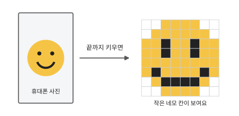
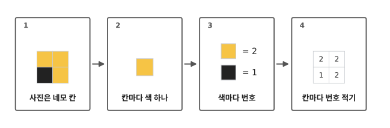
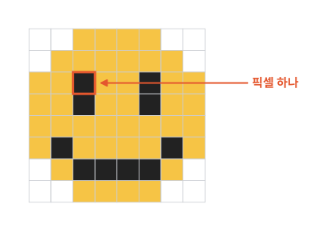
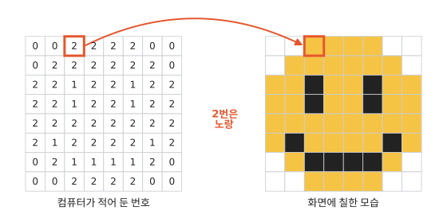
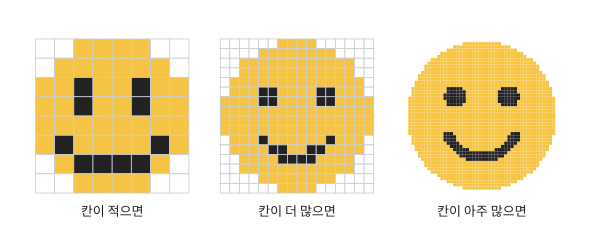
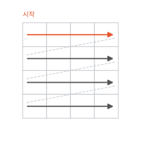

# 컴퓨터는 사진을 어떻게 기억하나요?

## 사진을 끝까지 키우면

휴대폰으로 사진을 보다가 두 손가락으로 벌려 크게 키워 본 적 있나요? 계속 키우고 또 키우면, 끝에는 작은 네모 칸이 보여요.

컴퓨터는 이 사진을 어떻게 기억하고 있을까요?

## 네 단계로 따라가 봐요

1. 사진은 네모 칸으로 되어 있어요.
2. 칸마다 색이 하나 있어요.
3. 컴퓨터는 색마다 번호를 정해요. 노랑은 2번처럼요.
4. 그리고 칸마다 그 번호를 적어 둬요. 이 칸은 2, 저 칸은 1처럼요.

## 작은 네모 칸, 픽셀

웃는 얼굴을 가로 8칸, 세로 8칸으로 나눠 봤어요. 칸은 모두 크기가 같은 네모예요. 칸 하나에는 색이 딱 하나만 들어가요. 노란 칸, 검은 칸, 흰 칸이 모여서 웃는 얼굴이 돼요.

이 작은 네모 칸 하나에는 이름이 있어요. **픽셀**이에요.

## 컴퓨터는 노랑을 몰라요

1편에서 본 것처럼, 컴퓨터는 숫자밖에 몰라요. 노랑이 어떤 색인지도 몰라요. 그래서 사람이 색마다 번호를 정해 줘요. 0번은 흰색, 1번은 검정, 2번은 노랑이에요. 색과 번호를 이렇게 짝지은 표가 **색 번호표**예요.

이 그림에서는 색을 세 개만 썼어요. 진짜 사진은 색이 아주 많아서, 번호도 아주 많아요.

## 숫자 색칠 놀이처럼

숫자 색칠 놀이를 해 본 적 있나요? 칸에 적힌 번호를 보고, 색 번호표에 맞는 색을 칠하는 놀이예요.

컴퓨터도 이 놀이처럼 해요. 컴퓨터는 색을 모르니까, 칸마다 번호를 적어 둬요. 사진을 보여 줄 때는 컴퓨터가 번호를 하나씩 읽어요. 그리고 번호에 맞는 색을 화면의 그 칸에 칠해요.

색칠 놀이 칸은 꽃잎 모양, 구름 모양처럼 제각각이지요? 컴퓨터 칸은 모두 똑같은 네모예요.

## 진짜 사진은 칸이 아주 많아요

칸이 적으면 웃는 얼굴이 울퉁불퉁해 보여요. 칸을 더 작게, 더 많이 나누면 점점 동그랗게 보여요.

휴대폰으로 찍은 진짜 사진은 칸이 아주아주 많아요. 우리 반 친구 25명이 모두 모여서 칠한다고 해 봐요. 한 사람이 1초에 한 칸씩, 밤에도 쉬지 않고 칠해요. 그래도 다 칠하려면 5일이 넘게 걸려요.

칸이 이렇게 많으니, 칸 하나는 아주 작아요. 너무 작아서 눈에 안 보여요. 그래서 사진이 부드럽게 보여요.

??? note "어른과 함께 계산해 보기: 진짜 사진은 칸이 몇 개일까"
    휴대폰 사진이 가로 4,000칸, 세로 3,000칸이라고 해 봐요. 그러면 칸은 4,000 × 3,000 = 1,200만 개예요.

    친구 25명이 1초에 한 칸씩 칠하면 1초에 25칸이에요. 1,200만 ÷ 25 = 48만 초이고, 하루는 86,400초이니 쉬지 않고 칠해도 5일 넘게 걸려요.

## 정리

- **픽셀**: 사진 속 작은 네모 칸 하나예요. 색이 하나만 들어가요.
- 컴퓨터는 칸마다 색 번호를 적어서 사진을 기억해요.

## 해 보기: 그림 전화 놀이

친구 한 명과 해요. 네모 칸이 그려진 종이(모눈종이)에 가로 4칸, 세로 4칸짜리 네모를 하나씩 그려요.

1. 한 명이 몰래 그림을 그려요. 칸마다 흰색으로 두거나 검게 칠해요.
2. 그린 사람이 번호를 불러 줘요. 흰 칸은 "0", 검은 칸은 "1"이에요. 맨 윗줄 왼쪽 칸부터 오른쪽으로 불러요. 한 줄이 끝나면 다음 줄 왼쪽 칸으로 가요.

    
3. 다른 한 명은 그림을 보지 않고, 들은 번호대로 같은 순서로 칸을 칠해요.
4. 두 그림을 나란히 놓아 봐요. 똑같으면 성공이에요.

번호만 들었는데 친구 종이에 똑같은 그림이 생겼지요? 컴퓨터도 사진을 보낼 때 이렇게 번호를 보내요.

## 확인 문제

??? question "1. 사진을 끝까지 키우면"
    휴대폰 사진을 끝까지 크게 키우면 무엇이 보일까요? 그걸 뭐라고 부를까요?

    **풀이**: 작은 네모 칸이 보여요. 이 칸 하나를 픽셀이라고 해요.

??? question "2. 번호대로 칠해 보기"
    색 번호표가 0번 흰색, 1번 검정이에요. 한 줄에 칸이 네 개 있고, 번호가 "0 1 1 0"이에요. 어느 칸이 검게 칠해질까요?

    **풀이**: 둘째 칸과 셋째 칸이에요. 가운데 두 칸만 검고, 양쪽 끝은 흰색이에요.

??? question "3. 왜 번호를 붙일까요?"
    컴퓨터는 왜 색에 번호를 붙일까요?

    **풀이**: 컴퓨터는 숫자밖에 몰라요. 색도 번호로 바꿔야 적어 둘 수 있어요.

!!! abstract "어른을 위한 정리 (건너뛰어도 돼요)"
    아이가 물을 만한 질문과 짧은 답이에요.

    - "키워도 네모가 안 보여." → 요즘 휴대폰은 칸과 칸 사이를 어울리는 색으로 메워서 매끈하게 보여 줘요. 그래도 사진 속에는 칸마다 번호가 적혀 있어요.
    - "색이 세 개뿐이야?" → 이 글에서만 세 개예요. 진짜 사진은 색이 아주 많고, 번호도 그만큼 많아요.
    - "노랑을 모르는데 어떻게 노랗게 나와?" → 컴퓨터는 "2번은 노랑"이라는 색 번호표대로 화면에 칠해요. 노랑이 어떤 색인지 몰라도 표만 있으면 돼요.
    - "왜 그냥 색을 칠해 두지 않아?" → 컴퓨터는 숫자밖에 적을 줄 몰라서, 색도 번호로 적어 둬요.

## 더 깊이

??? info "진짜 색 번호는 세 개예요"
    이 글에서는 색 하나에 번호 하나를 붙였어요. 진짜 컴퓨터는 칸마다 빨강, 초록, 파랑 빛을 얼마나 섞을지를 숫자 세 개로 적어요. 세 가지 빛을 조금씩, 또는 많이 섞으면 아주 많은 색을 만들 수 있어요.

??? info "사진 파일이 큰 까닭"
    칸마다 번호를 하나씩 적어 둬야 하니, 칸이 많은 사진일수록 적어 둘 번호도 많아져요. 실제 사진 파일은 비슷한 칸을 묶어 적는 방법(압축)으로 크기를 줄여요.

??? info "칸 대신 모양을 적는 그림"
    아이콘이나 글꼴처럼 아무리 키워도 매끈한 그림이 있어요. 이런 그림은 칸마다 번호를 적지 않고, "여기서 저기까지 선, 이 안은 노랑"처럼 모양을 적어 둬요. 이런 그림을 벡터 그림이라고 불러요.

??? info "글자는 어떻게 적을까"
    글자도 숫자로 바꿔야 컴퓨터가 적어 둘 수 있어요. 글자마다 번호를 붙이는 이야기는 다음 편에서 해요.
