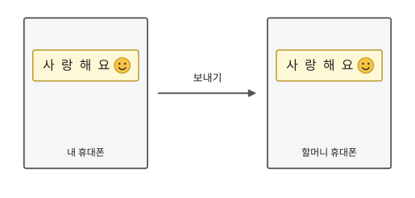
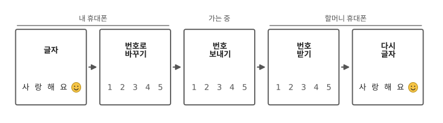
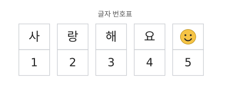
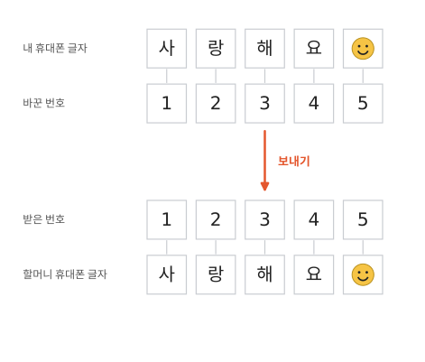
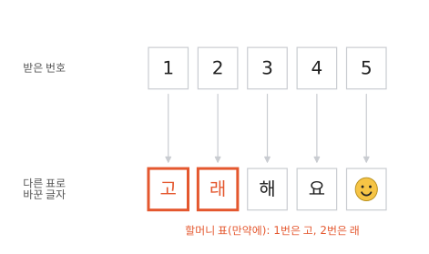
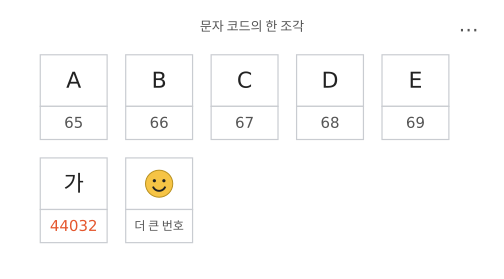

# 컴퓨터는 글자를 어떻게 기억하나요?

## 할머니께 보낸 메시지

휴대폰으로 할머니께 "사랑해요 😀(웃는 얼굴)"라고 보냈어요. 할머니 휴대폰에도 "사랑해요 😀"가 똑같이 떠요.

그런데 1편과 2편에서 본 것처럼, 컴퓨터는 숫자밖에 몰라요. 휴대폰 속에도 컴퓨터가 들어 있어요. 그럼 이 글자들은 어떻게 할머니께 갔을까요?

## 글자가 가는 길

글자는 이 다섯 칸을 지나 할머니께 가요. 가운데 세 칸에는 글자가 아니라 번호가 있지요? 비밀은 이 번호예요.

## 글자마다 번호를 정해요

번호 편지 놀이를 해 본 적 있나요? 글자마다 번호를 정해 두고, 글자 대신 번호로 편지를 쓰는 놀이예요. 비밀 암호 놀이라고도 해요.

컴퓨터도 글자마다 번호를 정해 둬요. 진짜 번호는 아주 커요. 여기서는 작은 번호로 해 볼게요. "사"는 1번, "랑"은 2번, "해"는 3번, "요"는 4번, 웃는 얼굴 😀는 5번이에요. 웃는 얼굴 같은 그림 문자를 **이모지**라고 해요. 이모지에도 이렇게 번호가 있어요.

## 보낼 때는 번호를 보내요

"사랑해요 😀"를 보내면, 내 휴대폰은 표를 보고 글자를 번호로 바꿔요. "1 2 3 4 5"가 되지요. 휴대폰이 보내는 건 바로 이 번호예요.

할머니 휴대폰은 "1 2 3 4 5"를 받아서, 같은 표를 보고 번호를 다시 글자로 바꿔요. 할머니 화면에 "사랑해요 😀"가 뜨는 건 이 덕분이에요.

2편의 그림 전화 놀이가 생각나지요? 그때 색에 번호를 붙였던 것처럼, 이번엔 글자에 번호를 붙였어요.

## 표가 다르면 어떻게 될까요

만약에 할머니 휴대폰의 표가 내 표와 조금 다르다면 어떨까요? 할머니 표에서는 1번이 "고", 2번이 "래"라고 해 봐요. 똑같이 "1 2 3 4 5"를 받아도, 할머니 화면에는 "고래해요 😀"가 떠요.

보내는 휴대폰과 받는 휴대폰은 꼭 **같은 표**를 써야 해요.

그래서 세상 사람이 모두 같이 쓰는 글자 번호표가 있어요. 이 표를 **문자 코드**라고 해요. 문자는 글자라는 뜻이에요. 휴대폰 "문자 메시지"도 글자로 쓴 메시지라서 그렇게 불러요.

## 세상 글자가 다 들어 있는 표

앞에서 쓴 1번부터 5번까지는 연습용 번호였어요. 실제로 쓰는 문자 코드는 아주아주 큰 표예요. 한글, 영어, 다른 나라 글자, 이모지가 모두 들어 있어요. 글자마다 번호가 하나씩 따로 있어요.

세상 컴퓨터는 거의 모두 이 큰 표 하나를 같이 써요. 그래서 다른 나라 친구에게 보내도 글자가 똑같이 보여요.

영어 "A"는 65번, "B"는 66번이에요. 한글 "가"의 번호는 다섯 자리 수예요. 그림에서 "가" 밑을 보세요. 웃는 얼굴은 그보다 더 큰 번호를 받았어요. 번호가 왜 그렇게 정해졌는지는 몰라도 괜찮아요. 모두가 같은 번호를 쓰는 게 중요해요.

## 정리

- **문자 코드**: 세상 사람이 모두 같이 쓰는 글자 번호표예요. 그래서 보내는 쪽과 받는 쪽이 같은 표를 써요.
- **이모지**: 웃는 얼굴 같은 그림 문자예요. 이모지에도 번호가 있어요.

## 해 보기: 번호 편지

친구 한 명과 해요.

1. 종이 두 장에 똑같은 글자 번호표를 만들어 하나씩 나눠 가져요. 예를 들어 "안 1, 녕 2, 친 3, 구 4, 야 5"처럼요.
2. 한 명이 번호로만 편지를 써요. "1 2 3 4 5"처럼요.
3. 다른 한 명이 표를 보고 글자로 바꿔 읽어요.
4. 이번에는 편지를 읽는 사람이, 쓴 친구 몰래 자기 표에서 한 칸만 다른 글자로 바꿔요. 그리고 같은 편지를 다시 소리 내 읽어 봐요. 쓴 친구는 무슨 말을 듣게 될까요?

## 확인 문제

??? question "1. 번호를 글자로 바꿔 보기"
    표가 "사"는 1, "랑"은 2, "해"는 3, "요"는 4예요. "3 1 2"는 무슨 말일까요?

    **풀이**: 3은 해, 1은 사, 2는 랑이에요. 그래서 "해사랑"이에요.

??? question "2. 친구 표가 다르면"
    내 표에서 1번은 "사", 2번은 "랑"이에요. 친구 표에서는 1번이 "고"이고, 2번은 나와 같은 "랑"이에요. 내가 "1 2"를 보내면 친구는 무엇을 읽을까요? 왜 그럴까요?

    **풀이**: "고랑"을 읽어요. 나는 1번을 "사"로 정했는데, 친구 표에서는 1번이 "고"라서 그래요. 둘이 같은 표를 써야 해요.

??? question "3. 이모지도 번호가 있을까요?"
    휴대폰에서 보내는 웃는 얼굴 😀도 번호로 바뀔까요?

    **풀이**: 네. 문자 코드에는 이모지도 들어 있어요. 웃는 얼굴도 번호로 바뀌어서 가요.

!!! abstract "어른을 위한 정리 (건너뛰어도 돼요)"
    - 아이가 "그럼 할머니 표는 왜 달랐어?"라고 물으면, "만약에 달랐다면 하고 생각해 본 거야. 그래서 다들 같은 표를 쓰기로 약속했어"라고 답해 주세요.
    - 메시지나 파일에서 글자가 이상한 기호로 보이는 일(글자 깨짐)은 실제로 쓴 쪽과 읽는 쪽이 서로 다른 문자 코드로 읽을 때 생겨요. 옛날 파일에서 가끔 보여요.
    - 새로 나온 이모지가 상대 휴대폰에서 빈 네모로 보이는 건, 번호는 제대로 갔는데 상대 휴대폰에 그 번호의 그림이 아직 없어서예요.
    - "가는 몇 번이야?" → 44,032번이에요. 번호는 글자들이 차례로 나눠 받은 것이라 특별한 뜻은 없어요. 영어 A(65)와 a(97)도 서로 다른 글자로 따로 번호를 받았어요.

## 더 깊이

??? info "진짜 번호는 얼마일까"
    오늘날 거의 모든 컴퓨터가 쓰는 문자 코드의 이름은 유니코드(Unicode)예요. 유니코드에서 영어 대문자 A는 65번, 소문자 a는 97번, 한글 가는 44,032번, 웃는 얼굴 😀는 128,512번이에요.[^ord]

??? info "한글은 글자마다 번호가 따로 있어요"
    유니코드에는 가, 각, 갂처럼 한글 글자마다 번호가 따로 있어요. 이렇게 번호를 받은 한글 글자는 11,172개예요.

??? info "번호를 컴퓨터 속에 적는 방법"
    같은 번호라도 컴퓨터 속에 적는 방법은 여러 가지예요. 컴퓨터 속 숫자가 어떻게 생겼는지는 다음 편에서 봐요.

[^ord]: 숫자는 파이썬의 `ord()`로 직접 확인했어요. 예: `ord("가")`는 44032.
