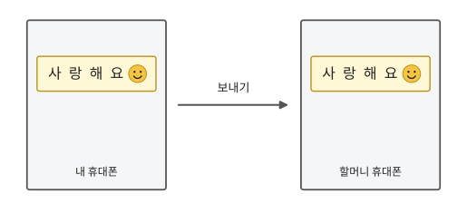
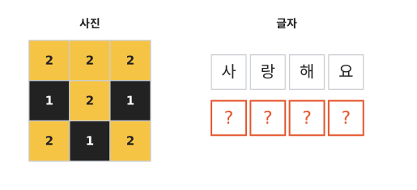
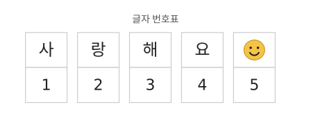
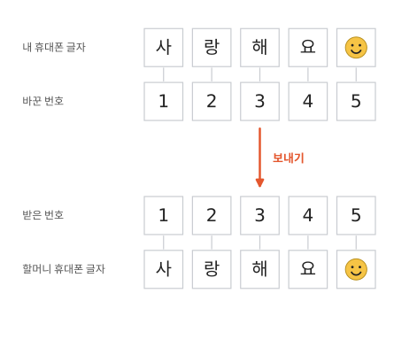
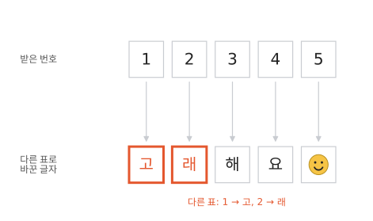
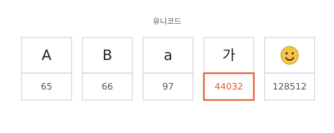
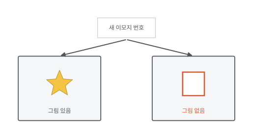

# 글자 번호표: 컴퓨터가 글자를 기억하고 보내는 방법

휴대폰으로 할머니께 "사랑해요 😀"라고 보내면 할머니 휴대폰에도 "사랑해요 😀"가 똑같이 떠요. 그런데 휴대폰 속 컴퓨터는 숫자밖에 다루지 못해요. 이 글을 읽고 나면 컴퓨터가 글자를 숫자로 바꿔서 기억하고 보내는 방법을 알게 돼요. 이 방법을 알면 가끔 글자가 이상한 기호나 빈 네모로 보이는 까닭도 보여요.

!!! abstract "이 글에서 알게 되는 것"
    1. 컴퓨터는 글자마다 번호를 정해 두고 글자 대신 번호를 기억하고 보내요. 받는 쪽은 그 번호를 다시 글자로 바꿔요.
    2. 보내는 쪽과 받는 쪽이 같은 번호표를 써야 해요. 표가 다르면 "사랑해요"가 "고래해요"처럼 엉뚱한 글자가 돼요.
    3. 세상 컴퓨터는 문자 코드라는 큰 번호표 하나를 같이 써요. 그 표에서 A는 65번, 가는 44032번이에요.

## 1. 컴퓨터는 글자도 숫자로 바꿔야 해요

할머니께 메시지를 보내는 장면부터 볼게요. 아래 그림에서 두 휴대폰의 말풍선을 보세요.

**그림 1.** 내 휴대폰에서 보낸 "사랑해요 😀"가 할머니 휴대폰에 똑같이 떴어요.
{ .fig-cap }

웃는 얼굴 😀처럼 글자 자리에 넣어 쓰는 작은 그림을 **이모지**라고 해요.

[1편](01-what-computers-do.md)에서 컴퓨터는 숫자를 더하고 비교하고 바꿔 적는 일만 한다고 했어요. 휴대폰 속에도 컴퓨터가 들어 있어서 휴대폰도 숫자만 다뤄요. 그럼 "사랑해요"는 어떻게 할머니께 갔을까요?

[2편](02-how-computers-keep-pictures.md)에서 사진을 숫자로 바꾼 일을 떠올려 봐요. 사진을 작은 네모 칸으로 나누고 색마다 번호를 정했어요. 그리고 칸마다 색 번호를 적었죠. 아래 그림의 왼쪽이 그렇게 숫자가 된 사진이에요. 오른쪽 글자 밑은 아직 물음표예요.

**그림 2.** 사진은 칸마다 색 번호가 적혀 숫자가 됐어요. 글자 밑에 들어갈 숫자는 아직 몰라요.
{ .fig-cap }

이 물음표 자리를 채워 볼게요. 사진에서 한 일을 글자에도 똑같이 하면 돼요.

## 2. 글자마다 번호를 정해 두면 숫자로 적을 수 있어요

친구랑 번호 편지 놀이를 해 본 적 있나요? 글자마다 번호를 정해 두고 글자 대신 번호로 편지를 쓰는 놀이예요. 컴퓨터도 이렇게 해요.

"사랑해요 😀"에 나온 글자에 번호를 붙여 볼게요. 사는 1번, 랑은 2번, 해는 3번, 요는 4번이에요. 😀도 글자처럼 번호를 받아서 5번이에요. 아래 표에서 글자마다 밑에 적힌 번호를 보세요.

**그림 3.** 글자 다섯 개가 1번부터 5번까지 번호를 받았어요.
{ .fig-cap }

글자와 번호를 짝지은 이 표를 **글자 번호표**라고 부를게요. 2편의 색 번호표와 같은 일을 하는 표예요. 진짜 컴퓨터가 쓰는 번호는 이보다 훨씬 커요. 여기서는 세기 쉽게 작은 번호로 해 보고 진짜 번호는 5절에서 볼게요.

이제 번호만 보고 글자를 읽을 수 있어요. "3 1 2"는 무슨 말일까요? 표에서 3은 해, 1은 사, 2는 랑이에요. 그래서 "해사랑"이에요. 표만 있으면 번호를 글자로 되돌릴 수 있어요.

## 3. 보낼 때는 번호를 보내고 받는 쪽이 글자로 되돌려요

이제 표를 들고 메시지를 보내 볼게요. "사랑해요 😀"를 보내면 내 휴대폰은 표를 보고 글자를 번호로 바꿔요. "1 2 3 4 5"가 돼요. 휴대폰이 할머니께 보내는 건 이 번호예요.

할머니 휴대폰은 "1 2 3 4 5"를 받아요. 그리고 같은 표를 보고 번호를 글자로 바꿔요. 그래서 할머니 화면에 "사랑해요 😀"가 떠요.

아래 그림을 위에서 아래로 따라가 보세요. 빨간 화살표를 지나 할머니께 가는 동안에는 글자가 없고 번호만 있어요.

**그림 4.** 글자는 번호로 바뀌어서 가고 할머니 휴대폰에서 다시 글자가 돼요.
{ .fig-cap }

글자를 기억해 둘 때도 같아요. 휴대폰 메모에 "사랑해요"를 적어 두면 휴대폰 속에는 "1 2 3 4"처럼 번호가 남아요. 화면에 보여 줄 때만 표를 보고 글자로 바꿔요.

## 4. 받는 쪽 표가 다르면 엉뚱한 글자가 떠요

3절에서 할머니 휴대폰은 내 휴대폰과 같은 표를 썼어요. 만약에 할머니 표가 조금 달랐다면 어떻게 될까요? 할머니 표에서는 1번이 "고", 2번이 "래"라고 해 볼게요. 3번, 4번, 5번은 내 표와 같아요.

아래 그림에서 빨간 칸 두 개를 보세요.

**그림 5.** 같은 "1 2 3 4 5"를 받았는데 다른 표로 읽어서 "고래해요 😀"가 됐어요.
{ .fig-cap }

번호는 하나도 틀리지 않고 잘 갔어요. 읽는 표만 달랐어요. 그래서 보내는 휴대폰과 받는 휴대폰은 꼭 같은 표를 써야 해요.

이런 일은 실제로도 생겨요. 오래된 파일을 열었는데 글자가 알아볼 수 없는 기호로 보일 때가 있어요. 글자를 쓴 쪽과 읽는 쪽이 서로 다른 표를 써서 생기는 일이에요. 이걸 **글자 깨짐**이라고 해요.

## 5. 세상 컴퓨터는 문자 코드라는 큰 표 하나를 같이 써요

표가 다르면 글자가 깨지니까 사람들은 모두 같은 표를 쓰기로 약속했어요. 세상 사람이 같이 쓰는 글자 번호표를 **문자 코드**라고 해요. 문자는 글자라는 뜻이에요. 휴대폰의 "문자 메시지"도 글자로 쓴 메시지라서 그렇게 불러요.

오늘날 거의 모든 컴퓨터가 쓰는 문자 코드의 이름은 **유니코드**예요. 유니코드에는 한글, 영어, 다른 나라 글자, 이모지가 모두 들어 있어요. 글자마다 번호가 하나씩 따로 있고요. 한글만 해도 가, 각, 갂처럼 11,172글자가 저마다 번호를 받았어요.

아래 그림에서 글자마다 받은 진짜 번호를 보세요.

**그림 6.** 유니코드에서 A는 65번, a는 97번, 가는 44032번, 😀는 128512번이에요.
{ .fig-cap }

A는 65번이고 B는 바로 다음인 66번이에요. 대문자 A와 소문자 a는 서로 다른 글자라서 번호도 따로 받았어요. 이 번호에 특별한 뜻은 없어요. 글자들이 차례로 나눠 받은 번호라서 모두가 같은 번호를 쓰기만 하면 돼요.

세상 컴퓨터가 이 표 하나를 같이 쓰니까 다른 나라 친구에게 보내도 글자가 똑같이 보여요. 2절의 1번부터 5번까지는 연습용 번호였어요. 실제로는 "사랑해요 😀"도 유니코드 번호로 바뀌어서 할머니께 가요.

## 6. 번호는 왔는데 그림이 없으면 빈 네모가 떠요

같은 표를 써도 글자 자리에 빈 네모가 뜰 때가 있어요. 새로 나온 이모지를 보냈을 때 자주 생겨요.

번호는 잘 갔어요. 표도 같아요. 그런데 휴대폰이 화면에 글자를 보여 주려면 그 번호에 맞는 그림도 갖고 있어야 해요. 새 이모지가 나온 지 얼마 안 됐으면 받는 휴대폰에 그 그림이 아직 없을 수 있어요. 그러면 번호가 무엇인지는 알아도 그릴 그림이 없어서 빈 네모를 띄워요.

아래 그림에서 같은 번호를 받은 두 휴대폰을 비교해 보세요.

**그림 7.** 같은 번호를 받았는데 그림이 있는 휴대폰은 이모지를 띄우고 그림이 없는 휴대폰은 빈 네모를 띄워요.
{ .fig-cap }

4절의 글자 깨짐과는 까닭이 달라요. 글자 깨짐은 읽는 표가 달라서 생겨요. 빈 네모는 표는 같은데 그릴 그림이 없어서 생겨요. 받는 휴대폰에 그 그림이 들어오면 같은 번호가 제대로 이모지로 보여요.

## 확인 문제

??? question "1. 친구 표가 다르면 무엇을 읽을까요?"
    내 표에서 1번은 "사", 2번은 "랑"이에요. 친구 표에서는 1번이 "고"이고 2번은 나와 같은 "랑"이에요. 내가 "1 2"를 보내면 친구는 무엇을 읽을까요?

    **풀이**: "고랑"을 읽어요. 번호 1은 잘 갔는데 친구 표에서 1번이 "고"라서 그래요. 둘이 같은 표를 써야 "사랑"이 돼요.

??? question "2. 빈 네모가 뜬 까닭은?"
    친구에게 새로 나온 이모지를 보냈더니 친구 휴대폰에는 빈 네모가 떴어요. 번호가 잘못 갔을까요?

    **풀이**: 아니요. 번호는 잘 갔어요. 친구 휴대폰에 그 번호의 그림이 아직 없어서 빈 네모를 띄운 거예요.

## 정리

컴퓨터는 숫자만 다뤄서 글자도 숫자로 바꿔요. 글자마다 번호를 정한 글자 번호표를 두고 "사랑해요 😀"를 "1 2 3 4 5"처럼 번호로 기억하고 보내요. 받는 휴대폰은 같은 표를 보고 번호를 다시 글자로 바꿔요.

받는 쪽 표가 다르면 같은 "1 2 3 4 5"가 "고래해요 😀"가 돼요. 그래서 세상 컴퓨터는 유니코드라는 문자 코드 하나를 같이 써요. 그 표에서 A는 65번, 가는 44032번, 😀는 128512번이에요. 표가 어긋나면 글자가 깨지고 그릴 그림이 없으면 빈 네모가 떠요.

그런데 65나 44032 같은 번호는 컴퓨터 속에 어떤 모습으로 들어 있을까요? 컴퓨터 속 숫자가 어떻게 생겼는지는 [4편](04-what-numbers-look-like.md)에서 볼게요.

### 새로 나온 말

- **이모지**: 글자 자리에 넣어 쓰는 작은 그림. 웃는 얼굴 😀도 이모지이고 글자처럼 번호를 받아요.
- **글자 번호표**: 글자마다 번호를 짝지어 둔 표. 이 글에서는 사 1, 랑 2, 해 3, 요 4, 😀 5였어요.
- **글자 깨짐**: 쓴 쪽과 읽는 쪽이 다른 표를 써서 글자가 엉뚱하게 보이는 일. "사랑해요"가 "고래해요"가 됐어요.
- **문자 코드**: 세상 사람이 같이 쓰는 글자 번호표.
- **유니코드**: 오늘날 거의 모든 컴퓨터가 쓰는 문자 코드. A는 65번, 가는 44032번이에요.
