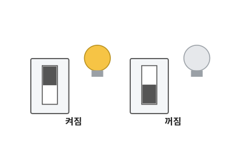
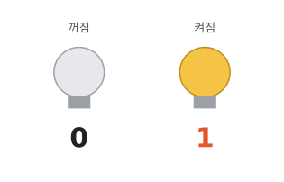
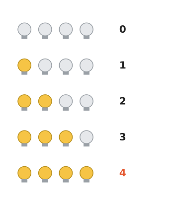
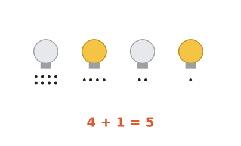
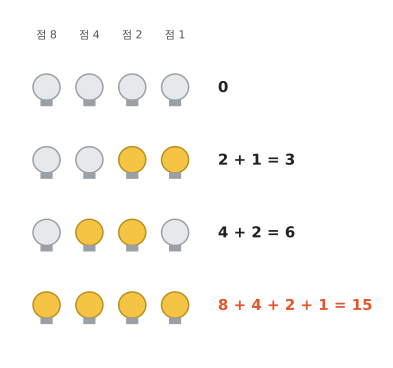
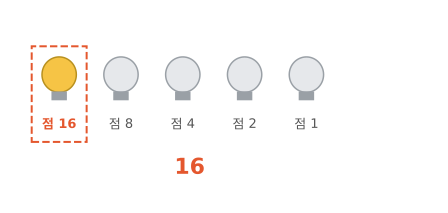
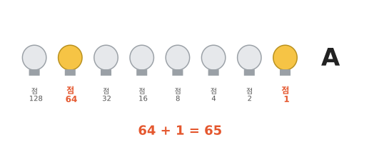
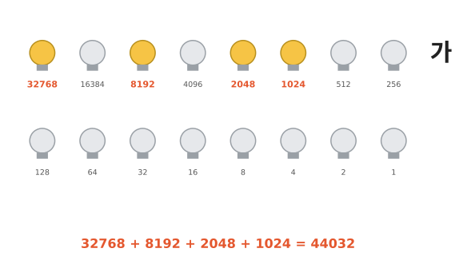

# 비트: 켜짐과 꺼짐으로 숫자를 적는 방법

방에 있는 전등 스위치는 올리면 불이 켜지고 내리면 꺼져요. 컴퓨터 속에도 이런 스위치가 아주 많이 들어 있어요. 이 글을 읽고 나면 켜짐과 꺼짐 두 가지밖에 모르는 스위치로 5나 65 같은 숫자를 적는 방법을 알게 돼요. [3편](03-how-computers-keep-letters.md)에서 글자는 번호가 됐어요. 그 번호가 컴퓨터 속에서 어떤 모습인지도 이 방법으로 보여요.

!!! abstract "이 글에서 알게 되는 것"
    1. 컴퓨터 속 전구 하나는 꺼짐과 켜짐, 곧 0과 1 두 가지만 적어요. 이 전구 하나를 비트라고 해요.
    2. 전구마다 1, 2, 4, 8처럼 두 배씩 커지는 점을 붙이고 켜진 전구의 점만 더하면 큰 수도 적을 수 있어요. 전구 네 개면 0부터 15까지예요.
    3. 컴퓨터는 전구 여덟 개를 한 묶음으로 써요. 3편의 A(65번)는 점 64 전구와 점 1 전구가 켜진 모습이에요.

## 1. 컴퓨터 속 스위치는 켜짐과 꺼짐만 알아요

전등 스위치부터 볼게요. 아래 그림에서 스위치 손잡이와 전구를 함께 보세요.

**그림 1.** 손잡이를 올리면 전구가 켜지고 내리면 꺼져요.
{ .fig-cap }

스위치가 할 줄 아는 건 켜지거나 꺼지는 것 두 가지뿐이에요. 반쯤 켜지는 일은 없어요.

컴퓨터 속에도 이런 스위치가 셀 수 없이 많이 들어 있어요. 아주 작아서 손톱만 한 조각 하나에 수십억 개가 들어가요. [2편](02-how-computers-keep-pictures.md)에서 사진의 색은 번호가 됐고 3편에서 글자도 번호가 됐어요. 그런데 스위치는 켜짐과 꺼짐밖에 모르는데 "5" 같은 번호는 어떻게 적을까요?

이제부터는 스위치 대신 전구만 그릴게요. 전구 하나가 스위치 하나예요. 켜진 전구는 노랗고 꺼진 전구는 회색이에요.

## 2. 전구 하나로는 0과 1만 적을 수 있어요

전구가 하나 있어요. 꺼져 있으면 0, 켜져 있으면 1이라고 정해요. 아래 그림에서 전구 밑의 숫자를 보세요.

**그림 2.** 꺼진 전구는 0이고 켜진 전구는 1이에요.
{ .fig-cap }

전구 하나로는 0과 1 두 가지만 적을 수 있어요. 2나 3은 적을 수 없어요.

컴퓨터 속 전구 하나에도 이름이 있어요. 이 전구 하나를 **비트**라고 해요. 비트 하나에는 0 아니면 1이 들어가요.

## 3. 켜진 전구 수만 세면 네 개로 4까지밖에 못 적어요

5를 적으려면 전구가 더 있어야 해요. 전구 네 개를 나란히 놓아 볼게요.

가장 쉬운 방법부터 해 봐요. 켜진 전구가 몇 개인지 세는 거예요. 하나 켜면 1, 둘 켜면 2예요. 아래 그림에서 오른쪽 숫자가 어디까지 가는지 보세요.

**그림 3.** 켜진 개수만 세면 전구 네 개로 0부터 4까지 다섯 가지만 적을 수 있어요.
{ .fig-cap }

네 개를 모두 켜도 4예요. 5는 적을 수 없어요. 큰 수를 적으려면 전구를 아주 많이 놓아야 해요. 100을 적으려면 전구가 100개나 있어야 하죠.

## 4. 전구마다 점을 붙이면 네 개로 15까지 적어요

이번에는 같은 전구 네 개에 점을 붙여 볼게요. 왼쪽부터 점 8개, 4개, 2개, 1개예요. 그리고 켜진 전구의 점만 더해요.

점 4개 전구와 점 1개 전구를 켜 볼게요. 아래 그림에서 켜진 전구 밑의 점을 세어 보세요.

**그림 4.** 점 4개 전구와 점 1개 전구가 켜져서 4 + 1 = 5가 됐어요.
{ .fig-cap }

3절에서는 못 적던 5를 적었어요. 같은 전구 네 개인데도요.

점이 왜 1, 2, 4, 8인지 볼게요. 1 + 1 = 2, 2 + 2 = 4, 4 + 4 = 8이에요. 오른쪽 전구의 점을 두 번 더하면 바로 왼쪽 전구의 점이 돼요. 그래서 왼쪽으로 갈수록 점이 두 배씩 많아져요.

이 방법으로 몇 가지 수를 더 만들어 볼게요. 이제부터 그림에서는 점을 숫자로 적어요. 아래 그림에서 줄마다 켜진 전구와 옆의 더하기 식을 맞춰 보세요.

**그림 5.** 전구 네 개를 모두 켜면 8 + 4 + 2 + 1 = 15예요.
{ .fig-cap }

모두 끄면 0이고 모두 켜면 15예요. 그 사이의 수는 켜는 전구를 바꿔서 다 만들 수 있어요. 7은 점 4, 2, 1 전구를 켜면 돼요. 9는 점 8과 점 1 전구를 켜면 되고요. 전구 네 개로 0부터 15까지 열여섯 가지 수를 적어요.

이렇게 0과 1 두 가지만 써서 수를 적는 방법을 **이진수**라고 해요. 우리가 평소 쓰는 수는 0부터 9까지 열 가지 숫자로 적어서 십진수라고 불러요.

## 5. 전구를 하나 더 놓을 때마다 적을 수 있는 수가 두 배가 돼요

전구 네 개로는 16을 적을 수 없어요. 모두 켜도 15거든요. 그럼 맨 왼쪽에 전구를 하나 더 놓아요. 새 전구의 점은 같은 규칙대로 8 + 8 = 16이에요. 아래 그림에서 빨간 점선 안의 새 전구를 보세요.

**그림 6.** 맨 왼쪽에 점 16 전구를 더 놓고 그것만 켜면 16이에요.
{ .fig-cap }

이제 다섯 개를 모두 켜면 16 + 8 + 4 + 2 + 1 = 31이에요. 전구가 네 개일 때는 0부터 15까지 16가지였는데 다섯 개가 되니 0부터 31까지 32가지가 됐어요. 전구 하나를 더 놓을 때마다 적을 수 있는 수가 두 배로 늘어요. 3절처럼 켜진 개수만 셀 때는 전구 하나를 더 놓아도 한 가지만 늘었죠.

## 6. 컴퓨터 속 A는 64 전구와 1 전구가 켜진 모습이에요

컴퓨터는 전구 여덟 개를 한 묶음으로 써요. 점은 같은 규칙으로 늘어서 왼쪽부터 128, 64, 32, 16, 8, 4, 2, 1이에요. 여덟 개를 모두 켜면 128 + 64 + 32 + 16 + 8 + 4 + 2 + 1 = 255예요. 그래서 한 묶음에 0부터 255까지 적을 수 있어요. 이 전구 여덟 개 묶음을 **바이트**라고 해요. 파일 크기를 말할 때 쓰는 KB, MB의 B가 바이트예요.

3편에서 유니코드로 A는 65번이었어요. 65를 바이트 하나에 적어 볼게요. 64 + 1 = 65니까 점 64 전구와 점 1 전구를 켜면 돼요. 아래 그림에서 켜진 전구 두 개를 보세요.

**그림 7.** 점 64 전구와 점 1 전구가 켜진 이 모습이 컴퓨터 속 A예요.
{ .fig-cap }

3편의 "가"는 44032번이었어요. 255보다 훨씬 커서 전구 여덟 개로는 모자라요. 전구를 열여섯 개 놓으면 맨 왼쪽 점이 32768까지 커져서 44032도 적을 수 있어요. 아래 그림에서 빨간 숫자 네 개를 더해 보세요.

**그림 8.** 전구 열여섯 개 가운데 네 개를 켜서 44032, 곧 "가"의 번호를 적었어요.
{ .fig-cap }

32768 + 8192 + 2048 + 1024 = 44032예요. 컴퓨터 속 글자와 사진은 모두 이렇게 켜진 전구와 꺼진 전구가 줄지어 있는 모습이에요. "컴퓨터는 0과 1로 되어 있다"는 말은 이 모습을 두고 하는 말이에요.

## 확인 문제

??? question "1. 무슨 수일까요?"
    점이 8, 4, 2, 1인 전구 네 개 가운데 점 8 전구와 점 2 전구만 켜져 있어요. 무슨 수일까요?

    **풀이**: 켜진 전구의 점만 더해요. 8 + 2 = 10이에요.

??? question "2. 11을 만들어 봐요"
    점이 8, 4, 2, 1인 전구 네 개로 11을 만들려면 어느 전구를 켜야 할까요?

    **풀이**: 점 8, 2, 1 전구를 켜요. 8 + 2 + 1 = 11이에요. 점 4 전구는 꺼요.

## 정리

컴퓨터 속 전구 하나는 켜짐과 꺼짐, 곧 1과 0 두 가지만 적어요. 이 전구 하나가 비트예요.

켜진 전구 수만 세면 전구 네 개로 4까지밖에 못 적어요. 전구마다 1, 2, 4, 8처럼 두 배씩 커지는 점을 붙이고 켜진 전구의 점만 더하면 같은 네 개로 0부터 15까지 적어요. 5는 점 4와 점 1 전구를 켠 모습이에요. 이렇게 0과 1로 수를 적는 방법이 이진수예요.

컴퓨터는 전구 여덟 개 묶음인 바이트를 써요. 바이트 하나에는 0부터 255까지 들어가고 A(65번)는 점 64와 점 1 전구가 켜진 모습이에요. 더 큰 번호인 "가"(44032번)는 전구 열여섯 개로 적어요.

[5편](05-where-computers-remember.md)에서는 컴퓨터가 이렇게 적은 숫자를 어디에 적어 두는지 볼게요.

### 새로 나온 말

- **비트**: 컴퓨터 속 전구(스위치) 하나. 꺼지면 0, 켜지면 1이에요.
- **이진수**: 0과 1 두 가지만 써서 수를 적는 방법. 점 4와 점 1 전구를 켠 모습이 5예요.
- **십진수**: 0부터 9까지 열 가지 숫자로 수를 적는 방법. 우리가 평소에 쓰는 수예요.
- **바이트**: 비트 여덟 개 묶음. 0부터 255까지 적을 수 있고 A는 점 64와 점 1 전구가 켜진 바이트예요.
