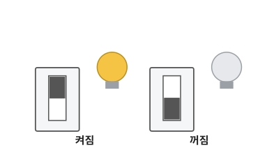
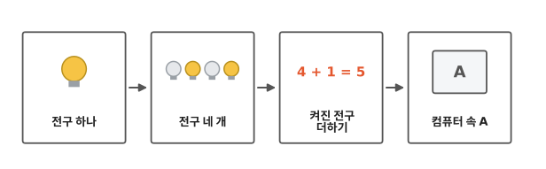
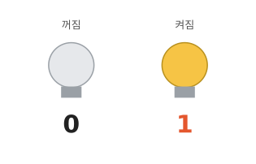
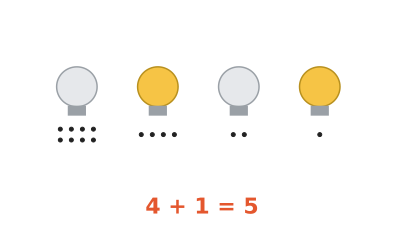
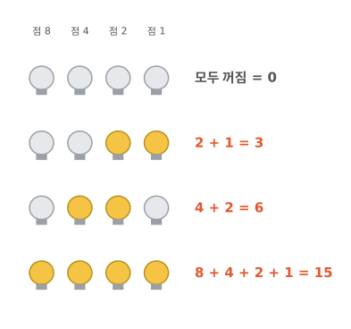
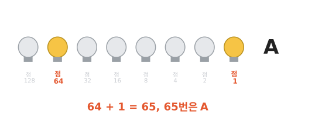

# 컴퓨터 속 숫자는 어떻게 생겼나요?

## 켜짐과 꺼짐, 두 가지뿐

방에 있는 전등 스위치를 떠올려 봐요. 스위치를 올리면 불이 켜지고, 내리면 꺼져요. 스위치는 켜지거나 꺼지거나, 그것밖에 못 해요.

컴퓨터 속에도 이런 스위치가 셀 수 없이 많이 들어 있어요. 1편부터 3편까지 보니, 컴퓨터는 색도 글자도 모두 숫자로 바꿔서 적었지요? 그럼 스위치로 "5"는 어떻게 적을까요?

켜졌는지 잘 보이게, 이제부터는 스위치 대신 전구로 그릴게요. 전구 하나가 스위치 하나예요.

## 이렇게 따라가요

그림처럼 전구 하나에서 시작해, 전구 네 개로 늘리고, 켜진 전구를 더해 볼 거예요. 끝에는 컴퓨터 속 "A"를 만나요.

## 전구 하나는 두 가지만 적어요

전구가 꺼져 있으면 0, 켜져 있으면 1이라고 정해요. 그러면 전구 하나로 0이나 1을 적을 수 있어요. 2나 3은 적을 수 없어요.

전구 하나는 컴퓨터 속 스위치 한 칸이에요. 이 한 칸에도 이름이 있어요. **비트**예요. 비트 하나에는 0 아니면 1이 들어가요.

## 전구에 점을 붙여요

5를 적으려면 전구가 더 있어야 해요. 전구 네 개를 나란히 놓고, 전구마다 점을 붙여요. 왼쪽부터 점 8개, 4개, 2개, 1개예요.

켜진 전구의 점만 세면 돼요. 점 4개 전구랑 점 1개 전구를 켜 봐요. 4 더하기 1, 5가 됐지요?

점은 왜 1, 2, 4, 8일까요? 1 + 1 = 2, 2 + 2 = 4, 4 + 4 = 8이에요. 오른쪽 전구의 점에 같은 수를 한 번 더 더하면, 바로 왼쪽 전구의 점이 돼요. 그래서 왼쪽으로 갈수록 점이 많아져요.

그냥 켜진 전구 개수를 세면 안 될까요? 그러면 전구 네 개로 4까지밖에 못 적어요. 점을 붙이면 같은 네 개로 15까지 적을 수 있어요.

## 0부터 15까지 다 적을 수 있어요

전구 네 개로 몇 가지 수를 만들어 봐요. 이제부터 그림에서는 점을 숫자로 적을게요.

- 모두 끄면 0이에요.
- 점 2개와 점 1개를 켜면 2 + 1 = 3이에요.
- 점 4개와 점 2개를 켜면 4 + 2 = 6이에요.
- 모두 켜면 8 + 4 + 2 + 1 = 15예요.

전구 네 개로는 0부터 15까지 적을 수 있어요. 16을 적으려면 맨 왼쪽에 전구를 하나 더 놓아요. 그 전구의 점은 8 + 8 = 16이에요.

## 컴퓨터 속 "A"

진짜 컴퓨터는 전구 여덟 개를 한 줄로 붙여서 써요. 여덟 개면 아주 큰 수까지 적을 수 있어요.

3편에서 영어 "A"는 65번이라고 했지요? 컴퓨터 속 "A"는 점 64 전구와 점 1 전구가 켜진 모습이에요. 64 더하기 1, 65예요.

??? note "더 알아보기: 여덟 개면 몇까지 적을까"
    점은 같은 규칙으로 늘어나요. 16 + 16 = 32, 32 + 32 = 64, 64 + 64 = 128이에요. 여덟 개를 모두 켜면 128 + 64 + 32 + 16 + 8 + 4 + 2 + 1 = 255예요. 그래서 전구 여덟 개로는 0부터 255까지 적을 수 있어요.

## 정리

- **비트**: 컴퓨터 속 스위치 한 칸이에요. 켜지면 1, 꺼지면 0이에요.
- 컴퓨터는 켜진 전구(스위치)의 점만 더해서 숫자를 적어요.

## 해 보기: 점 카드 놀이

친구 한 명과 해요.

1. 종이 카드 네 장을 만들어요. 앞면에 점을 8개, 4개, 2개, 1개 그리고, 뒷면은 비워 둬요.
2. 카드를 왼쪽부터 8, 4, 2, 1 순서로 놓아요. 앞면이 보이면 켜짐, 뒷면이 보이면 꺼짐이에요.
3. 한 명이 수를 불러요. 예를 들어 "11!" 다른 한 명은 카드를 뒤집어서 그 수를 만들어요.
4. 이번에는 한 명이 카드를 마음대로 놓아요. 다른 한 명이 무슨 수인지 맞혀요.

## 확인 문제

??? question "1. 무슨 수일까요?"
    전구 네 개 중에 점 8개 전구와 점 2개 전구만 켜져 있어요. 무슨 수일까요?

    **풀이**: 켜진 전구의 점만 더해요. 8 + 2 = 10이에요.

??? question "2. 7을 만들어 봐요"
    점이 8, 4, 2, 1인 전구 네 개가 있어요. 7을 만들려면 어느 전구를 켜야 할까요?

    **풀이**: 점 4개, 2개, 1개 전구를 켜요. 4 + 2 + 1 = 7이에요. 점 8개 전구는 꺼요.

??? question "3. 16을 만들 수 있을까요?"
    점이 8, 4, 2, 1인 전구 네 개로 16을 만들 수 있을까요?

    **풀이**: 못 만들어요. 네 개를 모두 켜도 8 + 4 + 2 + 1 = 15예요. 16을 적으려면 점 16 전구를 하나 더 놓아야 해요.

!!! abstract "어른을 위한 정리 (건너뛰어도 돼요)"
    - "컴퓨터는 0과 1로 되어 있다"는 말이 바로 이 켜짐·꺼짐 스위치 이야기예요. 글자도, 사진도, 영상도 모두 이 스위치들의 줄이에요.
    - 비트(bit)는 영어 binary digit, 곧 "두 가지 중 하나인 숫자"를 줄인 말이에요.
    - 스위치 여덟 개 묶음을 바이트라고 불러요. 파일 크기를 말할 때 쓰는 KB, MB의 B가 바이트예요.

## 더 깊이

??? info "이진수"
    켜짐과 꺼짐 두 가지로 수를 적는 이 방법을 이진수라고 불러요. 우리가 평소 쓰는 수는 0부터 9까지 열 가지 숫자로 적는 십진수예요.

??? info "한글 '가'는 스위치가 몇 개 필요할까"
    3편에서 한글 "가"는 44,032번이라고 했어요. 스위치 여덟 개로는 255까지밖에 못 적으니, "가"에는 스위치가 16개 필요해요. 16개면 65,535까지 적을 수 있어요.

??? info "컴퓨터 속 스위치의 진짜 이름"
    컴퓨터 속 스위치의 진짜 이름은 트랜지스터예요. 아주 작아서, 손톱만 한 칩 하나에 수십억 개가 들어가요. 예를 들어 Apple M1 칩에는 160억 개가 들어 있어요.[^m1]

[^m1]: [Apple 보도자료, 2020년 11월 10일](https://www.apple.com/newsroom/2020/11/apple-unleashes-m1/).
