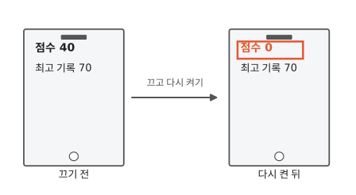
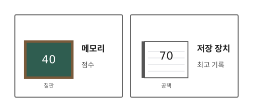
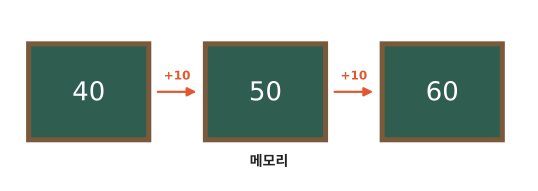
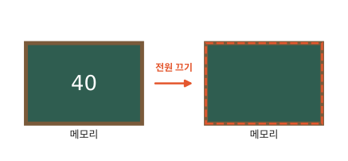
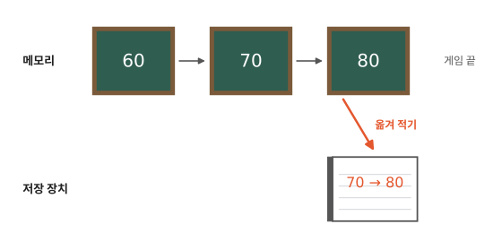
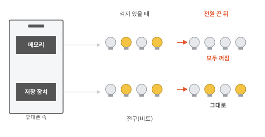
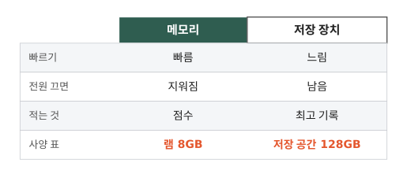

# 메모리와 저장 장치: 컴퓨터가 숫자를 적어 두는 두 곳

휴대폰으로 게임을 하다가 전원을 껐어요. 다시 켜 보니 하던 판의 점수는 없어지고 0부터 다시 시작해요. 그런데 최고 기록은 그대로 남아 있어요. 이 글을 읽고 나면 컴퓨터가 숫자를 어디에 적어 두길래 어떤 건 사라지고 어떤 건 남는지 알게 돼요. 이걸 알면 앱에 있는 "저장" 버튼을 왜 눌러야 하는지도 보여요.

!!! abstract "이 글에서 알게 되는 것"
    1. 컴퓨터는 숫자를 두 곳에 적어요. 지금 쓰는 숫자는 메모리에, 오래 둘 숫자는 저장 장치에 적어요.
    2. 메모리는 빨리 쓰고 지울 수 있어요. 대신 전원을 끄면 저절로 지워져요.
    3. 저장 장치는 느리지만 전원을 꺼도 남아요. 그래서 컴퓨터는 남겨야 할 숫자만 골라서 저장 장치에 옮겨 적어요.

## 1. 컴퓨터는 숫자를 두 곳에 적어요

끄기 전 게임 화면에는 점수 40, 최고 기록 70이 떠 있었어요. 아래 그림에서 다시 켠 뒤 화면의 빨간 칸을 보세요.

**그림 1.** 다시 켜니까 점수는 40에서 0이 됐어요. 최고 기록 70은 그대로예요.
{ .fig-cap }

[1편](01-what-computers-do.md)에서 컴퓨터 속에는 수를 적어 두는 칸이 있다고 했어요. 점수도 최고 기록도 그런 칸에 적혀 있어요. 둘 다 숫자인데 하나는 사라지고 하나는 남았죠. 두 숫자를 적어 둔 곳이 달라서 그래요.

교실을 떠올려 보세요. 금방 바뀌는 건 칠판에 쓰고 오래 남길 건 공책에 써요. 컴퓨터에도 칠판 같은 곳과 공책 같은 곳이 있어요. 아래 그림에서 점수와 최고 기록이 어디에 적혀 있는지 보세요.

**그림 2.** 점수 40은 칠판 같은 메모리에, 최고 기록 70은 공책 같은 저장 장치에 적혀 있어요.
{ .fig-cap }

칠판 같은 곳을 **메모리**, 공책 같은 곳을 **저장 장치**라고 해요. 전원을 끄면 메모리에 적힌 것만 지워져요. 왜 그런지 한 곳씩 볼게요.

## 2. 자꾸 바뀌는 점수는 메모리에 적어요

게임을 하는 동안 점수는 쉬지 않고 바뀌어요. 1편에서처럼 별 하나가 10점이라면 별을 먹을 때마다 40이 50이 되고 50이 60이 돼요.

이렇게 자꾸 바뀌는 숫자는 빨리 쓰고 빨리 지울 수 있는 곳에 적어야 편해요. 칠판이 그래요. 지우개로 쓱 지우고 새 숫자를 쓰면 끝이에요. 아래 그림에서 칠판의 숫자가 어떻게 바뀌는지 보세요.

**그림 3.** 별을 먹을 때마다 컴퓨터는 메모리의 점수를 지우고 10을 더한 수로 고쳐 써요.
{ .fig-cap }

컴퓨터의 칠판이 메모리예요. 컴퓨터는 지금 쓰고 있는 숫자를 메모리에 적어요. 메모리는 아주 빨라서 점수가 바뀔 때마다 금방 고쳐 쓸 수 있어요.

## 3. 전원을 끄면 메모리는 저절로 지워져요

이번엔 전원을 꺼 볼게요. 아래 그림에서 전원을 끈 뒤의 칠판을 보세요.

**그림 4.** 전원을 끄면 메모리에 적혀 있던 40이 사라지고 칠판이 텅 비어요.
{ .fig-cap }

다시 켠 게임이 0부터 시작한 까닭이 이거예요. 점수 40은 메모리에만 있었거든요.

여기서 진짜 칠판과 다른 점이 하나 있어요. 진짜 칠판은 누가 지우개로 지워야 지워져요. 메모리는 아무도 지우지 않아도 저절로 지워져요.

왜 저절로 지워질까요? [4편](04-what-numbers-look-like.md)에서 컴퓨터는 숫자를 전구로 적었어요. 켜진 전구는 1, 꺼진 전구는 0이었죠. 메모리 안에도 이런 전구가 아주 많이 들어 있어요. 그런데 전구는 전기가 들어와야 켜져 있어요. 전원을 끄면 전기가 끊겨서 켜져 있던 전구가 모두 꺼져요. 전구가 다 꺼지면 거기 적혀 있던 숫자도 함께 없어져요.

## 4. 오래 둘 숫자는 저장 장치에 옮겨 적어요

점수는 사라져도 괜찮아요. 새 판은 어차피 0부터 시작하니까요. 하지만 최고 기록은 다음에 켤 때도 남아 있어야 해요. 그러려면 전원을 꺼도 지워지지 않는 곳에 적어야 해요. 우리도 오래 기억할 건 공책에 적어 두죠. 컴퓨터의 공책이 저장 장치예요. 저장 장치에 적은 숫자는 전원을 꺼도 남아요.

여기서 이런 생각이 들 거예요. 그럼 처음부터 모든 숫자를 저장 장치에 적으면 되잖아? 그런데 저장 장치는 메모리보다 느려요. 그래서 컴퓨터는 숫자가 바뀔 때마다 저장 장치에 적지 않아요. 일은 빠른 메모리에서 해요. 남겨야 할 숫자만 골라서 저장 장치에 옮겨 적어요.

이번 판에서 점수가 60, 70, 80으로 올랐다고 해 볼게요. 아래 그림에서 빨간 화살표가 몇 번 나오는지 세어 보세요.

**그림 5.** 게임하는 동안에는 메모리의 점수만 바뀌어요. 게임이 끝난 뒤 저장 장치에는 한 번만 옮겨 적어요.
{ .fig-cap }

빨간 화살표는 하나뿐이에요. 점수가 60, 70, 80으로 바뀌는 동안 저장 장치는 그대로였어요. 게임이 끝나자 컴퓨터는 이번 점수 80과 최고 기록 70을 비교했어요. 80이 더 크니까 그때 한 번 저장 장치의 70을 80으로 고쳐 적었어요.

게임 화면에 "저장 중…"이 뜰 때가 있죠? 그때 컴퓨터는 메모리의 숫자를 저장 장치로 옮겨 적고 있어요. 그림 앱이나 글쓰기 앱의 "저장" 버튼도 같은 일을 해요. 누르면 메모리에 있던 그림이나 글을 저장 장치로 옮겨 적어요. 저장하지 않고 끄면 그림은 메모리에만 있다가 사라져요.

## 5. 휴대폰 속에도 메모리와 저장 장치가 따로 있어요

칠판과 공책은 쉽게 말하려고 빌려 온 물건이에요. 진짜 휴대폰 속에는 메모리 부품과 저장 장치 부품이 따로 들어 있어요. 둘 다 속에는 4편에서 본 전구가 아주아주 많아요.

다른 점은 하나예요. 저장 장치의 전구는 특별해서 전기가 끊겨도 꺼지지 않아요. 아주 작은 칸에 전기를 가둬 두는 방식이거든요. 밖에서 들어오던 전기가 끊겨도 가둬 둔 전기는 빠져나가지 않아요. 아래 그림에서 전원을 끈 뒤 두 줄의 전구를 비교해 보세요.

**그림 6.** 전원을 끄면 메모리 전구는 모두 꺼지고 저장 장치 전구는 켜진 그대로예요.
{ .fig-cap }

이 두 부품은 휴대폰 사양 표에서도 볼 수 있어요. 휴대폰을 살 때 보는 표에 "램 8GB, 저장 공간 128GB"처럼 적혀 있어요. 램은 메모리의 다른 이름이에요. 저장 공간은 저장 장치가 얼마나 많이 적을 수 있는지를 말해요. 아래 표의 맨 아래 줄을 보세요.

**그림 7.** 사양 표의 램이 메모리이고 저장 공간이 저장 장치예요.
{ .fig-cap }

휴대폰에 "저장 공간이 부족합니다"가 뜰 때가 있어요. 저장 장치라는 공책이 꽉 차서 더 적을 데가 없다는 뜻이에요. 사람들은 이걸 "메모리가 꽉 찼다"고 말하기도 해요. 그런데 이때 꽉 찬 곳은 저장 장치예요. 이 글에서 메모리는 전원을 끄면 지워지는 쪽만 가리켜요.

## 확인 문제

??? question "1. 저장하지 않은 그림"
    그림 앱에서 그림을 그리다가 저장하지 않고 휴대폰을 껐어요. 다시 켜면 그림이 남아 있을까요?

    **풀이**: 남아 있지 않아요. 그림이 메모리에만 있었는데 전원을 끄면 메모리는 저절로 지워져요.

??? question "2. 최고 기록을 적는 곳"
    게임 최고 기록은 메모리와 저장 장치 가운데 어디에 적어야 할까요?

    **풀이**: 저장 장치예요. 다음에 켤 때도 남아 있어야 하니까요.

## 정리

게임을 껐다 켜면 점수는 사라지고 최고 기록은 남았어요. 점수는 메모리에, 최고 기록은 저장 장치에 적혀 있었기 때문이에요.

메모리는 칠판처럼 빨리 쓰고 지울 수 있어서 컴퓨터는 지금 쓰는 숫자를 메모리에 적어요. 메모리 속 전구는 전기가 들어와야 켜져 있어요. 그래서 전원을 끄면 메모리는 저절로 지워져요.

저장 장치는 공책처럼 전원을 꺼도 남아요. 대신 느려서 컴퓨터는 남겨야 할 숫자만 골라 옮겨 적어요. 게임의 "저장 중…"과 앱의 "저장" 버튼이 하는 일이 이거예요.

지금까지 컴퓨터가 숫자를 어떻게 적고 어디에 두는지 봤어요. [6편](06-how-to-tell-computers.md)에서는 컴퓨터에게 일을 시키는 방법을 봐요.

### 새로 나온 말

- **메모리**: 컴퓨터가 지금 쓰는 숫자를 적어 두는 곳. 빠르지만 전원을 끄면 지워져요. 게임 점수 40이 여기 있었어요. 램이라고도 해요.
- **저장 장치**: 컴퓨터가 오래 둘 숫자를 적어 두는 곳. 느리지만 전원을 꺼도 남아요. 최고 기록 70이 여기 있었어요.
