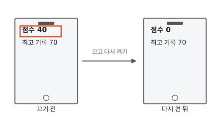
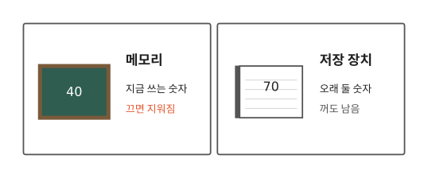
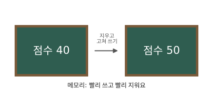
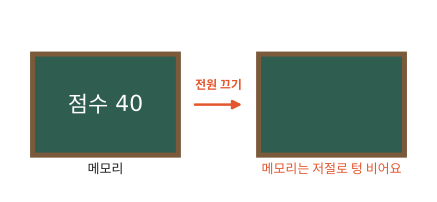
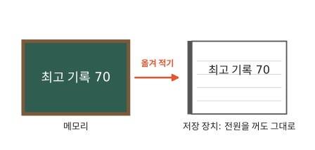
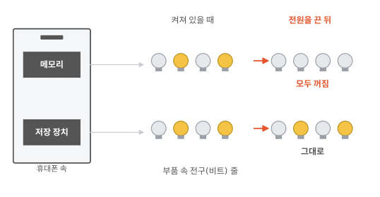

# 컴퓨터는 어디에 기억해 두나요?

## 끄면 사라지는 점수, 남는 최고 기록

게임을 하다가 휴대폰을 껐어요. 다시 켜 보니, 하던 판의 점수 40은 없어지고 0부터 다시 시작해요. 그런데 최고 기록 70은 그대로 남아 있어요.

왜 점수는 사라지고, 최고 기록은 남았을까요?

## 숫자를 두는 곳은 두 군데

비밀은 컴퓨터가 숫자를 적어 두는 자리에 있어요. 자리가 하나가 아니거든요. 칠판 같은 자리와 공책 같은 자리, 두 군데가 있어요.

## 지금 쓰는 숫자는 칠판에

게임을 하는 동안 점수는 쉴 새 없이 바뀌어요. 40이었다가 50이 되고, 또 60이 돼요. 자꾸 바뀌는 숫자는 빨리 쓰고 빨리 지울 수 있는 곳에 적어야 편해요. 교실 칠판이 딱 그래요.

컴퓨터에도 칠판 같은 자리가 있어요. 이 자리의 이름은 **메모리**예요. 하던 판의 점수는 메모리에 적혀 있어요.

## 전원을 끄면 메모리는 지워져요

수업이 끝나면 칠판을 지우지요? 메모리도 비슷해요. 휴대폰을 끄면 메모리에 적힌 숫자는 모두 지워져요. 아까 점수 40이 없어진 것도 그래서예요.

메모리는 누가 지우개로 지우지 않아도 저절로 지워져요. 4편에서 본 전구를 떠올려 봐요. 전기가 끊기면 켜져 있던 전구가 모두 꺼지지요? 메모리의 숫자도 그렇게 사라져요. 진짜 칠판은 누가 지워야 하니까, 이 점은 칠판과 달라요.

## 오래 둘 숫자는 공책에

최고 기록은 다음에 켤 때도 남아 있어야 해요. 그러니 꺼도 안 지워지는 곳에 적어 둬야겠지요? 우리도 중요한 건 공책에 적어 두지요? 그것처럼요. 컴퓨터의 공책은 이름이 **저장 장치**예요.

컴퓨터의 공책, 그러니까 저장 장치는 메모리보다 느려요. 그래서 컴퓨터는 숫자가 바뀔 때마다 공책에 쓰지 않아요. 새 최고 기록이 생기면, 그때 공책으로 옮겨 적어요.

게임 화면에 "저장 중…"이 뜰 때가 있지요? 그때 컴퓨터는 칠판의 숫자를 공책으로 옮겨 적고 있어요.

## 진짜 휴대폰 속에도 두 곳이 있어요

휴대폰 속에는 메모리와 저장 장치가 따로 들어 있어요. 둘 다 속에는 4편에서 본 전구가 아주아주 많아요.

다른 점은 하나예요. 저장 장치의 전구는 특별하게 만들어져서, 전기가 끊겨도 꺼지지 않아요. 그림처럼 전원을 끄면 메모리 전구는 다 꺼지고, 저장 장치 전구는 그대로예요.

가끔 휴대폰에 "저장 공간이 부족합니다"가 뜨지요? 저장 장치라는 공책이 꽉 차서 더 적을 데가 없다는 말이에요.

## 정리

- **메모리**: 지금 쓰는 숫자를 두는 곳이에요. 빠르지만 끄면 지워져요.
- **저장 장치**: 오래 둘 숫자를 두는 곳이에요. 꺼도 남아요.

## 해 보기: 칠판과 공책 놀이

친구 한 명과 해요. 작은 화이트보드나 종이 한 장을 칠판으로, 공책 한 권을 공책으로 써요.

1. 칠판에 0을 적고, 주사위를 다섯 번 굴려요. 나온 수를 더해서 칠판을 고쳐 적어요. 예를 들어 3이 나오면 3, 다음에 4가 나오면 7이에요.
2. 다섯 번이 끝나면 합을 공책에 "최고 기록"으로 적어요.
3. "전원 끄기!"라고 외치고 칠판을 깨끗이 지워요.
4. 1번부터 다시 해요. 이번 합이 공책의 최고 기록보다 크면 공책을 고쳐 적어요. 작으면 공책은 그대로 둬요.

칠판에만 있던 수는 사라지고, 공책에 적은 수만 남지요?

## 확인 문제

??? question "1. 저장하지 않은 그림"
    그림 앱에서 그림을 그리다가, 저장하지 않고 휴대폰을 껐어요. 다시 켜면 그림이 남아 있을까요? 왜 그럴까요?

    **풀이**: 남아 있지 않아요. 그림이 메모리에만 있었는데, 끄면 메모리는 지워져요.

??? question "2. 최고 기록은 어디에"
    게임 최고 기록은 메모리와 저장 장치 중 어디에 있어야 할까요?

    **풀이**: 저장 장치예요. 다음에 켤 때도 남아 있어야 하니까요.

??? question "3. 칠판과 메모리"
    칠판과 메모리는 어떤 점이 같고, 어떤 점이 다를까요?

    **풀이**: 같은 점은 빨리 쓰고 지울 수 있고, 오래 남지 않는다는 거예요. 다른 점은, 칠판은 누가 지워야 하지만 메모리는 전원이 꺼지면 저절로 지워진다는 거예요.

!!! abstract "어른을 위한 정리 (건너뛰어도 돼요)"
    - 문서나 그림 앱의 "저장" 버튼은 메모리에 있는 것을 저장 장치로 옮기는 일이에요. 저장하지 않고 끄면 사라지는 이유예요.
    - 휴대폰 사양에 "램 8GB, 저장 공간 128GB"처럼 적혀 있다면, 램이 메모리이고 저장 공간이 저장 장치예요.
    - 흔히 "휴대폰 메모리가 꽉 찼다"고 할 때는 사실 저장 장치를 말해요. 이 글에서 메모리는 끄면 지워지는 쪽만 가리켜요.
    - 저장 장치(플래시 메모리)는 작은 칸에 전기를 가둬 두는 방식으로 비트를 적어요. 그래서 전원이 없어도 남아요.

## 더 깊이

??? info "저장 장치는 어떻게 꺼도 남을까"
    저장 장치(플래시 메모리)는 아주 작은 칸에 전기를 가둬 두는 방식으로 비트를 적어요. 가둬 둔 전기는 밖에서 전기가 끊겨도 빠져나가지 않아서, 켜진 비트가 그대로 남아요.

??? info "진짜 이름들"
    메모리의 정식 이름은 램(RAM)이에요. 저장 장치에는 휴대폰에 많이 쓰는 플래시 메모리, 컴퓨터에 많이 쓰는 SSD 같은 종류가 있어요.

??? info "왜 둘로 나눌까"
    메모리는 저장 장치보다 훨씬 빨리 쓰고 읽을 수 있어요. 그래서 일은 메모리에서 하고, 오래 둘 것만 저장 장치에 옮겨 둬요. 대신 메모리는 전기가 있어야만 기억해요.

??? info "메모리 칸에도 번호가 있어요"
    메모리의 칸에는 사물함처럼 번호가 붙어 있어요. 컴퓨터는 이 번호로 "몇 번 칸의 숫자를 꺼내 와"라고 해요. 이 이야기는 알고리즘 편에서 다시 만나요.
