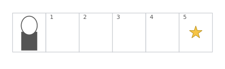
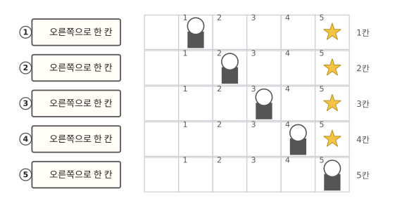
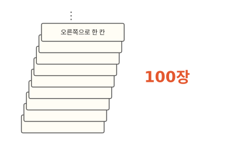
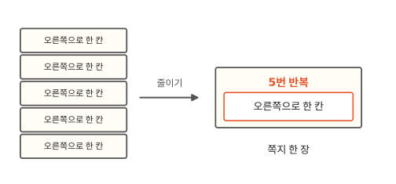
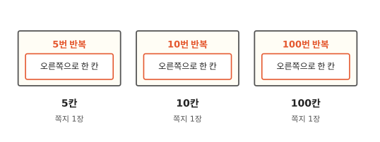
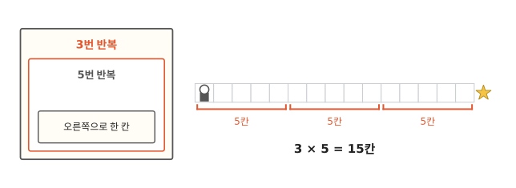
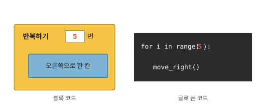

# 코드와 반복: 쪽지 한 장으로 백 칸 가기

게임 속 캐릭터를 오른쪽으로 다섯 칸 보내서 별을 먹게 하고 싶어요. [1편](01-what-computers-do.md)에서 컴퓨터는 사람이 쪽지에 적어 둔 명령어대로만 움직인다고 했어요. 이 글을 읽고 나면 캐릭터를 움직이는 쪽지를 어떻게 적는지 알게 돼요. 같은 쪽지가 수십 장 필요할 때 한 장으로 줄이는 방법도요. 이 방법은 학교 코딩 시간에 쓰는 블록에도 들어 있어요.

!!! abstract "이 글에서 알게 되는 것"
    1. 컴퓨터에게 시킬 명령어를 차례로 적어 둔 것을 코드라고 해요. 컴퓨터는 맨 위 쪽지부터 차례로 해요.
    2. 같은 명령어를 여러 번 시킬 때는 "5번 반복"처럼 한 번만 적어요. 이렇게 적는 걸 반복이라고 해요.
    3. 반복 쪽지는 숫자만 바꾸면 백 칸도 가요. 쪽지는 한 장이어도 컴퓨터는 한 칸 가기를 백 번 다 해요.

## 1. 명령어를 차례로 적은 쪽지 묶음이 코드예요

아래 그림에서 캐릭터와 별 사이가 몇 칸인지 세어 보세요.

**그림 1.** 캐릭터가 별에 닿으려면 오른쪽으로 다섯 칸 가야 해요.
{ .fig-cap }

캐릭터를 한 칸 옮기는 명령어를 "오른쪽으로 한 칸"이라고 해 볼게요. 다섯 칸을 가야 하니까 이 쪽지를 다섯 장 적어요. 컴퓨터는 맨 위 쪽지부터 차례로 해요. 아래 그림에서 쪽지 번호와 캐릭터가 선 칸을 줄마다 맞춰 보세요.

**그림 2.** 쪽지 한 장을 할 때마다 캐릭터가 한 칸씩 가요. 다섯 장을 다 하면 별에 닿아요.
{ .fig-cap }

1번 쪽지를 하면 한 칸, 2번 쪽지를 하면 또 한 칸이에요. 다섯 장을 다 하면 캐릭터가 별에 닿아요.

이렇게 컴퓨터에게 시킬 명령어를 차례로 적어 둔 것을 **코드**라고 해요. 1편에서 게임을 만든 사람이 적어 둔 쪽지 네 장도 코드였어요.

## 2. 같은 쪽지가 많으면 반복 쪽지 한 장으로 줄여요

다섯 칸은 쪽지 다섯 장이면 됐어요. 그런데 별이 백 칸 떨어져 있으면 어떨까요? 아래 그림처럼 같은 쪽지를 백 장이나 적어야 해요.

**그림 3.** 백 칸을 가려면 똑같은 쪽지가 100장 필요해요.
{ .fig-cap }

적기도 힘들고 몇 장 적었는지 세다가 헷갈리기도 쉬워요. 줄넘기를 떠올려 보세요. 체육 선생님은 "뛰어, 뛰어, 뛰어…"를 스무 번 말하지 않아요. "스무 번 뛰어!" 한 번이면 돼요.

코드도 그렇게 적어요. 쪽지 한 장에 "5번 반복"이라고 쓰고 그 안에 "오른쪽으로 한 칸"을 넣어요. 아래 그림에서 왼쪽 다섯 장과 오른쪽 한 장을 비교해 보세요.

**그림 4.** 같은 쪽지 다섯 장이 "5번 반복" 쪽지 한 장으로 줄었어요.
{ .fig-cap }

이 쪽지 한 장이면 캐릭터가 다섯 칸을 가요. 컴퓨터는 빨간 테두리 안의 "오른쪽으로 한 칸"을 다섯 번 해요. 이렇게 한 번만 적고 여러 번 시키는 걸 **반복**이라고 해요.

줄넘기를 세다 보면 몇 번 했는지 헷갈릴 때가 있죠? 컴퓨터는 헷갈리지 않아요. 다섯 번이라고 적으면 꼭 다섯 번 해요.

## 3. 숫자만 바꾸면 백 칸도 가요

반복 쪽지가 생겼으니 백 칸 문제도 풀 수 있어요. 아래 그림에서 세 쪽지가 서로 어디가 다른지 찾아보세요.

**그림 5.** 빨간 숫자만 5, 10, 100으로 바뀌었어요. 쪽지는 계속 한 장이에요.
{ .fig-cap }

열 칸을 가야 하면 "10번 반복", 백 칸이면 "100번 반복"으로 숫자만 바꿔요. 쪽지를 더 적을 필요가 없어요.

여기서 하나 헷갈리면 안 되는 게 있어요. 쪽지는 한 장이지만 캐릭터는 백 칸을 다 걸어가요. 컴퓨터가 "오른쪽으로 한 칸"을 정말로 100번 하거든요. 적는 건 짧아져도 컴퓨터가 하는 일의 양은 그대로예요. 그래도 1편에서 본 것처럼 컴퓨터는 아주 빨라서 금방 끝나요. 일이 얼마나 늘어나는지 세는 법은 알고리즘 [1편](../algorithms/01-why-big-o.md)에서 봐요.

숫자 대신 "계속 반복"이라고 적을 수도 있어요. 그러면 컴퓨터는 멈추지 않고 되풀이해요. 게임이 화면을 쉬지 않고 다시 그리는 것도 이런 반복이에요. 그런데 멈출 방법을 적어 두지 않고 잘못 쓰면 앱이 멈춘 것처럼 보여요.

## 4. 반복 안에 반복을 넣을 수도 있어요

반복 쪽지 안에는 아무 명령어나 넣을 수 있어요. 반복 쪽지를 또 넣어도 돼요. 아래 그림의 왼쪽 쪽지를 바깥부터 읽어 보세요.

**그림 6.** "5번 반복"을 3번 하니까 캐릭터는 5칸씩 세 번, 모두 15칸을 가요.
{ .fig-cap }

바깥 쪽지는 "3번 반복"이에요. 그 안의 "5번 반복"을 한 번 하면 캐릭터가 다섯 칸을 가요. 이걸 세 번 하니까 다섯 칸씩 세 번이에요. 한 칸 가기를 모두 3 × 5 = 15번 해요.

## 5. 진짜 코드도 같은 모양이에요

지금까지는 쪽지로 코드를 적었어요. 진짜 코드도 모양만 다르고 짜임은 같아요. 아래 그림에서 빨간 5가 어디에 있는지 보세요.

**그림 7.** 블록 코드도 글로 쓴 코드도 "5번 반복" 안에 "오른쪽으로 한 칸"이 들어 있어요.
{ .fig-cap }

왼쪽은 학교 코딩 시간에 쓰는 블록 코드예요. "반복하기" 블록 안에 "오른쪽으로 한 칸" 블록을 끼우고 몇 번 할지 숫자를 적어요. 그림 4의 반복 쪽지와 생김새가 거의 같죠.

오른쪽은 파이썬으로 쓴 코드예요. 파이썬은 코드를 글로 적을 때 쓰는 말 가운데 하나예요. 첫 줄 괄호 안의 빨간 5가 "5번"이에요. 첫 줄 전체가 "5번 반복"이라는 뜻이에요. 둘째 줄 `move_right()`는 "오른쪽으로 한 칸"이에요. 둘째 줄이 오른쪽으로 들어가 있죠? 들어간 줄이 반복 쪽지 안에 넣은 명령어라는 표시예요. 나머지 영어는 몰라도 괜찮아요. 이 코드를 직접 돌려 볼 수 있는 파일은 [`lab/c06_repeat.py`](https://github.com/oya150/bedrock/blob/main/lab/c06_repeat.py)에 있어요.

## 확인 문제

??? question "1. 손뼉은 몇 번?"
    반복 쪽지 맨 위에 "3번 반복", 그 안에 "손뼉 치기"가 적혀 있어요. 손뼉을 몇 번 칠까요?

    **풀이**: 3번이에요. 쪽지에 3번이라고 적혀 있으니까요.

??? question "2. 반복 쪽지로 바꿔 쓰기"
    "오른쪽으로 한 칸" 쪽지가 네 장 있어요. 반복 쪽지 한 장으로 바꿔 써 보세요.

    **풀이**: 쪽지 맨 위에 "4번 반복"이라고 쓰고 그 안에 "오른쪽으로 한 칸"을 넣어요.

??? question "3. 쪽지는 몇 장, 한 칸 가기는 몇 번?"
    반복 쪽지의 숫자를 "100번 반복"으로 바꿨어요. 안에는 "오른쪽으로 한 칸"이 그대로 있어요. 쪽지는 몇 장이고 컴퓨터는 한 칸 가기를 몇 번 할까요?

    **풀이**: 쪽지는 한 장이에요. 그래도 컴퓨터는 한 칸 가기를 100번 해요.

## 정리

캐릭터를 다섯 칸 보내려고 "오른쪽으로 한 칸" 쪽지를 다섯 장 적었어요. 컴퓨터는 맨 위부터 차례로 해서 별에 닿았어요. 이렇게 컴퓨터에게 시킬 명령어를 차례로 적어 둔 것이 코드예요.

같은 쪽지가 백 장 필요할 때는 "100번 반복" 쪽지 한 장에 "오른쪽으로 한 칸"을 넣어요. 한 번만 적고 여러 번 시키는 이 방법이 반복이에요. 숫자만 바꾸면 몇 칸이든 갈 수 있고 반복 안에 반복을 넣을 수도 있어요. 쪽지가 짧아져도 컴퓨터는 적힌 횟수만큼 다 해요.

[7편](07-can-computers-be-wrong.md)에서는 쪽지가 틀렸을 때 컴퓨터가 어떻게 움직이는지 봐요.

### 새로 나온 말

- **코드**: 컴퓨터에게 시킬 명령어를 차례로 적어 둔 것. "오른쪽으로 한 칸" 쪽지 다섯 장이 코드였어요.
- **반복**: 명령어를 한 번만 적고 여러 번 시키는 것. "5번 반복" 쪽지 한 장으로 캐릭터가 다섯 칸을 갔어요.
