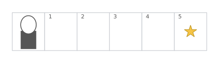
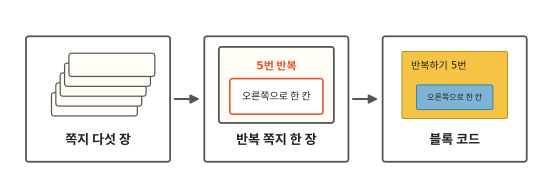
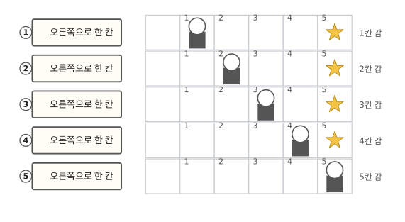
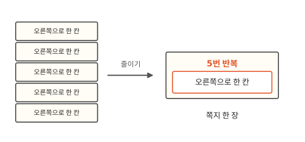
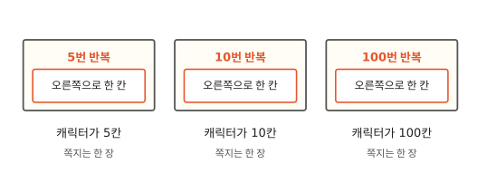
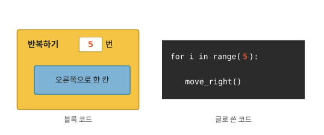

# 컴퓨터에게 일을 어떻게 시키나요?

## 별까지 다섯 칸



게임에서 캐릭터가 오른쪽으로 한 칸씩, 다섯 번 가서 별을 먹어요.

1편에서 컴퓨터는 사람이 적어 둔 쪽지대로만 움직인다고 했지요? 캐릭터를 다섯 칸 보내는 쪽지는 어떻게 생겼을까요?

## 쪽지에서 반복까지



끝까지 읽으면 쪽지 다섯 장이 한 장으로 줄어들어요.

## 명령어를 적은 쪽지, 코드



"오른쪽으로 한 칸" 쪽지를 다섯 장 적어요. 컴퓨터는 맨 위 쪽지부터 차례로 해요. 1번 쪽지에 한 칸, 2번 쪽지에 또 한 칸. 다섯 장을 다 하면 캐릭터가 별에 닿아요.

컴퓨터에게 시킬 일을 이렇게 적어 둔 것을 **코드**라고 해요. 1편의 명령어 쪽지 묶음도 코드였어요.

## 백 칸이면 쪽지가 백 장?



별이 백 칸 떨어져 있으면 어떨까요? 같은 쪽지를 백 장이나 적어야 해요.

줄넘기를 떠올려 봐요. 체육 선생님은 "뛰어, 뛰어, 뛰어…"를 스무 번 말하지 않아요. "스무 번 뛰어!" 한 번이면 돼요.

코드도 그렇게 적어요. 쪽지 한 장에 "5번 반복"이라고 쓰고, 그 밑에 "오른쪽으로 한 칸"을 써요. 이 쪽지 한 장이면 다섯 칸을 가요.

이렇게 한 번만 적고 여러 번 시키는 걸 **반복**이라고 불러요.

줄넘기를 세다 보면 몇 번 했는지 헷갈릴 때가 있지요? 컴퓨터는 안 헷갈려요. 다섯 번이라고 적으면 꼭 다섯 번 해요.

## 숫자만 바꾸면 돼요



열 칸을 가야 하면 "10번 반복", 백 칸이면 "100번 반복"으로 숫자만 바꿔요. 쪽지는 계속 한 장이에요.

쪽지는 한 장이지만, 캐릭터는 100칸을 다 걸어가요. 컴퓨터가 한 칸 가기를 100번 다 하거든요. 1편에서 본 것처럼 아주 빨라서 금방 끝나요.

## 진짜 코드는 이렇게 생겼어요



학교 코딩 시간에는 블록을 끼워서 코드를 만들기도 해요. "반복하기" 블록 안에 "오른쪽으로 한 칸" 블록을 끼우고, 몇 번 할지 숫자를 적어요.

그림 오른쪽은 어른들이 영어로 쓴 코드예요. 첫 줄 괄호 안의 빨간 5가 "다섯 번"이라는 뜻이고, 둘째 줄 `move_right`는 "오른쪽으로 한 칸"이에요. 나머지 영어는 몰라도 괜찮아요.

## 정리

- **코드**: 컴퓨터에게 시킬 명령어를 적어 둔 것이에요.
- **반복**: 한 번만 적고 여러 번 시키는 것이에요. 컴퓨터는 적힌 만큼 다 해요.

## 해 보기: 친구 로봇 놀이

친구 한 명과 해요. 한 명은 로봇, 한 명은 코드를 적는 사람이에요.

1. 바닥에 칸을 줄지어 그려요. 보도블록 줄을 써도 돼요. 로봇이 가야 할 칸을 하나 골라요.
2. 코드 적는 사람이 쪽지에 "앞으로 한 칸", "손뼉 치기" 같은 명령어를 적어요.
3. 로봇은 쪽지를 위에서부터 차례로, 적힌 대로만 해요.
4. 같은 쪽지가 여러 장 있으면 "몇 번 반복" 쪽지 한 장으로 바꿔서 다시 해 봐요. 반복 쪽지 안에는 "손뼉 치기"처럼 아무 명령어나 넣을 수 있어요.

## 확인 문제

??? question "1. 손뼉은 몇 번?"
    반복 쪽지 맨 위에 "3번 반복", 그 밑에 "손뼉 치기"가 적혀 있어요. 손뼉을 몇 번 칠까요?

    **풀이**: 3번이에요. 쪽지에 3번이라고 적혀 있으니까요.

??? question "2. 반복 쪽지로 바꿔 쓰기"
    "오른쪽으로 한 칸" 쪽지가 네 장 있어요. 반복 쪽지 한 장으로 바꿔 써 보세요.

    **풀이**: 쪽지 맨 위에 "4번 반복"이라고 쓰고, 그 밑에 "오른쪽으로 한 칸"을 써요.

??? question "3. 쪽지는 몇 장, 일은 몇 번?"
    반복 쪽지의 숫자를 "100번 반복"으로 바꿨어요. 그 밑에는 "오른쪽으로 한 칸"이 그대로 있어요. 쪽지는 몇 장이고, 컴퓨터는 한 칸 가기를 몇 번 할까요?

    **풀이**: 쪽지는 한 장이에요. 그래도 컴퓨터는 한 칸 가기를 100번 해요.

!!! abstract "어른을 위한 정리 (건너뛰어도 돼요)"
    - 코드는 크게 보면 반복과 조건을 엮어 만든 것이에요. 조건은 "이럴 때만 해"라는 명령으로, 1편의 "점수가 더 크면 최고 기록에 적기"가 그 예예요. 프로그래밍의 기본 뼈대가 이 둘이에요.
    - 반복은 짧게 적히지만 일의 양은 횟수만큼이에요. 코드 줄 수와 실제로 걸리는 시간은 다를 수 있어요. 이 이야기는 알고리즘 주제의 [첫 편](../algorithms/01-why-big-o.md)에서 이어져요.

## 더 깊이

??? info "글로 쓴 코드는 어떻게 생겼을까"
    파이썬이라는 프로그래밍 언어로 "5번 반복: 오른쪽으로 한 칸"을 쓰면 이렇게 돼요.

    ```python
    for i in range(5):
        move_right()
    ```

    `for i in range(5):`가 "5번 반복"이고, 그 아래 한 칸 들여 쓴 줄이 반복할 일이에요. 직접 돌려 볼 수 있는 코드는 [`lab/c06_repeat.py`](https://github.com/oya150/bedrock/blob/main/lab/c06_repeat.py)에 있어요.

??? info "반복 안의 반복"
    "3번 반복: (5번 반복: 한 칸 가기)"처럼 반복 안에 반복을 넣을 수도 있어요. 그러면 한 칸 가기를 3 × 5 = 15번 해요.

??? info "끝나지 않는 반복"
    횟수를 정하지 않고 "계속 반복"라고 적을 수도 있어요. 게임이 화면을 계속 그리는 것도 이런 반복이에요. 그런데 멈출 방법 없이 잘못 적으면 앱이 멈춘 것처럼 보여요.
