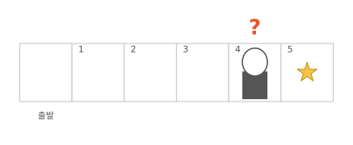
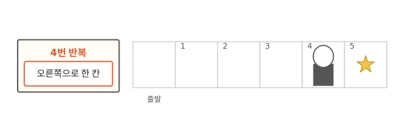
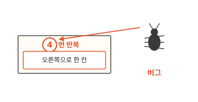
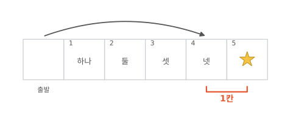
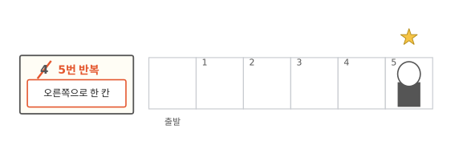
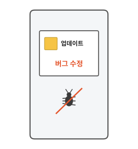

# 버그와 디버깅: 컴퓨터가 엉뚱하게 움직일 때

게임을 하다 보면 캐릭터가 엉뚱한 곳에서 멈출 때가 있어요. 별까지 한 칸만 더 가면 되는데 그 앞에서 딱 서 버리는 식이죠. 이 글을 읽고 나면 컴퓨터가 왜 이렇게 움직이는지 알게 돼요. 어디를 고치면 되는지도요.

!!! abstract "이 글에서 알게 되는 것"
    1. 컴퓨터는 쪽지에 적힌 대로만 움직여요. 쪽지가 틀리면 틀린 대로 움직여요.
    2. 쪽지 속에 숨어 있는 잘못을 버그라고 해요.
    3. 쪽지를 한 줄씩 따라 하며 칸을 세어 보면 버그가 보여요. 버그를 찾아 고치는 일을 디버깅이라고 해요.

## 1. 컴퓨터는 쪽지에 적힌 대로만 움직여요

[6편](06-how-to-tell-computers.md)에서 캐릭터를 별까지 보내는 쪽지를 적었어요. 이 쪽지 묶음을 코드라고 불렀죠. 이번에도 별은 출발 칸에서 오른쪽으로 다섯 칸 떨어진 5번 칸에 있어요.

그런데 게임을 켜 보니 이상해요. 아래 그림에서 캐릭터가 선 칸을 보세요.

**그림 1.** 별은 5번 칸에 있는데 캐릭터는 4번 칸에서 멈췄어요.
{ .fig-cap }

왜 멈췄을까요? 컴퓨터가 읽은 쪽지를 길 옆에 놓고 볼게요. 아래 그림에서 쪽지 맨 위의 숫자를 보세요.

**그림 2.** 쪽지에 "4번 반복"이라고 적혀 있어서 캐릭터가 네 칸만 갔어요.
{ .fig-cap }

쪽지에는 "4번 반복"이라고 적혀 있어요. 쪽지를 적던 사람이 5를 써야 할 자리에 실수로 4를 썼어요. 컴퓨터는 쪽지대로 "오른쪽으로 한 칸"을 네 번 하고 멈춰요. 그래서 캐릭터는 4번 칸에 서요.

여기서 이런 생각이 들 거예요. "별이 바로 옆에 있는데 한 칸 더 가면 되잖아?" 컴퓨터는 그런 생각을 하지 않아요. 별을 먹는 게 목표라는 것도 몰라요. [1편](01-what-computers-do.md)에서 본 것처럼 컴퓨터는 적힌 대로만 해요. 쪽지에 네 번이라고 적혀 있으면 네 번 하고 끝이에요.

컴퓨터는 시킨 일을 하나도 빼먹지 않고 했어요. 틀린 곳은 쪽지에 있어요.

## 2. 쪽지 속에 숨은 잘못을 버그라고 해요

캐릭터가 멈춘 까닭이 쪽지에 있었으니 고칠 곳도 쪽지예요.

쪽지 속에 숨어 있는 이런 잘못을 **버그**라고 불러요. 버그는 영어로 벌레라는 뜻이에요. 작은 벌레가 몰래 숨어서 일을 망치는 모습을 떠올리면 돼요.

아래 그림에서 벌레가 가리키는 곳을 보세요.

**그림 3.** 이 쪽지의 버그는 숫자 4 하나예요.
{ .fig-cap }

쪽지에 적힌 건 "4번 반복"과 "오른쪽으로 한 칸" 두 가지예요. 캐릭터는 오른쪽으로 가야 하니까 "오른쪽으로 한 칸"은 맞아요. 틀린 건 4뿐이에요. 숫자 하나가 틀렸을 뿐인데 캐릭터는 별을 못 먹었어요.

친구에게 쪽지를 주고 그대로 걸어 보라고 하면 어떨까요? 칸이 끝났는데 쪽지에 "오른쪽으로 한 칸"이 또 있으면 친구는 "어? 칸이 없는데?" 하고 멈출 수 있어요. 컴퓨터는 멈칫하지 않아요. 쪽지에 버그가 있으면 버그까지 그대로 따라 해요.

컴퓨터가 망가져서 생기는 고장도 있어요. 화면이 깨지거나 전원이 안 켜지는 것처럼요. 그때는 부품을 고치거나 바꿔야 해요. 버그는 다른 일이에요. 부품은 멀쩡하고 쪽지가 틀린 거라서 쪽지를 고쳐야 해요.

## 3. 쪽지를 따라 칸을 세면 버그가 보여요

이번 쪽지는 두 줄뿐이라서 4가 틀린 걸 금방 알 수 있었어요. 쪽지가 길어지면 어디가 틀렸는지 한눈에 보이지 않아요. 그럴 때 쓰는 방법이 있어요. 내가 컴퓨터가 된 것처럼 쪽지를 한 줄씩 따라 해 보는 거예요.

쪽지 첫 줄은 "4번 반복"이에요. 손가락을 출발 칸에 올려요. "오른쪽으로 한 칸"을 할 때마다 손가락을 한 칸 옮기면서 소리 내어 세어요. "하나, 둘, 셋, 넷." 네 번 했으니 반복이 끝나요.

아래 그림에서 화살표가 멈춘 칸과 별이 있는 칸을 보세요.

**그림 4.** 넷까지 세면 4번 칸에서 끝나서 별까지 한 칸이 남아요.
{ .fig-cap }

손가락은 4번 칸에 있고 별은 5번 칸에 있어요. 한 칸이 모자라요. 그 한 칸을 모자라게 만든 건 반복 횟수 4예요.

이렇게 쪽지를 따라 하다 보면 "내가 바란 것"과 "실제로 일어난 것"이 갈라지는 곳이 나와요. 이번에는 "5번 칸까지 가길 바랐는데 4번 칸에서 멈췄다"가 그곳이에요. 버그는 거기에 있어요.

## 4. 버그를 찾아 고치는 일이 디버깅이에요

버그를 찾았으니 고칠 차례예요. 쪽지의 4를 5로 고치고 다시 해 봐요.

아래 그림에서 고친 숫자와 캐릭터가 선 칸을 보세요.

**그림 5.** 4를 5로 고치자 캐릭터가 5번 칸까지 가서 별에 닿았어요.
{ .fig-cap }

이번에는 컴퓨터가 "오른쪽으로 한 칸"을 다섯 번 해요. 캐릭터가 5번 칸에 닿아서 별을 먹어요.

버그를 찾아서 고치는 일을 **디버깅**이라고 해요. 버그를 없앤다는 뜻이에요. 방금 한 일이 디버깅이에요. 쪽지를 따라 칸을 세서 버그를 찾았고 숫자 하나를 고쳤어요.

고친 다음에는 꼭 다시 해 봐야 해요. 4를 다른 숫자로 잘못 고쳤을 수도 있으니까요. 캐릭터가 별에 닿는 걸 눈으로 봐야 정말 고쳐진 거예요.

## 5. 휴대폰 앱도 버그를 고쳐서 다시 보내 줘요

휴대폰 게임이나 앱이 업데이트를 할 때가 있죠? 업데이트는 새로 고친 것을 받아서 앱이 바뀌는 일이에요. 그때 나오는 설명에 "버그를 고쳤어요"라고 적혀 있을 때가 많아요.

아래 그림은 그런 업데이트 알림을 간단히 그린 거예요. 빨간 글씨와 줄이 그어진 벌레를 보세요.

**그림 6.** 업데이트 알림에 버그를 고쳤다는 말이 적혀 있어요.
{ .fig-cap }

앱도 코드로 만들어요. 앱을 만든 사람도 우리가 한 것처럼 코드를 따라가며 버그를 찾아 고쳐요. 그리고 고친 코드를 휴대폰으로 다시 보내 줘요. 우리가 받는 업데이트가 그거예요.

## 확인 문제

??? question "1. 어디서 멈출까요?"
    별까지 세 칸이에요. 그런데 반복 쪽지에 "2번 반복", 그 밑에 "오른쪽으로 한 칸"이 적혀 있어요. 캐릭터는 몇 번 칸에서 멈출까요? 쪽지의 어디를 고쳐야 할까요?

    **풀이**: 2번 칸에서 멈춰요. 쪽지의 2를 3으로 고치면 별에 닿아요.

??? question "2. 손뼉이 너무 많아요"
    캐릭터가 손뼉을 세 번 치게 하고 싶었어요. 그런데 캐릭터가 손뼉을 다섯 번 쳤어요. 쪽지에는 "5번 반복", 그 밑에 "손뼉 치기"가 적혀 있어요. 버그는 어디에 있을까요?

    **풀이**: 쪽지의 5가 버그예요. 3으로 고쳐요. 캐릭터는 적힌 대로 다섯 번 친 거예요.

??? info "버그라는 이름은 어디서 왔을까요"
    1947년 미국 하버드 대학의 Mark II라는 컴퓨터 부품 사이에서 진짜 나방이 나왔어요. 일하던 사람들은 나방을 작업 일지에 테이프로 붙이고 "버그가 발견된 첫 진짜 사례"라고 적었어요. 이 일지는 지금 미국 스미스소니언 국립 미국역사박물관에 있어요.[^moth]

    "진짜"라고 적은 걸 보면 그 사람들은 이미 버그라는 말을 쓰고 있었어요. 발명가 에디슨도 1878년 편지에서 기계의 작은 문제를 버그라고 불렀어요.[^edison]

## 정리

컴퓨터는 쪽지에 적힌 대로만 움직여요. 쪽지에 "4번 반복"이라고 적혀 있으면 별이 바로 옆에 있어도 네 칸만 가고 멈춰요. 쪽지 속에 숨은 이런 잘못을 버그라고 해요.

버그를 찾으려면 내가 컴퓨터가 된 것처럼 쪽지를 한 줄씩 따라 하면서 칸을 세어 봐요. 바란 곳과 실제로 간 곳이 갈라지는 데에 버그가 있어요. 버그를 찾아 고치고 다시 해 보는 일을 디버깅이라고 해요. 휴대폰 앱의 업데이트도 이렇게 고친 코드를 보내 주는 일이에요.

[8편](08-how-videos-move.md)에서는 휴대폰 화면 속 영상이 어떻게 움직이는지 볼게요.

### 새로 나온 말

- **버그**: 코드(쪽지 묶음) 속에 숨어 있는 잘못. 이 글에서는 5를 써야 할 자리에 쓴 4가 버그였어요.
- **디버깅**: 버그를 찾아 고치는 일. 쪽지를 따라 칸을 세서 4를 찾고 5로 고쳤어요.
- **업데이트**: 앱을 만든 사람이 고친 것을 받아서 앱이 바뀌는 일.

[^moth]: [Smithsonian National Museum of American History, Log Book With Computer Bug](https://www.si.edu/object/log-book-computer-bug:nmah_334663).
[^edison]: [JSTOR Daily, The Bug in the Computer Bug Story](https://daily.jstor.org/the-bug-in-the-computer-bug-story/).
