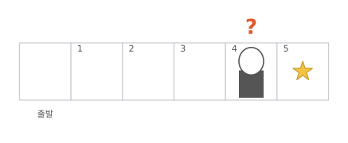
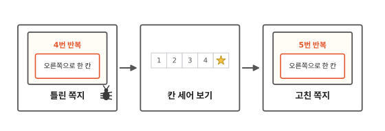
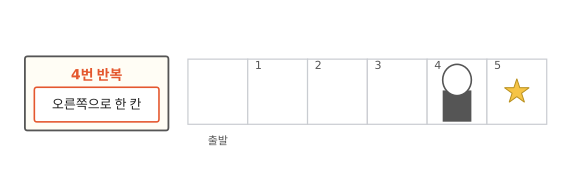
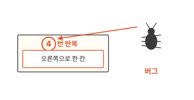
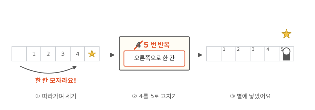
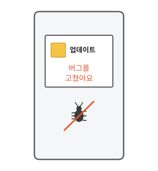

# 컴퓨터도 틀릴까요?

## 별 바로 앞에서 멈췄어요

게임을 하다가 캐릭터가 엉뚱한 곳에서 멈춘 적 있나요? 그림의 캐릭터는 출발 칸에서 떠나 4번 칸에 서 있어요. 한 칸만 더 가면 별인데, 움직이지 않아요.

컴퓨터가 실수한 걸까요?

## 틀린 쪽지에서 고친 쪽지까지

첫째 쪽지는 어디가 틀렸을까요? 끝까지 읽으면 직접 찾아서 고칠 수 있어요.

## 컴퓨터는 적힌 대로만 해요

그림처럼 별까지는 다섯 칸이에요. 그런데 쪽지를 적던 사람이 실수를 했어요. "4번 반복"이라고 적었어요. 6편에서 말한 것처럼, 컴퓨터에게 시킬 일을 쪽지에 적은 것이 코드예요.

컴퓨터는 쪽지를 읽고 "오른쪽으로 한 칸"을 네 번 하고 멈춰요. 쪽지에 네 번이라고 적혀 있으니까요.

"어? 별까지 한 칸 남았네." 컴퓨터는 그런 생각을 안 해요. 1편에서 본 것처럼, 컴퓨터는 적힌 대로만 하거든요.

## 쪽지 속 잘못, 버그

컴퓨터는 쪽지에 적힌 대로 했어요. 그러니 고칠 곳은 쪽지예요.

쪽지 속에 숨어 있는 이런 잘못을 **버그**라고 불러요. 버그는 영어로 벌레라는 뜻이에요. 여기서는 숫자 4가 버그예요. 잘못 적은 숫자 하나가 작은 벌레처럼 숨어서 일을 망쳤어요.

6편의 친구 로봇 놀이는 어땠을까요? 칸이 끝났는데 쪽지에 "앞으로 한 칸"이 또 있으면, 로봇을 하던 친구는 "어? 칸이 없는데?" 하고 멈출 수 있어요.

컴퓨터는 그러지 않아요. 쪽지에 적혀 있으면 그대로 해요.

## 버그를 찾아 고치기

버그는 어떻게 찾을까요? 내가 컴퓨터가 됐다고 생각해 봐요. 쪽지를 읽으면서 손가락으로 칸을 짚어 세어요. "한 칸, 두 칸, 세 칸, 네 칸. 반복 끝." 손가락은 4번 칸에서 멈췄는데 별은 5번 칸에 있어요. 한 칸이 모자라요. 쪽지의 4가 한 칸 모자란 숫자였던 거예요.

찾았으면 쪽지의 4를 5로 고쳐요. 다시 해 보면 캐릭터가 별에 닿아요.

버그를 찾아서 고치는 일을 **디버깅**이라고 해요. 버그를 없앤다는 뜻이에요.

## 진짜 앱도 버그를 고쳐요

휴대폰 게임이나 앱이 업데이트를 할 때가 있지요? 새로 고친 것을 받아서 바뀌는 일이에요. 그때 나오는 설명에 "버그를 고쳤어요"라고 적혀 있을 때가 많아요.

앱도 코드로 만들어요. 앱을 만든 사람이 코드에서 버그를 찾아 고쳐요. 그리고 고친 코드를 휴대폰으로 다시 보내 줘요. 그림에서 벌레에 줄을 그은 것처럼요.

## 정리

- **버그**: 쪽지(코드) 속에 숨어 있는 잘못이에요. 컴퓨터는 적힌 대로 하니까, 버그가 있으면 엉뚱한 일을 해요.
- **디버깅**: 버그를 찾아서 없애는 일이에요. 쪽지를 읽으면서 손가락으로 칸을 짚어 보면 찾을 수 있어요.

## 해 보기: 버그 찾기 로봇 놀이

둘이서 해요. 한 명은 로봇, 한 명은 쪽지를 적는 사람이에요.

1. 바닥에 칸 네 개를 줄지어 그려요. 맨 앞 칸은 출발 칸이에요. 맨 끝 칸에 신발 한 개를 놓아요.
2. 쪽지에 일부러 틀리게 적어요. 맨 위에 "2번 반복", 그 밑에 "앞으로 한 칸".
3. 로봇은 이상해도 멈추지 말고 쪽지대로만 움직여요. 신발 바로 앞 칸에서 멈추겠지요?
4. 둘이 같이 쪽지를 읽으며 칸을 세어 봐요. 틀린 숫자를 고쳐서 다시 해요.

잘되면 역할을 바꿔요. 쪽지 두 장의 순서를 바꾸는 버그를 넣어 봐도 좋아요.

## 확인 문제

??? question "1. 어디서 멈출까요?"
    별까지 세 칸이에요. 그런데 반복 쪽지에 "2번 반복", 그 밑에 "오른쪽으로 한 칸"이 적혀 있어요. 캐릭터는 몇 번 칸에서 멈출까요? 쪽지의 어디를 고쳐야 할까요?

    **풀이**: 2번 칸에서 멈춰요. 쪽지의 2를 3으로 고치면 별에 닿아요.

??? question "2. 손뼉이 너무 많아요"
    로봇이 손뼉을 세 번 치게 하고 싶었어요. 그런데 로봇이 손뼉을 다섯 번 쳤어요. 쪽지에는 "5번 반복", 그 밑에 "손뼉 치기"가 적혀 있어요. 버그는 어디에 있을까요?

    **풀이**: 쪽지의 5가 버그예요. 3으로 고쳐요. 로봇은 적힌 대로 다섯 번 친 거예요.

??? question "3. 친구에게 뭐라고 할까요?"
    친구가 "컴퓨터가 바보라서 틀렸어"라고 해요. 이 글을 읽었다면 친구에게 뭐라고 말해 줄 수 있을까요?

    **풀이**: "컴퓨터는 쪽지에 적힌 대로 했어. 쪽지에 버그가 있는지 같이 세어 보자."처럼 말해 줄 수 있어요.

!!! abstract "어른을 위한 정리 (건너뛰어도 돼요)"
    - 프로그램이 이상하게 움직일 때, 원인은 대개 코드에 있어요. 컴퓨터는 시킨 대로 했고 시킨 내용이 틀렸던 거예요. 아이가 "컴퓨터가 틀렸어"라고 하면 "쪽지에 뭐라고 적혀 있었을까?" 하고 되물어 주세요.
    - 한 줄씩 따라가며 "생각한 것"과 "실제로 일어난 것"이 갈라지는 곳을 찾는 방법은 개발자들이 실제로 쓰는 디버깅의 기본이에요.

## 더 깊이

??? info "버그라는 말은 어디서 왔을까"
    1947년, 미국 하버드 대학의 Mark II라는 컴퓨터 부품 사이에서 진짜 나방이 나왔어요. 일하던 사람들은 나방을 작업 일지에 테이프로 붙이고 "버그가 발견된 첫 진짜 사례"라고 적었어요. 이 일지는 지금 미국 스미스소니언 국립 미국역사박물관에 있어요.[^moth]

    "진짜"라고 적은 걸 보면, 그 사람들은 이미 버그라는 말을 쓰고 있었어요. 발명가 에디슨도 1878년 편지에서 기계의 작은 문제를 버그라고 불렀어요.[^edison]

??? info "망가진 것과 틀린 것"
    컴퓨터 부품이 망가져서 생기는 고장도 있어요. 화면이 깨지거나 전원이 안 켜지는 것처럼요. 이건 부품을 고치거나 바꿔야 해요. 버그는 부품이 멀쩡한데 코드가 틀린 경우라서, 코드를 고쳐야 해요.

??? info "버그를 미리 찾는 방법"
    개발자들은 앱을 내보내기 전에 컴퓨터에게 시험 문제를 내 봐요. "별까지 다섯 칸이면 캐릭터는 5번 칸에 있어야 해" 같은 문제를 코드로 적어 두고, 고칠 때마다 다시 풀게 해요. 이것을 테스트라고 불러요.

[^moth]: [Smithsonian National Museum of American History, Log Book With Computer Bug](https://www.si.edu/object/log-book-computer-bug:nmah_334663).
[^edison]: [JSTOR Daily, The Bug in the Computer Bug Story](https://daily.jstor.org/the-bug-in-the-computer-bug-story/).
