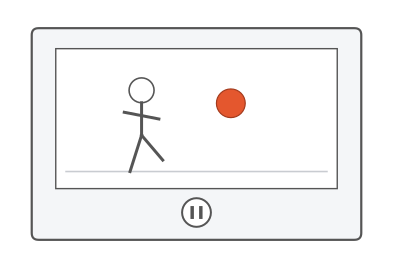
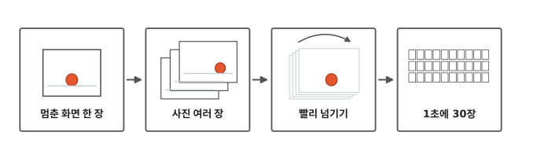
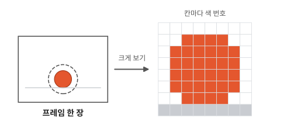
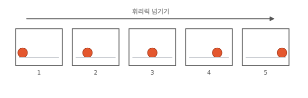
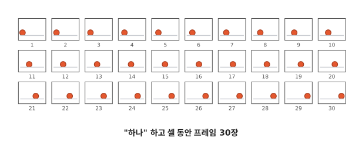
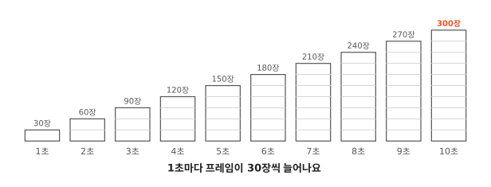

# 영상은 어떻게 움직일까요?

## 공중에 멈춘 공

휴대폰으로 영상을 보다가 멈춤 버튼을 눌러 본 적 있나요? 친구가 찬 공이 공중에 딱 멈춰요. 멈춘 화면은 꼭 사진 같아요.

영상 속에는 무엇이 들어 있을까요?

## 멈춘 화면에서 1초에 30장까지

그림 네 칸을 왼쪽부터 차례로 따라가요. 마지막에는 공책으로 직접 영상을 만들어 봐요.

## 멈추면 사진 한 장이 남아요

2편에서 사진은 작은 칸으로 되어 있고, 칸마다 색 번호가 있다고 했지요? 멈춘 화면도 그런 사진 한 장이에요. 크게 보면 칸이 보여요.

영상 속 사진 한 장을 **프레임**이라고 불러요. 생긴 건 사진과 똑같고, 영상 안에 있을 때 부르는 이름이에요. 영상은 프레임을 아주 많이 모아 둔 거예요.

## 사진이 어떻게 움직여요?

사진은 가만히 있잖아요. 그런데 영상 속 공은 굴러가요.

공책 구석에 공을 그려 봐요. 다음 장에는 공을 오른쪽으로 조금 옮겨 그리고, 또 다음 장에는 조금 더 옮겨 그려요. 이걸 휘리릭 넘기면 공이 굴러가요.

영상도 그래요. 공이 조금씩 다른 프레임을 빨리 바꿔 보여 줘요. 그러면 우리 눈에는 공이 굴러가는 것처럼 보여요.

## 1초에 30장

공책은 손으로 넘기니까 빨라졌다 느려졌다 해요. 그래서 공이 뚝뚝 끊겨 보이기도 해요. 컴퓨터는 프레임을 늘 똑같은 빠르기로 바꿔요. 휴대폰으로 찍은 영상은 보통 1초에 30장이에요.[^iphone] 1초는 "하나" 하고 셀 만큼의 짧은 시간이에요. 그동안 프레임 30장이 지나가요.

사람 손으로는 이렇게 못 넘기지만, 1편에서 본 것처럼 컴퓨터는 아주 빨라서 쉬워요.

## 영상은 숫자가 아주 많아요

1초 영상에는 프레임이 30장 있어요. 2초면 60장, 3초면 90장이에요. 이렇게 10초까지 세면 300장이 돼요.

프레임 한 장에는 2편의 사진처럼 색 번호가 가득 있어요. 프레임이 300장이면 색 번호도 아주 많겠지요?

그래서 영상을 많이 찍으면 휴대폰의 저장 장치(5편)가 금방 꽉 차요.

## 정리

- **프레임**: 영상 속 사진 한 장이에요. 영상은 프레임을 빨리 바꿔 보여 줘서 움직이는 것처럼 보여요.
- **1초에 30장**: 휴대폰 영상은 보통 "하나" 하고 셀 동안 프레임이 30장 지나가요.

## 해 보기: 공책 구석 영상

1. 공책이나 작은 메모지를 열 장 준비해요.
2. 첫 장 구석 아래쪽에 공을 하나 그려요.
3. 다음 장에는 공을 손톱만큼 옆에 그려요. 열 장까지 계속해요.
4. 엄지로 빠르게 넘겨 봐요. 공이 굴러가나요? 조금 끊겨 보여도 괜찮아요. 공이 움직이는 것처럼 보이면 성공이에요.
5. 이번에는 한 장씩 천천히 넘겨 봐요. 어떻게 보이나요?

## 확인 문제

??? question "1. 멈춘 화면 한 장"
    영상을 멈췄을 때 화면에 남는 사진 한 장을 뭐라고 부를까요?

    **풀이**: 프레임이에요.

??? question "2. 2초 동안 몇 장?"
    1초에 30장을 보여 주는 영상이에요. 2초 동안이면 프레임이 몇 장 지나갈까요?

    **풀이**: 30 + 30 = 60장이에요.

??? question "3. 아주 천천히 넘기면?"
    공책 구석 그림을 아주 천천히 한 장씩 넘기면 어떻게 보일까요?

    **풀이**: 공이 굴러가는 것처럼 보이지 않고, 그림이 한 장씩 따로 보여요.

!!! abstract "어른을 위한 정리 (건너뛰어도 돼요)"
    - 영상은 정지 화면(프레임)을 이어 놓은 것이에요. 휴대폰 기본 촬영은 대개 1초에 30장, 영화는 1초에 24장이에요.
    - 프레임이 많을수록, 화질이 좋을수록 파일이 커져요. 실제 영상 파일은 앞 프레임과 달라진 부분만 적어 두는 방식으로 크기를 크게 줄여요.

## 더 깊이

??? info "왜 움직이는 것처럼 보일까"
    예전에는 "눈에 그림이 잠깐 남아서"라고 설명했어요. 그런데 그림이 1초에 두 장만 바뀌어도 움직임을 느낄 수 있어서, 이 설명만으로는 모자라요. 지금은 머릿속에서 움직임을 알아채는 부분이 조금씩 다른 그림을 보고 "움직였다"고 느낀다고 보는 쪽이 많아요.[^motion]

??? info "바뀐 곳만 적어 두기"
    공이 굴러가는 동안 바닥과 하늘은 그대로예요. 그래서 실제 영상 파일은 프레임마다 모든 칸의 색 번호를 다 적지 않아요. 앞 장과 달라진 칸을 주로 적어 둬요. 이렇게 하면 영상이 훨씬 작아져요.

[^iphone]: 예를 들어 아이폰은 기본으로 1초에 30장을 찍어요. [Apple iPhone 사용 설명서, 비디오 녹화 설정 변경하기](https://support.apple.com/guide/iphone/change-video-recording-settings-iphc1827d32f/ios).
[^motion]: Steven M. LaValle, *Virtual Reality*, 6.2절 [Stroboscopic apparent motion](https://lavalle.pl/vr/node176.html).
