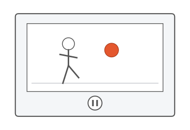
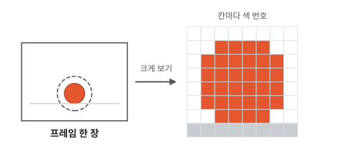
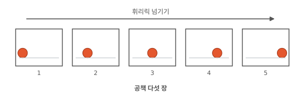
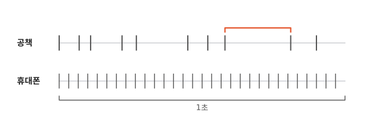
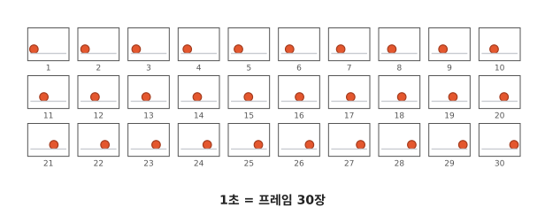
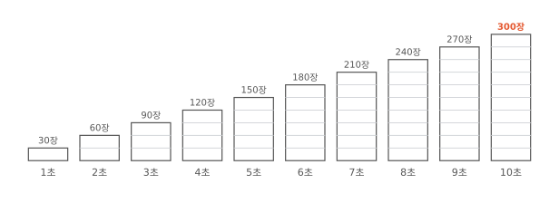
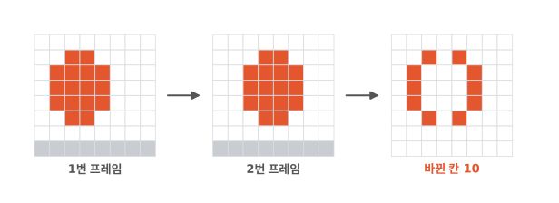

# 프레임: 영상이 움직여 보이는 까닭

휴대폰으로 친구가 공을 차는 영상을 보다가 멈춤 버튼을 누르면 공이 공중에 딱 멈춰요. 멈춘 화면은 꼭 사진 같죠. 이 글을 읽고 나면 사진처럼 가만히 있는 그림이 어떻게 움직이는 영상이 되는지 알게 돼요. 영상이 사진보다 휴대폰 저장 공간을 훨씬 많이 차지하는 까닭도 함께 보여요.

!!! abstract "이 글에서 알게 되는 것"
    1. 영상을 멈추면 사진 한 장이 남아요. 영상 속 사진 한 장을 프레임이라고 해요.
    2. 공이 조금씩 옮겨 간 프레임을 빨리 바꿔 보여 주면 공이 움직이는 것처럼 보여요.
    3. 휴대폰 영상은 보통 1초에 프레임 30장을 바꿔요. 그래서 영상을 많이 찍으면 저장 장치가 금방 차요.

## 1. 영상을 멈추면 사진 한 장이 남아요

아래 그림은 영상을 보다가 멈춘 휴대폰 화면이에요. 친구가 찬 공을 보세요.

**그림 1.** 멈춤 버튼을 누르자 친구가 찬 공이 공중에 멈췄어요.
{ .fig-cap }

[2편](02-how-computers-keep-pictures.md)에서 사진은 작은 네모 칸으로 되어 있고 칸마다 색 번호가 적혀 있다고 했어요. 이 칸을 픽셀이라고 불렀죠. 멈춘 화면도 그런 사진 한 장이에요. 공 둘레를 크게 키워 보면 칸이 보여요. 아래 그림 오른쪽의 칸들을 보세요.

**그림 2.** 멈춘 화면을 크게 보면 2편의 사진처럼 칸마다 색이 하나씩 들어 있어요.
{ .fig-cap }

영상 속 사진 한 장을 **프레임**이라고 불러요. 생긴 건 사진과 똑같아요. 영상 안에 있을 때 부르는 이름이에요. 영상은 이런 프레임을 아주 많이 모아 둔 거예요.

그런데 여기서 이런 생각이 들 거예요. 사진은 가만히 있는데 영상 속 공은 굴러가요. 사진을 모아 두기만 했는데 어떻게 움직일까요?

## 2. 조금씩 다른 그림을 빨리 넘기면 움직여 보여요

공책 구석에 그림을 그려서 알아볼게요. 첫 장 구석에 공을 하나 그려요. 다음 장에는 공을 손톱만큼 오른쪽에 그려요. 그다음 장에는 조금 더 오른쪽에 그려요.

아래 그림에서 공이 장마다 어디에 있는지 보세요.

**그림 3.** 1번부터 5번까지 장마다 공이 조금씩 오른쪽으로 가 있어요.
{ .fig-cap }

한 장 한 장은 멈춘 그림이에요. 그런데 엄지로 휘리릭 넘기면 공이 굴러가요. 공이 조금씩 다른 그림이 빠르게 바뀌면 우리 눈에는 공 하나가 움직이는 것처럼 보이거든요.

이번에는 한 장씩 천천히 넘겨 봐요. 공이 굴러가 보이지 않아요. 그림이 한 장씩 따로 보여요. 움직임으로 보이려면 빨리 넘겨야 해요.

영상도 똑같아요. 공이 조금씩 다른 프레임을 빨리 바꿔 보여 줘요. 그래서 공이 굴러가는 것처럼 보여요.

## 3. 휴대폰은 1초에 프레임 30장을 고르게 바꿔요

공책을 넘겨 보면 공이 뚝뚝 끊겨 보일 때가 있어요. 손으로 넘기니까 빨라졌다 느려졌다 하거든요. 아래 그림은 1초 동안 그림이 바뀌는 때마다 금을 하나씩 그은 거예요. 공책 줄의 빨간 괄호를 보세요.

**그림 4.** 공책은 넘기는 사이가 들쭉날쭉하고 휴대폰은 1초 동안 30번을 같은 사이로 바꿔요.
{ .fig-cap }

빨간 괄호는 손이 잠깐 멈칫한 곳이에요. 그동안 그림이 안 바뀌어서 공이 멈췄다가 툭 뛰는 것처럼 보여요. 휴대폰은 프레임을 늘 같은 빠르기로 바꿔요. 휴대폰으로 찍은 영상은 보통 1초에 30장이에요.[^iphone]

1초는 "하나" 하고 셀 만큼의 짧은 시간이에요. 그동안 프레임 30장이 지나가요. 아래 그림에서 1번부터 30번까지 공이 어디로 가는지 보세요.

**그림 5.** "하나" 하고 셀 동안 공이 조금씩 옮겨 간 프레임 30장이 지나가요.
{ .fig-cap }

사람 손으로는 1초에 30장을 고르게 넘길 수 없어요. [1편](01-what-computers-do.md)에서 본 것처럼 컴퓨터는 아주 빨라서 이 일이 쉬워요.

## 4. 10초 영상에는 프레임이 300장 들어 있어요

1초에 30장이면 영상이 길어질수록 프레임도 많아져요. 2초면 60장, 3초면 90장이에요. 아래 그림에서 막대가 어떻게 자라는지 보세요.

**그림 6.** 1초마다 30장씩 늘어서 10초 영상에는 프레임이 300장 있어요.
{ .fig-cap }

10초짜리 짧은 영상에도 프레임이 300장 들어 있어요. 프레임 한 장에는 2편의 사진처럼 칸마다 색 번호가 가득 있고요. 사진 300장만큼의 색 번호가 필요한 거예요.

그래서 영상을 많이 찍으면 휴대폰의 저장 장치가 금방 꽉 차요. 저장 장치는 [5편](05-where-computers-remember.md)에서 본 컴퓨터의 공책이에요. 전원을 꺼도 지워지지 않는 곳이죠.

## 5. 영상 파일은 바뀐 칸을 주로 적어 둬요

사진 300장만큼의 색 번호는 너무 많아요. 그래서 실제 영상 파일은 꾀를 써요. 공이 굴러가는 동안 바닥과 하늘은 그대로예요. 바뀌는 건 공 둘레뿐이에요.

아래 그림에서 1번 프레임과 2번 프레임을 나란히 놓았어요. 맨 오른쪽에는 둘이 다른 칸만 빨갛게 칠했어요. 빨간 칸이 몇 개인지 세어 보세요.

**그림 7.** 공이 한 칸 옮겨 가는 동안 64칸 가운데 바뀐 칸은 10칸뿐이에요.
{ .fig-cap }

한 프레임은 8칸씩 8줄이라서 64칸이에요. 그런데 다음 프레임에서 색이 바뀐 칸은 공의 왼쪽 끝과 오른쪽 끝 10칸뿐이에요. 나머지 54칸은 앞 장과 같아요.

그래서 실제 영상 파일은 프레임마다 모든 칸의 색 번호를 다 적지 않아요. 앞 장과 달라진 칸을 주로 적어 둬요. 이렇게 하면 영상이 훨씬 작아져요.

## 확인 문제

??? question "1. 멈춘 화면 한 장"
    영상을 멈췄을 때 화면에 남는 사진 한 장을 뭐라고 부를까요?

    **풀이**: 프레임이에요.

??? question "2. 2초 동안 몇 장?"
    1초에 30장을 보여 주는 영상이에요. 2초 동안이면 프레임이 몇 장 지나갈까요?

    **풀이**: 30 + 30 = 60장이에요.

??? info "왜 움직이는 것처럼 보일까요"
    예전에는 "눈에 그림이 잠깐 남아서"라고 설명했어요. 그런데 그림이 1초에 두 장만 바뀌어도 움직임을 느낄 수 있어서 이 설명만으로는 모자라요. 지금은 머릿속에서 움직임을 알아채는 부분이 조금씩 다른 그림을 보고 "움직였다"고 느낀다고 보는 쪽이 많아요.[^motion]

## 정리

영상을 멈추면 사진 한 장이 남아요. 영상 속 사진 한 장을 프레임이라고 해요. 프레임도 2편의 사진처럼 칸마다 색 번호가 적혀 있어요.

공책 구석에 공을 조금씩 옮겨 그리고 휘리릭 넘기면 공이 굴러가요. 영상도 공이 조금씩 다른 프레임을 빨리 바꿔 보여 줘서 움직이는 것처럼 보여요. 휴대폰 영상은 보통 1초에 30장을 고르게 바꿔요.

그래서 10초 영상에도 프레임이 300장 들어 있고 영상을 많이 찍으면 저장 장치가 금방 차요. 실제 영상 파일은 앞 장과 달라진 칸을 주로 적어서 크기를 줄여요.

[9편](09-how-touch-works.md)에서는 멈춤 버튼을 누를 때 화면이 손가락 자리를 어떻게 알아내는지 볼게요.

### 새로 나온 말

- **프레임**: 영상 속 사진 한 장. 공을 찬 영상을 멈췄을 때 화면에 남은 그림이 프레임이에요.

[^iphone]: 예를 들어 아이폰은 기본으로 1초에 30장을 찍어요. [Apple iPhone 사용 설명서, 비디오 녹화 설정 변경하기](https://support.apple.com/guide/iphone/change-video-recording-settings-iphc1827d32f/ios).
[^motion]: Steven M. LaValle, *Virtual Reality*, 6.2절 [Stroboscopic apparent motion](https://lavalle.pl/vr/node176.html).
