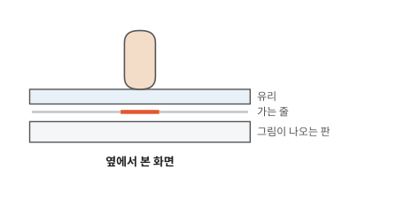
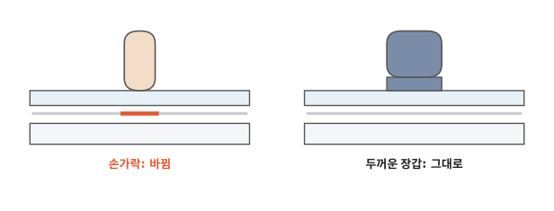
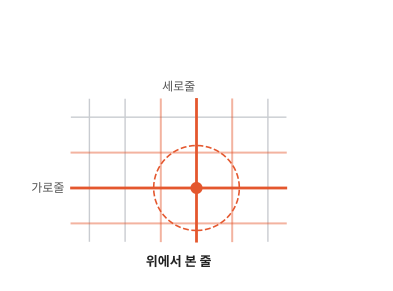
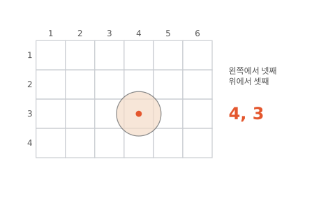
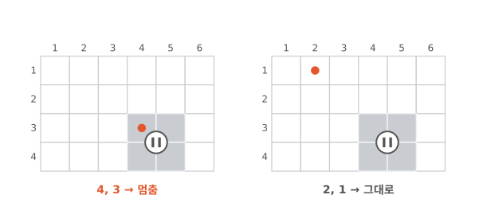
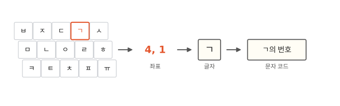
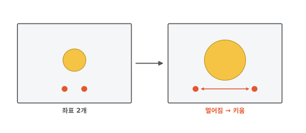

# 화면 터치: 누른 자리를 컴퓨터가 알아내는 법

[8편](08-how-videos-move.md)에서 영상을 보다가 멈춤 버튼을 톡 눌렀어요. 그러자 영상이 멈췄죠. 이 글을 읽고 나면 화면이 내 손가락 자리를 알아내는 방법을 알게 돼요. 컴퓨터가 그 자리를 보고 어떤 버튼이 눌렸는지 정하는 방법도요. 휴대폰 자판으로 글자를 치는 것도, 두 손가락으로 사진을 키우는 것도 모두 이 방법으로 움직여요.

!!! abstract "이 글에서 알게 되는 것"
    1. 화면 유리 밑에는 가는 가로줄과 세로줄이 깔려 있어요. 손가락이 닿으면 그 자리 줄의 전기가 조금 바뀌어서 화면이 손가락 자리를 알아채요.
    2. 화면은 누른 자리를 "4, 3"처럼 숫자 두 개로 컴퓨터에 알려 줘요. 이걸 좌표라고 해요.
    3. 컴퓨터는 버튼을 어느 칸에 그렸는지 알고 있어요. 좌표가 버튼 칸 안에 있으면 그 버튼이 눌린 거예요. 자판도 같은 방법으로 글자를 알아요.

## 1. 화면 유리 밑에 가는 줄이 깔려 있어요

멈춤 버튼을 누를 때 손가락은 유리에 닿을 뿐이에요. 진짜 버튼처럼 쑥 들어가지도 않아요. 그런데 휴대폰은 눌린 걸 어떻게 알까요?

휴대폰 화면은 여러 겹으로 되어 있어요. 맨 위가 손가락이 닿는 유리예요. 맨 아래는 그림이 나오는 판이고요. 그 사이에 눈에 안 보이는 아주 가는 줄이 깔려 있어요.[^3m]

아래 그림은 화면을 옆에서 본 모습이에요. 손가락 밑의 빨간 줄을 보세요.

**그림 1.** 유리와 그림이 나오는 판 사이에 가는 줄이 있고 손가락 밑의 줄이 빨개요.
{ .fig-cap }

줄에는 아주 약한 전기가 흘러요. 손가락이 유리에 닿으면 그 자리 줄의 전기가 조금 바뀌어요. 손가락은 아무것도 못 느낄 만큼 조금이에요. 그림에서 빨갛게 칠한 곳이 전기가 바뀐 곳이에요. 화면은 줄의 전기가 바뀐 걸 보고 손가락이 닿았다는 걸 알아채요.

## 2. 두꺼운 장갑을 끼면 줄의 전기가 바뀌지 않아요

추운 날 두꺼운 겨울 장갑을 끼고 휴대폰을 눌러 본 적 있나요? 잘 안 눌려요. 1절에서 본 줄을 떠올리면 왜 그런지 알 수 있어요.

아래 그림에서 두 화면 속 줄을 비교해 보세요.

**그림 2.** 손가락이 닿으면 줄의 전기가 바뀌어요. 두꺼운 장갑이 닿으면 줄은 그대로예요.
{ .fig-cap }

장갑이 손가락과 줄 사이를 막아서 줄의 전기가 바뀌지 않아요. 화면은 줄을 보고 눌린 걸 알아요. 그런데 줄이 그대로니까 아무것도 눌리지 않았다고 여겨요.

화면용 펜이나 터치 장갑은 끝에 전기가 통하는 재료를 써요. 그래서 손가락처럼 줄의 전기를 바꿀 수 있어요. 얇은 비닐 장갑은 낀 채로도 눌릴 때가 있어요.

## 3. 전기가 바뀐 줄들의 가운데가 누른 자리예요

이제 화면은 손가락이 닿았다는 걸 알아요. 그런데 멈춤 버튼을 눌렀는지 알려면 화면 어디에 닿았는지도 알아야 해요.

화면 속 줄은 한 방향으로만 깔려 있지 않아요. 가로줄도 있고 세로줄도 있어요. 화면을 위에서 보면 가로줄과 세로줄이 그물처럼 엇갈려 있어요. 아래 그림에서 빨간 줄들과 그 가운데의 빨간 점을 보세요.

**그림 3.** 손가락 밑의 줄 몇 개가 함께 바뀌고 그 가운데 두 줄이 만나는 곳이 손가락 자리예요.
{ .fig-cap }

손가락은 줄 사이보다 훨씬 넓어요. 그래서 손가락이 닿으면 가까운 세로줄 몇 개와 가로줄 몇 개의 전기가 함께 바뀌어요. 화면은 바뀐 세로줄의 한가운데 줄을 골라요. 그 줄을 보면 손가락이 왼쪽에서 얼마나 떨어져 있는지 알 수 있어요. 바뀐 가로줄에서도 한가운데 줄을 골라요. 그 줄로 위에서 얼마나 떨어져 있는지 알 수 있고요. 고른 두 줄이 만나는 곳이 손가락 자리예요.

## 4. 누른 자리는 숫자 두 개로 말해요

화면은 알아낸 자리를 컴퓨터에 알려 줘야 해요. 자리를 어떻게 말하면 좋을까요?

교실에서 "왼쪽에서 넷째 줄, 앞에서 셋째 자리"라고 하면 누구 자리인지 알 수 있죠. 화면도 자리를 이렇게 말해요. [2편](02-how-computers-keep-pictures.md)의 사진처럼 화면도 작은 네모 칸으로 되어 있어요. 그래서 "왼쪽에서 넷째, 위에서 셋째 칸"처럼 말할 수 있어요. 짧게 쓰면 "4, 3"이에요. 앞 숫자는 왼쪽에서 몇째 칸인지, 뒤 숫자는 위에서 몇째 칸인지 말해요.

진짜 화면에는 칸이 아주 많아요. 아래 그림은 쉽게 보려고 칸을 크게, 몇 개만 그렸어요. 손가락이 덮은 칸들과 빨간 점을 보세요.

**그림 4.** 손가락이 덮은 칸들의 한가운데가 왼쪽에서 넷째, 위에서 셋째 칸이라서 "4, 3"이에요.
{ .fig-cap }

교실 자리와 다른 점도 있어요. 손가락은 화면 칸보다 커서 칸을 여러 개 덮어요. 그래서 화면은 덮인 칸들의 한가운데 하나를 골라요. 그림에서는 왼쪽에서 넷째, 위에서 셋째 칸이에요.

이렇게 자리를 숫자 두 개로 말한 것을 **좌표**라고 해요. 같은 자리를 두 번 누르면 좌표도 두 번 다 같아요.

## 5. 좌표가 버튼 칸 안이면 영상이 멈춰요

화면이 컴퓨터에 "4, 3"을 알려 줬어요. 컴퓨터는 이 숫자 두 개로 무엇이 눌렸는지 정해요.

컴퓨터는 멈춤 버튼을 어느 칸에 그렸는지 알고 있어요. 자기가 그린 거니까요. 아래 그림에서는 회색 네 칸이에요. 왼쪽에서 넷째와 다섯째, 위에서 셋째와 넷째 칸이죠. 왼쪽 그림의 빨간 점이 회색 칸 안에 있는지 보세요.

**그림 5.** "4, 3"은 회색 버튼 칸 안이라 영상이 멈추고 "2, 1"은 칸 밖이라 아무 일도 없어요.
{ .fig-cap }

"4, 3"은 회색 칸 안이에요. 그래서 컴퓨터는 멈춤 버튼이 눌렸다고 보고 영상을 멈춰요. 오른쪽처럼 "2, 1"을 누르면 회색 칸 밖이에요. 그때는 아무 일도 일어나지 않아요.

버튼이 눌렸는지 정하는 일은 이게 다예요. 좌표가 버튼 칸 안에 드는지 살펴보면 돼요. 화면에 버튼이 여러 개 있으면 컴퓨터는 버튼마다 그린 칸을 알고 있다가 좌표가 어느 버튼 칸에 들었는지 찾아요.

## 6. 자판도 사진 키우기도 좌표로 알아요

메시지를 쓸 때 누르는 화면 자판도 버튼이 여러 개 모여 있는 거예요. 자판에서 "ㄱ"을 눌러 볼게요. 아래 그림에서 화살표를 따라가 보세요.

**그림 6.** 누른 자리 "4, 1"에 "ㄱ"이 그려져 있어서 컴퓨터는 "ㄱ"의 번호를 적어요.
{ .fig-cap }

그림에서는 쉽게 보려고 자판 하나를 한 칸으로 셌어요. 화면은 누른 자리의 좌표 "4, 1"을 알려 줘요. 컴퓨터는 그 자리에 "ㄱ"을 그려 둔 걸 알아서 "ㄱ"을 적어요. [3편](03-how-computers-keep-letters.md)에서 본 것처럼 컴퓨터는 글자를 문자 코드 번호로 적어요. 그래서 "ㄱ"도 번호로 적혀요.

2편에서는 두 손가락을 화면에 대고 벌려서 사진을 키웠어요. 두 손가락을 대면 좌표가 한꺼번에 두 개 들어와요. 아래 그림에서 두 빨간 점 사이가 어떻게 바뀌는지 보세요.

**그림 7.** 두 좌표 사이가 멀어지면 컴퓨터는 사진을 키워요.
{ .fig-cap }

손가락을 벌리면 두 좌표 사이가 점점 멀어져요. 컴퓨터는 이걸 보고 "키워 달라는 거구나" 하고 사진을 키워요.

## 확인 문제

??? question "눌렸을까요?"
    그림 5의 회색 네 칸이 멈춤 버튼이에요. 좌표 "5, 4"를 누르면 어떻게 될까요? "1, 4"를 누르면요?

    **풀이**: "5, 4"는 왼쪽에서 다섯째, 위에서 넷째 칸이라 회색 칸 안이에요. 그래서 영상이 멈춰요. "1, 4"는 맨 왼쪽 칸이라 회색 칸 밖이에요. 아무 일도 일어나지 않아요.

## 정리

휴대폰 화면 유리 밑에는 가는 가로줄과 세로줄이 깔려 있어요. 손가락이 닿으면 그 자리 줄의 전기가 조금 바뀌어요. 화면은 전기가 바뀐 세로줄과 가로줄이 만나는 곳을 찾아서 손가락 자리를 알아내요. 두꺼운 장갑을 끼면 줄의 전기가 바뀌지 않아서 잘 안 눌려요.

화면은 알아낸 자리를 "4, 3"처럼 숫자 두 개로 컴퓨터에 알려 줘요. 이 숫자 두 개가 좌표예요. 컴퓨터는 멈춤 버튼을 어느 칸에 그렸는지 알고 있어서 좌표가 그 칸 안에 들면 영상을 멈춰요. 자판에서 "ㄱ"을 누를 때도 두 손가락으로 사진을 키울 때도 컴퓨터는 좌표를 보고 할 일을 정해요.

다음 편에서는 내가 쓴 메시지를 중간에서 누가 봐도 못 읽게 바꾸는 방법을 봐요.

### 새로 나온 말

- **좌표**: 자리를 숫자 두 개로 말한 것. 왼쪽에서 넷째, 위에서 셋째 칸은 "4, 3"이에요.

[^3m]: 3M Touch Systems, *Touch Technology Brief: Projected Capacitive Technology*. [PDF](https://circuits.mit.edu/_static/S25/labs/rc/3m_capsense.pdf).
