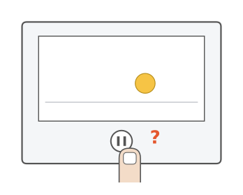
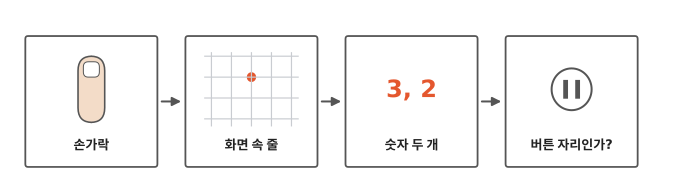
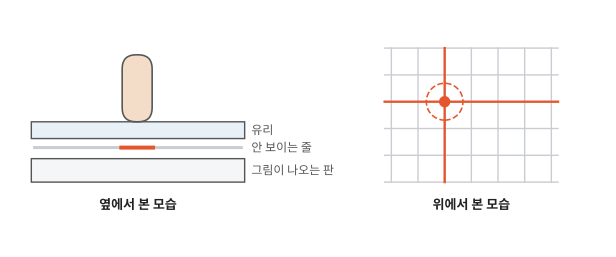
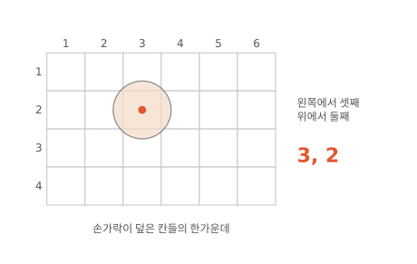
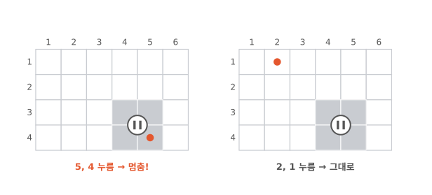
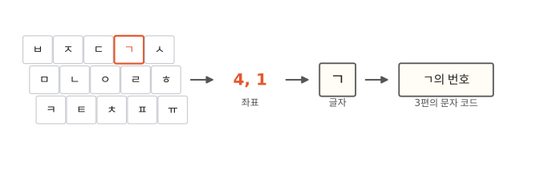

# 내가 누른 걸 컴퓨터는 어떻게 알까요?

## 멈춤 버튼을 톡

8편에서 영상을 멈출 때 손가락으로 멈춤 버튼을 톡 눌렀지요? 그러면 영상이 멈춰요.

컴퓨터는 내 손가락이 버튼에 닿은 걸 어떻게 알았을까요?

## 손가락에서 버튼까지

그림 네 칸을 왼쪽부터 차례로 따라가요. 마지막 칸에서 버튼을 눌렀는지 알아봐요.

## 화면 속에는 안 보이는 줄이 있어요

휴대폰 화면 유리 밑에는 눈에 안 보이는 아주 가는 줄이 깔려 있어요. 가로줄도 있고 세로줄도 있어요.[^3m]

줄에는 아주 약한 전기가 흘러요. 손가락이 유리에 닿으면 그 자리 줄의 전기가 조금 바뀌어요. 손가락은 아무것도 느끼지 못할 만큼 아주 조금이에요.

오른쪽 그림을 봐요. 전기가 바뀐 가로줄 하나와 세로줄 하나가 빨갛지요? 두 빨간 줄이 만나는 곳이 손가락 자리예요.

두꺼운 겨울 장갑을 끼면 잘 안 눌리지요? 장갑이 손가락과 줄 사이를 막으면 줄의 전기가 바뀌지 않아요. 그래서 화면이 눌린 걸 몰라요.

## 누른 자리를 숫자 두 개로

교실에서 "왼쪽에서 셋째, 앞에서 둘째 자리"라고 하면 누구 자리인지 알 수 있지요? 화면도 그렇게 자리를 말해요. 2편에서 본 것처럼 화면은 작은 칸으로 되어 있어요. 그래서 "왼쪽에서 셋째, 위에서 둘째 칸"처럼 말할 수 있어요. 짧게 쓰면 "3, 2"예요.

이렇게 자리를 숫자 두 개로 말한 것을 **좌표**라고 해요.

교실 자리와 다른 점도 있어요. 손가락은 화면 칸보다 커서 칸을 여러 개 덮어요. 그래서 화면은 덮인 칸들의 한가운데 하나를 골라요.

## 버튼 자리인지 살펴봐요

컴퓨터는 멈춤 버튼을 어느 칸에 그렸는지 알고 있어요. 자기가 그린 거니까요. 그림에서는 회색 네 칸이에요.

화면이 좌표 "5, 4"를 알려 주면, 컴퓨터는 그 칸이 회색 칸인지 살펴봐요. 그림에서 손가락으로 짚어 봐요. 회색 칸이지요? 그래서 영상을 멈춰요.

좌표가 "2, 1"이면 회색 칸 밖이에요. 그래서 아무 일도 일어나지 않아요.

## 자판도 똑같아요

메시지를 쓸 때 화면 자판에서 "ㄱ"을 눌러 봐요. 화면은 누른 자리의 좌표를 알려 줘요. 컴퓨터는 그 자리에 "ㄱ"을 그려 둔 걸 알고, "ㄱ"을 적어요.

3편에서 본 것처럼, 컴퓨터는 글자를 번호(문자 코드)로 적어요. "ㄱ"도 번호로 적혀요.

## 정리

- **좌표**: 자리를 숫자 두 개로 말한 것이에요. 화면은 내가 누른 자리를 좌표로 알려 주고, 컴퓨터는 그 자리에 무엇이 있는지 살펴봐요.

## 해 보기: 종이 화면 좌표 놀이

친구와 둘이서 해요.

1. 공책에 가로 6칸, 세로 4칸을 그려요. 위쪽에 1부터 6, 왼쪽에 위에서부터 1부터 4를 써요.
2. 한 사람이 몰래 칸 두세 개를 색칠해서 버튼을 만들어요.
3. 다른 사람은 그림을 보지 않고 좌표를 불러요. "3, 2!"
4. 버튼 칸이면 "멈춤!", 아니면 "그대로!"라고 답해요.
5. 다섯 번 안에 버튼을 찾으면 성공이에요. 역할을 바꿔서 또 해요.

## 확인 문제

??? question "1. 장갑을 끼면?"
    두꺼운 겨울 장갑을 끼고 화면을 누르면 왜 잘 안 될까요?

    **풀이**: 장갑이 막아서 화면 속 줄의 전기가 바뀌지 않아요. 그래서 화면이 손가락 자리를 몰라요.

??? question "2. 눌렸을까요?"
    본문 "버튼 자리인지 살펴봐요" 그림의 회색 네 칸이 버튼이에요. 좌표 "4, 3"을 누르면 어떻게 될까요? "1, 4"를 누르면요?

    **풀이**: "4, 3"은 회색 칸 안이라 영상이 멈춰요. "1, 4"는 회색 칸 밖이라 아무 일도 없어요.

??? question "3. 같은 자리를 또 누르면?"
    같은 자리를 두 번 누르면 좌표는 어떻게 될까요?

    **풀이**: 두 번 다 같은 좌표예요. 같은 자리니까요.

!!! abstract "어른을 위한 정리 (건너뛰어도 돼요)"
    - 요즘 휴대폰 화면은 투명한 전극을 가로·세로로 깔고, 손가락이 닿은 곳의 전기적 변화를 읽어 위치를 계산해요. 여러 전극의 값을 함께 써서 칸 사이의 위치까지 정밀하게 구해요.
    - 버튼이 눌렸는지는 "누른 좌표가 버튼 영역 안에 있나"라는 비교 하나로 정해요. 앱 화면의 버튼은 모두 이렇게 움직여요.

## 더 깊이

??? info "터치 펜과 터치 장갑"
    화면용 펜이나 터치 장갑은 끝에 전기가 통하는 재료를 써요. 그래서 손가락처럼 줄의 전기를 바꿀 수 있어요. 얇은 비닐 장갑은 낀 채로도 눌리는 경우가 있어요.[^3m]

??? info "두 손가락으로 사진 키우기"
    두 손가락을 대면 좌표가 두 개 들어와요. 두 좌표 사이가 점점 멀어지면 컴퓨터는 "키워 달라는 거구나" 하고 사진을 키워요.

??? info "진짜 키보드와 마우스"
    컴퓨터의 진짜 키보드는 자판마다 번호가 있어서, 누른 자판의 번호를 컴퓨터에 보내요. 마우스는 움직인 만큼을 숫자로 보내고, 컴퓨터는 그 숫자로 화살표의 좌표를 옮겨요.

[^3m]: 3M Touch Systems, *Touch Technology Brief: Projected Capacitive Technology*. [PDF](https://circuits.mit.edu/_static/S25/labs/rc/3m_capsense.pdf).
