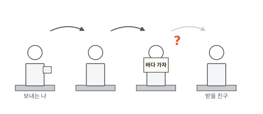
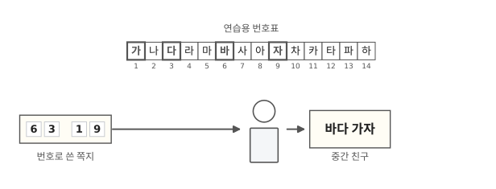
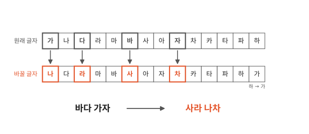
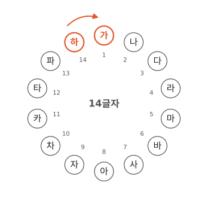
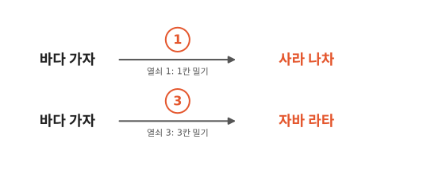
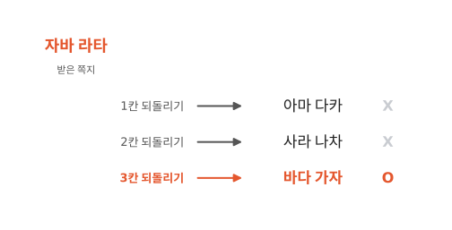
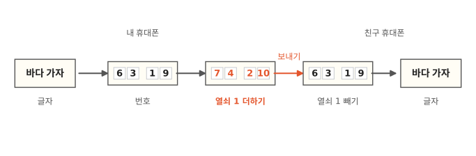

# 암호와 열쇠: 남이 못 읽게 메시지를 바꾸는 법

수업 시간에 맨 뒷자리 친구에게 쪽지를 보내려면 앞 친구들 손을 하나씩 거쳐야 해요. 중간에 누가 쪽지를 펼쳐 보면 다 읽히고요. 이 글을 읽고 나면 중간에서 누가 봐도 못 읽게 글을 바꾸는 방법을 알게 돼요. 휴대폰 메시지도 친구에게 가는 동안 중간을 거쳐요. 그래서 컴퓨터도 이 방법을 써요.

!!! abstract "이 글에서 알게 되는 것"
    1. 글자를 번호로만 바꿔서는 비밀이 안 돼요. 번호표는 누구나 알아서 번호를 다시 글자로 되돌릴 수 있어요.
    2. 글자를 정해 둔 칸 수만큼 밀어 쓰면 남이 못 읽는 암호가 돼요. 몇 칸 밀지 정한 비밀 숫자를 열쇠라고 해요.
    3. 컴퓨터는 글자 번호에 열쇠를 더해서 암호를 만들어요. 진짜 열쇠는 아주 길어서 하나씩 다 넣어 봐도 찾을 수 없어요.

## 1. 쪽지도 메시지도 중간을 거쳐서 가요

내가 맨 앞자리에 앉아 있고 받을 친구는 맨 뒷자리에 있어요. 쪽지에는 "바다 가자"라고 썼어요. 아래 그림에서 셋째 자리 친구가 무엇을 하는지 보세요.

**그림 1.** 쪽지가 뒤로 가는 길에 셋째 친구가 펼쳐서 "바다 가자"를 읽어요.
{ .fig-cap }

셋째 친구는 받을 사람이 아닌데도 쪽지를 읽었어요. 쪽지는 손에서 손으로 가니까 중간에 누구든 펼쳐 볼 수 있어요.

휴대폰 메시지도 비슷해요. 내 휴대폰에서 친구 휴대폰으로 곧장 가지 않고 중간을 거쳐서 가요. 어디를 거치는지는 [11편](11-how-messages-travel.md)에서 봐요. 이 글에서는 중간에서 누가 봐도 못 읽게 하는 방법을 찾아볼게요.

## 2. 글자를 번호로만 바꾸면 누구나 읽어요

[3편](03-how-computers-keep-letters.md)에서 글자를 번호로 바꿔 번호 편지를 써 봤죠. 글자 대신 번호를 쓰면 비밀처럼 보여요. 정말 비밀이 될까요?

연습용으로 작은 번호표를 만들어 볼게요. "가"부터 "하"까지 글자 14개에 1부터 14까지 번호를 붙여요. 이 표로 "바다 가자"를 쓰면 6, 3, 1, 9예요. 아래 그림에서 번호 쪽지를 받은 중간 친구가 무엇을 읽는지 보세요.

**그림 2.** 번호표를 아는 중간 친구는 6, 3, 1, 9를 보고 "바다 가자"를 읽어요.
{ .fig-cap }

번호표만 있으면 6은 "바", 3은 "다"로 되돌릴 수 있어요. 컴퓨터가 쓰는 번호표인 문자 코드도 마찬가지예요. 3편에서 본 것처럼 문자 코드는 세상 사람이 모두 같이 써요. 그래서 누구나 번호를 다시 글자로 바꿀 수 있어요.

## 3. 글자를 한 칸씩 밀어 쓰면 암호가 돼요

이번에는 글자를 다른 글자로 바꿔 써 볼게요. 같은 글자 14개로 해요. "가나다라마바사…" 차례에서 글자마다 그다음 글자를 쓰는 거예요. "바"는 "사"로, "다"는 "라"로 바꿔요. 아래 그림에서 윗줄 글자가 아랫줄 어느 글자로 바뀌는지 따라가 보세요.

**그림 3.** 글자마다 한 칸 밀어 쓰면 "바다 가자"가 "사라 나차"가 돼요.
{ .fig-cap }

중간 친구가 "사라 나차"를 봐도 무슨 말인지 몰라요. 받을 친구는 글자마다 한 칸 앞 글자로 되돌려서 "바다 가자"를 읽어요.

마지막 글자 "하"는 그다음 글자가 없어요. 그때는 맨 앞으로 돌아가서 "가"를 써요. 14글자를 동그랗게 늘어놓으면 쉽게 보여요. 아래 그림에서 빨간 화살표를 보세요.

**그림 4.** 동그랗게 놓은 글자에서 "하" 다음은 다시 "가"예요.
{ .fig-cap }

이렇게 놓으면 몇 칸을 밀어도 바꿀 글자가 꼭 있어요. 14칸을 밀면 한 바퀴 돌아서 제자리로 와요.

남이 못 읽게 바꾼 글을 **암호**라고 해요. "사라 나차"가 "바다 가자"의 암호예요.

## 4. 몇 칸 밀지 정한 비밀 숫자가 열쇠예요

한 칸 말고 세 칸을 밀 수도 있어요. "바"에서 "사, 아, 자" 하고 세 칸 가면 "자"가 돼요. 아래 그림에서 같은 "바다 가자"가 어떤 암호가 되는지 비교해 보세요.

**그림 5.** 한 칸 밀면 "사라 나차", 세 칸 밀면 "자바 라타"가 돼요.
{ .fig-cap }

같은 말인데 몇 칸 미느냐에 따라 전혀 다른 암호가 나와요. 그래서 몇 칸 밀지는 보내는 친구와 받는 친구가 미리 몰래 정해 둬요. 이 비밀 숫자를 **열쇠**라고 해요. 쪽지를 펼쳐 본 친구는 열쇠를 모르니까 한눈에 읽지 못해요.

이 방법은 아주 오래됐어요. 옛날 로마의 율리우스 카이사르는 비밀 편지를 쓸 때 글자를 세 칸씩 밀어 썼다는 기록이 있어요.[^caesar] 알파벳 A 자리에 넷째 글자 D를 쓰는 식이에요. 그래서 글자를 몇 칸씩 미는 암호를 "카이사르 암호"라고 불러요.

## 5. 열쇠를 모르면 하나씩 다 넣어 볼 수 있어요

글자를 미는 암호에는 약한 곳이 있어요. 열쇠를 몰라도 금방 풀려요.

중간 친구가 "자바 라타"라는 쪽지를 손에 넣었다고 해 볼게요. 열쇠는 몰라요. 그래도 한 칸, 두 칸, 세 칸 하고 차례로 되돌려 볼 수 있어요. 아래 그림에서 몇 번째에 말이 되는 글이 나오는지 보세요.

**그림 6.** "자바 라타"를 차례로 되돌려 보면 세 번째에 "바다 가자"가 나와요.
{ .fig-cap }

한 칸, 두 칸 되돌리면 "아마 다카", "사라 나차"처럼 말이 안 되는 글이 나와요. 세 칸을 되돌리니 "바다 가자"가 나왔어요. 열쇠가 3이었던 거예요.

열쇠로 쓸 수 있는 숫자가 몇 개인지 세어 볼게요. 그림 4에서 본 것처럼 14칸을 밀면 제자리라서 열쇠는 1부터 13까지예요. 13번만 해 보면 꼭 찾아요.

## 6. 컴퓨터는 글자 번호에 열쇠를 더해요

컴퓨터 안에서 글자는 번호로 적혀 있어요. 그래서 컴퓨터는 글자를 미는 대신 번호에 열쇠를 더해요. 연습용 번호표에서 "바"는 6번, "사"는 7번이에요. 한 칸 미는 것과 1을 더하는 것은 같은 일이에요.

아래 그림에서 내 휴대폰과 친구 휴대폰 사이에 무엇이 오가는지 보세요.

**그림 7.** 내 휴대폰은 번호에 1을 더해서 보내요. 친구 휴대폰은 1을 빼서 되돌려요.
{ .fig-cap }

내 휴대폰은 6, 3, 1, 9에 1씩 더해서 7, 4, 2, 10을 만들어요. 더해서 14보다 커지면 그림 4의 바퀴처럼 다시 1부터 세요. 중간을 거쳐 가는 건 7, 4, 2, 10이에요. 번호표로 되돌려도 "사라 나차"라서 중간에서는 읽지 못해요. 친구 휴대폰은 1씩 빼서 6, 3, 1, 9로 되돌리고 글자로 바꿔 "바다 가자"를 보여 줘요.

진짜 컴퓨터는 더하기보다 훨씬 복잡한 방법으로 번호를 바꿔요. 그 방법은 누구나 볼 수 있게 알려져 있어요.[^aes] 숨기는 건 열쇠뿐이에요. 그래서 5절처럼 열쇠를 하나씩 다 넣어 보는 방법을 막으려고 열쇠를 아주 길게 만들어요. 많이 쓰는 열쇠는 쓸 수 있는 가짓수가 서른아홉 자리 수만큼 있어요. 글자 14개로 미는 방법은 13가지였죠. 서른아홉 자리 수만큼이면 컴퓨터로 하나씩 다 넣어 봐도 끝이 안 나요.

## 확인 문제

??? question "1. 암호 만들기"
    열쇠 1로 "나라"를 암호로 바꾸면 무엇이 될까요?

    **풀이**: "다마"예요. "나" 다음은 "다", "라" 다음은 "마"예요.

??? question "2. 열쇠 찾기"
    중간 친구가 "사라 나차"라는 쪽지를 손에 넣었어요. 한 칸씩 되돌려 보면 몇 번째에 읽을 수 있을까요?

    **풀이**: 첫 번째예요. 한 칸 되돌리면 "바다 가자"가 나와요. 열쇠는 1이에요.

## 정리

글자를 번호로만 바꿔서 보내면 비밀이 안 돼요. 문자 코드는 세상 사람이 모두 같이 쓰는 번호표라서 누구나 번호를 글자로 되돌려요.

글자를 정해 둔 칸 수만큼 밀어 쓰면 "바다 가자"가 "사라 나차"처럼 남이 못 읽는 글이 돼요. 이 글이 암호예요. 몇 칸 밀지 정한 비밀 숫자가 열쇠이고 보내는 사람과 받는 사람만 알아요. 글자 14개로 미는 암호는 열쇠가 13가지뿐이라서 하나씩 다 넣어 보면 풀려요.

컴퓨터는 글자 번호에 열쇠를 더해서 암호를 만들고 받는 쪽은 빼서 되돌려요. 진짜 컴퓨터는 더 복잡한 방법과 아주 긴 열쇠를 써서 하나씩 다 넣어 봐도 찾을 수 없게 해요.

다음 편에서는 암호로 바꾼 메시지가 친구 휴대폰까지 어떤 길로 가는지 봐요.

### 새로 나온 말

- **암호**: 남이 못 읽게 바꾼 글. "바다 가자"를 한 칸씩 밀어 쓴 "사라 나차"가 암호예요.
- **열쇠**: 암호로 바꿀 때와 되돌릴 때 쓰는 비밀 숫자. 한 칸씩 밀었다면 열쇠는 1이에요.

[^aes]: 많이 쓰는 방법인 AES는 미국 국립표준기술연구소(NIST)가 공개한 표준이에요. [FIPS 197, Advanced Encryption Standard (AES)](https://csrc.nist.gov/pubs/fips/197/final).
[^caesar]: 수에토니우스, 『황제 열전』 율리우스 카이사르 56장. [J. C. Rolfe 영어 번역(1913), LacusCurtius](https://penelope.uchicago.edu/Thayer/E/Roman/Texts/Suetonius/12Caesars/Julius%2A.html).
