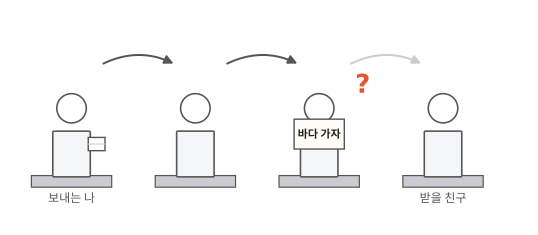
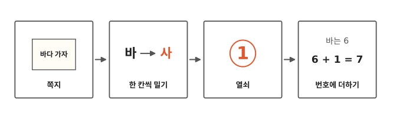
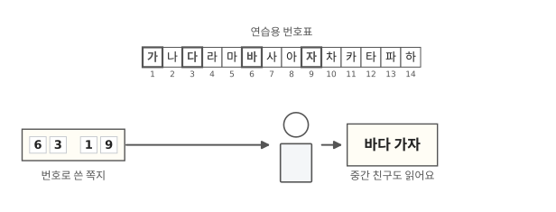
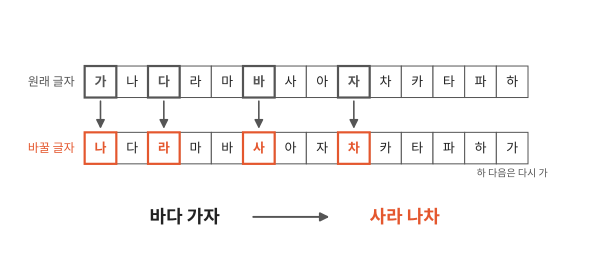
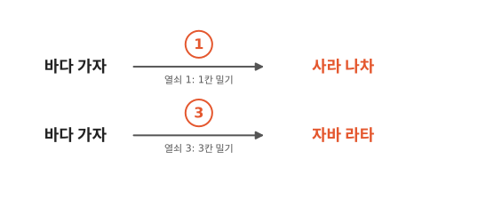
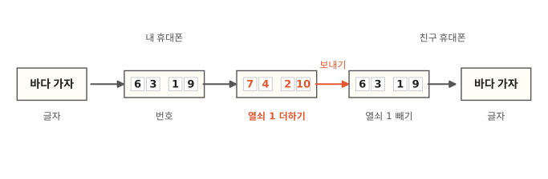

# 남이 봐도 못 읽는 메시지는 어떻게 만들까요?

## 뒤로 가는 쪽지

맨 뒷자리 친구에게 쪽지를 보내 본 적 있나요? 쪽지는 앞 친구들 손을 하나씩 거쳐서 가요. 그런데 중간에 누가 쪽지를 펼쳐 보면 어떡하죠?

휴대폰 메시지도 친구 휴대폰으로 바로 가지 않고, 중간을 거쳐서 가요. 어디를 거치는지는 다음 편에서 봐요. 이번에는 중간에서 누가 봐도 못 읽게 하는 방법을 알아봐요.

## 쪽지에서 더하기까지

그림 네 칸을 왼쪽부터 차례로 따라가요. 처음에는 손으로 쪽지 글자를 바꿔 봐요. 마지막 칸에서는 컴퓨터가 같은 일을 번호로 해요. 칸 속 낱말은 뒤에서 하나씩 나와요.

## 번호로만 써도 다 보여요

3편에서 번호 편지를 써 봤지요? 이번에도 연습용 작은 번호표를 써요. "가"부터 "하"까지 글자 14개에 1부터 14까지 번호를 붙였어요. 글자 대신 번호로 쓰면 비밀 같아 보여요.

그런데 3편에서 본 문자 코드는 세상 사람이 모두 같이 써요. 그래서 누구나 번호를 다시 글자로 바꿀 수 있어요. 그림에서는 연습용 번호표가 문자 코드 대신이에요. 이 표를 아는 중간 친구는 6, 3, 1, 9를 보고 "바다 가자"를 읽어요.

## 한 칸씩 밀어서 써요

이번에는 글자를 바꿔 써 봐요. 같은 글자 14개로 해요. "가나다라마바사…" 차례에서 글자마다 그다음 글자를 써요. "바"는 "사"로, "다"는 "라"로 바꿔요. 그러면 "바다 가자"는 "사라 나차"가 돼요.

중간 친구가 "사라 나차"를 봐도 무슨 말인지 몰라요. 받는 친구는 글자마다 한 칸 앞 글자로 되돌려서 "바다 가자"를 읽어요.

이렇게 남이 못 읽게 바꾼 글을 **암호**라고 해요.

## 몇 칸 밀지는 둘만 알아요

한 칸 말고 세 칸을 밀 수도 있어요. "바"에서 "사, 아, 자" 하고 세 칸 가면 "자"가 돼요. 그러면 "바다 가자"는 "자바 라타"가 돼요. 같은 말인데 전혀 다른 암호가 나와요.

몇 칸 밀지는 보내는 친구와 받는 친구가 미리 몰래 정해 둬요. 이 비밀 숫자를 **열쇠**라고 해요. 쪽지를 펼쳐 본 친구는 열쇠를 모르니까 한눈에 읽지 못해요.

그래도 글자를 미는 방법은 금방 들켜요. 1칸, 2칸, 3칸… 하나씩 되돌려 보면 되거든요. 글자가 14개라서 14칸을 밀면 한 바퀴 돌아 제자리예요. 그러니 13번까지만 해 보면 꼭 찾아요.

## 컴퓨터는 번호에 열쇠를 더해요

컴퓨터 안에서 글자는 번호로 적혀 있어요(3편). 그래서 컴퓨터는 번호에 열쇠를 더해요. 연습용 번호표에서 "바"는 6번, "사"는 7번이에요. 한 칸 미는 것과 1을 더하는 것은 같은 일이지요. 그림에서 6, 3, 1, 9에 1씩 더하니 7, 4, 2, 10이 됐어요. 더해서 14보다 커지면 다시 1부터 세요. 이 번호들이 친구 휴대폰으로 가요.

친구 휴대폰은 1씩 빼서 6, 3, 1, 9로 되돌려요. 그리고 글자로 바꿔 "바다 가자"를 보여 줘요.

글자를 미는 방법은 놀이로 쓰기 좋아요. 진짜 컴퓨터는 더하기보다 훨씬 복잡한 방법으로 번호를 바꿔요.

열쇠도 아주 긴 숫자를 써요. 열쇠로 쓸 수 있는 숫자가 너무 많아서, 하나씩 다 해 보면 컴퓨터로도 끝이 안 나요.

## 정리

- **암호**: 남이 못 읽게 바꾼 글이에요. 열쇠를 모르는 사람은 봐도 무슨 말인지 몰라요.
- **열쇠**: 바꿀 때와 되돌릴 때 쓰는 비밀 숫자예요. 이 편에서는 몇 칸 밀지가 열쇠예요. 열쇠가 있어야 원래 글로 되돌려요.

## 해 보기: 글자 밀기 암호표

친구와 둘이서 해요.

1. 친구와 몰래 열쇠를 정해요. 1부터 13 사이 숫자 하나예요.
2. 종이에 칸 14개짜리 줄을 두 줄 그려요. 윗줄에는 "가 나 다 라 마 바 사 아 자 차 카 타 파 하"를 써요.
3. 아랫줄은 열쇠만큼 뒤 글자부터 써요. 열쇠가 1이면 "나"부터 쓰고, "하" 다음에는 다시 "가"를 써요. "한 칸씩 밀어서 써요"의 그림과 같아요.
4. 쪽지에 쓸 말의 글자를 윗줄에서 찾고, 그 밑 글자로 바꿔 써요. 띄어쓰기는 그대로 둬요. "바다", "나라", "사자", "하마"처럼 줄에 있는 글자로만 된 말을 써요.
5. 받은 친구도 같은 표를 만들어서, 아랫줄 글자를 윗줄 글자로 되돌려 읽어요.
6. 이번에는 열쇠를 알려 주지 않고 쪽지를 건네요. 친구가 1칸부터 차례로 되돌려 봐요. 몇 번 만에 알아냈나요?

## 확인 문제

??? question "1. 암호 만들기"
    열쇠 1로 "나라"를 암호로 바꾸면 무엇이 될까요?

    **풀이**: "다마"예요. "나" 다음은 "다", "라" 다음은 "마"예요.

??? question "2. 열쇠를 모르면?"
    열쇠를 모르는 친구가 "사라 나차"라는 쪽지를 손에 넣었어요. 한눈에 읽을 수 있을까요?

    **풀이**: 한눈에는 못 읽어요. 하지만 열쇠를 1부터 차례로 넣어 되돌려 보면 알아낼 수 있어요. 1칸을 되돌리면 "바다 가자"가 나와요.

??? question "3. 번호로만 바꾸면?"
    글자를 문자 코드 번호로만 바꿔서 보내면 왜 비밀이 안 될까요?

    **풀이**: 문자 코드는 세상 사람이 모두 같이 써서, 누구나 번호를 글자로 되돌릴 수 있어요.

!!! abstract "어른을 위한 정리 (건너뛰어도 돼요)"
    - 실제로 쓰는 암호 방식(예: AES)은 누구나 볼 수 있게 공개돼 있어요. 숨기는 건 열쇠뿐이에요. 방식이 알려져도 열쇠를 모르면 풀 수 없게 만드는 게 목표예요.[^aes]
    - 열쇠를 쉽게 짐작되는 비밀번호(예: 1234)에서 만들면, 다 해 봐야 할 경우가 크게 줄어요. 방식이 튼튼해도 열쇠가 약하면 풀려요.

## 더 깊이

??? info "카이사르 암호"
    로마의 율리우스 카이사르는 비밀 편지를 쓸 때 글자를 세 칸씩 밀어 썼다는 기록이 있어요. 알파벳 A 자리에 넷째 글자 D를 쓰는 식이에요.[^caesar] 그래서 글자를 몇 칸씩 미는 암호를 "카이사르 암호"라고 불러요.

??? info "열쇠는 처음에 어떻게 전할까"
    교실에서는 쉬는 시간에 몰래 열쇠를 정하면 돼요. 그런데 멀리 있는 친구에게 열쇠를 알려 주려면, 그 열쇠도 중간을 거쳐야 해요. 컴퓨터는 이 문제를 "누구나 잠글 수 있지만 주인만 열 수 있는 자물쇠"로 풀어요. 친구가 열린 자물쇠를 먼저 보내 주면, 나는 그 자물쇠로 상자를 잠가서 보내요. 중간에서는 아무도 상자를 못 열어요. 여기서 말하는 자물쇠는 앞에서 본 "몇 칸 밀기" 열쇠와는 다른 방법이에요. 이 생각은 50년쯤 전에 논문에 처음 실렸어요.[^dh]

??? info "진짜 열쇠는 얼마나 길까"
    많이 쓰는 길이의 열쇠는 쓸 수 있는 경우가 서른아홉 자리 수만큼 있어요. 글자 14개로 미는 방법은 13가지, 두 자리 수였어요.

[^aes]: AES는 미국 국립표준기술연구소(NIST)가 공개한 표준이에요. [FIPS 197, Advanced Encryption Standard (AES)](https://csrc.nist.gov/pubs/fips/197/final).
[^caesar]: 수에토니우스, 『황제 열전』 율리우스 카이사르 56장. [J. C. Rolfe 영어 번역(1913), LacusCurtius](https://penelope.uchicago.edu/Thayer/E/Roman/Texts/Suetonius/12Caesars/Julius%2A.html).
[^dh]: Whitfield Diffie, Martin Hellman, *New Directions in Cryptography*, IEEE Transactions on Information Theory, 1976. [PDF](https://ee.stanford.edu/~hellman/publications/24.pdf).
