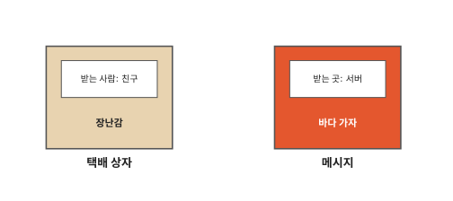
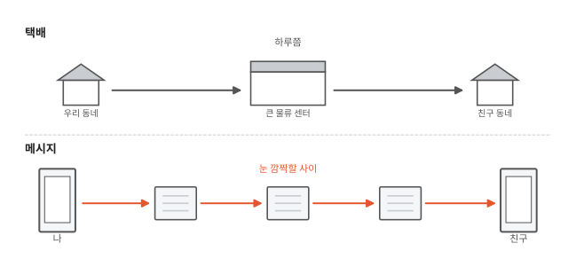
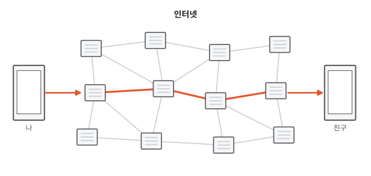
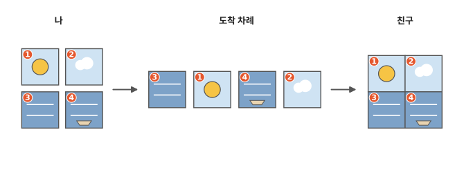
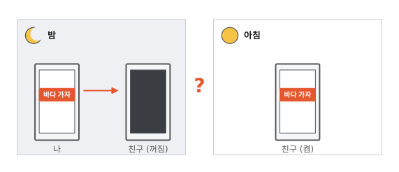
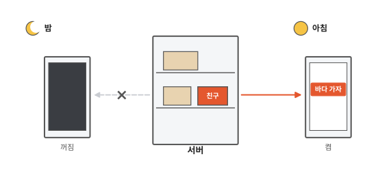

# 메시지가 가는 길: 인터넷과 서버

밤에 친구에게 "바다 가자"라고 메시지를 보냈어요. 그때 친구 휴대폰은 꺼져 있었어요. 그런데 아침에 친구가 휴대폰을 켜니 메시지가 와 있었어요. 이 글을 읽고 나면 메시지가 내 휴대폰에서 친구 휴대폰까지 어떤 길로 가는지 알게 돼요. 밤새 메시지가 어디서 기다렸는지도 알게 돼요.

!!! abstract "이 글에서 알게 되는 것"
    1. 메시지 겉에는 가야 할 곳의 숫자 주소가 적혀 있어요. 중간 컴퓨터는 안을 열지 않고 주소만 보고 다음 컴퓨터로 넘겨요.
    2. 세상의 컴퓨터는 그물처럼 이어져 있어요. 이 길을 인터넷이라고 해요. 사진처럼 큰 것은 작은 조각으로 나눠서 보내요.
    3. 친구 휴대폰이 꺼져 있으면 서버라는 컴퓨터가 메시지를 맡아 둬요. 휴대폰이 켜지면 서버가 건네줘요.

## 1. 메시지 겉에는 가야 할 곳이 적혀 있어요

[10편](10-how-to-keep-messages-secret.md)에서 쪽지는 친구들 손을 하나씩 거쳐서 갔어요. 휴대폰 메시지도 친구 휴대폰으로 곧장 가지 않고 중간을 거쳐 가요. 먼저 메시지가 길을 떠나기 전에 무슨 일이 생기는지 볼게요.

집에 오는 택배 상자를 떠올려 보세요. 상자 겉에 받는 사람이 적혀 있죠. 그래야 상자가 맞는 집으로 가요.

메시지도 똑같아요. 메시지 앱에서 친구를 고르고 "바다 가자"를 보내면 앱이 가야 할 곳을 메시지 겉에 적어 줘요. 아래 그림에서 두 상자에 붙은 흰 딱지를 보세요.

**그림 1.** 택배 상자에도 메시지에도 겉에 가야 할 곳이 적혀 있어요.
{ .fig-cap }

택배 상자 안에는 장난감이 들었고 메시지 안에는 "바다 가자"가 들었어요. 딱지는 둘 다 겉에 붙어 있어요. 그래서 안을 열지 않아도 어디로 갈지 알 수 있어요.

메시지 딱지에는 "친구" 대신 "서버"가 적혀 있어요. 서버는 메시지 앱을 만든 회사의 컴퓨터예요. 메시지는 먼저 서버로 가고 서버가 친구 휴대폰으로 다시 보내요. 서버가 하는 일은 5절에서 자세히 봐요.

컴퓨터가 실제로 보는 건 이름 대신 숫자로 된 주소예요. 집마다 주소가 있듯이 인터넷의 컴퓨터마다 숫자 주소가 있거든요. 이 숫자 주소를 **IP 주소**라고 해요. 앱은 메시지 겉에 서버의 IP 주소를 적어서 보내요.

## 2. 중간 컴퓨터는 주소만 보고 넘겨요

가야 할 곳을 적었으니 이제 메시지가 길을 떠나요. 택배가 가는 길과 나란히 놓고 볼게요.

택배는 우리 동네에서 큰 물류 센터로 가요. 거기서 다시 친구 동네로 가요. 물류 센터에서는 상자를 열지 않아요. 받는 사람만 보고 어느 트럭에 실을지 정해요.

메시지는 중간 컴퓨터 여러 대를 거쳐 가요. 아래 그림에서 아래쪽 메시지 길의 빨간 화살표를 따라가 보세요.

**그림 2.** 택배는 물류 센터 한 곳을 거치고 메시지는 컴퓨터 여러 대를 거쳐요.
{ .fig-cap }

중간 컴퓨터도 메시지를 열어 볼 필요가 없어요. 겉에 적힌 주소만 보고 다음 컴퓨터로 넘겨요. 물류 센터와 같은 일을 하는 거예요. 실제로 거쳐 가는 컴퓨터는 그림의 세 대보다 훨씬 많아요.

그래도 중간 컴퓨터가 마음먹으면 안을 열어 볼 수는 있어요. 그래서 메시지 앱은 [10편](10-how-to-keep-messages-secret.md)처럼 메시지를 암호로 바꿔서 보내요.

택배와 다른 점은 빠르기예요. 택배는 하루쯤 걸려요. 메시지는 눈 깜짝할 사이에 도착해요.

## 3. 컴퓨터를 이어 주는 그물 같은 길이 인터넷이에요

그림 2에서는 중간 컴퓨터를 한 줄로 그렸어요. 실제로는 컴퓨터들이 한 줄로 서 있지 않아요. 여러 갈래로 얽혀 있어요.

아래 그림에서 회색 선과 빨간 선을 보세요. 회색 선은 컴퓨터끼리 이어진 길이고 빨간 선은 "바다 가자"가 지나간 길이에요.

**그림 3.** 그물처럼 이어진 컴퓨터 열두 대 가운데 네 대를 지나서 친구 휴대폰에 닿았어요.
{ .fig-cap }

갈림길마다 중간 컴퓨터가 숫자 주소를 보고 다음 컴퓨터를 골라요. 그렇게 한 대씩 넘어가다 보면 친구 휴대폰에 닿아요.

이렇게 세상의 컴퓨터를 이어 주는 큰 길을 **인터넷**이라고 해요. 다른 나라 친구에게 보내는 메시지는 대개 바다 밑에 깔린 긴 선을 지나가요. 하늘의 인공위성으로 가는 건 아주 조금뿐이에요.

## 4. 큰 사진은 작은 조각으로 나눠 보내요

"바다 가자"는 짧은 글이에요. 바다에서 찍은 사진처럼 큰 것은 어떻게 보낼까요? 작은 조각 여러 개로 나눠서 보내요.

조각마다 받는 곳과 순서 번호를 적어요. 조각은 하나하나 인터넷을 지나가요. 그래서 친구 휴대폰에 뒤죽박죽 도착할 때도 있어요.

아래 그림에서 가운데 줄 조각의 빨간 번호를 보세요.

**그림 4.** 3, 1, 4, 2 차례로 도착한 조각을 번호대로 붙여서 사진이 다시 됐어요.
{ .fig-cap }

친구 휴대폰은 조각에 적힌 번호를 보고 1, 2, 3, 4 차례로 다시 이어 붙여요. 번호가 없으면 해가 바다 밑에 붙을 수도 있겠죠.

## 5. 친구 휴대폰이 꺼져 있으면 서버가 맡아 둬요

이제 처음 장면으로 돌아갈게요. 밤에 보낸 "바다 가자"는 인터넷을 지나 친구 휴대폰으로 가야 해요. 그런데 친구 휴대폰은 꺼져 있었어요. 아래 그림 가운데의 빨간 물음표를 보세요.

**그림 5.** 밤에는 꺼진 휴대폰에 닿지 못했는데 아침에 켜니 메시지가 와 있어요.
{ .fig-cap }

밤과 아침 사이 물음표 자리에서 메시지는 어디 있었을까요?

1절에서 메시지는 먼저 서버로 간다고 했어요. 그림 3의 빨간 길에 있던 컴퓨터 가운데 한 대가 서버예요. 친구 휴대폰이 꺼져 있으면 서버가 메시지를 맡아 둬요. 그러다 친구 휴대폰이 켜지면 건네줘요. 아래 그림에서 선반 위의 빨간 상자를 보세요.

**그림 6.** 밤에는 선반에서 기다리던 메시지가 아침에 휴대폰이 켜지자 건너가요.
{ .fig-cap }

이렇게 메시지를 맡아 두고 건네주는 컴퓨터가 **서버**예요. 밤새 "바다 가자"는 서버 선반에서 기다렸어요.

집에 아무도 없을 때 택배를 경비실이나 택배함에 맡긴 적 있죠? 그때는 내가 찾으러 가야 해요. 서버는 휴대폰이 켜지면 알아서 건네줘요. 친구 휴대폰이 켜져 있을 때는 서버가 오래 맡아 둘 일이 없어요. 메시지가 오자마자 곧 건네줘요.

## 확인 문제

??? question "1. 중간 컴퓨터"
    중간 컴퓨터는 메시지 안을 읽어야 다음 컴퓨터로 넘길 수 있을까요?

    **풀이**: 읽지 않아도 돼요. 겉에 적힌 주소만 보면 돼요. 물류 센터가 상자를 열지 않는 것과 같아요.

??? question "2. 꺼진 휴대폰"
    친구 휴대폰이 꺼져 있을 때 보낸 메시지는 어디서 기다릴까요?

    **풀이**: 서버에서 기다려요. 친구 휴대폰이 켜지면 서버가 건네줘요.

## 정리

메시지 겉에는 가야 할 곳의 주소가 적혀 있어요. 컴퓨터가 보는 건 IP 주소라는 숫자 주소예요. 앱은 먼저 서버의 IP 주소를 적어 서버로 보내고 서버가 친구 휴대폰으로 다시 보내요. 중간 컴퓨터는 메시지를 열지 않고 이 주소만 보고 다음 컴퓨터로 넘겨요.

세상의 컴퓨터는 그물처럼 이어져 있고 이 길을 인터넷이라고 해요. "바다 가자"는 그물 속 컴퓨터 몇 대를 지나 친구에게 갔어요. 사진처럼 큰 것은 번호 붙은 조각으로 나눠 보내고 받는 쪽이 번호대로 다시 붙여요.

친구 휴대폰이 꺼져 있으면 서버가 메시지를 맡아 둬요. 밤새 "바다 가자"는 서버에서 기다리다 아침에 친구 휴대폰으로 갔어요.

이렇게 주고받은 메시지는 휴대폰에 자꾸 쌓여요. [12편](12-how-search-works.md)에서는 쌓인 메시지 가운데 하나를 검색으로 금방 찾는 방법을 봐요.

### 새로 나온 말

- **IP 주소**: 인터넷의 컴퓨터마다 붙은 숫자 주소. "바다 가자" 겉에는 먼저 서버의 IP 주소가 적혀요. 중간 컴퓨터는 이 주소를 보고 메시지를 넘겨요.
- **인터넷**: 세상의 컴퓨터를 그물처럼 이어 주는 큰 길. "바다 가자"도 이 길로 갔어요.
- **서버**: 메시지를 맡아 두고 건네주는 컴퓨터. 친구 휴대폰이 꺼져 있는 동안 "바다 가자"를 맡아 뒀어요.
