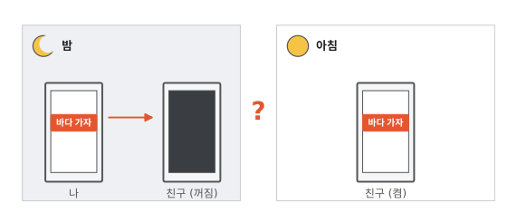
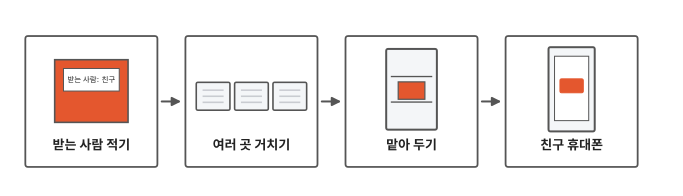
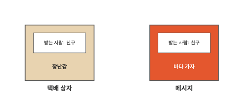
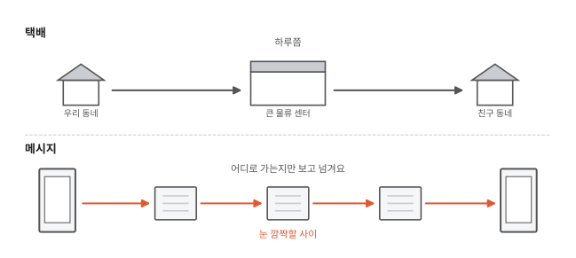
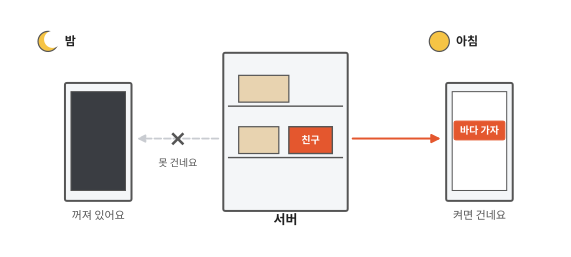

# 메시지는 어떤 길로 갈까요?

## 밤에 보낸 메시지

밤에 친구에게 "바다 가자"라고 메시지를 보냈어요. 그런데 친구 휴대폰은 꺼져 있었어요.

아침에 친구가 휴대폰을 켜니 메시지가 와 있어요. 밤새 메시지는 어디에 있었을까요?

## 내 휴대폰에서 친구 휴대폰까지

그림 네 칸을 왼쪽부터 차례로 따라가요. 10편에서 쪽지가 친구들 손을 거쳐 갔지요? 메시지도 중간을 거쳐요. 이번에는 그 길을 살펴봐요.

## 받는 사람을 적어요

집에 오는 택배 상자에는 받는 사람이 적혀 있지요? 그래야 상자가 맞는 집으로 가요.

메시지도 그래요. 메시지 앱에서 친구를 고르면, 앱이 받는 사람을 메시지 겉에 적어 줘요. 그래서 메시지가 친구를 찾아갈 수 있어요.

## 여러 곳을 거쳐 가요

택배는 우리 동네에서 큰 물류 센터로 가고, 거기서 친구 동네로 가요. 물류 센터에서는 상자를 열지 않아요. 받는 사람만 보고 어느 트럭에 실을지 정해요.

메시지는 중간에 있는 컴퓨터 여러 대를 거쳐 가요. 이 컴퓨터도 메시지를 열어 볼 필요가 없어요. 어디로 가는지만 보고 다음 컴퓨터로 넘겨요. 그림에는 겉에 "친구"라고 적었지만, 컴퓨터가 실제로 보는 건 숫자로 된 주소예요. 거쳐 가는 컴퓨터도 그림의 세 대보다 훨씬 많아요.

이렇게 세상의 컴퓨터를 이어 주는 큰 길을 **인터넷**이라고 해요. 이 길은 한 줄이 아니고, 그물처럼 여러 갈래로 이어져 있어요.

택배와 다른 점도 있어요. 택배는 하루쯤 걸려요. 메시지는 눈 깜짝할 사이에 도착해요.

## 꺼져 있으면 맡아 둬요

메시지가 가는 길 중간에는 메시지 앱을 만든 회사의 컴퓨터가 있어요. 친구 휴대폰이 꺼져 있으면, 이 컴퓨터가 메시지를 맡아 뒀다가 친구 휴대폰이 켜지면 건네줘요.

이렇게 메시지를 맡아 두고 건네주는 컴퓨터를 **서버**라고 해요. 밤새 메시지는 서버에서 기다렸어요.

집에 아무도 없을 때 택배가 경비실이나 택배함에 맡겨진 적 있지요? 그때는 내가 찾으러 가야 해요. 서버는 휴대폰이 켜지면 알아서 건네줘요.

## 정리

- **인터넷**: 세상의 컴퓨터를 이어 주는 큰 길이에요. 메시지는 이 길로 여러 컴퓨터를 거쳐 가요.
- **서버**: 메시지를 맡아 두고 건네주는 컴퓨터예요. 친구 휴대폰이 꺼져 있으면 서버가 메시지를 맡아 뒀다가 건네줘요.

## 해 보기: 교실 택배 놀이

여섯 명이 함께 해요.

1. 보내는 사람 1명, 중간 컴퓨터 2명, 서버 1명, 받는 사람 2명으로 나눠요. 이 차례로 한 줄로 앉아요.
2. 보내는 사람은 쪽지 겉에 받는 사람 이름을 쓰고, 안에 하고 싶은 말을 써서 접어요. 10편 암호로 써도 좋아요.
3. 중간 컴퓨터는 쪽지를 펴지 않고 옆으로 넘겨요. 서버도 펴지 않아요.
4. 서버는 겉의 이름을 보고, 받는 사람 둘 가운데 맞는 사람에게 건네요.
5. 받는 사람이 엎드려 있으면 휴대폰이 꺼진 거예요. 서버는 쪽지를 들고 기다렸다가, 고개를 들면 건네줘요.
6. 역할을 바꿔서 또 해요.

## 확인 문제

??? question "1. 꺼진 휴대폰"
    친구 휴대폰이 꺼져 있을 때 보낸 메시지는 어디에서 기다릴까요?

    **풀이**: 서버에서 기다려요. 친구 휴대폰이 켜지면 서버가 건네줘요.

??? question "2. 중간 컴퓨터"
    중간 컴퓨터들은 메시지 안을 읽어야 다음 곳으로 넘길 수 있을까요?

    **풀이**: 아니요. 어디로 가는지만 보면 돼요. 택배 물류 센터가 상자를 열지 않는 것과 같아요.

??? question "3. 켜져 있으면?"
    친구 휴대폰이 켜져 있을 때 메시지를 보내면, 메시지는 서버에서 오래 기다릴까요?

    **풀이**: 아니요. 친구 휴대폰이 켜져 있으면 서버가 바로 건네줘요. 서버가 오래 맡아 두는 건 휴대폰이 꺼져 있을 때예요.

!!! abstract "어른을 위한 정리 (건너뛰어도 돼요)"
    - 대부분의 메시지 앱은 휴대폰끼리 바로 보내지 않고 회사 서버를 거쳐요. 그래서 받는 쪽이 꺼져 있어도 메시지가 사라지지 않아요. 얼마나 오래 맡아 두는지는 앱마다 달라요. 예를 들어 어떤 앱은 전달하지 못한 메시지를 최대 30일 동안 맡아 두고, 전달하면 서버에서 지워요.[^wa]
    - 서버를 거친다고 서버가 내용을 다 보는 건 아니에요. 열쇠를 보내는 휴대폰과 받는 휴대폰만 아는 방식(종단 간 암호화)을 쓰면 서버도 내용을 못 봐요. 앱이 이 방식을 쓰는지는 앱 설명에서 확인할 수 있어요.[^wa]

## 더 깊이

??? info "작은 조각 여러 개"
    사진이나 영상처럼 큰 것은 작은 조각 여러 개로 나눠서 보내요. 조각마다 받는 곳과 순서가 적혀 있어서, 받는 쪽은 조각이 뒤죽박죽 도착해도 순서대로 다시 이어 붙여요.[^tcp]

??? info "주소는 숫자예요"
    인터넷의 컴퓨터마다 숫자로 된 주소가 있어요. 이 주소를 IP 주소라고 불러요. 중간 컴퓨터들은 이 숫자 주소를 보고 다음 컴퓨터를 골라요.[^ip]

??? info "바다 밑의 길"
    다른 나라 친구에게 보내는 메시지는 대개 바다 밑에 깔린 긴 선을 지나가요. 하늘의 인공위성으로 가는 건 아주 조금뿐이에요.[^cable]

[^wa]: WhatsApp은 전달하지 못한 메시지를 최대 30일 동안 암호화해 서버에 두고, 전달하면 지운다고 밝혀요. [WhatsApp 개인정보처리방침](https://www.whatsapp.com/legal/privacy-policy).
[^tcp]: [RFC 9293, Transmission Control Protocol (TCP)](https://www.rfc-editor.org/rfc/rfc9293).
[^ip]: [RFC 791, Internet Protocol](https://www.rfc-editor.org/rfc/rfc791).
[^cable]: TeleGeography, [Do Submarine Cables Account For Over 99% of Intercontinental Data Traffic?](https://resources.telegeography.com/2023-mythbusting-part-3)
