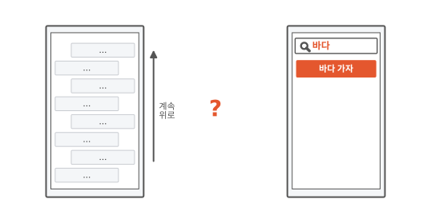
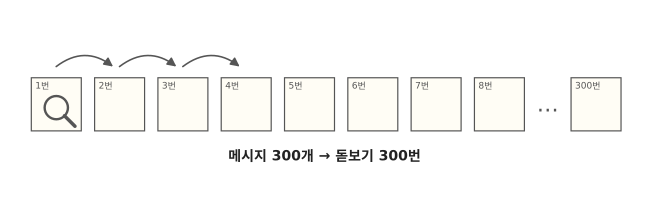
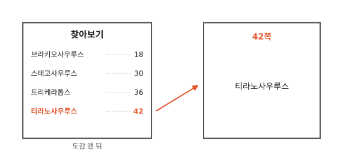
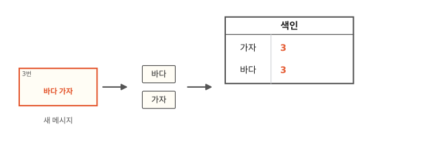
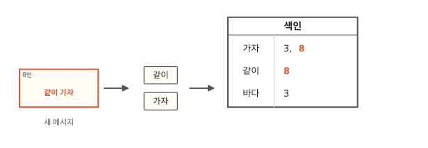
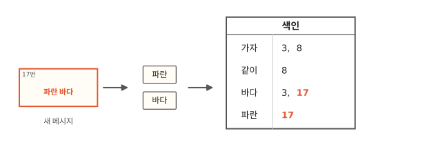
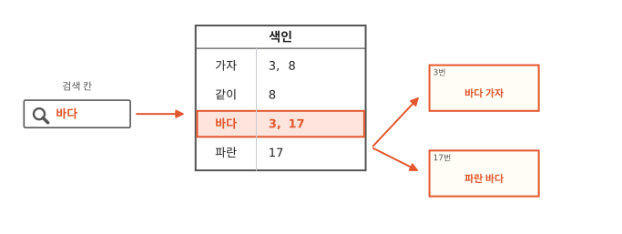

# 검색과 색인: 쌓인 메시지에서 낱말 찾기

지난여름 친구가 보낸 "바다 가자" 메시지를 다시 보고 싶어요. 대화방을 위로 올리고 또 올려도 끝이 안 나요. 그런데 검색 칸에 "바다"를 치면 그 메시지가 금방 나와요. 이 글을 읽고 나면 휴대폰이 어떻게 그렇게 빨리 찾는지 알게 돼요. 비밀은 휴대폰이 미리 적어 둔 표 한 장이에요.

!!! abstract "이 글에서 알게 되는 것"
    1. 메시지를 처음부터 하나씩 다 보면 메시지가 쌓일수록 오래 걸려요. 300개면 300번 봐야 해요.
    2. 휴대폰은 메시지가 올 때마다 낱말마다 메시지 번호를 표에 적어 둬요. 이 표를 색인이라고 해요.
    3. 검색하면 휴대폰은 색인에서 그 낱말 줄만 찾아요. 공룡 도감 맨 뒤의 찾아보기와 같은 방법이에요.

## 1. 검색은 낱말이 들어 있는 메시지를 찾아 줘요

[11편](11-how-messages-travel.md)처럼 주고받은 메시지는 휴대폰에 쌓여요. 몇 년이 지나면 대화방 하나에도 메시지가 아주 많아요. 그 가운데 지난여름의 "바다 가자"를 찾아야 해요.

아래 그림에서 두 휴대폰을 비교해 보세요. 왼쪽은 위로 계속 올리면서 찾고 오른쪽은 검색 칸에 "바다"를 쳤어요.

**그림 1.** 위로 계속 올려도 안 보이던 메시지가 검색 칸에 "바다"를 치니 나와요.
{ .fig-cap }

검색 칸에 "바다"를 치면 바다가 들어간 메시지들이 나와요. 그중에 찾던 메시지도 있어요. 이렇게 낱말을 넣어서 그 낱말이 들어 있는 것을 찾는 일을 **검색**이라고 해요.

휴대폰은 어떻게 찾았을까요? 가장 쉬운 방법부터 해 볼게요.

## 2. 하나씩 다 보면 메시지가 쌓일수록 오래 걸려요

가장 쉬운 방법은 첫 메시지부터 하나씩 "바다"가 들어 있나 보는 거예요. 대화방을 위로 올리면서 찾는 것과 같은 방법이에요. 아래 그림에서 돋보기가 1번, 2번, 3번으로 옮겨 가는 화살표를 보세요.

**그림 2.** 메시지가 300개면 돋보기가 300번 옮겨 다니며 봐야 해요.
{ .fig-cap }

휴대폰 속 컴퓨터는 아주 빨라서 300번쯤은 금방이에요. 그런데 메시지는 몇 년 동안 계속 쌓이고 검색은 하루에도 여러 번 해요. 메시지가 600개면 600번, 그보다 많으면 그만큼 더 봐야 해요. 쌓인 게 아주 많아지면 검색할 때마다 하나씩 다 보는 건 휴대폰에게도 오래 걸려요.

더 빠른 방법은 공룡 도감에 있어요.

## 3. 도감은 맨 뒤 찾아보기로 쪽을 찾아요

공룡 도감에서 티라노사우루스를 찾는다고 해 봐요. 첫 장부터 한 장씩 넘길 수도 있어요. 그런데 도감 맨 뒤를 펴면 더 빨라요. 아래 그림에서 빨간 줄과 빨간 화살표를 보세요.

**그림 3.** 찾아보기에서 "티라노사우루스 42"를 찾고 42쪽을 펴요.
{ .fig-cap }

맨 뒤 "찾아보기"에는 공룡 이름과 쪽 번호가 ㄱ, ㄴ, ㄷ 차례로 적혀 있어요. "티라노사우루스"는 ㅌ으로 시작하니까 찾아보기 끝쪽만 보면 돼요. 거기서 42를 찾아요. 42쪽을 펴면 티라노사우루스가 나와요. 한 장씩 넘길 일이 없어요.

## 4. 휴대폰은 메시지가 올 때마다 색인에 적어 둬요

휴대폰도 찾아보기 같은 표를 만들어 둬요. 메시지 세 개가 차례로 온다고 해 볼게요. 3번 "바다 가자", 8번 "같이 가자", 17번 "파란 바다"예요.

메시지가 오면 휴대폰은 메시지를 띄어쓰기에서 잘라 낱말로 나눠요. 그리고 낱말마다 표에 줄을 하나 두고 그 줄에 메시지 번호를 적어요. 3번 "바다 가자"는 "바다"와 "가자"로 나눠요. 아래 표에서 빨간 숫자를 보세요.

**그림 4.** 3번 메시지가 와서 "가자" 줄과 "바다" 줄에 3을 적었어요.
{ .fig-cap }

이어서 8번 "같이 가자"가 와요. "가자" 줄은 이미 있으니까 그 줄에 8을 더 적어요. "같이" 줄은 없으니까 새로 만들어요.

**그림 5.** 8번 메시지가 와서 "가자" 줄에 8을 더 적고 "같이" 줄을 새로 만들었어요.
{ .fig-cap }

마지막으로 17번 "파란 바다"가 와요. 이번엔 어느 줄이 바뀔지 먼저 맞혀 보세요.

**그림 6.** 17번 메시지가 와서 "바다" 줄에 17을 더 적고 "파란" 줄을 새로 만들었어요.
{ .fig-cap }

줄은 가나다 차례로 놓여요. 그래서 "같이" 줄은 "가자"와 "바다" 사이에 들어갔고 "파란" 줄은 맨 아래에 붙었어요.

이렇게 낱말마다 그 낱말이 든 메시지 번호를 적어 둔 표를 **색인**이라고 해요. 도감 찾아보기에는 중요한 이름만 골라 적어요. 휴대폰 색인에는 메시지의 낱말을 거의 다 적어요. 그래서 색인은 아주 길어요.

## 5. 검색하면 색인에서 그 낱말 줄만 찾아요

색인이 생겼으니 이제 "바다"를 검색해 볼게요. 아래 그림에서 검색 칸의 "바다"가 색인의 어느 줄로 가는지 보세요.

**그림 7.** 색인 "바다" 줄에 적힌 3번과 17번 메시지만 열어서 보여 줘요.
{ .fig-cap }

휴대폰은 메시지를 하나씩 보지 않고 색인에서 "바다" 줄을 찾아요. 색인도 가나다 차례로 놓여 있어서 도감에서 ㅌ 쪽을 펴듯 ㅂ이 있을 만한 곳만 보면 돼요. "바다" 줄에는 3과 17이 적혀 있어요. 그래서 3번과 17번 메시지만 열어서 보여 줘요. 메시지마다 보낸 날짜가 있으니까 둘 가운데 지난여름 것을 고르면 돼요.

색인을 만드는 데도 시간이 들어요. 그래도 메시지가 올 때마다 조금씩 적어 두니까 검색할 때는 빨라요.

??? info "\"바다에\"도 \"바다\"로 찾아요"
    메시지에는 "바다에 가자", "바다로 가자"처럼 적혀 있기도 해요. 컴퓨터는 색인에 적기 전에 "에", "로" 같은 조사를 떼어서 "바다"로 적어 둬요. 그래서 "바다"로 찾아도 나와요.

## 확인 문제

??? question "1. 색인 읽기"
    색인에 "사자: 4, 9"라고 적혀 있어요. "사자"가 들어 있는 메시지는 몇 번일까요?

    **풀이**: 4번과 9번이에요.

??? question "2. 새 메시지가 오면"
    12번 메시지 "사자 보러 가자"가 새로 왔어요. 색인의 "사자" 줄은 어떻게 바뀔까요? 다른 줄도 바뀔까요?

    **풀이**: "사자: 4, 9, 12"가 돼요. "보러" 줄과 "가자" 줄에도 12를 적어요.

## 정리

메시지를 처음부터 하나씩 다 보면 300개일 때 300번 봐야 해요. 메시지가 쌓일수록 그만큼 더 오래 걸려요.

휴대폰은 메시지가 올 때마다 낱말로 나눠서 낱말마다 메시지 번호를 적어 둬요. "바다 가자", "같이 가자", "파란 바다"가 오면 "바다" 줄에 3과 17이 적혀요. 이 표가 색인이에요.

"바다"를 검색하면 휴대폰은 색인에서 "바다" 줄만 찾아서 3번과 17번 메시지를 보여 줘요. 공룡 도감 맨 뒤의 찾아보기로 42쪽을 펴는 것과 같은 방법이에요.

메시지가 두 배로 늘면 하나씩 보기도 두 배로 오래 걸려요. 일이 얼마나 늘어나는지 재는 방법은 알고리즘 [1편](../algorithms/01-why-big-o.md)에서 봐요.

### 새로 나온 말

- **검색**: 낱말을 넣어서 그 낱말이 들어 있는 메시지나 글을 찾는 일. 검색 칸에 "바다"를 치면 "바다 가자"가 나와요.
- **색인**: 낱말마다 그 낱말이 든 메시지 번호를 적어 둔 표. "바다" 줄에는 3과 17이 적혀 있어요.
