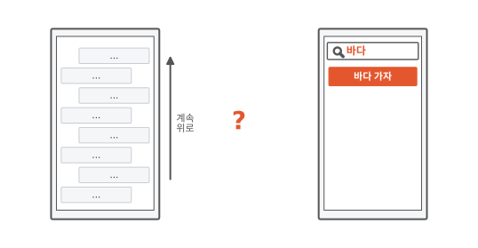
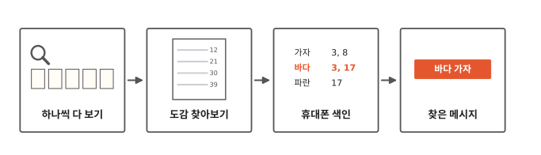
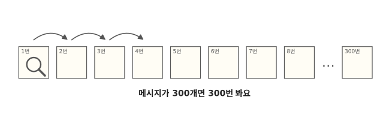
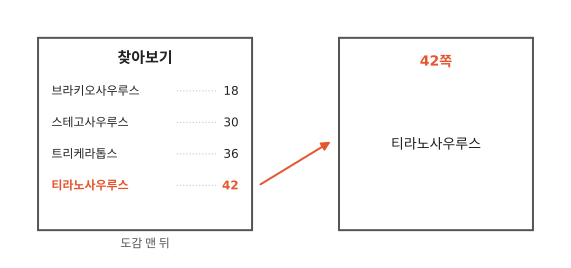
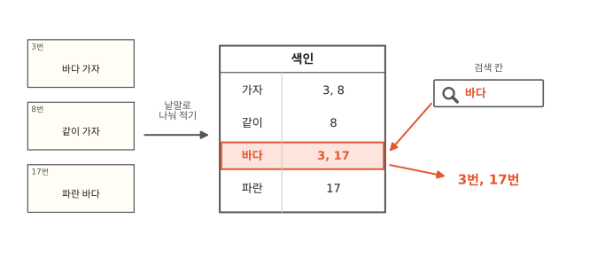

# 검색하면 어떻게 바로 찾을까요?

## 지난 여름 메시지

지난 여름에 친구가 "바다 가자"라고 보낸 메시지를 다시 보고 싶어요. 대화방을 위로 올리고 또 올려도 끝이 안 나요.

그런데 검색 칸에 "바다"를 치니, 바다가 들어간 메시지들이 나오고 그중에 그 메시지도 있어요. 이렇게 낱말을 넣어서 그 낱말이 들어 있는 것을 찾는 일을 **검색**이라고 해요.

휴대폰은 어떻게 이렇게 빨리 찾았을까요?

## 하나씩 보기에서 바로 찾기까지

그림 네 칸을 왼쪽부터 차례로 따라가요. 처음에는 하나씩 다 보는 느린 방법을 봐요. 그다음 공룡 도감의 찾아보기를 보고, 휴대폰도 같은 표를 만들어 둔다는 걸 봐요. 마지막 칸은 그 표로 찾은 메시지예요.

## 하나씩 다 보면 오래 걸려요

먼저 느린 방법부터 봐요. 첫 메시지부터 하나씩 "바다"가 들어 있나 보는 방법이에요. 대화방을 위로 올리면서 찾는 것과 같아요.

메시지가 300개면 300번을 봐야 해요. 1편에서 본 것처럼 휴대폰 속 컴퓨터는 아주 빨라서, 300번쯤은 금방이에요.

그런데 메시지는 몇 년 동안 계속 쌓이고, 검색은 하루에도 여러 번 해요. 쌓인 게 아주 많아지면 검색할 때마다 하나씩 다 보는 건 휴대폰도 오래 걸려요.

## 도감 맨 뒤에는 찾아보기가 있어요

공룡 도감에서 티라노사우루스를 찾는다고 해 봐요. 첫 장부터 한 장씩 넘길 수도 있지만, 도감 맨 뒤를 펴면 더 빨라요.

맨 뒤 "찾아보기"에는 공룡 이름과 쪽 번호가 ㄱ, ㄴ, ㄷ 차례로 적혀 있어요. "티라노사우루스"는 "ㅌ"으로 시작하니까 찾아보기 끝쪽만 보면 돼요. "티라노사우루스 42"를 찾고 42쪽을 펴면 티라노사우루스가 나와요.

## 휴대폰도 찾아보기를 만들어 둬요

메시지가 오면 휴대폰은 메시지를 낱말로 나눠요. "바다 가자"는 "바다"와 "가자"로 나눠요. 그리고 낱말마다 메시지 번호를 표에 적어요.

3번 "바다 가자"가 오면, "바다" 줄에 3을 적어요. "가자" 줄에도 3을 적어요.

8번 "같이 가자"가 오면, "가자" 줄에 8을 더 적어요.

17번 "파란 바다"가 오면, "바다" 줄에 17을 더 적어요.

이렇게 낱말마다 어디에 있는지 적어 둔 표를 **색인**이라고 해요.

검색 칸에 "바다"를 치면, 휴대폰은 메시지를 하나씩 보지 않고 색인에서 "바다" 줄을 찾아요. 색인도 낱말 차례로 놓여 있어요. 도감에서 "ㅌ" 쪽을 펴듯, "ㅂ"이 있을 만한 곳만 보면 돼요. 그리고 "바다" 줄에 적힌 3번과 17번을 열어서 보여 줘요. 메시지마다 보낸 날짜가 있으니까, 둘 가운데 지난 여름 것을 고르면 돼요.

도감과 다른 점도 있어요. 도감 찾아보기에는 중요한 이름만 골라 적어요. 휴대폰 색인에는 메시지의 낱말을 거의 다 적어요. 그래서 색인이 아주 길어요.

색인을 만드는 데도 시간이 들어요. 그래도 메시지가 올 때마다 조금씩 적어 두니까, 검색할 때는 빨라요.

## 정리

- **검색**: 낱말을 넣으면, 그 낱말이 들어 있는 메시지나 글을 찾아 주는 것이에요.
- **색인**: 낱말마다 어디에 있는지 적어 둔 표예요. 휴대폰은 하나씩 다 보지 않고 색인에서 찾아요.

## 해 보기: 쪽지 색인 만들기

친구와 둘이서 해요.

1. 쪽지 열 장 앞면에 짧은 말을 하나씩 써요. "바다 가자", "사자 봤어", "파란 바다"처럼 낱말 사이를 띄어 써요.
2. 쪽지 뒷면에 1부터 10까지 번호를 써요.
3. 색인 종이를 한 장 만들어요. 낱말을 쓰고, 그 낱말이 있는 쪽지 번호를 옆에 적어요. "바다: 1, 3"처럼요.
4. 글이 안 보이게 쪽지를 뒤집어서, 번호 차례로 늘어놓아요. 찾을 낱말을 다섯 개 정해요.
5. 한 사람은 낱말마다 1번부터 하나씩 뒤집어 읽으면서 찾아요. 다른 사람은 색인 종이를 보고 그 번호 쪽지만 뒤집어요. 누가 먼저 다섯 개를 다 찾았나요?
6. 색인 종이를 만드는 데도 시간이 걸렸지요? 그래도 한 번 만들어 두면 여러 번 쓸 수 있어요.

## 확인 문제

??? question "1. 색인 읽기"
    색인에 "사자: 4, 9"라고 적혀 있어요. "사자"가 들어 있는 메시지는 몇 번일까요?

    **풀이**: 4번과 9번이에요.

??? question "2. 새 메시지가 오면"
    12번 메시지 "사자 보러 가자"가 새로 왔어요. 색인의 "사자" 줄은 어떻게 바뀔까요? 다른 줄도 바뀔까요?

    **풀이**: "사자: 4, 9, 12"가 돼요. 새 메시지 번호를 더 적어요. 다른 줄도 바뀌어요. "보러" 줄과 "가자" 줄에도 12를 적어요.

??? question "3. 하나씩 다 보기"
    메시지가 많아질수록 하나씩 다 보는 방법은 왜 더 느려질까요?

    **풀이**: 봐야 할 메시지가 그만큼 늘어나니까요. 300개면 300번, 600개면 600번을 봐야 해요.

!!! abstract "어른을 위한 정리 (건너뛰어도 돼요)"
    - 검색 엔진은 낱말마다 그 낱말이 든 문서 목록을 적어 둔 표(역색인)를 미리 만들어 둬요.[^ir] 색인을 만드는 시간과 저장 공간을 먼저 쓰는 대신, 찾는 시간이 줄어요.
    - 한국어는 "바다에", "바다로"처럼 낱말 뒤에 조사가 붙어서, 색인을 만들 때 조사를 떼어 내는 처리를 따로 해요.[^nori] 검색이 기대와 다르게 나올 때는 이 처리가 원인일 수 있어요.

## 더 깊이

??? info "\"바다에\"도 \"바다\"로 찾아요"
    메시지에는 "바다에 가자", "바다로 가자"처럼 적혀 있기도 해요. 컴퓨터는 색인에 적기 전에 "에", "로" 같은 조사를 떼어서 "바다"로 적어 둬요. 그래서 "바다"로 찾아도 나와요.[^nori]

??? info "무엇을 먼저 보여 줄까"
    "바다"가 든 메시지가 열 개 나오면, 어떤 걸 맨 위에 보여 줄지 정해야 해요. 최근 것을 먼저 보여 주기도 하고, 찾는 말과 더 잘 맞는 것을 먼저 보여 주기도 해요.

??? info "검색 사이트는 어떻게 웹 페이지를 모을까"
    검색 사이트는 자동으로 움직이는 프로그램을 보내서 웹 페이지를 미리 읽어 와요. 읽어 온 페이지로 색인을 만들고, 누가 검색하면 그 색인에서 찾아요.[^google]

[^google]: Google 검색 센터, [How Google Search works](https://developers.google.com/search/docs/fundamentals/how-search-works).
[^ir]: Ricardo Baeza-Yates, Berthier Ribeiro-Neto, *Modern Information Retrieval* 2판 9장 강의 자료(역색인). [PDF](https://users.dcc.uchile.cl/~rbaeza/mir2ed/pdf/slides_chap09.pdf).
[^nori]: Apache Lucene 한국어 분석기는 기본으로 조사·어미를 색인에서 빼요. [KoreanPartOfSpeechStopFilter.java](https://github.com/apache/lucene/blob/main/lucene/analysis/nori/src/java/org/apache/lucene/analysis/ko/KoreanPartOfSpeechStopFilter.java).
