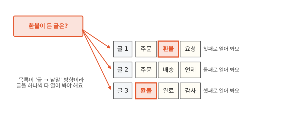
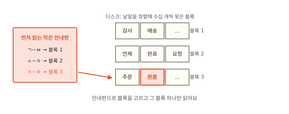
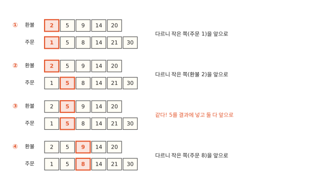
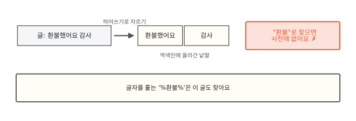
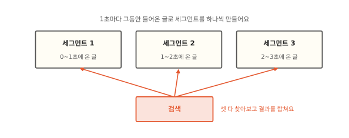
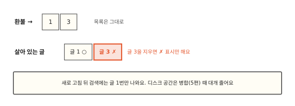
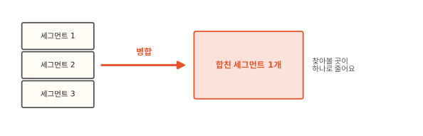

# 검색 엔진은 왜 목록을 거꾸로 만들어 둘까요?

## 백만 개 중에서 "환불" 찾기

어느 쇼핑몰 문의 게시판에 글이 백만 개 쌓였어요. 글은 데이터베이스에 들어 있어요. 데이터베이스는 글 같은 자료를 표에 차곡차곡 넣어 두고 꺼내 주는 프로그램이에요. 검색 칸에 "환불"을 치면 데이터베이스는 그림처럼 1번 글부터 한 줄씩 읽으면서 "환불"이 든 글을 골라요. 글이 많으니 결과가 나오기까지 한참 걸려요.

같은 글을 Elasticsearch(줄여서 ES)에 넣고 찾으면 훨씬 빨리 끝나요. ES는 검색을 전문으로 하는 프로그램이고 넣은 글 하나하나를 문서(document)라고 불러요. 이 편에서는 그냥 글이라고 할게요. 글 백만 개는 똑같은데 왜 이렇게 차이가 날까요? 답은 ES가 글을 받을 때 미리 만들어 두는 목록 하나에 있어요. 그 목록을 보기 전에 데이터베이스는 왜 빨리 못 찾는지부터 볼게요.

## 정렬해 둔 목록으로도 못 찾는 검색

데이터베이스도 빨리 찾는 목록을 만들 수 있어요. 자주 찾는 칸에 따로 만들어 두는 이 목록을 데이터베이스 인덱스(우리말로 색인)라고 하는데 국어사전이 낱말을 늘어놓듯이 값을 가나다순으로 정렬해 둔 거예요([알고리즘 11편](../algorithms/11-btree.md)의 B-트리가 이 목록을 짜는 방법이에요). 정렬돼 있으면 "환불로 시작하는 글"은 그림의 빨간 줄처럼 한곳에 모여 있으니 그 자리로 가서 거기부터 읽으면 끝나죠. 데이터베이스에 내리는 검색 명령에서는 이걸 `'환불%'`라고 써요. `%`는 그 자리에 아무 글자나 와도 된다는 표시예요.

게시판 검색은 "환불이 어디든 들어 있는 글", 곧 `'%환불%'`이에요. 이런 글은 정렬된 목록 여기저기에 흩어져 있어요. "빠른 환불 부탁"은 ㅃ 근처에, "주문 환불 요청"은 ㅈ 근처에 있으니 찾아갈 자리가 없어요. 그래서 데이터베이스는 정렬된 목록을 쓰지 못하고 1번 글부터 끝까지 다 읽어요. 이렇게 처음부터 끝까지 다 읽는 일을 전체 훑기(full scan)라고 해요. 글이 열 배가 되면 검색 시간도 열 배가 돼요. MySQL 같은 데이터베이스도 낱말 검색용 색인(FULLTEXT)을 따로 붙이면 빨리 찾는데 그 색인이 바로 이 편에서 볼 목록이에요.[^mysql]

## 글마다 낱말 목록을 만들어도 마찬가지예요

그러면 글을 저장할 때 띄어쓰기로 낱말을 잘라서 글마다 낱말 목록을 붙여 두면 어떨까요? 1번 글에는 "주문, 환불, 요청", 2번 글에는 "주문, 배송, 언제"를 붙여 두는 식이에요.

글마다 낱말 몇 개만 맞춰 보면 되니 긴 글을 글자 하나하나 훑을 때보다 글 하나를 보는 일은 가벼워져요. 그래도 그림처럼 글 백만 개의 목록을 하나씩 다 열어 봐야 하는 건 그대로예요. 이 목록으로 바로 답할 수 있는 건 "3번 글에는 무슨 낱말이 있지?"예요. 우리가 묻는 "환불이 든 글은 어디 있지?"와는 방향이 거꾸로거든요.

## 뒤집으면 낱말에서 바로 글로 가요

그래서 목록을 뒤집어요. 낱말마다 그 낱말이 든 글 번호를 적어 두는 거예요. "환불 → 1, 3", "주문 → 1, 2". 이렇게 낱말에서 글로 가는 목록을 **역색인**(inverted index)이라고 불러요. 글에서 낱말로 가는 앞 절의 목록을 거꾸로(역) 뒤집은 색인이라는 뜻이에요. [컴퓨터 12편](../computer/12-how-search-works.md)에서 휴대폰이 메시지가 올 때마다 적어 두던 색인이 바로 이 역색인이에요.

그런데 낱말이 수천 개라면 그중 "환불" 줄은 어떻게 빨리 찾을까요?

## 사전에서 낱말 하나 찾기

검색 엔진에서는 잘라 낸 낱말 하나를 용어(term)라고 불러요. 그래서 역색인에서 낱말 칸만 모은 쪽을 **용어 사전**(term dictionary)이라고 해요. 용어 사전은 가나다순으로 정렬해 둬요.[^hash]

정렬돼 있으니 "환불"은 [이진 탐색](../algorithms/03-why-sorted-is-fast.md)으로 찾을 수 있어요. 일곱 낱말의 가운데인 "완료"를 보고 환불이 더 뒤에 있으니 앞 절반을 버려요. 남은 "요청, 주문, 환불"의 가운데 "주문"을 보고 또 뒤로 가면 세 번 만에 "환불"에 닿아요. 거기 달린 글 번호 1, 3을 꺼내면 검색이 끝나요.

이렇게 찾으면 글을 하나씩 보는 것보다 얼마나 빠를까요?

## 글이 늘어도 사전에서 찾는 걸음은 그대로예요

글을 하나씩 보는 전체 훑기와 역색인에서 찾는 방법이 얼마나 차이 나는지 파이썬(프로그램을 짜는 언어)으로 재 봤어요. 낱말 30개짜리 글 20만 개를 만들고 그중 두 글에만 "환불"을 넣었어요.[^lab]

ms는 1초를 천으로 나눈 밀리초예요. 목록을 미리 만드는 시간은 빼고 찾는 시간만 보면 이 실험에서는 만 배 넘게 차이가 났어요. 만드는 시간은 조금 뒤에 따로 봐요. 0.2초면 짧아 보이지만 검색창 하나에 수많은 사람이 동시에 검색하면 그 시간이 쌓여 줄이 길어져요. 글이 늘면 이 차이가 더 벌어지고요.

하나씩 보는 쪽은 글 수만큼 걸음이 늘어요. 역색인 쪽은 사전에서 낱말을 찾는 걸음이 글 수와 상관없어요. 실험의 낱말 종류는 5,000개인데 반씩 버리기를 13번 하면 하나가 남으니 13걸음이면 찾아요. 찾은 다음 그 낱말이 든 글 번호를 꺼내는 만큼만 더 걸려요. 새 글에 처음 보는 낱말이 섞이면 사전도 커지죠. 두 배로 커져도 이진 탐색은 한 걸음 늘 뿐이에요. 실제 ES는 사전을 찾을 때 이진 탐색만 쓰지 않아서 걸음 수는 이와 달라요. 그래도 글이 늘어도 걸음이 거의 그대로라는 점은 같아요.

??? info "심화: 낱말이 수억 개면 사전을 다 메모리에 올릴까요?"
    ES에 글이 쌓여 사전이 아주 커지면 메모리가 모자라지 않을지 궁금할 때 보는 칸이에요. 낱말이 수억 개여도 사전을 다 메모리에 올리지 않고 찾는 방법을 다뤄요.

    컴퓨터에서 메모리는 손 닿는 작업대이고 디스크는 뒤쪽 창고예요. 작업대는 빠르지만 좁고 창고는 넓지만 꺼내 오는 데 시간이 걸려요. 그래서 큰 것은 창고에 두고 지금 쓰는 것만 작업대에 올려요.

    글 안의 칸(제목, 본문, 주문번호 같은 것)을 ES에서는 필드라고 해요. 주문번호나 이메일처럼 글마다 값이 다른 필드를 넣으면 사전의 낱말이 수억 개가 되기도 해요. 두꺼운 국어사전을 찾을 때 옆면의 ㄱ·ㄴ·ㄷ 표시로 먼저 자리를 잡듯이 ES는 사전을 디스크에 두고 낱말을 수십 개씩 묶은 덩어리(블록)로 나눠 둬요. 그리고 어느 낱말이 어느 블록에 있는지 적은 작은 안내판을 따로 만들어 둬요. 이 안내판을 ES는 용어 색인(term index)이라고 불러요.

    

    찾을 때는 안내판으로 블록을 고르고 디스크에서 그 블록 하나만 읽어 와요.[^leaf] 블록은 필요할 때 하나씩만 읽으니 사전 전체를 메모리에 올릴 필요가 없죠. 실제 안내판은 그림의 첫 글자 범위보다 훨씬 촘촘하게 적혀 있어요(6편).

??? info "심화: 안내판은 ES 메모리를 얼마나 차지할까요?"
    ES가 컴퓨터 메모리를 얼마나 쓰는지 궁금할 때 보는 칸이에요. 낱말이 아주 많아져도 ES 몫의 메모리가 늘지 않는 까닭을 다뤄요.

    앞 칸의 안내판은 사전보다 훨씬 작지만 낱말이 수억 개면 안내판도 꽤 커져요. 여럿이 쓰는 작업실에서 내 책상 크기를 먼저 정해 두듯이 ES는 시작할 때 자기 전용 메모리 크기를 정해 두고 그 안에서 일해요. ES는 자바라는 프로그래밍 언어로 만들어서 이 전용 메모리를 자바 힙(heap)이라고 해요. 옛 버전은 안내판을 이 힙에 통째로 올려 뒀어요. 그래서 크기가 정해진 힙을 안내판이 많이 차지했어요.

    

    ES 7.7부터는 안내판을 디스크 파일로 두고 필요한 부분만 운영체제(윈도나 macOS처럼 컴퓨터 전체를 관리하는 프로그램)가 그때그때 메모리로 읽어 줘요.[^offheap] 도서관 열람실의 빈 책상에 자주 보는 책을 잠깐 펼쳐 두다가 누가 앉으면 치우듯이 운영체제는 아무도 안 쓰는 메모리에 읽은 파일을 놓아두다가 다른 프로그램이 메모리를 달라고 하면 그 자리를 내줘요. 이렇게 운영체제가 파일을 잠깐 놓아두는 메모리를 페이지 캐시(page cache)라고 해요. 그래서 낱말이 아주 많아도 ES 전용 메모리는 거의 늘지 않아요.

그러면 "환불 주문"처럼 낱말 두 개가 다 든 글만 보고 싶을 때는 어떻게 할까요?

## 두 낱말이 다 든 글은 목록 둘을 겹쳐 찾아요

"환불"과 "주문"이 둘 다 든 글을 찾을 때는 두 낱말에 달린 글 번호 줄을 꺼내서 겹치는 번호만 골라요. 수학에서 말하는 교집합이에요. 낱말 하나에 달린 이 글 번호 줄을 **포스팅 목록**(postings list)이라고 해요. 포스팅 목록은 글 번호순으로 정렬해 두는데 그래야 두 줄을 앞에서부터 같이 훑을 수 있어요.

두 목록의 맨 앞에 손가락을 하나씩 올려요. 환불 쪽은 2, 주문 쪽은 1이에요. 번호가 다르면 작은 쪽 손가락만 한 칸 앞으로 옮기니 주문 쪽이 5로 가요. 이번엔 환불 쪽 2가 작아서 환불 쪽이 5로 가죠. 둘 다 5가 됐으니 5를 결과에 넣고 둘 다 한 칸씩 옮겨요. 어느 손가락도 뒤로 돌아가지 않으니 두 목록을 한 번씩만 훑고 끝나요. 같은 실험의 글 20만 개에서 포스팅 목록에 글 번호가 천 개쯤씩 달린 낱말 두 개를 골라 겹쳐 봤더니 1 ms도 안 걸렸어요. 글을 하나씩 보며 낱말 하나를 찾던 200 ms와 비교하면 200분의 1도 안 돼요.

"환불 또는 주문"은 같은 방식으로 훑으면서 어느 한쪽에라도 있는 번호를 모으면 돼요. 하나 조심할 게 있어요. ES에서 가장 흔히 쓰는 검색(`match`)은 "환불 주문"처럼 낱말 두 개를 받으면 기본으로 이 "또는" 쪽으로 찾아요. 그래서 "환불"만 든 글도 함께 나와요. 둘 다 든 글만 보여 주는 쇼핑몰 검색창이라면 쇼핑몰 프로그램이 ES에 검색을 넘길 때 "둘 다"라고 따로 알려 준 거예요.[^and]

??? info "심화: '환불 요청'처럼 붙은 말은 어떻게 찾을까요?"
    따옴표 검색이 어떻게 붙은 말만 골라내는지 궁금할 때 보는 칸이에요. 검색창에 따옴표를 붙여 "환불 요청"을 치면 두 낱말이 이 순서로 붙어 있는 글만 보여 주는 곳이 많아요. 이렇게 낱말이 붙은 차례 그대로 찾는 검색을 구문 검색이라고 해요. "요청 먼저 하고 환불 대기"라는 글은 두 낱말이 다 있어도 빠지죠. 글 번호만 적어 둔 목록으로는 이 둘을 가를 수 없어요. 그래서 역색인은 낱말이 글의 몇 번째 위치에 있는지도 함께 적어 둬요.

    

    위치를 적으면 색인이 그만큼 커져요. 그래서 ES는 필드(글 안의 제목이나 본문 같은 칸)마다 위치를 적을지 고르게 해 뒀어요(`index_options`). 문장을 담는 필드는 기본으로 위치까지 적어요. 공간을 아끼려고 이 설정을 낮춘 필드에 구문 검색(`match_phrase`)을 보내면 위치 정보(positions)가 없다는 오류가 나요.[^index-options]

이렇게 찾는 쪽은 빨라졌는데 목록을 미리 만드는 데는 무엇이 들까요?

## 미리 만드는 데는 시간과 공간이 들어요

위 실험에서 글 20만 개로 역색인을 만드는 데 1초 가까이 걸렸어요. 글을 하나 넣을 때마다 낱말을 자르고 낱말마다 목록에 번호를 더해야 하거든요. 그래서 이 실험에서는 검색을 다섯 번 넘게 해야 미리 만든 쪽이 이득이었어요.

공간도 들어요. 원래 글과 따로 역색인을 저장하니 디스크(자료를 오래 보관하는 저장 장치)를 더 써요.

시간과 공간 말고 역색인에 내주는 게 하나 더 있어요. 찾을 수 있는 것이 정해져 버려요.

## 잘라 둔 낱말로만 찾을 수 있어요

역색인에는 미리 잘라 둔 낱말만 올라가요. 그래서 낱말을 어떻게 자르느냐에 따라 찾을 수 있는 글이 달라져요. 글에 "환불했어요"라고만 적혀 있으면 띄어쓰기로 자른 낱말은 "환불했어요"라서 "환불"로는 안 나와요.

처음 장면의 데이터베이스는 글자를 하나하나 훑으니 이 글도 찾아내요. 그래서 게시판 검색을 데이터베이스에서 ES로 옮기면 전에는 나오던 글이 안 나올 수 있어요.

역색인에 내주는 게 또 있어요. 게시판에는 새 글이 쉬지 않고 올라오는데 넣은 글이 바로 검색되지 않아요. 왜 그럴까요?

## 넣은 글은 잠시 뒤에야 검색돼요

글이 올 때마다 역색인을 고쳐 쓰면 느려요. 택배 기사가 물건을 하나 받을 때마다 출발하지 않고 조금 모았다가 한 번에 싣고 가듯이 ES도 넣은 글을 잠깐(기본 1초) 모았다가 그 글들로 작은 역색인을 새로 하나 만들어요. 이 작은 역색인을 세그먼트(segment)라고 하고 세그먼트를 만드는 이 일을 새로 고침(refresh)이라고 해요(4편). 넣은 글이 잠시 뒤에야 검색에 나오는 게 이 때문이에요.

새로 고침을 할 때마다 세그먼트가 하나씩 생기니 ES 안에는 세그먼트가 여러 개 있어요. 검색할 때는 세그먼트를 모두 찾아보고 결과를 합쳐요.

??? info "심화: 글을 지우면 역색인에서도 바로 지워질까요?"
    글을 지웠는데 검색에 언제부터 안 나오고 지운 만큼 저장 공간은 언제 비는지 궁금할 때 보는 칸이에요. 휴대폰에서 사진을 지워도 "최근 삭제" 앨범에 한동안 남아 있듯이 ES도 지운 글을 바로 없애지 않아요. 앨범과 달리 지운 글을 되살릴 수는 없어요.

    ES는 한 번 만든 세그먼트를 고치지 않아요(5편). 그래서 글을 지울 때 "이 글은 지움"이라는 삭제 표시만 따로 해 두고 목록은 그대로 둬요.

    

    검색할 때 이 표시를 보고 지운 글을 걸러 내요. 지운 글은 다음 새로 고침 뒤부터 검색 결과에서 빠져요. 그럼 공간은 언제 빌까요? 세그먼트가 너무 많아지면 찾아볼 곳이 늘어 검색이 느려져요. 그래서 ES는 틈틈이 몇 개씩 하나로 합치는데 이 일을 병합이라고 해요(5편).

    

    병합할 때 지운 글은 새 세그먼트로 옮기지 않아요. 그래서 목록 속 번호와 디스크 공간은 이 병합 때 대개 함께 치워져요.[^df] 글을 고치는 것도 옛 글을 지우고 새 글을 넣는 방식이라 똑같아요.

만드는 데 시간과 공간이 들고 못 찾는 글이 생기고 넣은 글도 잠시 늦게 보인다면 역색인은 언제 만들 만할까요?

## 역색인은 언제 쓸모 있을까요

두 가지를 물어보면 대부분 정해져요. 먼저 자주 찾는지예요. 몇 년 치 가계부 파일에서 가끔 가게 이름을 찾는 정도라면 그때그때 파일을 훑어도 충분해요. 미리 만든 목록을 꺼낼 일이 드물면 넣을 때 들인 시간을 되찾지 못해요. 게시판 검색처럼 하루에도 수없이 찾는다면 미리 만든 쪽이 금방 이득을 봐요.

다음은 글 중간에 든 낱말로 찾는지예요. 상품 이름이 "청바"로 시작하는 것만 찾는다면 앞부분이 정해진 검색이라 데이터베이스 인덱스로 충분해요(`'청바%'`). "데님"을 쳤을 때 "슬림핏 데님 바지"까지 나와야 한다면 글 중간의 낱말로 찾는 일이라 역색인이 필요해요. "환불했어요"까지 "환불"로 찾게 낱말을 잘 자르는 방법은 [2편](02-analyzer.md)에서 이어 가요.

## 정리

- 역색인: 낱말에서 그 낱말이 든 글 번호로 가는 목록이에요. 글에서 낱말로 가는 목록을 뒤집은 모양이에요.
- 용어 사전: 역색인의 낱말 쪽이에요. 정렬돼 있어서 글이 늘어도 낱말 하나를 빨리 찾아요.
- 포스팅 목록: 낱말 하나에 달린 글 번호 줄이에요. 번호순이라 두 목록을 한 번씩만 훑어 겹칠 수 있어요.
- 미리 만드는 데 시간과 공간이 들고 잘라 둔 낱말로만 찾을 수 있어요. 넣은 글은 모았다가 세그먼트로 올려서 잠시 뒤에 검색돼요. 자주 찾고 글 중간의 낱말로 찾을 때 쓸모 있어요.

[^mysql]: MySQL 8.0 참조 매뉴얼, "Comparison of B-Tree and Hash Indexes". LIKE의 인자가 와일드카드로 시작하지 않는 상수 문자열이면 B-트리 인덱스를 쓸 수 있어요. `'%Patrick%'`처럼 와일드카드로 시작하면 쓰지 않는 예도 실려 있어요. 이 편의 데이터베이스는 이런 기본 인덱스만 둔 경우예요. MySQL에는 낱말 검색용 색인(FULLTEXT)을 따로 붙이는 기능도 있는데 그 색인은 이 편에서 볼 역색인과 같은 생각으로 만들어요. <https://dev.mysql.com/doc/refman/8.0/en/index-btree-hash.html>
[^lab]: 낱말 5,000종에서 30개씩 뽑아 글을 만들었어요. 파이썬 메모리 안에서 두 방법을 비교한 것이라 데이터베이스나 ES의 실제 시간과는 달라요. 시간은 컴퓨터마다 달라서 그림에는 여러 번 잰 값을 어림해 적었어요.
[^and]: ES `match` 질의는 `operator` 기본값이 `or`이고 `"operator": "and"`를 주면 둘 다 든 글만 찾아요. 이 편에 적은 ES 동작(`operator` 기본값, 위치 정보가 없는 필드의 구문 검색 오류, 지운 글이 새로 고침 뒤에 빠지는 것, 지운 글이 "이 낱말이 든 글 수"에 남는 것)은 로컬 ES 7.17.26과 9.2.0에서 똑같이 확인했어요.
[^index-options]: Elasticsearch 문서, "index_options" 매핑 파라미터. `text`의 기본값은 positions이고 docs나 freqs로 낮추면 구문 검색을 할 수 없어요. <https://www.elastic.co/guide/en/elasticsearch/reference/current/index-options.html>
[^df]: ES는 검색 결과의 순서를 정할 때 "이 낱말이 든 글 수"(문서 빈도)를 써요(8편). 병합 전까지는 이 수에 지운 글도 들어 있어서 지운 글이 많으면 순서가 조금 어긋나고 병합 뒤에 살짝 바뀌기도 해요.
[^hash]: 낱말 하나만 찾는다면 낱말을 칸 번호로 바로 바꾸는 규칙인 [해시](../algorithms/09-hash.md)로도 찾을 수 있어요. 정렬해 두면 "환불로 시작하는 낱말"처럼 이웃한 낱말까지 한꺼번에 꺼낼 수 있어서 ES는 정렬을 골라요.
[^leaf]: 블록 안은 앞에서부터 차례로 훑어요. 블록 하나에 낱말이 수십 개뿐이라 많아야 수십 걸음이에요. ES 8.15부터는 블록 안 낱말이 모두 같은 길이일 때(자릿수가 같은 주문번호처럼) 블록 안도 이진 탐색으로 찾아요. Lucene 9.11 변경 기록 GITHUB#11888(블록 안 낱말 길이가 같으면 이진 탐색, 같은 길이의 아이디 찾기를 예로 듦). ES 8.15가 Lucene 9.11을 써요. <https://github.com/apache/lucene/blob/releases/lucene/9.12.0/lucene/CHANGES.txt>
[^offheap]: ES는 자바로 만든 프로그램이라 자바가 직접 관리하는 메모리(자바 힙)를 따로 잡아 써요. 옛 버전은 안내판도 이 힙에 올렸어요. ES 7.3부터 `_id`(글마다 붙는 고유 번호 칸)를 뺀 필드의 안내판을, 7.7부터는 `_id`까지 힙 밖에 둬요. Lucene 8.0 변경 기록 LUCENE-8635(기본 키가 아닌 필드의 용어 사전 색인을 힙 밖에), Elasticsearch 7.3 릴리스 노트 #42838·#43150(`_id` 말고 나머지 필드, 7.3은 mmap 저장일 때), ES 7.7.0 릴리스 노트 #52405(`_id`의 용어 사전 색인도 힙 밖으로). <https://lucene.apache.org/core/8_0_0/changes/Changes.html>, <https://www.elastic.co/guide/en/elasticsearch/reference/7.3/release-notes-7.3.0.html>, <https://www.elastic.co/guide/en/elasticsearch/reference/7.8/release-notes-7.7.0.html>
