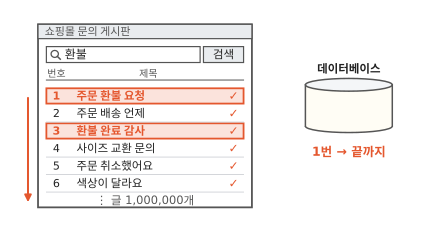
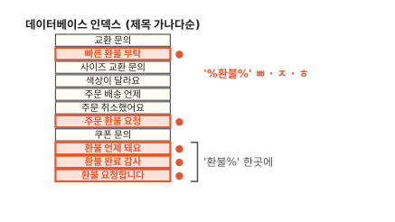
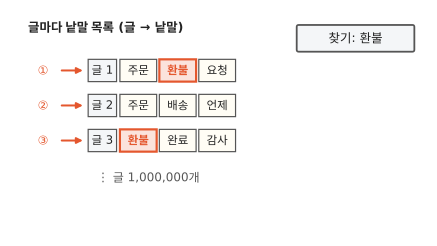
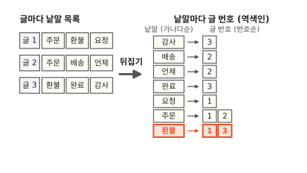
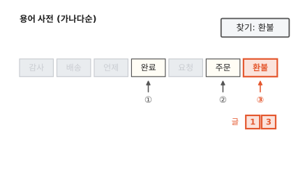
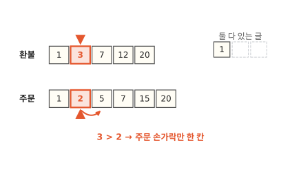
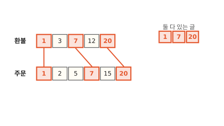
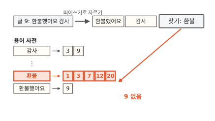
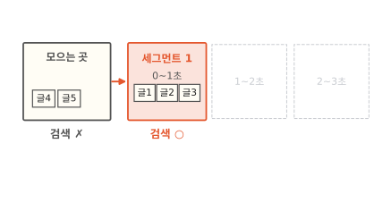
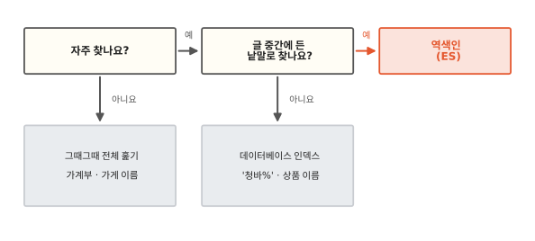

# 역색인: 검색 엔진이 낱말에서 글로 가는 목록

쇼핑몰 문의 게시판에 글이 백만 개 쌓였어요. 검색창에 "환불"을 치면 결과가 나올 때까지 한참 걸려요. 같은 글을 검색 엔진 Elasticsearch(ES)에 넣어 두면 훨씬 빨리 나와요.[^doc] 그 차이는 ES가 글을 받을 때 미리 만들어 두는 목록 하나에서 와요. 이 글을 읽고 나면 그 목록이 어떻게 생겼는지 알게 돼요. 그 목록을 알면 ES가 왜 빠른지와 함께 어떤 글은 왜 못 찾는지도 보여요.

!!! abstract "이 글에서 알게 되는 것"
    1. 데이터베이스는 "환불"이 글 중간에 든 글을 찾으려고 모든 글을 처음부터 끝까지 읽어요. 제목을 가나다순으로 정렬해 둬도 "환불로 시작하는 글"만 빨리 찾아요.
    2. 검색 엔진은 글을 낱말로 잘라 낱말마다 그 낱말이 든 글 번호를 적어 둬요. 이 목록이 역색인이에요. 낱말 하나는 그 줄만 꺼내면 되고 낱말 두 개는 번호 줄 둘을 겹쳐서 찾아요.
    3. 빨라진 대신 값을 치러요. 미리 만드는 데 시간과 공간이 들고 잘라 둔 낱말로만 찾을 수 있고 넣은 글은 잠시 뒤에야 검색돼요.

## 1. 데이터베이스는 글 중간의 낱말을 찾으려고 모든 글을 읽어요

게시판 글은 데이터베이스에 들어 있어요. 데이터베이스는 자료를 표에 차곡차곡 넣어 두고 꺼내 주는 프로그램이에요. 글 하나가 표의 한 줄이에요.

검색창에 "환불"을 쳐요. 데이터베이스는 어느 글에 "환불"이 들었는지 모르는 채로 시작해요. 그래서 1번 글부터 한 줄씩 읽으면서 "환불"이 있는 글을 골라 둬요. 아래 그림에서 왼쪽 화살표가 어디까지 내려가는지 보세요.

**그림 1.** 데이터베이스는 "환불"이 든 1번과 3번을 고르려고 마지막 글까지 모두 읽어요.
{ .fig-cap }

중간에 멈출 수는 없어요. 마지막 글에도 "환불"이 있을지 모르니까요. 이렇게 처음부터 끝까지 다 읽는 일을 전체 훑기(full scan)라고 해요. 글이 열 배가 되면 읽을 줄도 열 배가 돼요.

여기서 이런 생각이 들 거예요. 데이터베이스도 빨리 찾으려고 목록을 만들어 두지 않나요? 맞아요. 제목 칸의 값을 따로 모아서 국어사전처럼 가나다순으로 늘어놓을 수 있어요. 이 목록을 데이터베이스 인덱스라고 해요. 이 목록을 짜는 방법은 [알고리즘 11편](../algorithms/11-btree.md)에 있어요.

아래 그림은 제목 열한 개를 가나다순으로 늘어놓은 데이터베이스 인덱스예요. "환불"이 든 줄이 어디 있는지 보세요.

**그림 2.** "환불"로 시작하는 제목 셋은 맨 아래에 모여 있고 "환불"이 중간에 든 제목 둘은 ㅃ과 ㅈ 근처에 흩어져 있어요.
{ .fig-cap }

"환불로 시작하는 제목"은 한곳에 모여 있어요. 그 자리로 가서 거기부터 읽으면 끝나요. 데이터베이스 검색 명령에서는 이걸 `'환불%'`라고 써요. `%`는 그 자리에 아무 글자나 와도 된다는 표시예요.

게시판에서 찾는 건 "환불이 어디든 들어 있는 글"이에요. 검색 명령으로는 `'%환불%'`예요. "빠른 환불 부탁"은 ㅃ 근처에 있고 "주문 환불 요청"은 ㅈ 근처에 있어서 한 자리로 찾아갈 수 없어요. 그래서 데이터베이스는 이 목록을 쓰지 못하고 다시 전체 훑기를 해요.[^mysql]

## 2. 목록을 뒤집으면 낱말에서 글로 가요

정렬해 둬도 글 중간의 낱말에는 닿지 못했어요. 이번에는 글을 저장할 때 띄어쓰기로 낱말을 잘라서 글마다 낱말 목록을 붙여 둘게요. 1번 글 "주문 환불 요청"에는 주문, 환불, 요청을 붙여요.

이 목록은 글에서 낱말로 가요. "3번 글에 무슨 낱말이 있지?"에는 3번 줄만 보면 답이 나와요. 그런데 우리가 묻는 건 "환불이 든 글은 어디 있지?"예요. 아래 그림에서 화살표 ①②③을 보세요.

**그림 3.** 글에서 낱말로 가는 목록으로 "환불"을 찾으려면 글 1, 글 2, 글 3을 차례로 다 열어 봐요.
{ .fig-cap }

묻는 방향과 목록의 방향이 반대예요. 그래서 글이 백만 개면 목록 백만 개를 다 열어 봐야 해요.

과학책 맨 뒤의 찾아보기를 떠올려 보세요. "광합성 34, 112"처럼 낱말 옆에 그 낱말이 나오는 쪽 번호가 적혀 있어요. 낱말에서 쪽으로 가요. 글 목록도 이렇게 뒤집어 볼게요. 글 1의 낱말 주문, 환불, 요청 옆에 1을 하나씩 적어요. 글 2와 3도 같은 식으로 적어요. 아래 그림 오른쪽에서 "환불" 줄을 보세요.

**그림 4.** 뒤집은 목록에서는 "환불" 줄 하나에 1번과 3번 글이 달려 있어요.
{ .fig-cap }

이제 "환불" 줄 하나만 보면 1번과 3번 글이 나와요. 백만 개를 하나씩 열 일이 없어요.

찾아보기처럼 무엇을 찾으려고 미리 만들어 둔 목록을 색인이라고 해요.

그림 오른쪽처럼 낱말에서 글로 가는 색인을 **역색인**(inverted index)이라고 불러요. 글에서 낱말로 가던 방향을 거꾸로(역) 뒤집었다는 뜻이에요. 데이터베이스 인덱스는 제목을 통째로 가나다순으로 늘어놓았어요. 역색인은 글을 낱말로 잘라서 낱말마다 글 번호를 달아요. [컴퓨터 12편](../computer/12-how-search-works.md)에서 휴대폰이 메시지가 올 때마다 적어 둔 색인도 역색인이에요.

## 3. 낱말을 정렬해 두면 몇 걸음 만에 "환불"에 닿아요

"환불" 줄만 보면 된다는 걸 알았어요. 그런데 낱말이 수천 개라면 그중 "환불" 줄은 어떻게 찾을까요?

낱말 칸을 가나다순으로 정렬해 두면 [이진 탐색](../algorithms/03-why-sorted-is-fast.md)을 쓸 수 있어요. 가운데 낱말을 보고 찾는 낱말이 그보다 앞인지 뒤인지 따져서 절반을 버리기를 되풀이하는 방법이에요. 아래 그림에서 화살표 ①②③을 차례로 따라가 보세요.

**그림 5.** 완료, 주문, 환불 순서로 세 번 보고 "환불"에 닿아서 글 번호 1, 3을 꺼내요.
{ .fig-cap }

일곱 낱말의 가운데는 "완료"예요. 환불은 완료보다 뒤에 있으니 앞 절반을 버려요. 남은 요청, 주문, 환불의 가운데인 "주문"을 보고 또 앞을 버려요. 세 번째에 "환불"에 닿아요. 거기 달린 글 번호 1, 3을 꺼내면 검색이 끝나요.

검색 엔진에서는 잘라 낸 낱말 하나를 용어(term)라고 불러요. 역색인에서 용어 칸만 모은 쪽은 **용어 사전**(term dictionary)이라고 해요. 그림 속 일곱 칸이 용어 사전이에요.

볼 때마다 절반을 버리니까 용어 사전이 두 배로 커져도 한 걸음만 늘어요. 그리고 이 걸음 수는 글이 몇 개인지와 상관이 없어요. 글이 백만 개에서 이백만 개로 늘어도 낱말 종류가 그대로면 "환불"에 닿는 걸음은 같아요. 전체 훑기는 글이 두 배면 읽을 줄도 두 배였어요. 그래서 글이 많을수록 역색인 쪽이 크게 앞서요.

실제 ES는 사전을 찾을 때 이진 탐색 말고 다른 방법도 함께 써서 걸음 수는 이와 달라요. 그래도 글이 늘 때 걸음이 거의 늘지 않는 건 같아요.

## 4. 두 낱말이 다 든 글은 번호 줄 둘을 겹쳐서 찾아요

낱말 하나는 줄 하나만 꺼내면 됐어요. 이번에는 "환불 주문"처럼 두 낱말이 다 든 글을 찾아볼게요. 두 낱말의 글 번호 줄을 꺼내서 둘 다에 있는 번호만 고르면 돼요.

게시판 글이 더 쌓여서 두 줄이 길어졌다고 해 볼게요. 환불 줄은 1, 3, 7, 12, 20이고 주문 줄은 1, 2, 5, 7, 15, 20이에요. 두 줄 모두 작은 번호부터 적혀 있어요.

두 줄의 맨 앞에 손가락을 하나씩 올리고 가리키는 번호를 비교해요. 둘 다 1이에요. 1을 결과에 넣고 두 손가락을 다 한 칸씩 옮겨요. 이번에는 환불 쪽이 3이고 주문 쪽이 2예요. 아래 그림에서 주문 줄의 굽은 화살표를 보세요.

**그림 6.** 3과 2가 다르면 작은 쪽인 주문 손가락만 한 칸 옮겨요.
{ .fig-cap }

주문 줄의 2는 환불 줄에 나올 수 없어요. 환불 줄은 번호순이고 손가락이 벌써 3까지 왔으니까요. 그래서 번호가 다르면 작은 쪽 손가락만 앞으로 옮겨요. 이 규칙대로 끝까지 가면 아래 그림처럼 돼요.

**그림 7.** 두 줄에 다 있는 번호는 1, 7, 20이에요.
{ .fig-cap }

어느 손가락도 뒤로 돌아가지 않았어요. 두 줄을 한 번씩만 훑고 끝나요. 낱말 하나에 달린 이 글 번호 줄을 **포스팅 목록**(postings list)이라고 해요. 포스팅 목록은 늘 번호순으로 적어 둬요. 그래야 손가락이 뒤로 가지 않아요.

"환불 또는 주문"처럼 어느 한쪽에라도 있는 글을 찾을 때도 같은 방식으로 훑어요. 이때는 두 손가락이 지나간 번호를 다 모아요.

## 5. 빨라진 대신 치르는 값이 셋 있어요

ES는 "환불"이 든 글을 용어 사전에서 몇 걸음 만에 찾았어요. 이렇게 빠른 데는 값이 따라요.

첫째로 미리 만드는 데 시간과 공간이 들어요. 글이 들어올 때마다 낱말을 자르고 낱말마다 포스팅 목록에 번호를 더해야 해요. 원래 글과 따로 역색인을 저장하니 디스크도 더 써요. 디스크는 자료를 오래 보관하는 저장 장치예요. 한 번 만든 역색인은 검색할 때마다 다시 쓰니까 자주 찾을수록 들인 시간을 금방 돌려받아요.

둘째로 잘라 둔 낱말로만 찾을 수 있어요. 게시판 9번 글에 "환불했어요 감사"라고만 적혀 있다고 해 볼게요. 띄어쓰기로 자르면 "환불했어요"가 낱말 하나로 용어 사전에 올라가요. 아래 그림에서 "환불" 줄에 9가 있는지 보세요.

**그림 8.** "환불" 줄에는 9가 없어요. 9는 "환불했어요" 줄에만 있어요.
{ .fig-cap }

용어 사전에서 "환불"과 "환불했어요"는 서로 다른 낱말이에요. 검색어는 용어 사전의 낱말과 글자까지 똑같아야 찾아요. 1절의 데이터베이스는 글자를 하나하나 훑으니 이 글도 찾아냈어요. 그래서 게시판 검색을 데이터베이스에서 ES로 옮기면 전에는 나오던 글이 안 나올 수 있어요.

셋째로 넣은 글은 잠시 뒤에야 검색돼요. 용어 사전은 가나다순으로 정렬해 뒀고 포스팅 목록은 번호순으로 정렬해 뒀어요. 새 글이 올 때마다 처음 보는 낱말을 사전의 제자리에 끼워 넣고 번호 줄을 늘리면 느려요. 디스크에 빽빽이 써 둔 목록을 매번 고쳐 써야 하거든요.

택배 기사는 물건을 하나 받을 때마다 출발하지 않아요. 조금 모았다가 한 번에 싣고 가요. ES도 들어온 글을 잠깐(기본 1초) 모아요. 1초가 되면 모인 글로 작은 역색인을 새로 하나 만들어요. 아래 그림에서 빨간 상자와 모으는 곳에 남은 글을 보세요.

**그림 9.** 글 1, 2, 3은 세그먼트 1이 돼서 검색되고 그다음에 온 글 4, 5는 아직 검색되지 않아요.
{ .fig-cap }

이 작은 역색인을 **세그먼트**(segment)라고 해요. 1초마다 세그먼트가 하나씩 생기니 ES 안에는 세그먼트가 여러 개 있어요. 검색할 때는 세그먼트를 모두 찾아보고 결과를 합쳐요.

모은 글로 세그먼트를 만드는 일은 refresh(새로 고침)라고 불러요. 넣은 글은 refresh를 거쳐야 검색에 나와요. refresh는 [4편](04-refresh.md)에서 자세히 봐요.

## 6. 자주 찾고 글 중간의 낱말로 찾을 때 역색인을 써요

값을 치르면서도 역색인을 만들 만한 때는 언제일까요? 두 가지를 물어보면 대부분 정해져요. 아래 그림의 갈림길을 왼쪽 위부터 따라가 보세요.

**그림 10.** 자주 찾고 글 중간에 든 낱말로 찾을 때 역색인을 써요.
{ .fig-cap }

첫째 물음은 "자주 찾나요?"예요. 몇 년 치 가계부 파일에서 가끔 가게 이름을 찾는 정도라면 그때그때 훑어도 충분해요. 찾을 일이 드물면 역색인을 만드는 데 들인 시간을 돌려받지 못해요. 게시판 검색처럼 하루에도 수없이 찾는다면 미리 만든 쪽이 금방 이득이에요.

둘째 물음은 "글 중간에 든 낱말로 찾나요?"예요. 상품 이름이 "청바"로 시작하는 것만 찾는다면 앞부분이 정해져 있어요. 1절의 데이터베이스 인덱스로 충분해요. "데님"을 쳤을 때 "슬림핏 데님 바지"까지 나와야 한다면 글 중간의 낱말로 찾는 일이라 역색인이 필요해요.

데이터베이스에도 역색인을 붙일 수 있어요. MySQL 같은 데이터베이스에는 낱말 검색용 색인(FULLTEXT)을 따로 붙이는 기능이 있어요. 이 색인도 낱말에서 글로 가는 같은 생각으로 만들어요.

## 정리

처음에 데이터베이스는 "환불"이 든 글을 모으려고 백만 줄을 다 읽었어요. 제목을 가나다순으로 정렬해 둬도 "환불"이 중간에 든 글은 여기저기 흩어져 있어서 찾아가지 못했어요.

ES는 글을 넣을 때 낱말로 잘라서 낱말마다 그 낱말이 든 글 번호를 적어 둬요. 이 역색인의 용어 사전에서 "환불"을 찾고 거기 달린 포스팅 목록 1, 3을 꺼내면 끝나요. 게시판 글이 여섯 개든 백만 개든 "환불"을 찾아가는 길은 같아요. 두 낱말이 다 든 글은 번호순으로 적은 포스팅 목록 둘을 두 손가락으로 한 번씩 훑어서 찾아요.

대신 미리 만드는 데 시간과 공간이 들어요. "환불했어요"처럼 잘라 둔 낱말과 글자가 다르면 못 찾고 넣은 글은 refresh로 세그먼트가 된 다음에야 검색돼요.

이 편에서는 낱말을 띄어쓰기로만 잘랐어요. [2편](02-analyzer.md)에서는 ES가 글을 낱말로 자르는 분석기를 보고 "환불했어요"에서 "환불"을 떼어 내는 방법을 봐요.

### 새로 나온 말

- **전체 훑기**: 처음부터 끝까지 다 읽기. 데이터베이스는 "환불"을 찾으려고 백만 줄을 다 읽었어요.
- **데이터베이스 인덱스**: 칸의 값을 가나다순으로 늘어놓은 목록. `'환불%'`는 빨리 찾지만 `'%환불%'`는 못 찾아요.
- **역색인**: 낱말에서 그 낱말이 든 글 번호로 가는 목록. "환불" 줄에 1, 3이 달려 있었어요.
- **용어 사전**: 역색인에서 잘라 낸 낱말(용어) 칸만 가나다순으로 모은 쪽. 일곱 칸에서 세 번 만에 "환불"에 닿았어요.
- **포스팅 목록**: 낱말 하나에 달린 글 번호 줄. 번호순으로 적어요. 환불의 포스팅 목록은 1, 3, 7, 12, 20이었어요.
- **세그먼트**: 1초쯤 모은 글로 만든 작은 역색인. 글 1, 2, 3이 세그먼트 1이 됐어요.
- **refresh**: 모은 글로 세그먼트를 만드는 일. 넣은 글은 이걸 거쳐야 검색에 나와요.

[^doc]: ES는 넣은 글 하나하나를 문서(document)라고 불러요. 이 편에서는 그냥 글이라고 해요.
[^mysql]: MySQL 8.0 참조 매뉴얼, "Comparison of B-Tree and Hash Indexes". `LIKE`의 인자가 `%`로 시작하지 않는 상수 문자열이면 B-트리 인덱스를 쓸 수 있고 `'%Patrick%'`처럼 `%`로 시작하면 쓰지 않아요. 이 편의 데이터베이스는 이런 기본 인덱스만 둔 경우예요. <https://dev.mysql.com/doc/refman/8.0/en/index-btree-hash.html>
