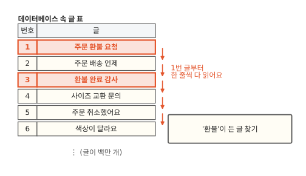
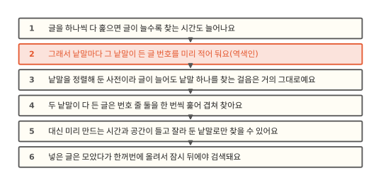
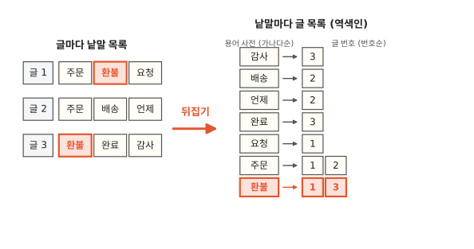
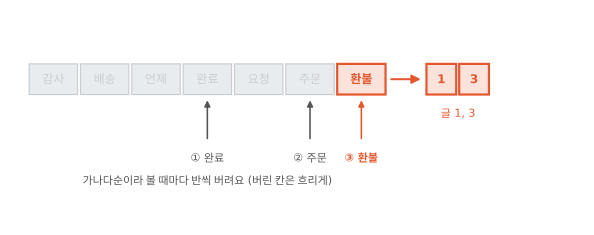
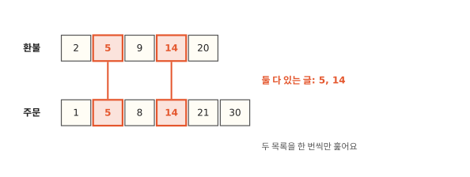

# 검색 엔진은 왜 목록을 거꾸로 만들어 둘까요?

## 게시판 검색이 느려졌어요



고객 문의 게시판에 검색 칸을 붙여야 해요. 처음에는 데이터베이스에 `WHERE body LIKE '%환불%'`을 걸었고 잘 돌았어요. 그런데 글이 백만 개를 넘자 검색 한 번에 몇 초씩 걸리기 시작했어요. 같은 글을 Elasticsearch(이하 ES)에 넣고 "환불"이라는 낱말로 찾았더니 몇 밀리초 만에 끝나요. ES는 글 한 건을 문서(document)라고 부르는데 이 편에서는 게시판 이야기라서 그냥 글이라고 할게요.

ES가 더 빠른 컴퓨터를 쓰는 것도 아닌데 왜 이렇게 차이가 날까요? 답은 ES가 글을 받을 때 미리 만들어 두는 목록 하나에 있어요.

## 한 줄씩 보기에서 목록 합치기까지



먼저 데이터베이스가 왜 한 줄씩 다 읽는지 봐요. 다음으로 글마다 낱말 목록을 만들어 보고 그 목록을 뒤집어요. 마지막으로 검색어가 둘일 때 목록 두 개를 합치는 방법을 보고 이 목록을 미리 만드는 데 드는 값을 따져 봐요.

이 편은 ES 시리즈의 첫 편이에요. 뒤의 편들은 글 한 건이 ES에 들어와서 검색되어 나가기까지를 차례로 따라가요. 2편부터 나오는 단계들은 모두 이 편에서 만들 목록과 이어져 있어요.

## 한 줄씩 다 보면 글 수만큼 걸려요

데이터베이스 인덱스는 값을 정렬해 둔 목록이에요. 정렬돼 있으니 `'환불%'`처럼 앞부분이 정해진 검색은 "환불"로 시작하는 자리를 찾아가서 거기부터 읽으면 끝나요. [알고리즘 11편](../algorithms/11-btree.md)의 B-트리가 이 정렬된 목록을 디스크에 맞게 짠 모양이에요.

`'%환불%'`은 그 자리를 찾아갈 수 없어요. 환불이 글의 맨 앞에 올지 중간에 올지 모르니 정렬 순서가 아무 도움이 안 돼요. 데이터베이스는 인덱스를 쓰지 못하고 1번 글부터 끝까지 다 읽으면서 "환불"이 들어 있는지 하나하나 확인해요.[^mysql] 글이 열 배가 되면 검색 시간도 열 배가 돼요.

## 글마다 낱말 목록을 만들어도 마찬가지예요

그러면 글을 저장할 때 띄어쓰기로 낱말을 잘라서 글마다 낱말 목록을 붙여 두면 어떨까요? 1번 글에는 "주문, 환불, 요청", 2번 글에는 "주문, 배송, 언제"를 붙여 두는 식이에요.

글 속 문자열을 처음부터 훑는 일은 줄어들어요. 그래도 여전히 글마다 열어 봐야 해요. 우리가 알고 싶은 건 "환불이 든 글이 어디 있지?"인데, 이 목록으로 바로 답할 수 있는 질문은 "3번 글에는 무슨 낱말이 있지?"예요. 환불이 든 글을 찾으려면 결국 모든 글의 목록을 하나씩 열어 봐야 해요.

## 뒤집으면 낱말에서 바로 글로 가요



그래서 목록을 뒤집어요. 낱말마다 그 낱말이 든 글 번호를 적어 두는 거예요. "환불 → 1, 3", "주문 → 1, 2". 이렇게 낱말에서 글로 가는 목록을 **역색인**(inverted index)이라고 불러요. 글에서 낱말로 가는 앞의 목록을 거꾸로 했다는 뜻이에요. 책 맨 뒤의 찾아보기가 같은 모양이고 [컴퓨터 12편](../computer/12-how-search-works.md)에서 휴대폰 메시지 검색으로 본 것도 이 목록이에요. 다만 책 찾아보기에는 사람이 고른 낱말만 실리고 역색인에는 글에서 잘라 낸 낱말이 빠짐없이 다 올라가요.

역색인은 두 부분으로 나뉘어요. 그림 오른쪽의 낱말 칸 모음을 **용어 사전**(term dictionary)이라고 하고 낱말 하나에 달린 글 번호 줄을 **포스팅 목록**(postings list)이라고 해요. 둘 다 정렬해 둬요. 용어 사전은 가나다순, 포스팅 목록은 글 번호순이에요. 용어 사전을 정렬한 까닭은 이 절 끝에서 포스팅 목록을 정렬한 까닭은 다음 절에서 봐요.

??? info "동료용 심화: 포스팅에 담기는 네 가지"
    Lucene 포스팅에는 필드 설정에 따라 네 단계까지 담겨요. 글 번호(docs), 그 글에서 낱말이 나온 횟수(freqs), 낱말의 위치(positions), 글자 단위 시작·끝(offsets)이에요. ES 매핑의 `index_options`가 이 단계를 정하고 `text` 필드의 기본값은 positions까지예요.[^index-options]

    위치가 있어야 `match_phrase`가 "환불 요청"처럼 붙어 나온 낱말을 확인할 수 있어요. 횟수는 8편 BM25 점수 계산에 쓰여요. 점수에는 필드 길이(norms)도 들어가는데 이건 포스팅과 따로 저장돼요. `keyword` 필드는 기본값이 docs라서 구문 검색을 할 수 없고 점수에 횟수가 들어가지 않아요.[^keyword] `text` 필드도 `index_options`를 docs나 freqs로 낮추면 색인이 작아지는 대신 `match_phrase`가 오류를 내요. 숫자·날짜 필드는 아예 역색인을 쓰지 않고 BKD 트리에 담겨요(11편).



용어 사전이 정렬돼 있으니 "환불"은 [이진 탐색](../algorithms/03-why-sorted-is-fast.md)으로 찾아요. 일곱 낱말의 가운데인 "완료"를 보고 환불이 더 뒤에 있으니 앞 절반을 버려요. 남은 "요청, 주문, 환불"의 가운데 "주문"을 보고 또 뒤로 가면 세 번 만에 "환불"에 닿아요. 거기 달린 포스팅 목록 1, 3을 꺼내면 검색이 끝나요. 글이 아무리 많아도 하나씩 열어 보는 일이 없어요.

얼마나 차이가 나는지 직접 재 봤어요. 낱말 30개짜리 글 20만 개를 만들고 그중 두 글에만 "환불"을 넣었어요.[^lab]

| 방법 | 걸린 시간 |
|---|---|
| 글마다 낱말을 하나씩 확인 | 약 200 ms |
| 역색인에서 "환불" 찾기 | 약 0.01 ms |

찾는 일만 놓고 보면 2만 배쯤 차이가 나요. 글이 늘어날 때를 생각하면 차이는 더 벌어져요. 하나씩 보는 쪽은 글이 두 배면 시간도 두 배인데 역색인 쪽은 이진 탐색이라 낱말 종류가 두 배가 돼도 한 걸음만 늘어요.

??? info "동료용 심화: 실제 용어 사전은 블록과 FST로 짜여 있어요"
    수억 개 용어를 정렬된 배열로 메모리에 다 올리면 힙이 버티지 못해요. Lucene은 용어를 정렬해서 수십 개씩 블록으로 묶어 세그먼트 파일에 두고 "어느 접두사는 어느 블록에 있다"는 작은 색인만 따로 둬요. 이 색인을 FST라는 오토마톤으로 압축해요. 예전에는 이 색인을 JVM 힙에 올렸어요. Lucene 8부터 힙 밖(mmap)에 둘 수 있게 됐고 ES 7.x 중반부터는 `_id` 필드만 힙에 두고 나머지는 힙 밖에 둬요.[^offheap] 그래서 실제 찾기는 FST로 블록 자리를 찾고 그 블록 하나를 읽어 훑는 두 걸음이에요. 용어 사전은 세그먼트마다, 필드마다 따로 있어서 검색 한 번은 세그먼트 수만큼 이 두 걸음을 되풀이해요. 6편에서 자세히 다뤄요.

## 검색어가 둘이면 목록 둘을 합쳐요



"환불 주문"처럼 두 낱말이 다 든 글을 찾을 때는 포스팅 목록 두 개를 꺼내서 겹치는 번호만 골라요. 포스팅 목록이 글 번호순으로 정렬돼 있어서 이 일이 쉬워져요.

두 목록의 맨 앞에 손가락을 하나씩 올려요. 환불 쪽은 2, 주문 쪽은 1이에요. 번호가 다르면 작은 쪽 손가락만 한 칸 앞으로 옮겨요. 주문 쪽이 5로 가요. 환불 쪽 2가 작으니 환불 쪽이 5로 가요. 이제 둘 다 5라서 5를 결과에 넣고 둘 다 한 칸씩 옮겨요. 이렇게 하면 어느 손가락도 뒤로 돌아가지 않으니 두 목록을 한 번씩만 훑고 끝나요. 위 실험에서 글 1,152개짜리 목록과 1,234개짜리 목록을 겹치는 데 1 ms 안팎이 걸렸어요.

"환불 또는 주문"은 같은 방식으로 훑으면서 어느 한쪽에라도 있는 번호를 모으면 돼요. 결과도 번호순으로 나오고 양쪽에 다 있는 번호는 두 손가락이 같은 칸에 설 때 하나로 걸러져요.

??? info "동료용 심화: 목록이 아주 길면 건너뛰어요"
    한쪽 목록이 짧고 다른 쪽이 수백만 개라면 긴 쪽을 한 칸씩 옮기는 것도 아까워요. Lucene은 긴 쪽에서 "이 번호 이상인 첫 글"로 한 번에 건너뛰는 `advance(target)`을 쓰고 이를 빠르게 하려고 포스팅 목록에 건너뛰기 표(skip data)를 함께 저장해요. 그래서 실제 AND는 가장 짧은 목록을 앞세우고 나머지 목록을 그 번호로 건너뛰게 하는 방식으로 돌아요. 7편에서 다뤄요.

## 미리 만들어 두는 데도 시간과 자리가 들어요

위 실험에서 글 20만 개로 역색인을 만드는 데 1초 가까이 걸렸어요. 한 줄씩 다 보는 검색 다섯 번쯤의 시간이에요. 검색을 다섯 번만 넘게 해도 미리 만들어 두는 편이 낫고 게시판 검색은 하루에도 수없이 하니 따질 것도 없어요. 반대로 글을 쓰기만 하고 거의 찾지 않는 데이터라면 역색인을 만드는 일이 손해예요.

드는 것은 두 가지예요.

- 쓸 때 일이 늘어요. 글 하나를 넣을 때마다 낱말을 자르고 낱말마다 목록에 번호를 더해야 해요. ES는 넣은 글을 먼저 메모리에 쌓아 두고 잠시 뒤 묶음 하나로 내보낸 다음에야 검색에 보이게 해요. 그래서 넣자마자 검색되지는 않아요. 4편에서 다뤄요.
- 자리를 더 차지해요. 원래 글과 별도로 역색인을 저장해요. ES는 원래 글(JSON)도 `_source`라는 이름으로 따로 저장해서 검색 결과로 돌려줘요.

그리고 역색인에는 미리 잘라 둔 낱말만 있어서 낱말을 어떻게 자르느냐가 찾을 수 있는 것을 정해요. 역색인에 "환불"이 올라가야 "환불"로 찾을 수 있어요. 글에 "환불했어요"라고만 적혀 있으면 띄어쓰기로 자른 낱말은 "환불했어요"라서 "환불"로는 안 나와요. 처음 장면의 `LIKE '%환불%'`은 이런 글도 찾아내니 ES로 옮기면 찾히는 글이 달라져요. 이 문제는 2편에서 다뤄요.

??? info "동료용 심화: 포스팅의 글 번호(doc id)"
    포스팅 목록에 적히는 번호는 Lucene이 세그먼트 안에서 0부터 차례로 매기는 정수(doc id)예요. 글의 `_id`와는 다른 번호예요. 정수라서 정렬·차이값 압축·건너뛰기가 쉬워요. 세그먼트마다 번호를 따로 매기고 세그먼트를 합치면 번호가 다시 매겨져요. 그래서 이 번호는 바깥에서 쓸 수 없고 `_id`에서 doc id로 가는 길은 `_id` 필드의 역색인이 따로 맡아요. doc id가 32비트 정수라서 Lucene 인덱스 하나, 곧 ES 샤드 하나에 담을 수 있는 글은 약 21억 개가 상한이에요(`IndexWriter.MAX_DOCS`).

    글을 지우거나 고쳐도 포스팅 목록에서 번호를 빼지 않아요. 세그먼트마다 "살아 있는 글" 비트셋(liveDocs)에 지웠다고 표시만 해요. 그래서 병합 전까지는 `doc_freq` 같은 통계에 지운 글이 섞여 있어요. 세그먼트는 4편, 합치기는 5편에서 다뤄요.

## 정리

- 역색인: 낱말에서 그 낱말이 든 글 번호로 가는 목록이에요. 글에서 낱말로 가는 목록을 뒤집은 모양이에요.
- 용어 사전: 역색인의 낱말 쪽이에요. 정렬돼 있어서 이진 탐색으로 찾아요.
- 포스팅 목록: 낱말 하나에 달린 글 번호 줄이에요. 번호순으로 정렬돼 있어서 두 목록을 한 번씩만 훑어 합칠 수 있어요.

## 직접 해 보기

ES를 도커로 하나 띄우고 글 세 개를 넣어요. 보안을 끈 개발용 컨테이너예요. 7.17과 9.x 어느 쪽이든 결과가 같아요.

```bash
docker run -d --name es -p 9200:9200 -e discovery.type=single-node \
  -e xpack.security.enabled=false elasticsearch:7.17.26
```

9.x로 해 보려면 이미지를 `docker.elastic.co/elasticsearch/elasticsearch:9.2.0`처럼 원하는 버전으로 바꾸면 돼요.

글 세 개는 조사 없이 낱말만 띄어 썼어요. 넣고 나서 부르는 `_refresh`는 메모리에 쌓인 글을 바로 검색에 보이게 하는 요청이에요(4편). 전체 명령은 [lab/es/01_es.sh](https://github.com/oya150/bedrock/blob/main/lab/es/01_es.sh)에 있어요.

```bash
curl -XPUT localhost:9200/board/_doc/1 -H 'Content-Type: application/json' -d '{"body":"주문 환불 요청"}'
curl -XPUT localhost:9200/board/_doc/2 -H 'Content-Type: application/json' -d '{"body":"주문 배송 언제"}'
curl -XPUT localhost:9200/board/_doc/3 -H 'Content-Type: application/json' -d '{"body":"환불 완료 감사"}'
curl -XPOST localhost:9200/board/_refresh
curl 'localhost:9200/board/_termvectors/1?fields=body&term_statistics=true'
```

마지막 요청은 1번 글의 낱말을 보여 줘요. 낱말마다 붙은 `doc_freq`는 그 낱말이 든 글 수, 곧 포스팅 목록의 길이예요. 샤드가 하나이고 지운 글이 없어서 정확히 맞아요. 샤드가 여럿이면 그 글이 있는 샤드 안의 수만 나와요. "요청"은 1, "주문"과 "환불"은 2가 나와요. 낱말이 가나다순으로 나오는 것도 보세요.

## 확인 문제

??? question "1. 역색인 만들기"
    글 1 "사과 배", 글 2 "배 포도", 글 3 "사과 포도 배"로 역색인을 만들어 보세요. 그리고 "사과 포도"가 둘 다 든 글을 손가락 두 개로 찾아보세요.

    **풀이** 배 → 1, 2, 3 / 사과 → 1, 3 / 포도 → 2, 3. 사과(1, 3)와 포도(2, 3)에 손가락을 올려요. 1과 2가 다르니 작은 쪽인 사과 손가락을 3으로 옮겨요. 이번엔 포도 쪽 2가 작으니 포도 손가락을 3으로 옮겨요. 둘 다 3이라서 답은 글 3이에요.

??? question "2. 앞에 붙은 퍼센트"
    `LIKE '환불%'`은 인덱스를 쓰는데 `LIKE '%환불'`은 못 써요. 왜일까요?

    **풀이** 인덱스는 값을 앞에서부터 정렬해 둔 목록이에요. "환불"로 시작하는 값은 정렬된 목록에서 한 덩어리로 모여 있어서 그 자리를 찾아갈 수 있어요. "환불"로 끝나는 값은 정렬된 목록 여기저기에 흩어져 있어서 다 읽어 봐야 해요.

??? question "3. 목록이 정렬돼 있지 않다면"
    포스팅 목록의 번호가 뒤죽박죽 섞여 있다면 두 낱말이 다 든 글을 찾는 일이 어떻게 달라질까요?

    **풀이** 손가락을 한 방향으로만 옮길 수 없어요. 한쪽 목록의 번호 하나마다 다른 쪽 목록을 처음부터 다 뒤져야 해요. 목록 길이가 각각 천 개면 한 번씩 훑기는 이천 걸음이지만 다 뒤지기는 백만 걸음이 돼요.

## 업무 판단 연습

??? question "상품 이름 자동완성"
    쇼핑몰 검색 칸에 글자를 칠 때마다 그 글자로 시작하는 상품 이름을 보여 주려고 해요. 상품은 5만 개이고 이미 MySQL에 있어요. ES를 새로 들여야 할까요?

    **풀이** "그 글자로 시작하는"은 앞부분이 정해진 검색이라 `LIKE '청바%'`가 인덱스를 써요. 상품 5만 개면 데이터베이스로 충분해요. 이름 중간의 낱말로도 찾게 하거나("데님"을 쳤을 때 "슬림핏 데님 바지"가 나오게), 오타나 비슷한 말까지 다루려면 역색인을 따로 두는 편이 맞아요.

??? question "로그에서 주문번호 찾기"
    하루 로그 수억 줄에서 특정 주문번호가 찍힌 줄을 가끔 찾아요. 한 달에 몇 번 찾을까 말까예요. 로그 전체를 ES에 넣어야 할까요?

    **풀이** 역색인은 쓸 때 일을 더 하고 자리를 더 차지하는 대신 찾을 때 빨라요. 찾는 일이 드물면 그만큼 들인 품이 남지 않아요. 날짜별 파일을 `grep`으로 훑거나, 주문번호처럼 늘 쓰는 값 몇 개만 따로 뽑아 색인하는 쪽을 먼저 따져 봐요. 찾는 일이 잦아지거나 여러 조건을 섞어 찾아야 할 때 ES를 다시 따져 봐요.

[^mysql]: MySQL 8.0 참조 매뉴얼, "Comparison of B-Tree and Hash Indexes". LIKE의 인자가 와일드카드로 시작하지 않는 상수 문자열이면 B-트리 인덱스를 쓸 수 있고, `'%Patrick%'`처럼 와일드카드로 시작하면 쓰지 않는 예가 실려 있어요. <https://dev.mysql.com/doc/refman/8.0/en/index-btree-hash.html>
[^index-options]: Elasticsearch 문서, "index_options" 매핑 파라미터. <https://www.elastic.co/guide/en/elasticsearch/reference/current/index-options.html>
[^lab]: 재는 코드: [lab/es/01_inverted_index.py](https://github.com/oya150/bedrock/blob/main/lab/es/01_inverted_index.py). 낱말 5,000종에서 30개씩 뽑아 글을 만들었어요. 파이썬 메모리 안에서 두 방법을 비교한 것이라 데이터베이스나 ES의 실제 시간과는 달라요. 시간은 컴퓨터마다 다르고, 표에는 여러 번 잰 값을 어림해 적었어요.
[^keyword]: Elasticsearch 문서, "Keyword type family". `index_options` 기본값이 docs이고 freqs로 바꿀 수 있어요. <https://www.elastic.co/guide/en/elasticsearch/reference/current/keyword.html>
[^offheap]: Lucene 8.0 변경 기록 LUCENE-8635(용어 사전 색인을 힙 밖에), Elasticsearch PR #42838(`_id` 말고는 힙 밖에). <https://lucene.apache.org/core/8_0_0/changes/Changes.html>, <https://github.com/elastic/elasticsearch/pull/42838>
