# 검색 엔진은 왜 목록을 거꾸로 만들어 둘까요?

## 백만 개 중에서 "환불" 찾기

어느 쇼핑몰 문의 게시판에 글이 백만 개 쌓였어요. 글은 데이터베이스에 들어 있어요. 데이터베이스는 글 같은 자료를 표에 차곡차곡 넣어 두고 꺼내 주는 프로그램이에요.

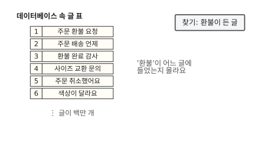

검색 칸에 "환불"을 치면 데이터베이스는 어느 글에 "환불"이 들었는지 모르는 채로 시작해요. 어디서부터 볼까요?

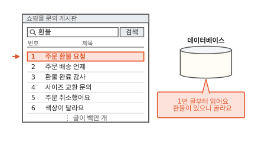

1번 글부터 한 줄씩 읽어요. 1번 글에 "환불"이 있으니 골라 둬요.

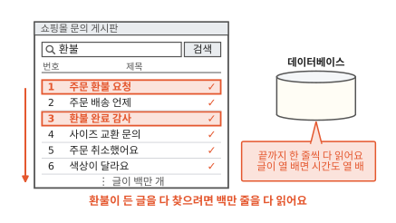

그렇게 마지막 글까지 다 읽어야 "환불"이 든 글을 빠짐없이 모아요. 글이 많으니 결과가 나오기까지 한참 걸려요.

Elasticsearch(ES)는 검색을 전문으로 하는 프로그램이에요.[^doc] 같은 글을 ES에 넣어 두고 찾으면 훨씬 빨리 끝나요. 글 백만 개는 똑같은데 왜 이렇게 차이가 날까요? 답은 ES가 글을 받을 때 미리 만들어 두는 목록 하나에 있어요. 그 목록을 보기 전에 데이터베이스가 왜 빨리 못 찾는지부터 볼게요.

## 정렬해 둔 목록으로도 못 찾는 검색

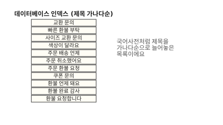

데이터베이스도 빨리 찾는 목록을 만들 수 있어요. 표에서 자주 찾는 칸(예를 들어 제목 칸)의 값을 따로 모아 그림처럼 가나다순으로 정렬해 두는 거예요. 국어사전이 낱말을 늘어놓는 것과 같아요. 이 목록을 데이터베이스 인덱스라고 해요. 이 목록을 짜는 방법은 [알고리즘 11편](../algorithms/11-btree.md)의 B-트리예요.

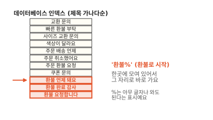

정렬돼 있으면 "환불로 시작하는 글"은 그림의 빨간 세 줄처럼 한곳에 모여 있어요. 그 자리로 가서 거기부터 읽으면 끝나죠. 데이터베이스에 내리는 검색 명령에서는 이걸 `'환불%'`라고 써요. `%`는 그 자리에 아무 글자나 와도 된다는 표시예요. 게시판 검색도 이렇게 찾아갈 수 있을까요?

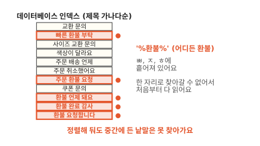

게시판에서 찾는 건 "환불이 어디든 들어 있는 글"이에요. 검색 명령으로 쓰면 `'%환불%'`예요. 이런 글은 그림의 빨간 줄처럼 정렬된 목록 여기저기에 흩어져 있어요. "빠른 환불 부탁"은 ㅃ 근처에, "주문 환불 요청"은 ㅈ 근처에 있어요. 한 자리로 찾아갈 수가 없어요. 그래서 데이터베이스는 정렬된 목록을 쓰지 못하고 1번 글부터 끝까지 다 읽어요.[^mysql]

이렇게 처음부터 끝까지 다 읽는 일을 전체 훑기(full scan)라고 해요. 글이 열 배가 되면 검색 시간도 열 배가 돼요.

## 글마다 낱말 목록을 만들어도 마찬가지예요

그러면 글을 저장할 때 띄어쓰기로 낱말을 잘라서 글마다 낱말 목록을 붙여 두면 어떨까요? 1번 글에는 "주문, 환불, 요청", 2번 글에는 "주문, 배송, 언제"를 붙여 두는 식이에요.

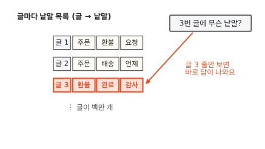

이 목록은 글에서 낱말로 가요. 그래서 "3번 글에는 무슨 낱말이 있지?"에는 글 3 줄만 보고 바로 답해요. "환불이 든 글은 어디 있지?"에는 어떻게 답할까요?

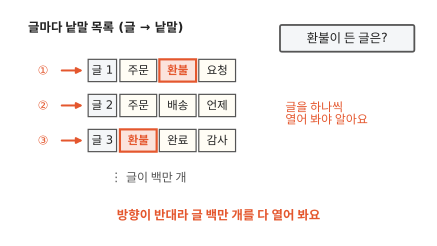

우리가 묻는 건 반대 방향이에요. 이걸 알려면 그림처럼 글 백만 개의 목록을 하나씩 다 열어 봐야 해요.

글 하나를 볼 때는 낱말 몇 개만 맞춰 보면 돼요. 긴 글을 글자 하나하나 훑던 때보다는 가벼워요. 그래도 백만 개를 다 열어 보는 건 그대로예요.

## 뒤집으면 낱말에서 바로 글로 가요

과학책 맨 뒤에는 찾아보기가 있어요. "광합성 34, 112"처럼 낱말 옆에 그 낱말이 나오는 쪽 번호가 적혀 있죠. 낱말에서 쪽으로 바로 가요. 글 목록도 이렇게 뒤집어 볼게요.

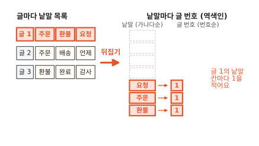

글 1의 낱말 주문, 환불, 요청 옆에 1을 적었어요. 낱말은 가나다순으로 제자리에 둬요.

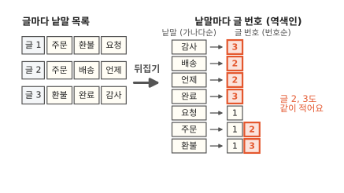

글 2와 3도 같은 식으로 적으면 낱말마다 그 낱말이 든 글 번호가 모여요. "환불 → 1, 3", "주문 → 1, 2"예요.

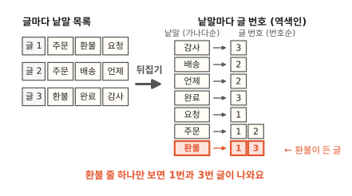

이제 "환불" 줄 하나만 보면 1번과 3번 글이 나와요. 백만 개를 하나씩 열 일이 없어요.

찾아보기처럼 무엇을 찾으려고 미리 만들어 둔 목록을 색인이라고 해요.

이렇게 낱말에서 글로 가는 목록을 **역색인**(inverted index)이라고 불러요. 앞 절의 목록은 글에서 낱말로 갔어요. 그 방향을 거꾸로(역) 뒤집은 색인이에요. 두 절 앞에서 본 데이터베이스 인덱스는 칸의 값을 통째로 가나다순으로 늘어놓았어요. 역색인은 글을 낱말로 잘라 낱말마다 글 번호를 달아요.

[컴퓨터 12편](../computer/12-how-search-works.md)에서 휴대폰은 메시지가 올 때마다 색인을 적어 뒀어요. 그 색인도 역색인이에요.

그런데 낱말이 수천 개라면 그중 "환불" 줄은 어떻게 빨리 찾을까요?

## 사전에서 낱말 하나 찾기

낱말 칸을 가나다순으로 정렬해 두면 돼요.[^hash] 국어사전이 낱말을 늘어놓는 것과 같아요.

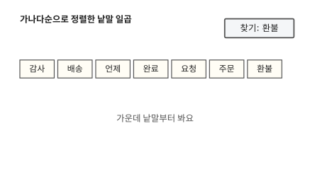

정렬돼 있으니 "환불"은 [이진 탐색](../algorithms/03-why-sorted-is-fast.md)으로 찾을 수 있어요. 일곱 낱말의 가운데부터 봐요.

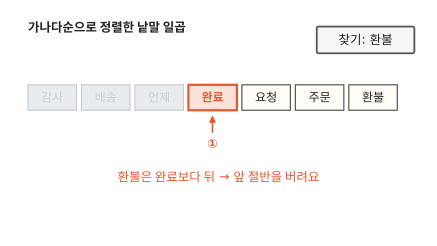

가운데 낱말은 "완료"예요. 환불이 더 뒤에 있으니 앞 절반을 버려요.

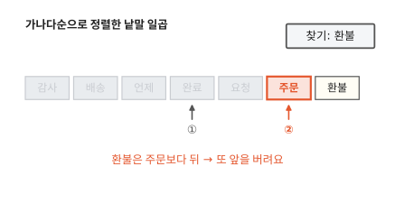

남은 "요청, 주문, 환불"의 가운데 "주문"을 보고 또 뒤로 가요.

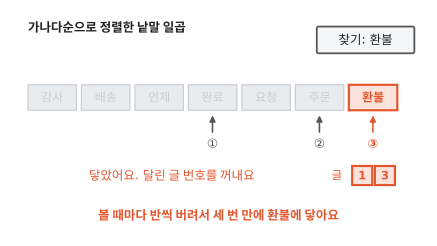

세 번 만에 "환불"에 닿았어요. 거기 달린 글 번호 1, 3을 꺼내면 검색이 끝나요.

검색 엔진에서는 잘라 낸 낱말 하나를 용어(term)라고 불러요.

그래서 역색인에서 낱말 칸만 모은 쪽을 **용어 사전**(term dictionary)이라고 해요. 그림 속 일곱 칸이 용어 사전이에요.

이렇게 찾으면 글을 하나씩 보는 것보다 얼마나 빠를까요?

## 글이 늘어도 사전에서 찾는 걸음은 그대로예요

전체 훑기와 역색인 찾기가 얼마나 차이 나는지 재 봤어요. 파이썬(프로그램을 짜는 언어)으로 낱말 30개짜리 글 20만 개를 만들었어요. 그중 두 글에만 "환불"을 넣었어요.[^lab]

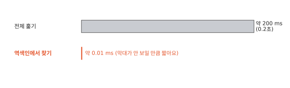

이 실험에서는 만 배 넘게 차이가 났어요. 전체 훑기는 약 200 ms, 역색인에서 찾기는 약 0.01 ms예요. ms는 1초를 천으로 나눈 밀리초예요. 목록을 미리 만드는 시간은 빼고 찾는 시간만 잰 값이에요. 만드는 시간은 조금 뒤에 따로 봐요.

0.2초는 짧아 보여요. 그런데 검색창 하나로 수많은 사람이 동시에 검색해요. 0.2초씩이 쌓이면 앞사람 검색이 끝나기를 기다리는 줄이 길어져요. 글이 늘면 이 차이가 더 벌어지고요.

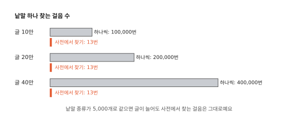

하나씩 보는 쪽은 글 수만큼 걸음이 늘어요. 역색인 쪽은 사전에서 낱말을 찾는 걸음이 글 수와 상관없어요. 그림은 낱말 종류를 5,000개로 두고 글 수만 바꿔 계산한 걸음 수예요. 5,000개를 반씩 버리면 2,500개, 1,250개, 625개로 줄어요. 이렇게 반씩 버려 가면 13걸음 안에 찾아요. 찾은 다음에는 그 낱말이 든 글 번호를 꺼내는 만큼만 더 걸려요.

새 글에 처음 보는 낱말이 섞이면 사전도 커지죠. 사전이 두 배로 커져도 이진 탐색은 한 걸음 늘 뿐이에요. 실제 ES는 사전을 찾을 때 이진 탐색 말고 다른 방법도 함께 써요. 그래서 걸음 수는 이와 달라요. 그래도 글이 늘 때 걸음이 거의 늘지 않는 건 같아요.

??? info "심화: 낱말이 수억 개면 사전을 다 메모리에 올릴까요?"
    ES에 글이 쌓여 사전이 아주 커지면 메모리가 모자라지 않을지 궁금할 때 보는 칸이에요. 낱말이 수억 개여도 사전을 다 메모리에 올리지 않고 찾는 방법을 다뤄요.

    컴퓨터에서 메모리는 손 닿는 작업대이고 디스크는 뒤쪽 창고예요. 작업대는 빠르지만 좁아요. 창고는 넓지만 꺼내 오는 데 시간이 걸려요. 그래서 큰 것은 창고에 두고 지금 쓰는 것만 작업대에 올려요.

    글 안에는 제목, 본문, 주문번호 같은 칸이 있어요. 이런 칸을 ES에서는 필드라고 해요. 주문번호나 이메일처럼 글마다 값이 다른 필드를 넣으면 사전의 낱말이 수억 개가 되기도 해요.

    두꺼운 국어사전은 옆면의 ㄱ·ㄴ·ㄷ 표시로 먼저 자리를 잡고 찾아요. ES도 비슷해요. 사전을 디스크에 두고 낱말을 수십 개씩 묶은 덩어리(블록)로 나눠 둬요.

    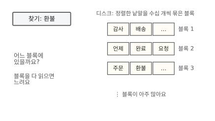

    블록이 아주 많으면 "환불"이 어느 블록에 있는지부터 알아야 해요. 그래서 어느 낱말이 어느 블록에 있는지 적은 작은 안내판을 따로 만들어 둬요.

    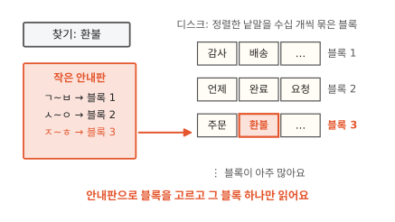

    찾을 때는 안내판으로 블록을 고르고 디스크에서 그 블록 하나만 읽어 와요.[^leaf] 블록은 필요할 때 하나씩만 읽어요. 그래서 사전 전체를 메모리에 올릴 필요가 없죠.

    이 안내판을 ES는 용어 색인(term index)이라고 불러요. 용어 사전을 빨리 찾게 해 주는 색인이에요. 실제 안내판은 그림의 첫 글자 범위보다 훨씬 촘촘하게 적혀 있어요(6편).

??? info "심화: 안내판은 ES 메모리를 얼마나 차지할까요?"
    ES가 컴퓨터 메모리를 얼마나 쓰는지 궁금할 때 보는 칸이에요. 낱말이 아주 많아져도 ES 몫의 메모리가 늘지 않는 이유를 다뤄요.

    앞 칸의 안내판은 사전보다 훨씬 작지만 낱말이 수억 개면 안내판도 꽤 커져요. ES는 시작할 때 자기 전용 메모리 크기를 정해 둬요. 그리고 그 안에서 일해요. 여럿이 쓰는 작업실에서 내 책상 크기를 먼저 정해 두는 것과 같아요.

    ES는 자바라는 프로그래밍 언어로 만들었어요. 그래서 이 전용 메모리를 자바 힙(heap)이라고 해요. 옛 버전은 안내판을 이 힙에 통째로 올려 뒀어요. 그래서 크기가 정해진 힙을 안내판이 많이 차지했어요.

    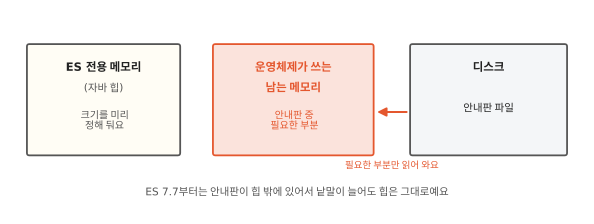

    ES 7.7부터는 안내판을 디스크 파일로 둬요. 그리고 필요한 부분만 운영체제가 그때그때 메모리로 읽어 줘요.[^offheap] 운영체제는 윈도나 macOS처럼 컴퓨터 전체를 관리하는 프로그램이에요.

    도서관 열람실의 빈 책상에는 자주 보는 책을 잠깐 펼쳐 둘 수 있어요. 누가 앉으면 치우면 돼요. 운영체제도 아무도 안 쓰는 메모리에 읽은 파일을 놓아둬요. 그러다 다른 프로그램이 메모리를 달라고 하면 그 자리를 내줘요.

    이렇게 운영체제가 파일을 잠깐 놓아두는 메모리를 페이지 캐시(page cache)라고 해요. 안내판은 이 메모리에 올라가요. 그래서 낱말이 아주 많아도 ES 전용 메모리는 거의 늘지 않아요.

"환불 주문"처럼 낱말 두 개가 다 든 글만 보고 싶을 때는 어떻게 할까요?

## 두 낱말이 다 든 글은 목록 둘을 겹쳐 찾아요

"환불"과 "주문"이 둘 다 든 글을 찾을 때는 두 낱말에 달린 글 번호 줄을 꺼내요. 그리고 겹치는 번호만 골라요. 수학에서 말하는 교집합이에요. 앞 절의 글 1~3 말고도 게시판 글이 더 쌓여서 두 줄이 길어졌다고 해 볼게요. 환불 줄은 1, 3, 7, 12, 20이고 주문 줄은 1, 2, 5, 7, 15, 20이에요.

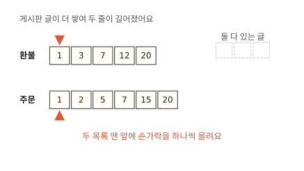

두 목록의 맨 앞에 손가락을 하나씩 올리고 두 손가락이 가리키는 번호를 비교해요.

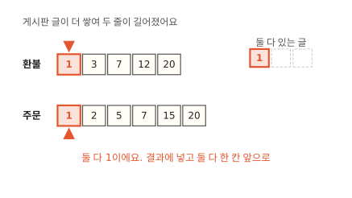

둘 다 1이라 1을 결과에 넣고 두 손가락을 다 한 칸씩 옮겨요. 이번에는 3과 2로 번호가 달라요.

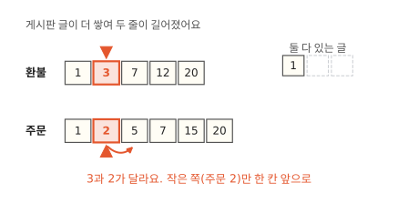

번호가 다르면 작은 쪽 손가락만 한 칸 앞으로 옮겨요. 주문 줄의 2는 환불 줄에 나올 수가 없어요. 환불 줄은 번호순이고 손가락이 이미 3까지 왔으니까요. 이 규칙대로 끝까지 가 볼게요.

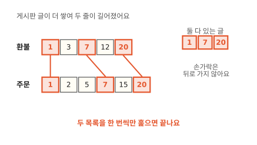

둘 다 든 글은 1, 7, 20이에요. 어느 손가락도 뒤로 돌아가지 않았어요. 두 줄 모두 글 번호를 번호순으로 적어 뒀기 때문이에요. 그래서 두 목록을 한 번씩만 훑고 끝나요. 낱말 하나에 달린 이 글 번호 줄을 **포스팅 목록**(postings list)이라고 해요.

같은 실험에서 낱말 두 개를 골라 겹쳐 봤어요. 둘 다 포스팅 목록에 글 번호가 천 개쯤씩 달린 낱말이에요. 겹치는 데 1 ms도 안 걸렸어요. 낱말 하나를 찾던 0.01 ms보다는 오래 걸려요. 번호 천 개씩을 훑어야 하니까요. 그래도 전체 훑기로 낱말 하나를 찾던 200 ms의 200분의 1도 안 돼요.

"환불 또는 주문"도 같은 방식으로 훑어요. 어느 한쪽에라도 있는 번호를 모으면 돼요.

하나 조심할 게 있어요. ES에서 가장 흔히 쓰는 검색은 `match`예요. 이 검색에 "환불 주문"처럼 낱말 두 개를 주면 기본으로 이 "또는" 쪽으로 찾아요. 그래서 "환불"만 든 글도 함께 나와요. 쇼핑몰 프로그램은 손님이 친 검색어를 받아 ES에 넘겨요. 둘 다 든 글만 나오는 검색창이라면 이 프로그램이 "둘 다"라고 따로 적어 보낸 거예요.[^and]

??? info "심화: '환불 요청'처럼 붙은 말은 어떻게 찾을까요?"
    따옴표 검색이 어떻게 붙은 말만 골라내는지 궁금할 때 보는 칸이에요. 검색창에 따옴표를 붙여 "환불 요청"을 쳐 보세요. 두 낱말이 이 순서로 붙어 있는 글만 보여 주는 곳이 많아요. 이렇게 낱말이 붙은 차례 그대로 찾는 검색을 구문 검색이라고 해요.

    "요청 먼저 하고 환불 대기"라는 글은 두 낱말이 다 있어도 빠지죠. 글 번호만 적어 둔 목록으로는 이 둘을 가를 수 없어요. 그래서 역색인은 낱말이 글의 몇 번째 위치에 있는지도 함께 적어 둬요.

    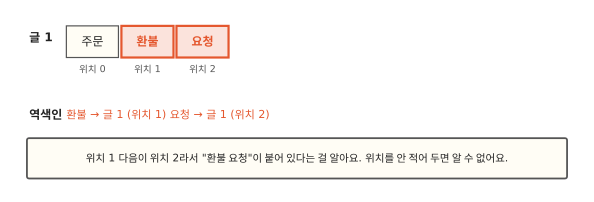

    위치를 적으면 역색인이 그만큼 커져요. 그래서 ES는 위치를 적을지 필드마다 고르게 해 뒀어요. 필드는 글 안의 제목이나 본문 같은 칸이에요. 이 설정의 이름은 `index_options`예요. 문장을 담는 필드는 기본으로 위치까지 적어요. 공간을 아끼려고 이 설정을 낮춘 필드도 있어요. 그런 필드에 `match_phrase`로 구문 검색을 보내면 위치 정보(positions)가 없다는 오류가 나요.[^index-options]

이렇게 찾는 쪽은 빨라졌는데 목록을 미리 만드는 데는 무엇이 들까요?

## 미리 만드는 데는 시간과 공간이 들어요

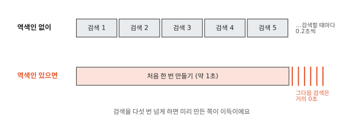

위 실험에서 글 20만 개로 역색인을 만드는 데 1초 가까이 걸렸어요. 글을 하나 넣을 때마다 낱말을 자르고 낱말마다 목록에 번호를 더해야 하거든요. 전체 훑기는 한 번에 0.2초였어요. 다섯 번 훑으면 만드는 데 든 1초와 같아져요. 그래서 이 실험에서는 검색을 다섯 번 넘게 해야 미리 만든 쪽이 이득이었어요.

공간도 들어요. 원래 글과 따로 역색인을 저장하니 디스크를 더 써요. 디스크는 자료를 오래 보관하는 저장 장치예요.

역색인을 쓰면 생기는 불편이 하나 더 있어요. "환불했어요"라고 쓴 글이 "환불"로는 안 나올 수 있어요. 왜 그럴까요?

## 잘라 둔 낱말로만 찾을 수 있어요

역색인에는 미리 잘라 둔 낱말만 올라가요. 그래서 낱말을 어떻게 자르느냐에 따라 찾을 수 있는 글이 달라져요. 게시판 9번 글에 "환불했어요 감사"라고만 적혀 있다고 해 볼게요.

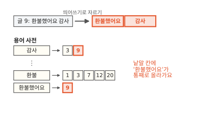

띄어쓰기로 자르면 "환불했어요"가 낱말 하나로 용어 사전에 올라가요. 이제 "환불"로 찾아볼게요.

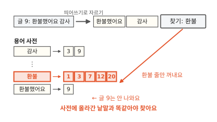

환불 줄에는 9가 없어요. 용어 사전에서 "환불"과 "환불했어요"는 서로 다른 낱말이에요.

처음 장면의 데이터베이스는 글자를 하나하나 훑으니 이 글도 찾아내요. 그래서 게시판 검색을 데이터베이스에서 ES로 옮기면 전에는 나오던 글이 안 나올 수 있어요.

새 글에서도 불편이 하나 생겨요. 게시판에는 새 글이 쉬지 않고 올라와요. 그런데 방금 넣은 글이 바로 검색되지 않아요. 왜 그럴까요?

## 넣은 글은 잠시 뒤에야 검색돼요

용어 사전은 가나다순으로, 글 번호 줄은 번호순으로 정렬해 뒀어요. 새 글에 처음 보는 낱말이 있으면 가나다순 사전의 제자리에 끼워 넣어야 해요. 낱말마다 붙은 번호 줄도 늘려야 해요. 디스크에 빽빽이 써 둔 목록을 글이 올 때마다 이렇게 고쳐 쓰면 느려요.

택배 기사는 물건을 하나 받을 때마다 출발하지 않아요. 조금 모았다가 한 번에 싣고 가요. ES도 넣은 글을 잠깐(기본 1초) 모아요.

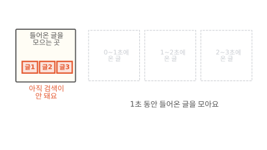

모으는 동안 이 글들은 아직 검색에 나오지 않아요. 1초가 되면 무슨 일이 생길까요?

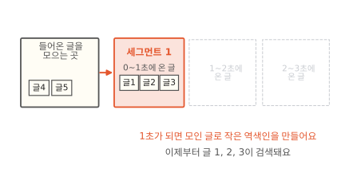

모인 글로 작은 역색인을 새로 하나 만들어요. 그림의 작은 역색인을 세그먼트(segment)라고 해요.

세그먼트를 만드는 이 일은 새로 고침(refresh)이라고 해요. 새로 고침은 4편에서 자세히 봐요. 넣은 글은 새로 고침을 거쳐야 검색에 나와요. 그래서 잠시 뒤에야 보여요.

새로 고침을 할 때마다 세그먼트가 하나씩 생기니 ES 안에는 세그먼트가 여러 개 있어요. 검색은 이 중 어디를 볼까요?

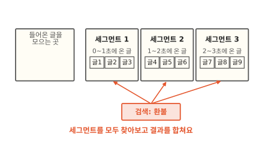

검색할 때는 세그먼트를 모두 찾아보고 결과를 합쳐요.

??? info "심화: 글을 지우면 역색인에서도 바로 지워질까요?"
    글을 지웠을 때 검색에서 언제 빠지고 저장 공간은 언제 비는지 궁금하면 보는 칸이에요. 휴대폰에서 사진을 지워도 "최근 삭제" 앨범에 한동안 남아 있죠. ES도 지운 글을 바로 없애지 않아요. 앨범과 달리 지운 글을 되살릴 수는 없어요.

    ES는 한 번 만든 세그먼트를 고치지 않아요(5편). 글 3을 지운다고 해 볼게요.

    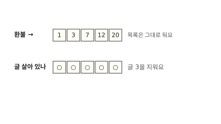

    환불 줄에서 3을 빼려면 세그먼트를 고쳐야 해요. 그래서 "이 글은 지움"이라는 삭제 표시만 따로 해 둬요.

    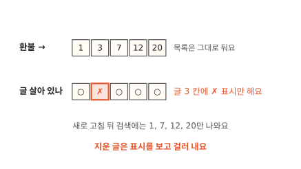

    검색할 때 이 표시를 보고 지운 글을 걸러 내요. 지운 글은 다음 새로 고침 뒤부터 검색 결과에서 빠져요. 그럼 공간은 언제 빌까요?

    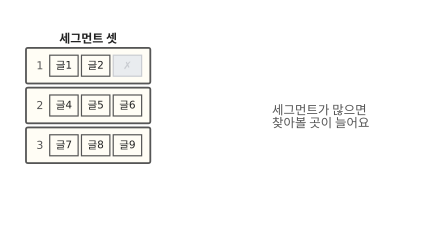

    세그먼트가 너무 많아지면 찾아볼 곳이 늘어 검색이 느려져요. 그래서 ES는 틈틈이 세그먼트 몇 개를 하나로 합쳐요. 이 일을 병합이라고 해요(5편).

    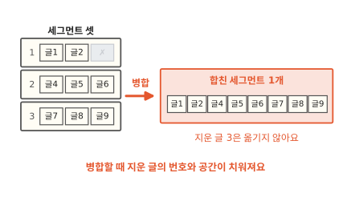

    병합할 때 지운 글은 새 세그먼트로 옮기지 않아요. 그래서 목록 속 번호와 디스크 공간은 이 병합 때 대개 함께 치워져요.[^df] 글을 고치는 것도 옛 글을 지우고 새 글을 넣는 방식이라 똑같아요.

시간과 공간이 들고 못 찾는 글도 생겨요. 넣은 글은 잠시 늦게 보여요. 그래도 역색인을 만들 만한 때는 언제일까요?

## 역색인은 언제 쓸모 있을까요

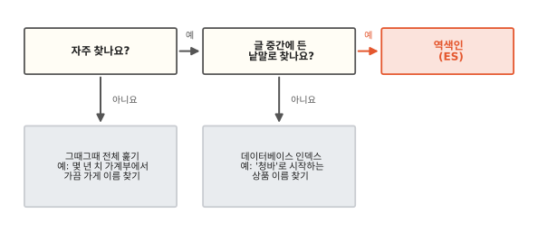

두 가지를 물어보면 대부분 정해져요. 첫째 물음은 "자주 찾나요?"예요. 몇 년 치 가계부 파일에서 가끔 가게 이름을 찾는 정도라면 그때그때 파일을 훑어도 충분해요. 미리 만든 목록을 꺼낼 일이 드물면 넣을 때 들인 시간을 되찾지 못해요. 게시판 검색처럼 하루에도 수없이 찾는다면 미리 만든 쪽이 금방 이득을 봐요.

둘째 물음은 "글 중간에 든 낱말로 찾나요?"예요. 상품 이름이 "청바"로 시작하는 것만 찾을 때가 있어요. 앞부분이 정해져 있으니 데이터베이스 인덱스로 충분해요. 검색 명령으로는 `'청바%'`예요. "데님"을 쳤을 때 "슬림핏 데님 바지"까지 나와야 할 때도 있어요. 글 중간의 낱말로 찾는 일이라 이때는 역색인이 필요해요.

데이터베이스에도 역색인을 붙일 수 있어요. MySQL 같은 데이터베이스에는 낱말 검색용 색인(FULLTEXT)을 따로 붙이는 기능이 있어요. 이 색인을 붙이면 데이터베이스도 글 중간의 낱말을 빨리 찾아요. 이 색인도 역색인과 같은 생각으로 만들어요.

## 다시 "환불"을 찾아 볼게요

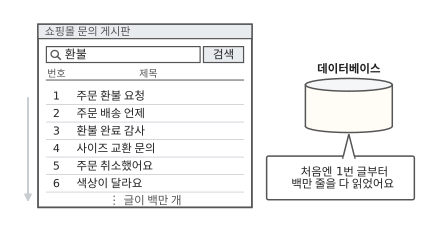

처음 장면의 게시판으로 돌아왔어요. 그때 데이터베이스는 "환불"이 든 글을 모으려고 1번 글부터 백만 줄을 다 읽었어요.

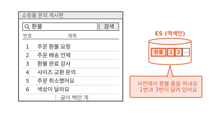

이번에는 같은 글을 ES에 넣어 두고 찾아요. 용어 사전에서 "환불" 줄을 꺼내면 1과 3이 달려 있어요.

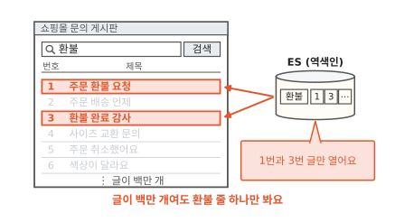

1번과 3번 글만 열면 끝나요. 나머지 글은 열어 보지도 않아요. 게시판 글이 여섯 개든 백만 개든 "환불"을 찾아가는 길은 같아요.

### 이 편에서 줄여 그린 것

그림을 쉽게 하려고 실제와 다르게 줄인 곳이 세 군데 있어요.

1. 낱말은 띄어쓰기로 잘랐어요. ES는 분석기라는 도구로 낱말을 잘라요. 한국어 분석기를 쓰면 "환불했어요"에서 "환불"을 떼어 낼 수도 있어요. [2편](02-analyzer.md)에서 봐요.
2. 용어 사전의 낱말과 포스팅 목록의 번호를 칸마다 그대로 적은 것처럼 그렸어요. 실제로는 앞부분이 같은 낱말을 한 번만 적어요. 번호도 앞 번호와의 차이만 적어서 훨씬 작아요. [6편](06-terms-postings.md)에서 봐요.
3. 이 편은 환불이 든 글을 찾는 데서 멈췄어요. 실제 검색은 찾은 글마다 점수를 매겨 잘 맞는 글부터 보여 줘요. [8편](08-bm25.md)에서 봐요.

### 이 편에서 새로 나온 말

[^doc]: ES는 넣은 글 하나하나를 문서(document)라고 불러요. 이 편에서는 그냥 글이라고 해요.
[^mysql]: MySQL 8.0 참조 매뉴얼, "Comparison of B-Tree and Hash Indexes". LIKE의 인자가 와일드카드로 시작하지 않는 상수 문자열이면 B-트리 인덱스를 쓸 수 있어요. `'%Patrick%'`처럼 와일드카드로 시작하면 쓰지 않는 예도 실려 있어요. 이 편의 데이터베이스는 이런 기본 인덱스만 둔 경우예요. MySQL에는 낱말 검색용 색인(FULLTEXT)을 따로 붙이는 기능도 있는데 그 색인은 이 편에서 볼 역색인과 같은 생각으로 만들어요. <https://dev.mysql.com/doc/refman/8.0/en/index-btree-hash.html>
[^lab]: 낱말 5,000종에서 30개씩 뽑아 글을 만들었어요. 파이썬 메모리 안에서 두 방법을 비교한 것이라 데이터베이스나 ES의 실제 시간과는 달라요. 시간은 컴퓨터마다 달라서 그림에는 여러 번 잰 값을 어림해 적었어요.
[^and]: ES `match` 질의는 `operator` 기본값이 `or`이고 `"operator": "and"`를 주면 둘 다 든 글만 찾아요. 이 편에 적은 ES 동작(`operator` 기본값, 위치 정보가 없는 필드의 구문 검색 오류, 지운 글이 새로 고침 뒤에 빠지는 것, 지운 글이 "이 낱말이 든 글 수"에 남는 것)은 로컬 ES 7.17.26과 9.2.0에서 똑같이 확인했어요.
[^index-options]: Elasticsearch 문서, "index_options" 매핑 파라미터. `text`의 기본값은 positions이고 docs나 freqs로 낮추면 구문 검색을 할 수 없어요. <https://www.elastic.co/guide/en/elasticsearch/reference/current/index-options.html>
[^df]: ES는 검색 결과의 순서를 정할 때 "이 낱말이 든 글 수"(문서 빈도)를 써요(8편). 병합 전까지는 이 수에 지운 글도 들어 있어서 지운 글이 많으면 순서가 조금 어긋나고 병합 뒤에 살짝 바뀌기도 해요.
[^hash]: 낱말 하나만 찾는다면 낱말을 칸 번호로 바로 바꾸는 규칙인 [해시](../algorithms/09-hash.md)로도 찾을 수 있어요. 정렬해 두면 "환불로 시작하는 낱말"처럼 이웃한 낱말까지 한꺼번에 꺼낼 수 있어서 ES는 정렬을 골라요.
[^leaf]: 블록 안은 앞에서부터 차례로 훑어요. 블록 하나에 낱말이 수십 개뿐이라 많아야 수십 걸음이에요. ES 8.15부터는 블록 안 낱말이 모두 같은 길이일 때(자릿수가 같은 주문번호처럼) 블록 안도 이진 탐색으로 찾아요. Lucene 9.11 변경 기록 GITHUB#11888(블록 안 낱말 길이가 같으면 이진 탐색, 같은 길이의 아이디 찾기를 예로 듦). ES 8.15가 Lucene 9.11을 써요. <https://github.com/apache/lucene/blob/releases/lucene/9.12.0/lucene/CHANGES.txt>
[^offheap]: ES는 자바로 만든 프로그램이라 자바가 직접 관리하는 메모리(자바 힙)를 따로 잡아 써요. 옛 버전은 안내판도 이 힙에 올렸어요. ES 7.3부터 `_id`(글마다 붙는 고유 번호 칸)를 뺀 필드의 안내판을, 7.7부터는 `_id`까지 힙 밖에 둬요. Lucene 8.0 변경 기록 LUCENE-8635(기본 키가 아닌 필드의 용어 사전 색인을 힙 밖에), Elasticsearch 7.3 릴리스 노트 #42838·#43150(`_id` 말고 나머지 필드, 7.3은 mmap 저장일 때), ES 7.7.0 릴리스 노트 #52405(`_id`의 용어 사전 색인도 힙 밖으로). <https://lucene.apache.org/core/8_0_0/changes/Changes.html>, <https://www.elastic.co/guide/en/elasticsearch/reference/7.3/release-notes-7.3.0.html>, <https://www.elastic.co/guide/en/elasticsearch/reference/7.8/release-notes-7.7.0.html>
