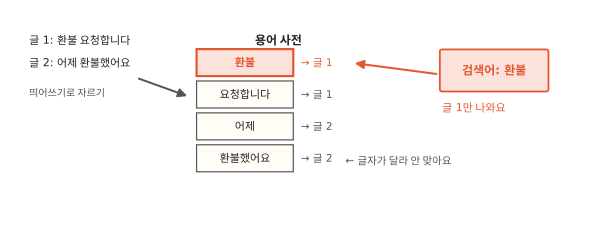
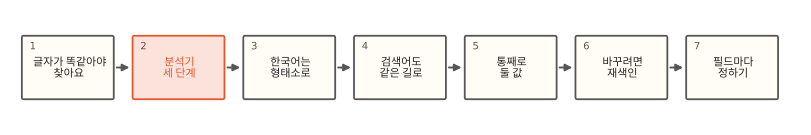
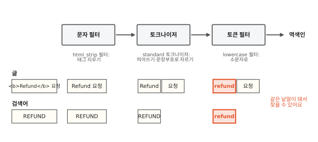
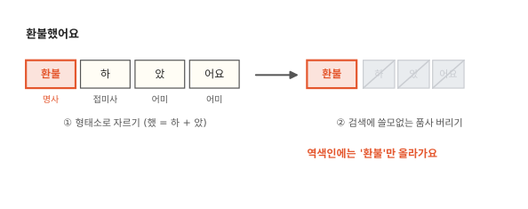
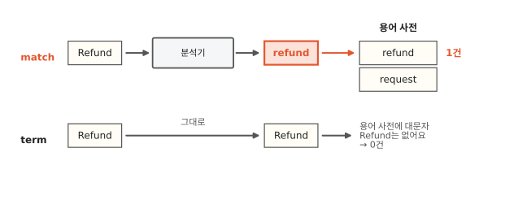

# 같은 글자인데 왜 검색이 안 될까요?

## "환불"로 찾았는데 "환불했어요"가 안 나와요



[1편](01-inverted-index.md)에서 만든 게시판 검색을 실제 글로 시험해 봤어요. "환불"을 치니 "환불 요청합니다"는 나오는데 "어제 환불했어요"는 안 나와요. 영어 상품명 필드에서는 `term` 쿼리로 "Refund"를 찾았더니 "Refund Request"라는 상품이 0건이에요. 글에 분명히 그 글자가 들어 있는데 왜 못 찾을까요?

1편의 역색인을 떠올려 보면 실마리가 보여요. 역색인은 용어 사전에서 낱말을 찾아 그 낱말의 글 목록을 꺼내요. 이때 낱말은 글자 하나까지 똑같아야 해요. 띄어쓰기로만 잘랐다면 사전에 올라간 낱말은 "환불했어요"이고 "환불"은 사전에 없는 낱말이에요.

## 글자 맞추기에서 바꾸기 어려운 까닭까지



그러니 검색이 되느냐는 글을 어떻게 잘라서 사전에 올렸느냐에 달려 있어요. 먼저 ES가 글을 자르는 세 단계를 보고 한국어는 왜 낱말 안쪽까지 잘라야 하는지 봐요. 그다음 검색어도 같은 방식으로 잘라야 하는 까닭과, 자르는 방식을 나중에 바꾸기 어려운 까닭을 봐요.

## 분석기는 세 단계로 글을 잘라요



ES는 `text` 필드에 글이 들어오면 역색인에 올리기 전에 **분석기**(analyzer)에 통과시켜요. 분석기 안에서는 부품 세 개가 차례로 돌아요.

1. 문자 필터(char filter)는 글자 단위로 글을 손봐요. HTML 태그를 지우거나 특정 기호를 바꾸는 일이에요. 없어도 돼요.
2. 토크나이저(tokenizer)는 글을 조각으로 잘라요. 하나뿐이고 꼭 있어야 해요.
3. 토큰 필터(token filter)는 잘린 조각을 하나씩 손봐요. 소문자로 바꾸거나, 뜻 없는 낱말을 버리거나, 동의어를 덧붙여요. 여러 개를 줄 세울 수 있어요.

토크나이저가 잘라 낸 조각 하나하나를 **토큰**(token)이라고 불러요. 토큰 필터를 다 거친 토큰이 용어 사전에 낱말로 올라가요. 그림에서 분석기는 `<b>Refund</b> 요청`의 태그를 지우고 둘로 자르고 소문자로 바꿔서 "refund"와 "요청"을 사전에 올려요.

`text` 필드에 따로 정하지 않으면 standard 분석기를 써요. 문자 필터 없이 standard 토크나이저와 lowercase 필터만 있어요. standard 토크나이저는 띄어쓰기와 문장부호를 경계로 잘라요. 그래서 "환불했어요. Refund-Request!"를 넣으면 `환불했어요`, `refund`, `request` 세 토큰이 나와요. 영어는 하이픈에서 잘리고 소문자가 됐지만 한국어는 띄어쓰기 덩어리째 남았어요.

??? info "심화: standard 토크나이저가 자르는 기준"
    standard 토크나이저는 유니코드 표준 문서 UAX #29의 낱말 경계 규칙을 따라요.[^uax29] 공백과 하이픈 같은 문장부호에서 경계를 긋지만 한글 음절과 로마자는 같은 "낱말 글자"로 쳐서 붙어 있으면 한 토큰으로 남겨요. 로컬 7.17과 9.2에서 돌려 보면 `환불Refund`는 `환불refund` 하나, `ORD2024`는 `ord2024` 하나, `ORD-2024`는 `ord`와 `2024` 둘이에요. 낱말 안쪽의 아포스트로피(`can't`), 숫자 사이 마침표(`3.14`), 밑줄(`a_b`)도 자르지 않아요. 한자와 히라가나는 글자 하나씩, 가타카나는 붙어서 나와요.

    `max_token_length` 기본값은 255자예요. 넘는 토큰은 버리지 않고 255자마다 끊어 여러 토큰으로 내보내요.

## 한국어는 낱말 안쪽까지 잘라야 해요



영어는 낱말 사이를 띄어 쓰고 낱말 모양이 크게 바뀌지 않아서 띄어쓰기로 잘라도 꽤 맞아요. 한국어는 "환불했어요", "환불을", "환불이라도"처럼 낱말 뒤에 조사와 어미가 붙어요. 띄어쓰기로 자르면 같은 "환불"이 붙은 꼬리마다 다른 낱말이 돼요.

그래서 한국어는 뜻을 가진 가장 작은 단위, 곧 형태소로 잘라요. "환불했어요"는 환불(명사) + 하(접미사) + 았(어미) + 어요(어미)예요. "했" 한 글자가 "하"와 "았" 둘로 나뉘었어요. 글자 모양만 보고는 나눌 수 없어서 사전과 문법 지식이 필요해요. 이렇게 사전을 보고 글을 형태소로 나누는 일을 **형태소 분석**이라고 해요.

ES에는 한국어 형태소 분석기 nori가 공식 플러그인으로 있어요. nori 분석기는 형태소로 자른 뒤 어미·조사처럼 검색에 쓸모없는 품사를 버려요. 한자를 한글 읽기로 바꾸고 영어를 소문자로 바꾸는 필터도 함께 들어 있어요. 로컬 ES에서 돌려 보면 "환불했어요"는 `환불` 하나, "간식을 샀어요"는 `간식`, `사` 둘이 남아요. "샀"도 "사 + 았"으로 풀려서 동사의 줄기(어간) "사"가 사전에 올라가요.

형태소 분석은 사전에 기대니 사전에 없는 말에서 틀려요. 새로 생긴 상품명이나 줄임말은 엉뚱한 곳에서 잘릴 수 있어요. nori는 사용자 사전을 따로 받아서 이런 말을 바로잡아요.

??? info "심화: nori가 자르는 방법"
    nori는 mecab-ko-dic 사전을 Lucene 형식으로 옮겨 넣었어요.[^nori] 입력 문장의 모든 위치에서 사전에 있는 형태소 후보를 펼쳐 격자(lattice)를 만들고 형태소마다 붙은 비용과 앞뒤 품사 연결 비용을 더해 가장 싼 경로를 비터비 알고리즘으로 골라요. 사전에 없는 구간은 글자 종류로 묶은 미등록어로 처리해요.

    설정에서 자주 만지는 것은 세 가지예요. `decompound_mode`는 복합명사를 어떻게 남길지 정해요(`none` 그대로, `discard` 쪼갠 것만, `mixed` 둘 다, 기본 `discard`). `user_dictionary`나 `user_dictionary_rules`로 사용자 사전을 넣어요. `nori_part_of_speech` 필터의 `stoptags`가 버릴 품사 목록이고 기본 목록에 어미(E 계열)·조사(J 계열)·접미사(XSV 등)가 들어 있어요. 사용자 사전은 한 줄에 "낱말" 또는 "낱말 + 나눌 모양"을 적어요(예: `세종시 세종 시`). 사용자 사전을 바꾸면 이미 색인된 글에는 반영되지 않아서 재색인이 필요해요.

    품사를 버리는 탓에 생기는 사고도 하나 있어요. 사용자가 "에서"처럼 조사만 치면 분석 결과 토큰이 0개가 돼요. `match`의 `zero_terms_query` 기본값이 `none`이라 결과는 0건이에요. 이럴 때는 `_analyze`에 `"field": "title"`처럼 필드를 주면 그 필드의 실제 분석기로 잘라 볼 수 있어요.

## 검색어도 같은 길로 와야 해요



글만 잘 자른다고 끝나지 않아요. 검색어도 글과 같은 방식으로 잘라야 사전의 낱말과 글자가 맞아요. 사전에는 "refund"가 소문자로 올라가 있으니 검색어 "Refund"도 소문자가 돼야 해요.

`match` 쿼리는 검색어를 그 필드의 분석기로 잘라서 찾아요. "Refund"가 "refund"가 되니 1건이 나와요. 검색어가 여러 토큰으로 잘리면 기본값으로는 그중 하나만 맞아도 찾아요(OR). 모두 맞아야 하면 `"operator": "and"`를 줘요. `term` 쿼리는 검색어를 자르지 않고 그대로 사전에서 찾아요. "Refund"는 사전에 없으니 0건이에요. 맨 처음 장면의 상품도 이렇게 0건이 됐어요. `term` 쿼리는 자르지 않은 값을 그대로 찾는 쿼리라서 자르지 않고 저장한 필드에 맞아요.

자르지 않고 저장하는 필드가 `keyword`예요. `keyword` 필드는 값 전체를 토큰 하나로 사전에 올려요. "Refund Request"는 대소문자와 공백까지 그대로 낱말 하나예요. 주문번호, 이메일, 상태값처럼 통째로 일치해야 하는 값에 맞고 정렬과 집계에도 이 필드를 써요. `keyword` 필드에 `match`를 걸면 검색어도 이 필드의 방식대로 자르지 않고 통째로 찾아요. 그래서 "refund request"로 찾으면 대소문자가 달라 0건이에요. 대소문자만 무시하고 싶으면 `keyword` 필드에 소문자로 바꾸는 손질(normalizer)을 붙여요. 이 손질은 저장하는 값과 검색어에 똑같이 적용돼요.

| 필드 | 저장할 때 | `match` | `term` |
|---|---|---|---|
| `text` | 분석기로 잘라서 | 검색어도 같은 분석기로 잘라서 찾음 | 검색어를 그대로 찾음. 사전 낱말과 글자까지 같을 때만 맞음 |
| `keyword` | 값 전체를 그대로 | 검색어를 그대로 찾음 | 검색어를 그대로 찾음 |

??? info "심화: 저장과 검색에 다른 분석기를 쓰는 경우"
    매핑에서 `search_analyzer`를 따로 주면 검색어만 다른 분석기로 잘라요. 대표적인 예가 자동완성이에요. 저장할 때 edge_ngram 필터로 "청바지"를 `청`, `청바`, `청바지`로 늘려 올리고 검색어 "청바"는 standard로 그대로 둬요. 검색어까지 edge_ngram으로 자르면 `청` 하나만으로도 걸려서 결과가 지나치게 넓어져요. edge_ngram 필터의 기본값은 `min_gram` 1, `max_gram` 2라서 위 예처럼 세 글자까지 만들려면 `max_gram`을 3 이상으로 줘야 해요. 낱말마다 `max_gram`만큼 토큰이 늘어나니 색인이 커져요. 7.2부터는 이 구성을 미리 짜 둔 `search_as_you_type` 필드 타입도 있어요.

    동의어도 비슷해요. 여러 낱말로 된 동의어("휴대폰" ↔ "핸드폰 단말기")는 토큰 위치가 그래프 모양이 되는데 역색인에는 그래프를 그대로 저장할 수 없어요. 그래서 `synonym_graph` 필터는 검색 분석기에만 두는 것이 권장 구성이에요.[^synonym] 검색 쪽에만 두면 동의어 목록을 바꿔도 재색인이 필요 없어요. 다만 바꾼 목록을 반영하려면 필터에 `updateable: true`를 주고 `_reload_search_analyzers`를 불러야 하고(7.3부터), 그렇지 않으면 인덱스를 닫았다 열어야 해요. 8.10부터는 동의어 세트를 API로 관리하는 `_synonyms`도 있어요. 한국어에서는 순서도 봐야 해요. 동의어 규칙의 낱말도 앞단 필터를 거쳐 분석되니 nori 품사 필터 뒤에 두면 규칙 속 낱말이 쪼개지거나 사라져서 규칙이 안 먹을 수 있어요.

    `keyword` 필드에는 분석기 대신 normalizer를 줄 수 있어요. 토크나이저 없이 lowercase 같은 글자 단위 필터만 허용해요. 대소문자만 무시하고 통째 일치는 지키고 싶을 때 써요. normalizer는 `term` 쿼리의 검색어에도 적용돼서 "Refund Request"로 찾아도 "refund request"와 맞아요. 집계 결과에는 정규화된 값이 나오고 `_source`는 원래 값 그대로예요.

## 한번 자르면 바꾸기 어려워요

역색인에는 잘린 결과만 남아요. 원래 글은 1편에서 본 `_source`에 따로 보관돼 있지만 사전과 포스팅 목록은 그때의 분석기가 만든 토큰으로 이미 짜여 있어요. 그래서 나중에 nori로 바꾸고 싶어도 이미 들어간 글의 역색인은 저절로 바뀌지 않아요.

그래서 ES는 이미 있는 필드의 분석기를 매핑에서 바꾸지 못하게 막아 둬요. 바꾸려면 새 분석기로 매핑을 만든 새 인덱스에 글을 다시 넣어야 해요. 이 일을 재색인(reindex)이라고 해요. 글이 많으면 몇 시간이 걸리는 일이에요. 검색어 쪽 분석기(`search_analyzer`)는 바꿀 수 있어요. 이미 올라간 토큰과 맞기만 하면 되니까요.

??? info "심화: 재색인 없이 분석기를 바꾸는 방법"
    재색인 자체는 피할 수 없지만 서비스 중단은 피할 수 있어요. 흔한 방법은 별칭(alias)이에요. 검색은 늘 별칭 이름으로 하고 새 매핑의 인덱스를 따로 만들어 `_reindex`로 채운 뒤 별칭을 원자적으로 옮겨요. 재색인하는 동안 들어오는 쓰기는 따로 챙겨야 해요. 두 인덱스에 다 넣거나, 시각을 기준으로 빠진 구간을 한 번 더 돌리거나, 잠깐 쓰기를 멈춰요. `_reindex`는 `_source`에서 글을 읽으니 `_source`를 꺼 둔 인덱스는 이 방법을 쓸 수 없어요. 큰 인덱스는 `slices: auto`로 나눠 돌리고 `requests_per_second`로 부하를 조절해요. 같은 인덱스 안에서 새 필드(멀티 필드)를 더하는 방법도 있지만 기존 글에 새 필드를 채우려면 `_update_by_query`로 결국 전부 다시 색인해야 해요.

## 정리

- 분석기: 글을 역색인에 올리기 전에 자르고 손보는 부품이에요. 문자 필터, 토크나이저, 토큰 필터 세 단계로 돌아요.
- 토큰: 분석기가 잘라 낸 조각이에요. 토큰 필터를 다 거친 토큰이 용어 사전의 낱말이 돼요.
- 형태소 분석: 사전을 보고 글을 뜻을 가진 가장 작은 단위로 자르는 일이에요. 한국어 검색은 조사와 어미 때문에 이게 필요해요.
- `text` 필드는 잘라서 저장하고 `keyword` 필드는 통째로 저장해요. 검색어는 저장할 때와 같은 방식으로 잘라야 맞아요.

## 직접 해 보기

[1편](01-inverted-index.md)처럼 보안을 끈 개발용 컨테이너를 `es`라는 이름으로 띄워 두었다고 할게요. ES의 `_analyze` API로 분석기가 글을 어떻게 자르는지 바로 볼 수 있어요. 인덱스를 만들지 않아도 돼요.

```bash
curl -XPOST localhost:9200/_analyze -H 'Content-Type: application/json' \
  -d '{"analyzer":"standard","text":"환불했어요. Refund-Request!"}'
```

nori는 플러그인이라 설치하고 다시 시작해야 해요.

```bash
docker exec es bin/elasticsearch-plugin install --batch analysis-nori
docker restart es
curl -XPOST localhost:9200/_analyze -H 'Content-Type: application/json' \
  -d '{"tokenizer":"nori_tokenizer","text":"환불했어요"}'
```

토크나이저만 쓰면 품사를 버리기 전 모습 `환불`, `하`, `았`, `어요`가 나와요. `"analyzer":"nori"`로 바꾸면 `환불`만 남아요. `term`과 `match`의 차이까지 한 번에 보는 전체 명령은 [lab/es/02_es.sh](https://github.com/oya150/bedrock/blob/main/lab/es/02_es.sh)에 있어요.

## 확인 문제

??? question "1. standard로 자르면"
    standard 분석기에 "Elasticsearch-Guide 읽는중"을 넣으면 어떤 토큰이 나올까요?

    **풀이** `elasticsearch`, `guide`, `읽는중`이에요. 하이픈과 띄어쓰기에서 잘리고 영어는 소문자가 돼요. 한글은 띄어쓰기 덩어리째 남아요.

??? question "2. 소문자로 term"
    처음 장면의 `text` 필드 `title`("Refund Request")에 `term` 쿼리로 "refund"(소문자)를 찾으면 몇 건이 나올까요?

    **풀이** 1건이에요. `term`은 검색어를 자르지 않지만 검색어가 처음부터 사전의 낱말 "refund"와 글자가 똑같으니 찾아요. 그래도 사용자가 친 검색어를 `text` 필드에 `term`으로 넘기는 일은 피해요. 대문자 하나만 섞여도 0건이 되니까요.

??? question "3. 분석기를 바꾸려는데 오류가 나요"
    standard로 쓰던 `text` 필드를 nori로 바꾸려고 매핑 수정 요청을 보냈더니 오류가 났어요. 왜 그럴까요?

    **풀이** 이미 들어간 글의 역색인은 standard가 자른 토큰으로 짜여 있어요. 분석기만 바꾸면 검색어는 nori로, 사전은 standard로 잘린 상태가 돼서 서로 안 맞아요. 그래서 ES는 기존 필드의 분석기 변경을 막고 새 인덱스에 다시 넣게 해요.

## 판단 연습

??? question "주문번호 필드"
    주문 검색 화면에서 주문번호 "ORD-2024-00153"으로 정확히 찾아야 해요. 이 필드를 `text`로 둘까요, `keyword`로 둘까요?

    **풀이** `keyword`예요. `text`로 두면 standard가 하이픈에서 잘라 `ord`, `2024`, `00153`이 돼요. "2024"만 쳐도 2024년 주문이 모두 걸리고 `match`의 기본 동작은 낱말 중 하나만 맞아도 찾는 OR라서 엉뚱한 주문이 섞여요. 통째로 일치해야 하는 값은 `keyword`에 두고 `term`으로 찾아요. 사용자가 소문자로 칠 수 있으면 소문자 손질(lowercase normalizer)을 붙여요.

??? question "게시판에 nori 붙이기"
    운영 중인 게시판 인덱스(글 3천만 개)가 standard 분석기를 쓰고 있어요. "환불했어요"가 안 나온다는 문의가 계속 와요. 무엇부터 할까요?

    **풀이** 분석기를 바꾸려면 재색인이 필요해요. 먼저 `_analyze`로 실제 문의 글 몇 개를 nori에 넣어 보고 원하는 토큰이 나오는지, 상품명이나 줄임말이 이상하게 잘리지 않는지 확인해요. 잘리는 말이 있으면 사용자 사전부터 만들어요. 그다음 새 매핑으로 새 인덱스를 만들어 `_reindex`로 채우고 검색은 별칭으로 걸어 둔 채 별칭만 옮겨요. 기존 인덱스는 문제가 없다고 확인될 때까지 지우지 않아요.

[^uax29]: Unicode Standard Annex #29, "Unicode Text Segmentation". <https://www.unicode.org/reports/tr29/>. Elasticsearch 문서 "Standard tokenizer"도 이 규칙을 따른다고 밝혀요. <https://www.elastic.co/guide/en/elasticsearch/reference/current/analysis-standard-tokenizer.html>
[^nori]: Elasticsearch 문서, "Korean (nori) analysis plugin". <https://www.elastic.co/guide/en/elasticsearch/plugins/current/analysis-nori.html>
[^synonym]: Elasticsearch 문서, "Synonym graph token filter". 여러 낱말 동의어는 검색 분석기에서만 쓰라고 안내해요. <https://www.elastic.co/guide/en/elasticsearch/reference/current/analysis-synonym-graph-tokenfilter.html>

