# 같은 글자인데 왜 검색이 안 될까요?

## "환불"로 찾았는데 "환불했어요"가 안 나와요

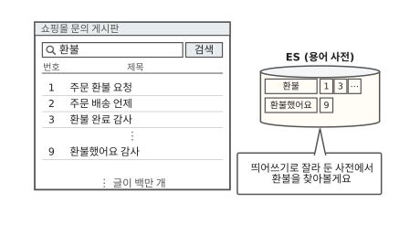

1편의 쇼핑몰 문의 게시판을 ES로 옮기고 검색창에 "환불"을 쳐 봤어요. 게시판 글은 띄어쓰기로 잘라서 용어 사전에 올라가 있어요.

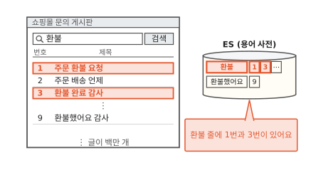

용어 사전의 `환불` 줄에서 1번과 3번 글이 나와요.

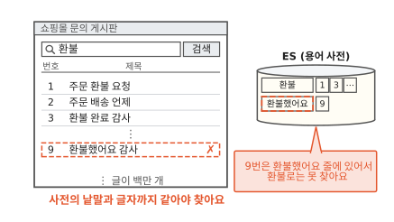

그런데 9번 글 "환불했어요 감사"는 안 나와요. 글에 분명히 "환불" 두 글자가 들어 있어요.

1편 끝에서 본 일이에요. 띄어쓰기로 자르면 9번 글에서는 `환불했어요`가 통째로 용어 사전에 올라가요. 검색어 "환불"은 `환불`과는 맞지만 `환불했어요`와는 글자가 달라요. 검색어는 용어 사전의 낱말과 글자 하나까지 똑같아야 찾아요.[^fuzzy]

그럼 ES는 글을 어떻게 잘라 용어 사전에 올릴까요?

## 분석기는 세 단계로 글을 잘라요

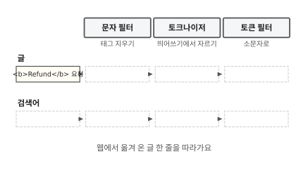

웹에서 옮겨 온 글에는 굵은 글씨 표시 같은 꾸밈과 영어 대문자가 섞여 있기도 해요. 이런 글 하나를 따라가면 세 단계가 하는 일이 모두 보여요. 그래서 여기서는 "환불"의 영어 낱말 Refund가 든 글 `<b>Refund</b> 요청`을 따라가 볼게요.

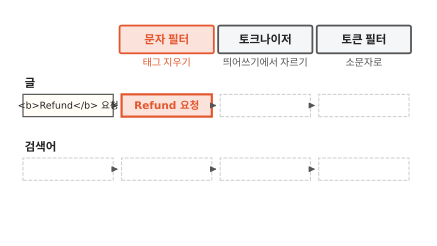

먼저 `<b>` 같은 꾸밈 표시가 지워져요.

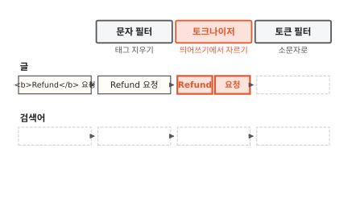

다음에 띄어쓰기에서 `Refund`와 `요청` 둘로 잘려요.

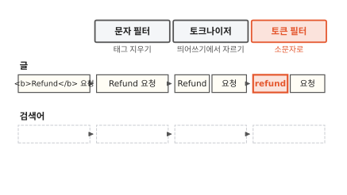

마지막으로 `Refund`가 소문자 `refund`가 돼요. 용어 사전에는 `refund`와 `요청`이 올라가요.

문장을 담는 필드라면 ES는 글을 용어 사전에 올리기 전에 늘 이런 줄을 지나게 해요. 이 줄을 **분석기**(analyzer)라고 불러요.

공장의 조립 줄처럼 분석기 안에서는 부품 세 개가 차례로 일해요.

1. 문자 필터(char filter)는 글자 단위로 글을 고쳐요. 웹 문서의 꾸밈 표시인 HTML 태그를 지우거나 특정 기호를 바꿔요. 없어도 돼요.
2. 토크나이저(tokenizer)는 글을 조각으로 잘라요. 하나뿐이고 꼭 있어야 해요.
3. 토큰 필터(token filter)는 잘린 조각을 하나씩 다듬어요. 소문자로 바꾸거나 뜻 없는 낱말을 버려요. 토큰 필터는 여러 개를 차례로 이어 둘 수 있어요.

토크나이저가 잘라 낸 조각 하나하나를 **토큰**(token)이라고 불러요. 토큰 필터를 다 거친 토큰이 용어 사전의 낱말(1편)이 돼요.

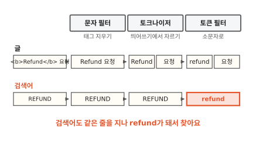

글만 이 줄을 지나는 게 아니에요. 검색어도 똑같은 줄을 지나요. 검색어 `REFUND`도 `refund`가 됐어요. 글 속 낱말과 검색어가 같은 모양이 되니 찾을 수 있어요.

분석기를 따로 고르지 않은 글은 어떤 줄을 지날까요?

## 따로 정하지 않으면 기본 분석기가 잘라요

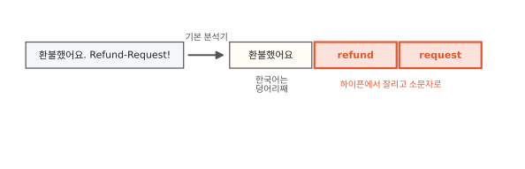

게시판 글은 제목, 본문 같은 칸으로 나뉘어 ES에 들어가요. ES에서는 글 안의 이런 칸을 필드라고 해요. 본문처럼 문장을 담는 칸은 `text` 필드로 만들어요. 분석기를 따로 정해 주지 않은 `text` 필드는 기본 분석기(standard)를 써요.

기본 분석기 안에서 켜져 있는 부품은 둘이에요. 띄어쓰기와 문장부호에서 자르는 토크나이저와 소문자로 바꾸는 토큰 필터예요.[^uax29] 그래서 "환불했어요. Refund-Request!"를 넣으면 `환불했어요`, `refund`, `request` 세 토큰이 나와요. 영어는 하이픈에서 잘리고 소문자가 됐어요. 한국어는 띄어쓰기 덩어리째 남았어요.

기본 분석기도 "환불했어요"를 통째로 남겼어요. 처음 장면처럼 "환불"로는 아직 이 글을 못 찾아요.

한국어는 어떻게 잘라야 "환불했어요"에서 "환불"이 나올까요?

## 한국어는 낱말 안쪽까지 잘라야 해요

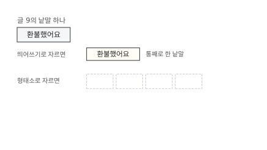

영어는 낱말 사이를 띄어 써요. 낱말 끝이 바뀌는 일도 한국어보다 적어요. 그래서 띄어쓰기로 잘라도 낱말이 제 모양으로 잘 나와요. 한국어는 "환불했어요", "환불을", "환불이라도"처럼 낱말 뒤에 조사와 어미가 붙어요. 띄어쓰기로 자르면 셋이 모두 다른 낱말로 용어 사전에 올라가요.

세 낱말에 똑같이 든 것은 "환불"이에요. 그래서 낱말을 뜻을 가진 가장 작은 단위까지 잘라요. 이 단위를 형태소라고 해요.

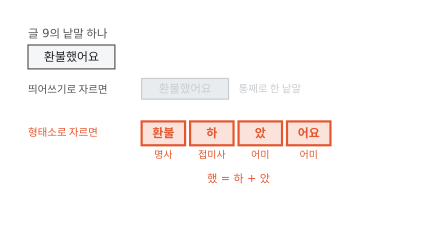

"환불했어요"를 형태소로 자르면 환불 + 하 + 았 + 어요예요. 명사 "환불" 뒤에 접미사 "하"와 어미 "았", "어요"가 붙었어요. "했" 한 글자가 "하"와 "았" 둘로 나뉘었어요. 글자 모양만 봐서는 이렇게 나눌 수 없어요. 형태소를 모아 둔 국어사전 같은 목록과 문법 지식이 있어야 해요. 형태소 사전을 보고 글을 형태소로 나누는 일을 **형태소 분석**이라고 해요.

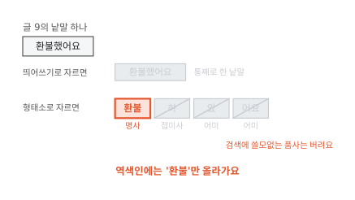

ES에는 한국어 형태소 분석기 nori가 있어요. 따로 설치해 붙이는 공식 플러그인이에요.[^nori] nori는 형태소로 자른 뒤 검색에 쓸모없는 품사를 버려요. 조사·어미·접미사가 대표이고 "아주" 같은 부사도 버려요. nori가 보는 형태소 사전은 글을 자를 때 쓰는 목록이에요. 검색할 때 낱말을 찾는 용어 사전과는 다른 것이에요.

제 컴퓨터에서 ES를 실행해 nori로 잘라 봤어요. "환불했어요"는 `환불` 하나가 남았어요. "간식을 샀어요"는 `간식`, `사` 둘이 남았어요. "샀"도 "사 + 았"으로 풀려서 동사의 줄기(어간) "사"가 용어 사전에 올라가요.

글자 모양만 보고 자르는 길도 있어요. 글자 두 개씩 겹쳐 잘라 용어 사전에 올리는 방법이에요.[^ngram] 이렇게 자르면 "호수박물관"이 `호수`, `수박`, `박물`, `물관`으로 올라가요. 그래서 "수박"을 찾으면 박물관 글까지 걸려요. 한국어는 흔히 형태소로 잘라요.

그러면 9번 글도 이제 찾을 수 있을까요?

## nori로 자를 때 챙길 것

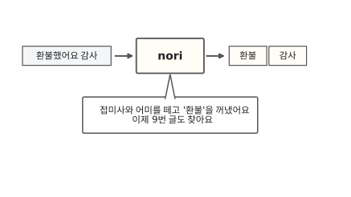

nori로 자르면 9번 글 "환불했어요 감사"에서 `환불`과 `감사`가 용어 사전에 올라가요. 이제 "환불"로 9번 글도 찾아요.

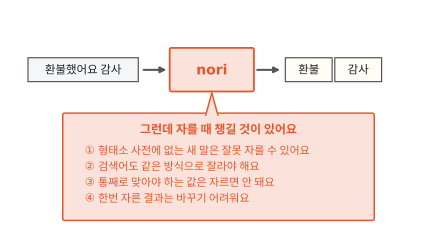

그런데 nori로 자르기로 했다고 끝나지는 않아요. 자를 때 챙길 것이 네 가지 있어요. 첫째부터 볼게요.

### 형태소 사전에 없는 말은 사용자 사전으로 바로잡아요

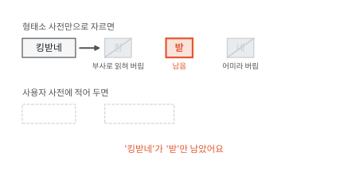

유행어 "킹받네"를 제 컴퓨터에서 실행한 ES의 nori로 잘라 봤어요. `킹`은 부사로 읽혀 버려지고 `받`만 남았어요. 형태소 분석은 형태소 사전에 기대요. 그래서 형태소 사전에 없는 말에서 틀릴 수 있어요. 새 상품 이름이나 유행어가 형태소 사전에 있는 작은 조각으로 쪼개질 수 있으면 nori는 그 조각대로 잘라 버려요.

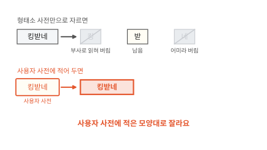

그래서 nori는 형태소 사전에 덧붙일 낱말 목록을 따로 받아요. 이 목록을 사용자 사전이라고 해요. 새 낱말을 사용자 사전에 적어 두면 nori는 대개 적어 둔 모양대로 잘라요. 제 컴퓨터에서도 "킹받네"를 사용자 사전에 넣으니 `킹받네` 하나로 남았어요.

??? info "심화: nori는 형태소를 어떻게 골라낼까요?"
    띄어쓰기 없는 "아버지가방에"처럼 자르는 방법이 여럿인 글을 nori가 어떻게 하나로 고르는지 궁금할 때 보는 칸이에요. 같은 글자도 "아버지가 방에"로도 "아버지 가방에"로도 자를 수 있어요. 그래서 가장 그럴듯한 길을 골라야 해요.

    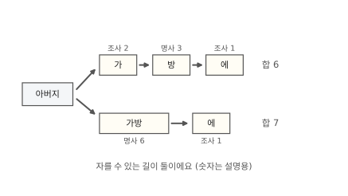

    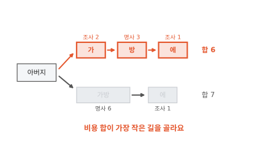

    nori는 mecab-ko-dic이라는 공개 한국어 형태소 사전을 넣어 쓰고 있어요. 먼저 글의 글자마다 그 자리에서 시작하는 형태소 후보를 형태소 사전에서 모두 찾아 펼쳐요. 후보마다 "이 형태소가 얼마나 드문가"를 비용으로 붙여요. "명사 다음에 조사가 오는 건 흔하다"처럼 앞뒤 품사가 이어지는 비용도 붙여요.

    지하철 노선도에서는 환승 시간까지 더해 가장 빨리 가는 길을 골라요. nori도 처음부터 끝까지 비용 합이 가장 작은 길을 골라요. 이렇게 길을 고르는 방법을 비터비 알고리즘이라고 해요. 그림의 숫자는 설명하려고 붙인 것이에요. 앞뒤 품사가 이어지는 비용은 빼고 그렸어요.

    실제 결과는 버전마다 달랐어요. 제 컴퓨터에서 실행한 ES에서 nori 안의 토크나이저로 "아버지가방에"를 잘라 봤어요. 9.2.0은 `아버지`, `가`, `방`, `에`로 잘랐어요. 7.17.26은 `아버지`, `가방`, `에`로 잘랐어요. 버전마다 들어 있는 nori 부품이 달라요. 그래서 같은 글도 고르는 길이 달라질 수 있어요.

    길을 고른 다음에는 품사 필터가 조사를 버려요. 형태소 사전에 아예 없는 구간은 같은 종류 글자가 이어진 덩어리를 모르는 낱말 하나로 처리해요. 한글끼리 이어진 덩어리나 로마자끼리 이어진 덩어리가 그런 예예요.

    사용자 사전에 넣은 낱말은 아주 낮은 비용을 받아요. 그래서 길을 고를 때 거의 언제나 뽑혀요. 그 결과 대개 넣은 모양대로 잘려요.

둘째로 검색어 쪽을 볼게요. 검색어는 어떻게 잘라야 용어 사전의 낱말과 맞을까요?

### 검색어도 같은 방식으로 잘라야 해요

손님이 검색창에 "환불했어요"를 그대로 쳤다고 해 봐요. 이 검색어가 통째로 남으면 용어 사전의 `환불`과 글자가 달라요. ES에서 가장 흔히 쓰는 검색(`match`)은 검색어를 글과 같은 분석기로 잘라서 찾아요. 그래서 검색어 "환불했어요"도 nori를 지나 `환불`이 되고 1번, 3번, 9번 글을 다 찾아요.

검색어가 여러 토큰으로 잘릴 때도 있어요. 그때는 기본으로 그중 하나만 맞아도 찾아요(1편).

검색어를 자르지 않고 낱말 하나로 그대로 찾는 검색(`term`)도 있어요. 둘의 차이는 대문자와 소문자가 갈리는 영어에서 잘 보여요. 그래서 상품 이름 "Refund Request"가 든 글을 "Refund"로 찾는 예로 볼게요. 용어 사전에는 소문자 `refund`가 올라가 있어요.

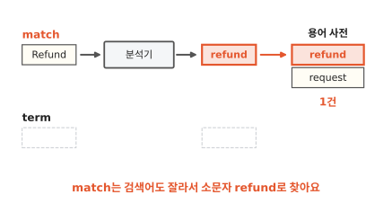

`match`는 검색어 "Refund"를 `refund`로 바꿔서 1건을 찾아요.

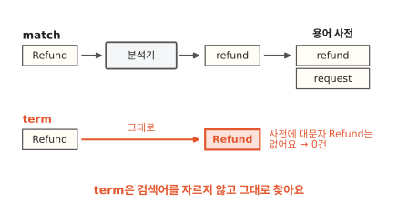

`term`은 "Refund"를 그대로 찾아요. 용어 사전에 대문자 `Refund`는 없으니 0건이에요.

??? info "심화: 검색어를 일부러 다르게 자르는 자동완성"
    검색창에 "청바"까지만 쳐도 "청바지"를 보여 주는 자동완성이 어떻게 만들어지는지 궁금할 때 보는 칸이에요. 쇼핑몰 자동완성은 상품 이름을 보여 주니 여기서는 상품 "청바지"로 볼게요. 자동완성에서는 저장할 때와 검색할 때 일부러 다르게 잘라요.

    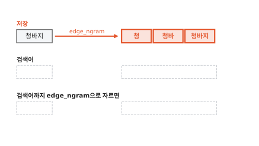

    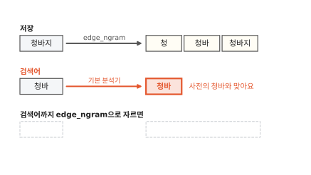

    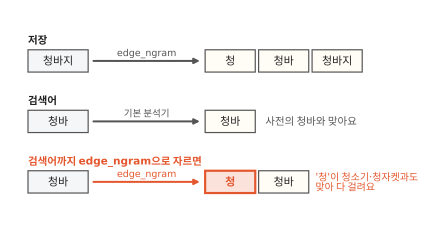

    필드마다 무엇을 어떻게 저장할지 적은 설정을 매핑이라고 해요.

    매핑에서 검색어용 분석기(`search_analyzer`)를 따로 줄 수 있어요. 그러면 검색어만 다른 분석기로 잘라요.

    자동완성을 만드는 방법은 여럿이에요. 흔한 방법에서는 저장할 때 edge_ngram 필터로 "청바지"를 앞에서부터 늘려 잘라요. 용어 사전에는 `청`, `청바`, `청바지`가 올라가요. 검색어 쪽은 edge_ngram 없이 기본 분석기로만 잘라요. 그래서 "청바"는 `청바` 하나로 남아요.

    검색어까지 edge_ngram으로 자르면 `청`도 검색어 토큰이 돼요. 토큰 하나만 맞아도 찾으니 "청"으로 시작하는 낱말이 모두 걸려요. edge_ngram은 낱말마다 토큰을 여러 개 만들어요. 그만큼 역색인이 커져요.[^sayt]

셋째로 주문번호처럼 잘리면 곤란한 값을 볼게요. 이런 값은 어디에 담을까요?

### 통째로 맞아야 하는 값은 자르지 않고 둬요

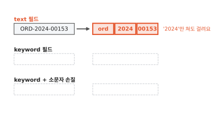

셋째는 분석기를 무엇으로 고르든 생기는 일이에요. 주문번호 "ORD-2024-00153"을 `text` 필드에 넣어 봐요. 기본 분석기가 하이픈에서 잘라 `ord`, `2024`, `00153` 세 토큰을 용어 사전에 올려요. 이러면 "2024"만 쳐도 2024년 주문이 모두 걸려요. 주문번호, 이메일, 주문 상태("배송중", "배송완료")는 검색어와 값 전체가 같아야 찾는 값이에요. 이런 값은 자르면 안 돼요.

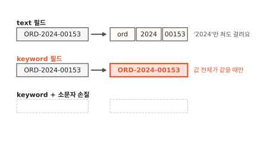

그래서 ES에는 값을 자르지 않고 통째로 담는 필드(`keyword` 필드)가 있어요. `keyword` 필드는 값 전체를 토큰 하나로 용어 사전에 올려요. "ORD-2024-00153"은 대소문자와 하이픈을 그대로 살린 낱말 하나가 돼요. `keyword` 필드에서는 `match`도 검색어를 자르지 않고 통째로 찾아요.

그런데 손님이 주문번호를 "ord-2024-00153"처럼 소문자로 칠 수 있어요. 대문자로 저장된 값과 글자가 달라서 이대로는 못 찾아요. 이럴 때는 `keyword` 필드에 소문자 손질(normalizer)을 붙여요. 소문자 손질은 값을 자르지 않고 소문자로만 바꿔요.

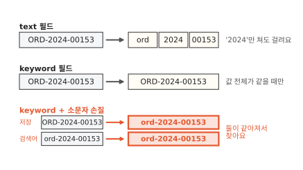

소문자 손질은 저장하는 값에도 검색어에도 똑같이 들어가요. `term`은 검색어를 자르지 않아요. 그래도 `keyword` 필드의 소문자 손질은 거쳐요.[^norm] 그래서 `match`로 찾든 `term`으로 찾든 "ORD-2024-00153"과 "ord-2024-00153"이 같은 낱말이 돼요.

| 필드 | 저장할 때 | `match`로 찾으면 | `term`으로 찾으면 |
|---|---|---|---|
| `text` | 분석기로 잘라서 | 검색어도 같은 분석기로 잘라서 찾아요 | 검색어를 그대로 찾아요. 용어 사전의 낱말과 글자까지 같을 때만 맞아요 |
| `keyword` | 값 전체를 그대로 | 검색어를 자르지 않고 찾아요 | 검색어를 자르지 않고 찾아요 |
| `keyword` + 소문자 손질 | 소문자로 바꿔 통째로 | 검색어를 소문자로 바꿔 통째로 찾아요 | 검색어를 소문자로 바꿔 통째로 찾아요 |

넷째는 이미 잘라 둔 글이에요. 게시판 글은 이미 기본 분석기로 잘려 들어가 있어요. 이제 nori로 바꾸려면 어떻게 할까요?

### 한번 자르면 바꾸기 어려워요

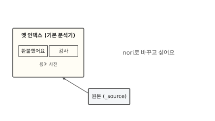

ES는 게시판 글을 한 통에 모아 둬요. 게시판 하나가 통 하나인 식이에요. 이 통을 ES 인덱스라고 해요. 1편의 데이터베이스 인덱스와 이름은 같지만 다른 것이에요. ES 인덱스 안에 글과 역색인이 함께 들어 있어요.

역색인에는 잘린 결과만 남아요. 원래 글은 ES가 따로 보관하는 원본(`_source`)에 남아 있어요.[^source] 하지만 용어 사전과 포스팅 목록은 글을 넣던 때의 분석기가 자른 토큰으로 이미 짜여 있어요.

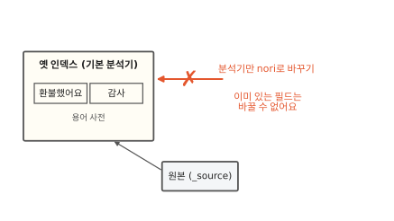

분석기를 nori로 바꿀 수 있다고 해 봐요. 그때부터 검색어는 nori로 잘리는데 용어 사전은 기본 분석기로 잘린 채 남아요. 그러면 검색어와 용어 사전의 낱말이 서로 안 맞게 돼요. 그래서 ES는 이미 있는 필드의 분석기를 바꾸지 못하게 막아 둬요.[^search]

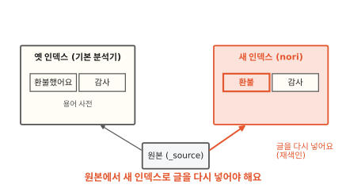

nori로 바꾸려면 nori로 설정한 새 인덱스를 만들어요. 그리고 원본에서 글을 읽어 새 인덱스에 다시 넣어요. 이 일을 재색인(reindex)이라고 해요. 글을 하나하나 다시 자르니 글이 많을수록 오래 걸려요.

사용자 사전을 고쳐도 이미 넣은 글은 옛 사용자 사전으로 잘린 그대로예요. 고친 사용자 사전을 쓰려면 글을 다시 넣어야 해요.

??? info "심화: 검색을 멈추지 않고 재색인하려면?"
    게시판 검색을 멈출 수 없는데 분석기를 바꿔야 할 때 보는 칸이에요. 재색인은 피할 수 없어요. 그래도 검색이 끊기지 않게 할 수는 있어요.

    휴대폰 바탕화면의 바로가기는 이름은 그대로 두고 가리키는 앱만 바꿀 수 있어요. ES의 별칭(alias)이 이런 바로가기예요.

    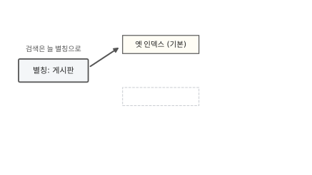

    검색은 늘 별칭 이름으로 해요.

    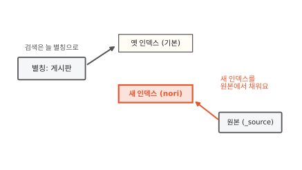

    새 설정의 인덱스를 따로 만들어 `_reindex`로 채워요. 그동안 검색은 옛 인덱스에서 그대로 돌아요.

    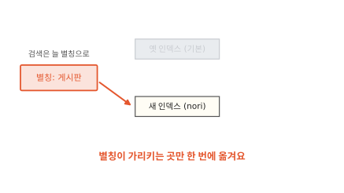

    다 채우면 별칭이 가리키는 곳을 한 번에 새 인덱스로 옮겨요.

    재색인하는 동안 들어오는 새 글은 따로 챙겨야 해요. 두 인덱스에 다 넣는 방법이 있어요. 시각을 기준으로 빠진 구간을 한 번 더 넣어도 돼요. 잠깐 쓰기를 멈출 수도 있어요.

    `_reindex`는 원본(`_source`)에서 글을 읽어요. 그래서 원본을 꺼 둔 인덱스에는 이 방법을 쓸 수 없어요.

자르는 방식은 나중에 바꾸기 어려우니 처음에 잘 정해야 해요. 필드를 만들 때 무엇을 보고 정할까요?

## 필드마다 어떻게 자를지 정해요

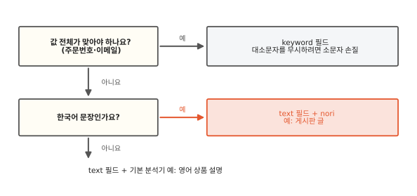

필드를 만들 때 두 가지를 물어보면 대부분 정해져요. 첫째 물음은 "값 전체가 맞아야 하나요?"예요. 주문번호나 이메일은 한 글자만 달라도 다른 값이에요. 이런 값은 `keyword` 필드에 둬요. 사람마다 대소문자를 섞어 칠 수 있으면 소문자 손질을 붙여요.

둘째 물음은 "한국어 문장인가요?"예요. 게시판 글이나 상품 후기에는 조사와 어미가 붙어요. 이런 한국어 문장은 `text` 필드에 nori를 붙여요. 영어 상품 설명처럼 띄어쓰기로 잘라도 되는 글은 기본 분석기로 시작해요.

기본 분석기는 "refunds"와 "refund"를 다른 낱말로 둬요.[^stem] 둘을 같은 낱말로 맞추려면 영어용 분석기(`english`)를 써요.

어느 쪽이든 나중에 바꾸려면 재색인이 필요해요. 그래서 정하기 전에 실제 글을 미리 잘라 봐요. ES에는 글을 보내면 분석기가 자른 토큰만 돌려주는 기능(`_analyze` API)이 있어요. 이 기능으로 실제 글 몇 개를 넣어 봐요. 원하는 토큰이 나오면 그 분석기로 정해요.

처음 장면의 게시판이라면 제목과 본문을 nori를 붙인 `text` 필드로 만들어요.

## 다시 "환불"을 찾아 볼게요

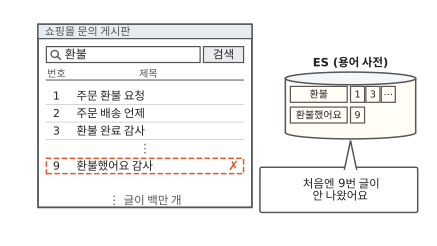

처음 장면의 게시판으로 돌아왔어요. 띄어쓰기로 잘라 둔 사전에서는 9번 글이 안 나왔어요.

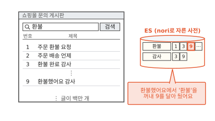

이번에는 게시판 글을 nori로 자르는 새 인덱스에 다시 넣었어요. 9번 글에서 `환불`이 나와 `환불` 줄에 9가 붙었어요.

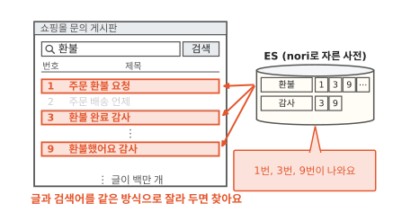

이제 "환불"을 치면 9번 글 "환불했어요 감사"도 나와요. "환불을", "환불이라도"처럼 다른 꼴로 쓴 글도 같은 `환불` 줄에서 찾아요.

### 이 편에서 줄여 그린 것

그림을 쉽게 하려고 실제와 다르게 줄인 곳이 세 군데 있어요.

1. 품사 이름을 명사, 어미처럼 우리말로 적었어요. nori는 품사를 기호로 적어요. 일반 명사는 `NNG`, 문장을 끝내는 어미는 `EF`예요.
2. 분석기를 지난 토큰을 글자만 있는 칸으로 그렸어요. 실제 토큰에는 글 안에서 몇 번째 낱말인지(위치)와 몇 번째 글자부터인지 같은 정보도 함께 붙어요. 위치는 1편 심화 칸의 붙은 말 찾기에서 써요.
3. 재색인 그림에서 원본(`_source`)을 인덱스 밖 상자로 그렸어요. 실제로는 원본도 같은 ES 인덱스 안에 글마다 함께 들어 있어요. 역색인과 따로 보관할 뿐이에요.

### 이 편에서 새로 나온 말

[^fuzzy]: 이 편에서 다루는 보통 검색 이야기예요. 오타를 봐주는 검색(fuzzy)처럼 일부러 조금 다른 낱말까지 찾는 검색은 따로 있어요.
[^uax29]: 토크나이저 이름도 분석기와 같은 standard예요. 기본 분석기에는 불용어(뜻 없는 낱말)를 버리는 필터도 들어 있지만 기본으로 꺼져 있어요. 토크나이저(standard)는 유니코드 표준 문서 UAX #29의 낱말 경계 규칙을 따라요. 한글 음절과 로마자·숫자는 붙어 있으면 한 토큰이라 `환불Refund`는 `환불refund` 하나, `ORD2024`는 `ord2024` 하나, `ORD-2024`는 `ord`와 `2024` 둘이에요. 낱말 안쪽의 아포스트로피(`can't`), 숫자 사이 마침표(`3.14`), 밑줄(`a_b`)에서는 자르지 않아요. 한 토큰이 255자(`max_token_length`)를 넘으면 255자마다 끊어요. 기본 분석기의 결과는 제 컴퓨터에 띄운 ES 7.17.26과 9.2.0에서 똑같았어요. <https://www.unicode.org/reports/tr29/>, <https://www.elastic.co/guide/en/elasticsearch/reference/current/analysis-standard-analyzer.html>
[^nori]: Elasticsearch 문서, "Korean (nori) analysis plugin". 복합명사를 어떻게 남길지 정하는 `decompound_mode`의 기본값은 `discard`(쪼갠 것만 남김)예요. 버릴 품사 목록 `stoptags`의 기본값에는 어미(E 계열)·조사(J 계열)·접미사 말고도 부사·관형사·감탄사 같은 품사가 들어 있어요. 그래서 사용자가 "에서"처럼 조사만 치면 토큰이 0개가 되고 `match`의 `zero_terms_query` 기본값(`none`)에 따라 0건이 나와요. 사용자 사전은 한 줄에 "낱말" 또는 "낱말 + 나눌 모양"을 적어요(예: `세종시 세종 시`). <https://www.elastic.co/guide/en/elasticsearch/plugins/current/analysis-nori.html>
[^ngram]: 이렇게 글자 몇 개씩 겹쳐 자르는 방법을 n-gram이라고 해요.
[^norm]: Elasticsearch 문서, "normalizer" 매핑 파라미터. normalizer는 `match` 같은 검색에도 `term` 같은 낱말 단위 검색에도 쓰인다고 적혀 있어요. <https://www.elastic.co/guide/en/elasticsearch/reference/current/normalizer.html>
[^source]: 공간을 아끼려고 원본을 꺼 둘 수도 있어요.
[^search]: 검색어만 따로 자르는 분석기(`search_analyzer`)는 이미 있는 필드에서도 바꿀 수 있어요. 바꾸면 검색어와 용어 사전이 어긋날 수 있으니 저장 분석기와 맞는지 확인해요.
[^stem]: 낱말의 모양 변화를 줄기로 맞춰 주는 일을 어간 추출(stemming)이라고 해요. 기본 분석기는 어간 추출을 하지 않아요.
[^sayt]: edge_ngram 필터가 만드는 조각의 가장 짧은 길이(`min_gram`)는 기본 1글자, 가장 긴 길이(`max_gram`)는 기본 2글자라서 세 글자까지 만들려면 `max_gram`을 3 이상으로 줘야 해요. 7.2부터는 이 구성을 미리 짜 둔 `search_as_you_type` 필드도 있어요. 동의어("휴대폰"을 치면 "핸드폰"도 찾기)도 ES 문서는 검색어 쪽 분석기에만 두라고 권해요. 여러 낱말 동의어는 토큰 위치가 그래프 모양이 되는데 역색인에는 그래프를 그대로 저장할 수 없어서예요. 검색 쪽에만 두면 목록을 바꿔도 다시 넣을 필요가 없고 바꾼 목록은 필터에 `updateable: true`를 주고 `_reload_search_analyzers`(7.3부터)로 반영해요. 동의어 필터를 nori 품사 필터 뒤에 두면 동의어 규칙 속 낱말도 nori로 잘려요. 그래서 "휴대폰을, 핸드폰" 같은 규칙이 여러 낱말 규칙으로 바뀌어요. 조사 "에서"처럼 품사 필터에 통째로 버려지는 낱말이 규칙에 있으면 인덱스를 만들 때 오류가 나요. <https://www.elastic.co/guide/en/elasticsearch/reference/current/analysis-synonym-graph-tokenfilter.html>
