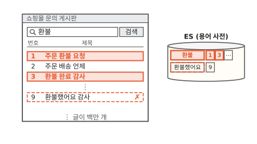
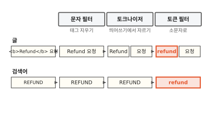
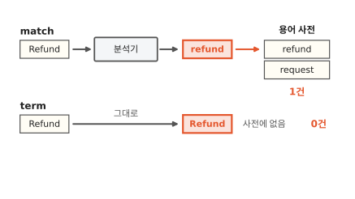
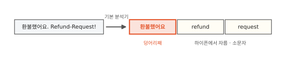
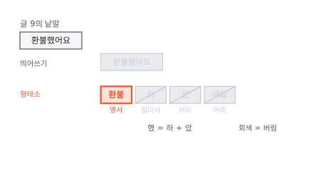
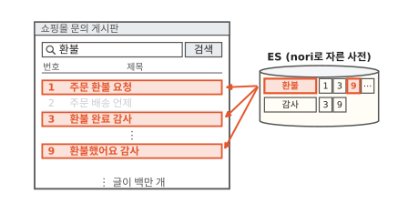
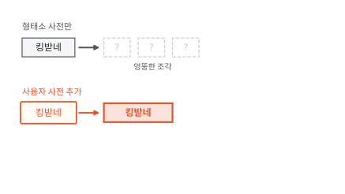
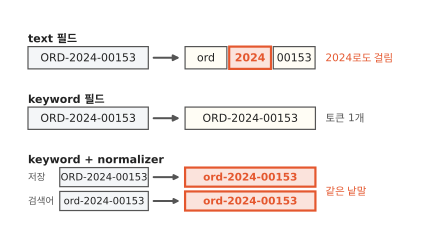
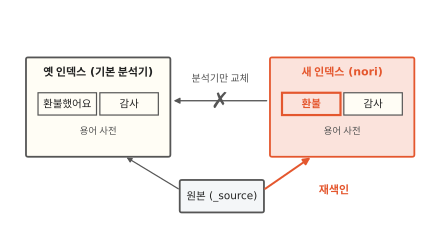

# 분석기: ES가 글을 낱말로 자르는 방법

쇼핑몰 문의 게시판에서 "환불"을 검색했는데 "환불했어요 감사"라고 쓴 글이 안 나올 때가 있어요. 글에 "환불" 두 글자가 분명히 들어 있는데도요. 이 글을 읽고 나면 Elasticsearch(ES)가 글을 어떻게 잘라서 용어 사전에 올리는지 알게 돼요. 자르는 방식에 따라 찾을 수 있는 글이 달라져요. 나중에 바꾸기도 어려워서 처음에 알고 정해야 해요.

!!! abstract "이 글에서 알게 되는 것"
    1. ES는 글을 용어 사전에 올리기 전에 분석기로 잘라요. 검색어도 같은 분석기로 잘라서 둘의 모양을 맞춰요.
    2. 기본 분석기는 띄어쓰기에서 잘라서 "환불했어요"를 통째로 남겨요. 한국어는 nori로 형태소까지 잘라야 "환불"이 나와요.
    3. 주문번호처럼 통째로 맞아야 하는 값은 자르지 않는 `keyword` 필드에 둬요. 분석기는 나중에 바꾸려면 글을 다시 넣어야 해요.

## 1. 검색어는 용어 사전의 낱말과 글자까지 같아야 찾아요

[1편](01-inverted-index.md)에서 게시판 글을 낱말로 잘라 역색인을 만들었어요. 역색인은 낱말마다 그 낱말이 든 글 번호를 적어 둔 목록이에요. 낱말 칸만 모은 쪽은 용어 사전이라고 불렀어요.

이 게시판을 ES로 옮기고 검색창에 "환불"을 쳐 볼게요. 게시판 글은 띄어쓰기로 잘라서 용어 사전에 올라가 있어요. 아래 그림에서 게시판의 9번 줄과 용어 사전의 두 줄을 비교해 보세요.

**그림 1.** "환불" 줄에서는 1번과 3번만 나오고 9번은 "환불했어요" 줄에 따로 있어요.
{ .fig-cap }

9번 글 "환불했어요 감사"는 띄어쓰기로 자르면 `환불했어요`가 한 덩어리로 용어 사전에 올라가요. 검색어 "환불"은 `환불` 줄과는 맞지만 `환불했어요` 줄과는 글자가 달라요. ES는 검색어를 용어 사전의 낱말과 글자 하나까지 맞춰 보기 때문에 9번 글을 못 찾아요.[^fuzzy]

그러니 글을 어떻게 잘라 두느냐가 찾을 수 있는 글을 정해요. ES가 글을 자르는 순서부터 볼게요.

## 2. 분석기는 글과 검색어를 같은 방식으로 잘라요

웹에서 옮겨 온 글에는 굵은 글씨 표시 같은 꾸밈이 섞여 있기도 해요. 영어 대문자도 섞여 있고요. 그래서 "환불"의 영어 낱말이 든 글 `<b>Refund</b> 요청` 하나를 따라가 볼게요. 아래 그림의 "글" 줄을 왼쪽에서 오른쪽으로 읽어 보세요.

**그림 2.** 글과 검색어가 같은 세 단계를 지나서 둘 다 `refund`가 돼요.
{ .fig-cap }

먼저 `<b>` 같은 꾸밈 표시가 지워져요. 다음에 띄어쓰기에서 `Refund`와 `요청` 둘로 잘려요. 마지막으로 `Refund`가 소문자 `refund`가 돼요. 용어 사전에는 `refund`와 `요청`이 올라가요.

ES는 문장을 담는 칸이면 글을 용어 사전에 올리기 전에 늘 이런 단계를 지나게 해요. 이 단계 묶음을 **분석기**(analyzer)라고 해요. 분석기 안에서는 부품 세 개가 차례로 일해요.

1. 문자 필터(char filter)는 글자를 고쳐요. 웹 문서의 꾸밈 표시인 HTML 태그를 지우는 일 같은 거예요. 없어도 돼요.
2. 토크나이저(tokenizer)는 글을 조각으로 잘라요. 꼭 하나 있어야 해요.
3. 토큰 필터(token filter)는 잘린 조각을 하나씩 다듬어요. 소문자로 바꾸거나 쓸모없는 낱말을 버려요. 여러 개를 이어 둘 수 있어요.

토크나이저가 잘라 낸 조각 하나를 **토큰**(token)이라고 해요. 토큰 필터까지 거친 토큰이 용어 사전의 낱말이 돼요.

그림 2의 "검색어" 줄도 보세요. 손님이 `REFUND`라고 쳐도 검색어가 같은 분석기를 지나 `refund`가 돼요. 글 속 낱말과 검색어가 같은 모양이 되니까 찾을 수 있어요. ES에서 가장 흔히 쓰는 검색(`match`)이 이렇게 검색어도 잘라서 찾아요.

검색어를 자르지 않고 그대로 찾는 검색(`term`)도 있어요. 아래 그림에서 두 검색이 "Refund"로 몇 건을 찾는지 보세요.

**그림 3.** `match`는 검색어를 `refund`로 바꿔서 1건을 찾고 `term`은 `Refund` 그대로 찾아서 0건이에요.
{ .fig-cap }

용어 사전에는 소문자 `refund`만 있어요. `term`은 대문자 `Refund`를 그대로 찾으니 맞는 낱말이 없어요. 글을 잘라 둔 칸에서는 검색어도 같은 분석기로 잘라야 맞아요.

## 3. 기본 분석기는 "환불했어요"를 통째로 남겨요

게시판 글은 제목, 본문 같은 칸으로 나뉘어 ES에 들어가요. ES에서는 이런 칸을 필드라고 해요. 본문처럼 문장을 담는 칸은 `text` 필드로 만들어요. 필드마다 어떤 종류이고 어떤 분석기를 쓸지 적어 둔 설정을 매핑(mapping)이라고 해요. 매핑에서 분석기를 따로 정하지 않은 `text` 필드는 기본 분석기(standard)로 잘라요.

기본 분석기는 띄어쓰기와 문장부호에서 자르고 소문자로 바꿔요.[^standard] 아래 그림에서 한국어 칸과 영어 칸이 어떻게 잘렸는지 보세요.

**그림 4.** 영어는 하이픈에서 잘리고 소문자가 됐지만 "환불했어요"는 한 덩어리로 남았어요.
{ .fig-cap }

영어는 낱말 사이를 띄어 쓰고 낱말 끝이 바뀌는 일도 적어요. 그래서 띄어쓰기로만 잘라도 낱말이 제 모양으로 나와요. 한국어는 "환불했어요", "환불을", "환불이라도"처럼 낱말 뒤에 조사와 어미가 붙어요. 띄어쓰기로 자르면 이 셋이 모두 다른 낱말로 용어 사전에 올라가요. 기본 분석기로는 1절의 9번 글을 여전히 못 찾아요.

## 4. nori는 한국어를 형태소까지 잘라요

세 낱말에 똑같이 든 것은 "환불"이에요. 그러니 낱말 안쪽까지 잘라서 "환불"을 꺼내면 돼요.

"환불했어요"는 환불 + 하 + 았 + 어요로 나눌 수 있어요. 명사 "환불" 뒤에 접미사 "하"와 어미 "았", "어요"가 붙은 모양이에요. 이렇게 뜻을 가진 가장 작은 단위를 형태소라고 해요. 아래 그림에서 "했" 한 글자가 어떻게 나뉘었는지 보세요.

**그림 5.** "환불했어요"를 형태소로 자르면 "환불"만 남고 하, 았, 어요는 버려져요.
{ .fig-cap }

"했"이 "하"와 "았" 둘로 나뉘었어요. 글자 모양만 봐서는 이렇게 나눌 수 없어요. 형태소를 모아 둔 목록(형태소 사전)과 문법 지식이 있어야 해요. 형태소 사전을 보고 글을 형태소로 나누는 일을 **형태소 분석**이라고 해요. 형태소 사전은 글을 자를 때 쓰는 목록이라서 검색할 때 낱말을 찾는 용어 사전과는 다른 것이에요.

ES에는 한국어 형태소 분석기 nori가 있어요. 따로 설치해 붙이는 공식 플러그인이에요.[^nori] nori는 형태소로 자른 뒤 검색에 쓸모없는 품사를 버려요. 조사, 어미, 접미사가 대표이고 "아주" 같은 부사도 버려요. 그래서 "환불했어요"에서는 `환불` 하나가 남아요.

게시판 글을 nori로 다시 잘라 넣었다고 해 볼게요. 아래 그림에서 용어 사전의 `환불` 줄을 보세요.

**그림 6.** nori로 자른 사전에는 `환불` 줄에 9가 붙어서 "환불"로 1번, 3번, 9번이 다 나와요.
{ .fig-cap }

이제 "환불"을 치면 9번 글 "환불했어요 감사"도 나와요. 손님이 검색창에 "환불했어요"를 그대로 쳐도 괜찮아요. `match`는 검색어도 nori로 잘라서 `환불`로 찾거든요. "환불을", "환불이라도"처럼 다른 꼴로 쓴 글도 같은 `환불` 줄에서 찾아요.

형태소 분석은 형태소 사전에 기대요. 그래서 형태소 사전에 없는 새 말에서는 틀릴 수 있어요. 유행어 "킹받네"는 형태소 사전에 없어요. nori는 사전에 없는 말을 사전에 있는 작은 조각으로 나눠 보려 해서 엉뚱하게 잘릴 수 있어요. 그러면 "킹받네"로 찾아도 이 말이 든 글이 잘 나오지 않아요.

이럴 때는 형태소 사전에 덧붙일 낱말 목록을 따로 줘요. 이 목록을 사용자 사전이라고 해요. 아래 그림의 두 줄을 비교해 보세요.

**그림 7.** 사용자 사전에 "킹받네"를 적어 두면 쪼개지지 않고 한 토큰으로 남아요.
{ .fig-cap }

nori는 사용자 사전에 적은 낱말을 우선해서 대개 적어 둔 모양대로 잘라요. 새 상품 이름이나 유행어가 자주 나오는 게시판이면 사용자 사전을 함께 챙겨요.

## 5. 통째로 맞아야 하는 값은 `keyword` 필드에 둬요

지금까지는 잘라야 찾는 글이었어요. 반대로 잘리면 곤란한 값도 있어요. 주문번호 "ORD-2024-00153"이 그래요. 아래 그림에서 같은 주문번호가 세 가지 필드에서 어떻게 저장되는지 보세요.

**그림 8.** `text` 필드는 주문번호를 세 토큰으로 자르고 `keyword` 필드는 한 토큰으로 둬요.
{ .fig-cap }

`text` 필드에 넣으면 기본 분석기가 하이픈에서 잘라 `ord`, `2024`, `00153` 세 토큰을 올려요. 그러면 "2024"만 쳐도 2024년 주문이 모두 걸려요. 주문번호, 이메일, 주문 상태("배송중", "배송완료")는 값 전체가 같아야 찾는 값이에요.

그래서 ES에는 값을 자르지 않고 통째로 담는 `keyword` 필드가 있어요. "ORD-2024-00153"은 대문자와 하이픈을 그대로 살린 토큰 하나로 용어 사전에 올라가요. `keyword` 필드에서는 `match`도 검색어를 자르지 않고 통째로 찾아요.

그런데 손님이 주문번호를 "ord-2024-00153"처럼 소문자로 칠 수 있어요. 대문자로 저장된 값과 글자가 달라서 이대로는 못 찾아요. 이럴 때는 `keyword` 필드에 normalizer를 붙여요. normalizer는 값을 자르지 않고 소문자로 바꾸는 일만 해요. 그림 8의 셋째 줄처럼 저장하는 값과 검색어가 둘 다 normalizer를 지나서 같은 낱말이 돼요. `term`도 `keyword` 필드의 normalizer는 거쳐요.[^norm]

| 필드 | 저장할 때 | 검색어는 |
|---|---|---|
| `text` | 분석기로 잘라서 | `match`는 같은 분석기로 자르고 `term`은 그대로 찾아요 |
| `keyword` | 값 전체를 그대로 | 자르지 않고 통째로 찾아요 |
| `keyword` + normalizer | 소문자로 바꿔 통째로 | 소문자로 바꿔 통째로 찾아요 |

## 6. 분석기를 바꾸려면 글을 다시 넣어야 해요

게시판 글이 이미 기본 분석기로 잘려 들어가 있다고 해 볼게요. 이제 nori로 바꾸고 싶어요.

ES는 게시판 글을 한 통에 모아 둬요. 이 통을 ES 인덱스라고 해요. 1편의 데이터베이스 인덱스와 이름은 같지만 다른 것이에요. ES 인덱스 안에는 글 원본과 역색인이 함께 들어 있어요.[^source] 역색인은 글을 넣던 때의 분석기가 자른 토큰으로 이미 짜여 있어요.

분석기만 nori로 바꿨다고 해 볼게요. 그때부터 검색어는 nori로 잘려서 `환불`이 되는데 용어 사전에는 `환불했어요`가 그대로 있어요. 검색어와 용어 사전이 서로 안 맞게 돼요. 그래서 ES는 이미 있는 필드의 분석기를 바꾸지 못하게 막아 둬요. 아래 그림에서 원본에서 나가는 두 화살표를 보세요.

**그림 9.** 분석기만 바꿀 수는 없어서 nori로 설정한 새 인덱스에 원본 글을 다시 넣어요.
{ .fig-cap }

nori로 바꾸려면 nori로 설정한 새 인덱스를 만들어요. 그리고 원본에서 글을 읽어 새 인덱스에 다시 넣어요. 이 일을 **재색인**(reindex)이라고 해요. 글을 하나하나 다시 자르니 글이 많을수록 오래 걸려요. 사용자 사전을 고쳤을 때도 마찬가지예요. 이미 넣은 글은 옛 사용자 사전으로 잘린 그대로라서 고친 사전을 쓰려면 글을 다시 넣어야 해요.

그래서 필드를 만들 때 미리 정해 둬요. 두 가지를 물어보면 대부분 정해져요.

- 값 전체가 맞아야 하나요? 주문번호나 이메일이면 `keyword` 필드에 둬요. 대소문자를 섞어 칠 수 있으면 normalizer를 붙여요.
- 한국어 문장인가요? 게시판 글이나 상품 후기면 `text` 필드에 nori를 붙여요. 영어 상품 설명처럼 띄어쓰기로 잘라도 되는 글은 기본 분석기로 시작해요.

정하기 전에 실제 글을 잘라 볼 수도 있어요. ES에는 글을 보내면 분석기가 자른 토큰만 돌려주는 기능(`_analyze` API)이 있어요. 게시판 글 몇 개를 넣어 보고 원하는 토큰이 나오면 그 분석기로 정해요.

## 정리

ES는 글을 용어 사전에 올리기 전에 분석기로 잘라요. 분석기는 꾸밈을 지우는 문자 필터, 글을 토큰으로 자르는 토크나이저, 토큰을 다듬는 토큰 필터로 이루어져 있어요. `match` 검색은 검색어도 같은 분석기로 잘라서 글 속 낱말과 모양을 맞춰요.

기본 분석기는 띄어쓰기에서 잘라서 "환불했어요"를 통째로 남겨요. 그래서 "환불"로는 9번 글을 못 찾았어요. nori는 형태소 분석으로 "환불했어요"에서 `환불`을 꺼내요. 형태소 사전에 없는 새 말은 사용자 사전으로 바로잡아요.

주문번호처럼 통째로 맞아야 하는 값은 `keyword` 필드에 두고 대소문자는 normalizer로 맞춰요. 이미 있는 필드의 분석기는 바꿀 수 없어서 바꾸려면 새 인덱스로 재색인해요.

[3편](03-routing.md)에서는 ES가 글을 여러 조각에 나눠 담는데 그 조각 수를 왜 나중에 바꾸기 어려운지 봐요.

### 새로 나온 말

- **분석기**: 글을 잘라 용어 사전에 올릴 낱말을 만드는 단계 묶음. `<b>Refund</b> 요청`을 `refund`와 `요청`으로 만들었어요.
- **토큰**: 분석기가 잘라 낸 조각 하나. "환불했어요 감사"를 nori로 자르면 `환불`, `감사` 토큰이 나와요.
- **형태소 분석**: 형태소 사전을 보고 낱말을 뜻을 가진 가장 작은 단위로 나누는 일. "환불했어요"를 환불 + 하 + 았 + 어요로 나눴어요.
- **사용자 사전**: 형태소 사전에 덧붙이는 낱말 목록. "킹받네"를 적어 두면 한 토큰으로 남아요.
- **매핑**: 필드마다 종류와 분석기를 적어 둔 설정. 본문은 `text` 필드, 주문번호는 `keyword` 필드라고 적어요.
- **`keyword` 필드**: 값을 자르지 않고 토큰 하나로 저장하는 필드. "ORD-2024-00153"을 통째로 올려요.
- **normalizer**: `keyword` 필드 값을 자르지 않고 소문자로만 바꾸는 기능. "ORD-2024-00153"과 "ord-2024-00153"을 같은 낱말로 맞춰요.
- **재색인**: 새 설정의 인덱스에 원본 글을 다시 넣는 일. 기본 분석기로 넣은 게시판 글을 nori 인덱스에 다시 넣었어요.

[^fuzzy]: 오타를 봐주는 검색(fuzzy)처럼 일부러 조금 다른 낱말까지 찾는 검색은 따로 있어요.
[^standard]: 토크나이저 이름도 standard예요. 유니코드 표준 문서 UAX #29의 낱말 경계 규칙을 따라요. 기본 분석기에는 뜻 없는 낱말(불용어)을 버리는 필터도 들어 있지만 기본으로 꺼져 있어요. <https://www.elastic.co/guide/en/elasticsearch/reference/current/analysis-standard-analyzer.html>
[^nori]: Elasticsearch 문서, "Korean (nori) analysis plugin". 버릴 품사 목록(`stoptags`)의 기본값에는 조사·어미·접미사 말고도 부사·관형사·감탄사 같은 품사가 들어 있어요. <https://www.elastic.co/guide/en/elasticsearch/plugins/current/analysis-nori.html>
[^norm]: Elasticsearch 문서, "normalizer" 매핑 파라미터. <https://www.elastic.co/guide/en/elasticsearch/reference/current/normalizer.html>
[^source]: 원본은 `_source`라는 칸에 글마다 따로 보관해요. 공간을 아끼려고 원본을 꺼 둘 수도 있는데 그러면 원본에서 다시 넣는 재색인을 쓸 수 없어요.
