# 샤드 수는 왜 나중에 못 바꿀까요?

## 조각을 하나 늘리려는데 ES가 거절해요

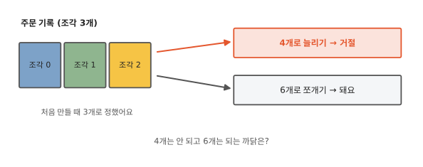

쇼핑몰 주문 기록을 ES에 담았어요. 주문이 많아서 ES는 이 기록을 조각 세 개로 나눠 컴퓨터 세 대에 담았어요. 1년이 지나 주문이 늘자 조각 하나가 너무 커졌어요. 그래서 조각을 4개로 늘리려 했더니 ES가 거절해요. 그런데 6개로 쪼개는 건 받아 줘요.

1편과 2편에서 글이라고 부른 것을 ES는 문서(document)라고 불러요. 주문 하나가 문서 하나예요. 이 편도 이 이름을 따라요.

4개는 안 되고 6개는 되는 규칙은 어디서 나왔을까요? 먼저 ES가 왜 기록을 조각으로 나누는지부터 봐요.

## 인덱스는 샤드 여러 개로 나뉘어요

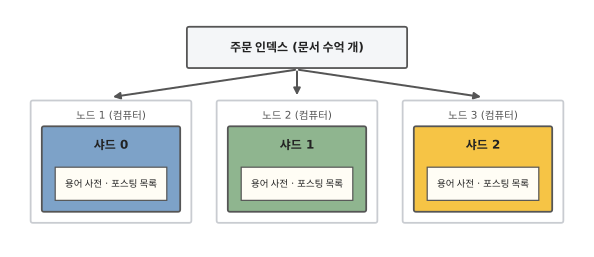

주문 기록 전체는 ES에서 인덱스 하나예요. 인덱스는 문서를 모아 두는 단위예요(2편). 문서가 수억 개가 되면 컴퓨터 한 대로는 모자라요. 저장 공간인 디스크도 작업 공간인 메모리도 부족해요. 그래서 ES는 인덱스 하나를 여러 조각으로 나눠 여러 컴퓨터에 흩어 놓아요. 이 조각을 **샤드**(shard)라고 해요.

그림에서 샤드 셋은 컴퓨터 세 대에 하나씩 들어 있어요. ES가 돌아가는 이 컴퓨터 한 대를 노드(node)라고 해요.

샤드 하나는 자기 몫의 문서만으로 만든 작은 인덱스예요. 용어 사전과 포스팅 목록(1편)도 샤드마다 따로 있어요.[^lucene] 문서 하나는 샤드 하나에만 들어가요. 샤드를 통째로 복사한 복제본(14편)은 여기서 빼고 말해요. 새 주문이 들어올 때 어느 샤드에 넣을지는 어떻게 정할까요?

## 샤드 번호는 계산으로 정해요

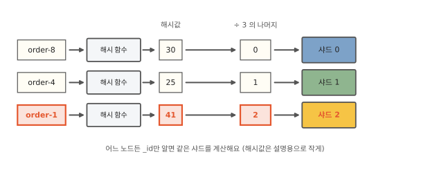

주문 `order-1`이 들어오면 어느 샤드에 넣어야 할까요? 문서마다 "몇 번 샤드에 있음"을 표로 적어 두는 방법이 먼저 떠올라요. 그 방법을 쓰면 문서를 꺼낼 때마다 표부터 봐야 해요. 표도 문서 수만큼 커져요. ES는 표 대신 계산으로 정해요. 문서가 갈 샤드를 이렇게 정하는 일을 **라우팅**(routing)이라고 해요.

계산에는 문서마다 붙는 고유 번호(`_id`)를 써요. 이 번호를 해시 함수에 넣어 정수 하나를 얻어요. 해시 함수는 글자를 넣으면 숫자 하나를 내놓는 계산이에요. 같은 글자를 넣으면 늘 같은 숫자가 나와요. 비슷한 글자라도 숫자는 고르게 흩어져요([알고리즘 9편](../algorithms/09-hash.md)). ES가 쓰는 해시 함수는 murmur3예요. ES 9.4부터 새로 만든 인덱스는 이 숫자(해시값)를 샤드 수로 나눠요. 그 나머지가 샤드 번호예요. 그림처럼 해시값이 41이면 3으로 나눈 나머지가 2라서 샤드 2로 가요.[^ver]

이 계산 덕분에 어느 노드든 `_id`만 알면 그 문서가 있는 샤드를 바로 알아요. 번호로 문서 하나를 꺼내는 요청(`GET orders/_doc/order-1`)은 계산한 샤드 하나에만 물어봐요. 샤드 셋을 다 뒤질 필요가 없어요. 낱말로 찾는 검색은 맞는 문서가 어느 샤드에 있을지 모르니 샤드 전부에 물어요(12편).

계산에 넣는 값은 꼭 `_id`여야 할까요?

## 라우팅 값을 직접 줄 수도 있어요

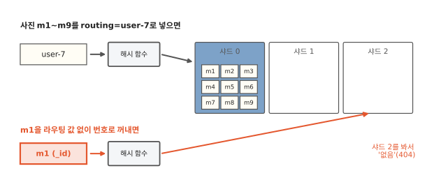

휴대폰 사진 앱을 생각해 봐요. 사진 하나가 문서 하나이고 사람들은 거의 언제나 자기 사진만 찾아요. 기본 라우팅은 `_id`로 샤드를 정하니 한 사용자의 사진이 샤드 셋에 흩어져요. 그래서 "user-7의 사진" 검색은 샤드 셋에 다 물어봐야 해요.

해시 함수에 넣는 값은 바꿀 수 있어요. 문서를 넣을 때 라우팅 값(`?routing=user-7`)을 주면 `_id` 대신 이 값으로 샤드를 계산해요. 그러면 같은 사용자의 사진이 모두 한 샤드에 모여요. 검색할 때도 같은 라우팅 값을 주면 샤드 하나에만 물어보면 돼요.

대신 두 가지를 떠안아요. 먼저 꺼낼 때도 같은 라우팅 값을 줘야 해요. 사진 `m1`을 라우팅 값 없이 번호로 꺼내 봐요. ES는 `_id`로 계산한 샤드에 물어봐요. 사진은 user-7로 계산한 샤드에 있으니 ES는 없다고 답해요. 오류 번호는 404예요. 두 계산이 우연히 같은 샤드를 가리키는 사진은 찾아져서 더 헷갈려요.

이 실수는 미리 막을 수 있어요. 2편에서 본 매핑은 필드마다 저장 방식을 적는 설정이에요. 매핑에 `"_routing": {"required": true}`를 적어 두면 라우팅 값을 빠뜨린 쓰기와 꺼내기를 ES가 오류로 알려 줘요.

다음으로 사진이 아주 많은 사용자가 있으면 그 사용자의 사진이 든 샤드만 커져요. 기본 라우팅에서는 해시 함수가 문서를 고르게 흩어 줬어요. 이제는 사용자마다 사진 수가 크게 다르면 샤드 크기도 그만큼 달라져요.

라우팅 값으로 정하든 `_id`로 정하든 계산에는 샤드 수가 들어가요. 그 샤드 수가 바뀌면 어떻게 될까요?

## 샤드 수를 바꾸면 문서 대부분이 자리를 옮겨요

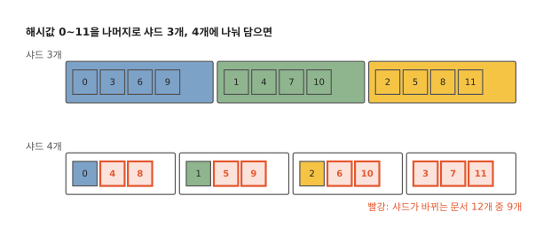

샤드 번호가 계산으로 정해지니 계산에 쓰는 샤드 수가 바뀌면 답도 바뀌어요. 그림은 해시값 0부터 11까지를 3으로 나눈 나머지와 4로 나눈 나머지로 각각 담아 봤어요. 3으로 나누면 4는 샤드 1에 가요. 4로 나누면 4는 샤드 0으로 가요. 12개 중 0, 1, 2 세 개만 같은 샤드에 남고 나머지 9개는 자리가 바뀌어요.

문서가 많아도 비율은 비슷했어요. 문서 10만 개로 실험해 봤어요. 샤드 3개짜리 인덱스와 4개짜리 인덱스에 넣는다고 치고 문서마다 ES의 계산식으로 샤드를 계산했어요. 이 실험에서는 넷 중 셋이 다른 샤드로 갔어요.[^lab] 샤드 5개를 6개로 바꿨을 때는 여섯 중 다섯이 다른 샤드로 갔어요.

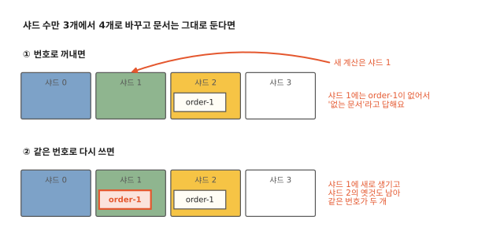

샤드 수만 바꾸고 문서는 그대로 둔다고 해 봐요. `order-1`이 샤드 2에 들어 있는데 새 계산이 샤드 1을 가리킨다고 해 봐요. 번호로 꺼내는 요청은 계산한 샤드에만 물어보니 샤드 1은 `order-1`이 없다고 답해요. 같은 번호로 주문을 고쳐 쓰면 샤드 1에 `order-1`이 하나 더 생기고 샤드 2의 옛것도 남아요. 그래서 ES는 이미 만든 인덱스의 샤드 수를 바꾸는 요청을 받지 않아요.[^err] 샤드 수를 마음대로 바꾸려면 새 샤드 수로 인덱스를 새로 만들어야 해요. 그다음 문서를 모두 다시 넣는 재색인(2편)을 해요.

??? info "심화: 노드를 늘리면 ES는 무엇을 옮길까요?"
    주문이 늘어 노드를 한 대 더 붙였을 때 문서가 새 노드로 어떻게 가는지 궁금할 때 보는 칸이에요. 샤드 수가 그대로라서 문서마다 다시 계산해도 같은 샤드가 나와요.

    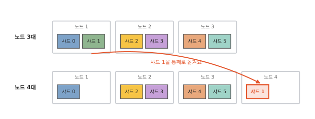

    ES는 샤드를 통째로 새 노드로 옮겨요. 문서는 다시 계산할 필요가 없어요. 샤드 수가 그대로인 동안 문서와 샤드의 짝은 바뀌지 않고 샤드와 노드의 짝만 바뀌어요. 샤드 하나가 완전한 작은 인덱스라서 파일째 복사하면 돼요. 그림은 샤드 6개짜리 인덱스라서 노드 4대에 나눠 놓을 샤드가 넉넉해요. 복제본은 빼고 세어 봐요. 샤드가 3개뿐인 인덱스는 노드 4대에 샤드를 하나씩 나눠 줘도 한 대가 남아요.

그런데 처음 장면에서 ES는 6개로 쪼개는 건 받아 줬어요. 샤드 수가 바뀌는데 어떻게 그럴 수 있을까요?

## 샤드를 2배, 4배로 쪼갤 수는 있어요

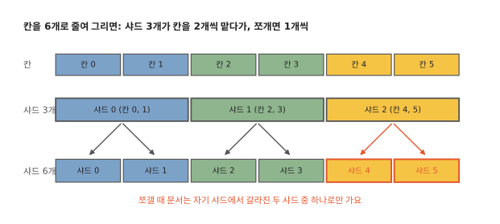

6개로 쪼개면 옛 샤드 0에 있던 문서는 어디로 갈까요? ES에서 쪼개기는 `_split` 요청으로 해요. 옛 샤드 0에는 해시값을 3으로 나눈 나머지가 0인 문서가 있어요. 그림의 0, 3, 6, 9예요. 이 문서들을 6으로 나누면 나머지가 0 아니면 3이에요. 그래서 새 샤드 두 곳으로만 가요.[^ver] 6이 3의 배수라서 그래요. 9로 해 보면 9를 6으로 나눈 나머지는 3이고 이 3을 다시 3으로 나누면 0이에요. 9를 처음부터 3으로 나눈 나머지 0과 같아요.

다른 옛 샤드에서 문서를 받아 올 일이 없으니 ES는 빠르게 쪼갤 수 있어요. 먼저 옛 샤드의 파일에 이름표를 하나 더 붙여요. 이 이름표를 하드 링크라고 해요. 두 새 샤드는 이 이름표로 같은 파일을 함께 써요. 그다음 새 샤드마다 자기 몫이 아닌 문서를 지워요. 지울 때는 새 샤드마다 '지웠음' 표시를 따로 달 뿐 함께 쓰는 파일은 그대로 둬요. 그래서 두 샤드가 서로 영향을 주지 않아요.

쪼개기는 원본을 그대로 두고 샤드 6개짜리 새 인덱스를 만드는 일이에요. 그동안 원본에는 새 문서를 넣지 못하게 막아 둬야 해요.[^split2] 다 쪼개고 나면 검색과 쓰기를 새 인덱스로 돌려요. 원본은 그때 지워도 돼요.

4로 나누면 같은 문서들이 새 샤드 0, 3, 2, 1로 네 곳에 다 흩어져요. 새 샤드마다 옛 샤드 세 곳에서 문서를 모아 와야 하니 파일을 넘겨주는 방식이 통하지 않아요. 그래서 ES는 이런 샤드 수를 받지 않아요. 새 샤드 수는 옛 샤드 수의 배수여야 해요.

배수라고 다 되지는 않아요. 케이크 위에 금을 그어 작은 칸 768개로 나눠 두었다고 해 봐요. 3조각으로 자를 때도 6조각이나 12조각으로 자를 때도 칸 경계를 따라 똑같이 자를 수 있어요. 9조각은 768이 9로 나누어떨어지지 않아서 칸 한가운데를 잘라야 해요. ES도 인덱스를 만들 때 이런 칸 수를 정해 둬요. 이 칸 수를 **라우팅 칸**(routing shards) 수라고 해요.

라우팅 칸 수는 샤드 수에 2를 거듭 곱해 키운 수예요. 1,024를 넘지 않는 데까지 키워요. 그래서 샤드 3개면 768, 샤드 2개면 1,024예요.[^v7]

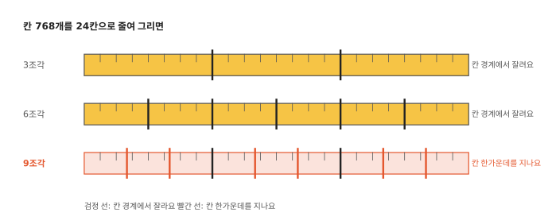

ES는 두 조건을 모두 채울 때만 쪼개기를 받아 줘요. 새 샤드 수가 옛 샤드 수의 배수여야 해요. 그리고 라우팅 칸 수가 새 샤드 수로 나누어떨어져야 해요. 그래서 샤드 3개는 6개, 12개, 24개처럼 2배, 4배, 8배로 쪼갤 수 있어요. 가장 많이는 768개까지예요. 9개는 3의 배수예요. 하지만 768을 9로 나누면 나머지가 남아요. 그래서 9개로는 못 쪼개요.

케이크와 달리 라우팅 칸은 눈에 보이는 조각이 없어요. ES가 쪼개기를 받아 줄지 따질 때 보는 숫자예요.[^shrink]

9.4부터 만든 인덱스는 해시값을 샤드 수로 바로 나눠요. 그러면 3개를 9개로 늘려도 옛 샤드 하나가 새 샤드 셋으로 갈라지기만 해요. 계산만 보면 9개도 될 것 같지만 ES는 이 숫자 규칙을 9.4에서도 그대로 지켜요. 9.3까지는 해시값을 칸에 담아 샤드를 골랐고 그때 생긴 규칙이에요.

??? info "심화: ES 9.3까지는 샤드를 어떻게 계산했을까요?"
    라우팅 칸이 쪼개기 한도 말고 샤드 계산에 어떻게 쓰였는지 궁금할 때 보는 칸이에요. ES 7.0부터 9.3까지 만든 인덱스는 해시값을 샤드 수로 바로 나누지 않아요. 라우팅 칸을 거쳐 이렇게 계산해요.

    ```
    routing_factor = number_of_routing_shards / number_of_shards
    shard = floorMod(murmur3(_routing), number_of_routing_shards) / routing_factor
    ```

    `number_of_routing_shards`는 라우팅 칸 수예요. 샤드 3개면 768이에요. `number_of_shards`는 샤드 수예요. `routing_factor`는 샤드 하나가 맡는 칸 수예요. 샤드 3개면 768 ÷ 3 = 256이에요. 해시값을 768로 나눈 나머지로 칸 번호를 정하고 샤드 하나가 이어진 칸 256개씩을 맡아요. 샤드 0은 칸 0~255, 샤드 1은 칸 256~511, 샤드 2는 칸 512~767이에요.

    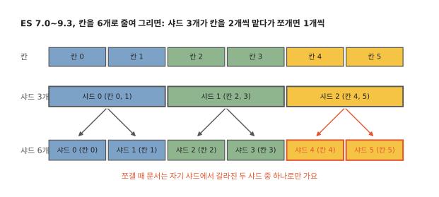

    그래서 칸 수가 새 샤드 수로 나누어떨어져야 샤드마다 칸을 똑같이 나눠 맡을 수 있어요. 6개로 쪼개면 샤드 하나가 맡던 칸 256개를 128개씩 반으로 나눠 맡아요. 그래서 옛 샤드 0은 새 샤드 0과 1로 갈라지고 옛 샤드 2는 새 샤드 4와 5로 갈라져요.[^lab2] 본문 그림의 9.4 방식에서는 옛 샤드 0이 새 샤드 0과 3으로, 옛 샤드 2가 새 샤드 2와 5로 갈라져요.

    `_routing`은 라우팅 값이고 주지 않으면 `_id`를 써요. murmur3 해시값은 음수일 수도 있어요. 그래서 나머지를 구하는 보통 기호인 `%` 대신 `floorMod`를 써요. `floorMod`는 음수를 나눠도 0 이상인 나머지를 내요.[^murmur][^routing]

??? info "심화: 쪼개면 디스크가 두 배로 들까요?"
    새 인덱스를 하나 더 만든다니 디스크가 원본만큼 더 필요할지 궁금할 때 보는 칸이에요. 생각보다 적게 들어요. 본문에서 본 하드 링크 덕분이에요. 쪼갠 직후에는 원본과 파일을 나눠 쓰니 디스크가 거의 늘지 않아요.

    자기 몫이 아닌 문서는 처음에는 지웠다는 표시만 남아요. 이 문서들은 세그먼트를 합칠 때 실제로 빠져요(5편). 세그먼트는 샤드 안의 작은 역색인이에요(1편). 합치는 동안에는 새 파일을 쓰니 디스크가 잠시 늘어요.

    하드 링크를 허락하지 않는 파일 시스템에서는 처음부터 원본만큼 더 들어요. ES를 만든 회사 Elastic의 문서는 하드 링크와 상관없이 원본 한 벌만큼 빈 공간을 두라고 권해요.[^split]

그러면 처음 인덱스를 만들 때 샤드 수는 몇 개로 정해야 할까요?

## 샤드 수는 어떻게 정할까요?

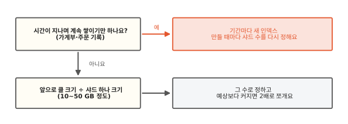

샤드 수는 나중에 마음대로 못 바꾸니 지금 크기보다 앞으로 클 크기를 보고 정해요. Elastic 공식 문서는 샤드 하나를 10~50 GB(기가바이트) 정도로 두라고 권해요.[^size] 50 GB는 휴대폰 사진 1만 장 정도의 크기예요. 사진 한 장을 5 MB쯤으로 잡았어요.

계속 쌓이기만 하지는 않는 상품 인덱스로 먼저 봐요. 1년 뒤 100 GB가 될 것 같은 상품 인덱스가 있어요. 샤드 2개로 나누면 하나가 50 GB라서 권하는 범위의 끝에 닿아요. 샤드 3개로 시작하면 하나가 33 GB쯤이라 여유가 있어요.

너무 잘게 나누는 것도 좋지 않아요. 샤드마다 ES가 따로 쓰는 메모리가 있어요. 라우팅 값 없는 검색은 샤드 전부에 물어요. 그래서 샤드가 많을수록 물어볼 곳이 늘어요. 예상보다 커지면 2배로 쪼개요.

가계부 지출 기록이나 주문 기록은 시간이 지나며 계속 쌓이기만 해요. 이런 데이터는 몇 년 뒤 크기를 미리 알기 어려워요. 그래서 기간마다 인덱스를 새로 만들어요(`budget-2025`, `budget-2026`). 새 인덱스를 만들 때마다 샤드 수를 그때 크기에 맞춰 다시 정할 수 있어요. 검색은 `budget-*`처럼 여러 인덱스에 한 번에 물을 수 있어요.[^rollover] 처음 장면의 주문 기록도 해마다 새 인덱스로 만들 수 있어요. 이때는 새해 인덱스를 만들면서 샤드를 4개로 정하면 돼요.

## 정리

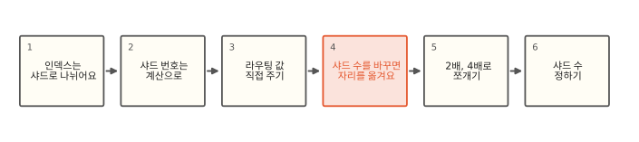

이 편에서 새로 나온 말이에요.

- 샤드: 인덱스를 나눈 조각이에요. 하나하나가 자기 몫 문서로 만든 작은 인덱스예요.
- 라우팅: 문서가 갈 샤드를 계산으로 정하는 일이에요. 기본은 `_id`의 해시값과 샤드 수로 정해요.
- 쪼개기: 원본을 두고 샤드를 2배, 4배로 늘린 새 인덱스를 만드는 일이에요. 옛 샤드 하나가 새 샤드 몇 개로 갈라지기만 해요. 그래서 재색인 없이 돼요.
- 라우팅 칸: 인덱스를 만들 때 정하는 칸 수예요. 샤드 3개면 768이에요. 이 수가 새 샤드 수로 나누어떨어져야 쪼갤 수 있어요.

[^lucene]: ES는 역색인을 만들고 찾는 일을 공개 라이브러리 Lucene에 맡겨요. 샤드 하나가 Lucene 인덱스 하나예요.
[^ver]: 일반 인덱스 이야기예요. 시계열 인덱스(`index.mode: time_series`)는 `_id` 대신 정해 둔 필드 값으로 샤드를 골라요. ES 7.0부터 9.3까지 만든 인덱스는 해시값을 먼저 라우팅 칸(쪼개기 절)에 담고 칸으로 샤드를 골라요. 그래서 같은 해시값이라도 샤드 번호가 다를 수 있고(해시값 41은 샤드 0) 쪼갤 때 옛 샤드 0이 새 샤드 0과 1로 갈라져요. 자세한 식은 쪼개기 절의 심화 칸에 있어요.
[^lab]: 10만 개 실험은 ES에 넣지 않고 9.3까지의 계산식(샤드 3개면 칸 768개, 4개면 1,024개)을 파이썬으로 돌려 셌어요(`_id`는 "0"~"99999"). 칸 없이 나머지로만 계산해도 넷 중 셋이 옮겨요.
[^v7]: ES 7.0부터 만든 인덱스의 기본값이에요. 원본 샤드가 1개인 인덱스는 예외라서 칸 수를 따지지 않고 몇 개로든 쪼갤 수 있어요. 샤드가 512개 이하면 1,024를 넘지 않는 범위에서 가장 크게 키우고(샤드 5개면 640, 4개면 1,024) 512개를 넘으면 샤드 수의 2배로 해요. 7.17.26과 9.2.0 모두 `_settings?include_defaults`로 보면 칸 수가 샤드 수(3)로 나오는데 실제 값은 클러스터 상태(`GET _cluster/state/metadata/orders`)의 `routing_num_shards`(768)예요. 직접 계산해 맞춰 보니 768로는 30개가 모두 맞았고 3으로 계산하면 8개만 맞았어요. 6.x까지는 칸 수가 샤드 수와 같아서 쪼개려면 인덱스를 만들 때 칸 수를 미리 줘야 했어요. 9.3까지 만든 인덱스는 이 칸을 거쳐 샤드를 계산하고 9.4부터 새로 만든 인덱스는 계산에는 칸을 쓰지 않지만 쪼갤 수 있는지는 여전히 칸 수로 따져요.
[^shrink]: 거꾸로 샤드를 줄이는 것(`_shrink`)은 옛 샤드 여러 개를 새 샤드 하나로 그대로 합치는 일이라서 옛 샤드 수를 나누어떨어지게 하는 수로만 돼요. 6개를 3개나 2개로는 줄일 수 있고 4개로는 못 줄여요. `_shrink`를 하려면 원본 샤드마다 그 샤드나 그 샤드의 복제본 중 하나가 모두 같은 노드에 모여 있어야 해서 보통 `index.routing.allocation.require._name`으로 한 노드에 모은 뒤 실행해요. 줄인 샤드 하나에 들어갈 문서는 약 21억 개를 넘으면 안 돼요. 샤드 안의 문서 번호를 32비트 정수로 매기기 때문이에요. <https://www.elastic.co/guide/en/elasticsearch/reference/current/indices-shrink-index.html>
[^murmur]: 문자열을 글자 하나당 2바이트(UTF-16 리틀 엔디언)로 바꿔 시작값(seed) 0으로 32비트 murmur3를 돌리고 결과를 부호 있는 정수로 써요.
[^split2]: `index.blocks.write: true`로 막아요. `_shrink`도 같아요. 계속 주문이 들어오는 인덱스라면 새 인덱스를 따로 만들어 넘어가는 편이 현실적이에요.
[^lab2]: 제 컴퓨터에 띄운 ES 7.17.26과 9.2.0에서 주문 30개(`order-1`~`order-30`)를 넣은 샤드 3개짜리 인덱스를 6개로 쪼개 확인했어요. 쪼개기 전에도 30개 모두 이 식으로 계산한 샤드에 들어 있었어요. 같은 ES에서 `routing=user-7`로 넣은 사진 9장은 모두 샤드 0에 들어갔고 3개를 9개로 쪼개는 요청은 거절됐어요.
[^err]: 열린 인덱스에 샤드 수를 바꾸라고 하면 ES는 `Can't update non dynamic settings [[index.number_of_shards]]`라고 답해요. 9.2.0은 여기에 "`reopen`을 주거나 인덱스를 닫고 바꾸라"는 안내를 덧붙이지만 그렇게 해도 `final ... setting [index.number_of_shards], not updateable`로 막혀요. 7.17.26에서도 닫은 인덱스는 같은 오류로 막혔어요.
[^routing]: Elasticsearch 문서, "_routing field". 9.4.0부터 새로 만든 인덱스의 계산식과 `routing_partition_size` 조건이 여기 있어요. 계산을 맡은 소스 클래스는 7.16부터 `IndexRouting`, 그 전에는 `OperationRouting`이에요. <https://www.elastic.co/docs/reference/elasticsearch/mapping-reference/mapping-routing-field>
[^split]: Elasticsearch 문서, "Split index API". <https://www.elastic.co/guide/en/elasticsearch/reference/current/indices-split-index.html>
[^size]: Elasticsearch 문서, "Size your shards". 최근 문서는 샤드 하나의 문서 수를 2억 개 아래로 두라는 권고도 함께 둬요. 7.17 문서는 10~50 GB 권고만 두고(문서 수 권고는 없어요) 경험상 로그·시계열 데이터에 잘 맞는다고 덧붙여요. <https://www.elastic.co/guide/en/elasticsearch/reference/current/size-your-shards.html>
[^rollover]: 정해 둔 크기나 기간이 차면 새 인덱스를 만들고 쓰기를 그쪽으로 넘기는 일을 ES는 롤오버(rollover)라고 해요. 인덱스 수명 관리(ILM)나 데이터 스트림이 이 일을 자동으로 해요.
