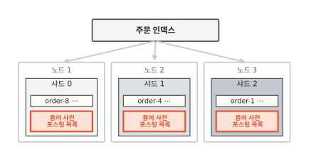
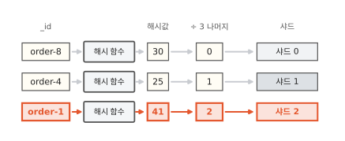
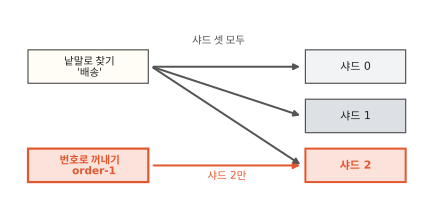
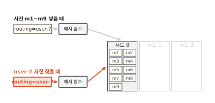
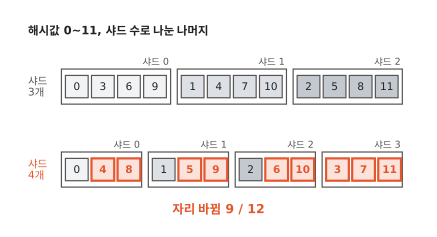
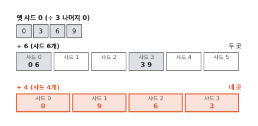
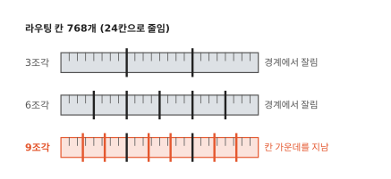

# 샤드와 라우팅: 문서가 갈 샤드를 정하는 계산

쇼핑몰 주문 기록을 ES에 담았어요. ES는 이 기록을 조각 세 개로 나눠 컴퓨터 세 대에 담았어요. 1년이 지나 주문이 늘어서 조각을 4개로 늘려 달라고 했더니 ES가 거절해요. 그런데 6개로 쪼개 달라고 하면 받아 줘요. 이 글을 읽고 나면 ES가 주문마다 들어갈 조각을 계산으로 정한다는 걸 알게 돼요. 4개는 안 되고 6개는 되는 것도 그 계산 때문이에요. 조각 수는 나중에 마음대로 못 바꿔서 인덱스를 만들기 전에 알아 두어야 해요.

!!! abstract "이 글에서 알게 되는 것"
    1. ES는 인덱스를 샤드라는 조각 여러 개로 나눠 담고 문서가 갈 샤드를 계산으로 정해요. 계산의 뼈대는 문서 번호의 해시값을 샤드 수로 나눈 나머지예요.
    2. 샤드 수가 바뀌면 나머지가 달라져서 문서 대부분이 엉뚱한 샤드를 가리켜요. 그래서 ES는 이미 만든 인덱스의 샤드 수를 바꾸지 못하게 막아요.
    3. 2배, 4배처럼 배수로 쪼개면 옛 샤드 하나가 새 샤드 몇 개로만 갈라져서 쪼개기는 받아 줘요. 그래도 샤드 수는 처음부터 앞으로 클 크기를 보고 정하는 게 좋아요.

## 1. ES는 인덱스를 샤드 여러 개로 나눠 담아요

[1편](01-inverted-index.md)과 [2편](02-analyzer.md)에서 글이라고 부른 것을 ES는 문서(document)라고 불러요. 이 글에서도 문서라고 할게요. 주문 하나가 문서 하나예요. 문서를 모아 두는 단위는 인덱스이고 주문 기록 전체가 인덱스 하나예요.

주문이 수억 개가 되면 컴퓨터 한 대로는 모자라요. 디스크도 메모리도 부족해져요. 디스크는 오래 저장해 두는 곳이고 메모리는 계산할 때 쓰는 작업 공간이에요.

그래서 ES는 인덱스 하나를 여러 조각으로 나눠 여러 컴퓨터에 흩어 놓아요. 이 조각을 **샤드**(shard)라고 해요. ES가 돌아가는 컴퓨터 한 대는 **노드**(node)라고 불러요.

아래 그림에서 샤드마다 빨갛게 칠한 칸을 보세요.

**그림 1.** 주문 인덱스를 나눈 샤드 셋이 노드마다 하나씩 들어 있고 샤드마다 용어 사전과 포스팅 목록이 따로 있어요.
{ .fig-cap }

샤드 하나는 자기 몫의 문서만으로 만든 작은 인덱스예요. 1편에서 본 용어 사전과 포스팅 목록도 샤드마다 따로 만들어요. 용어 사전은 낱말을 모은 목록이고 포스팅 목록은 낱말마다 그 낱말이 든 문서 번호를 적은 줄이에요.[^lucene]

문서 하나는 샤드 하나에만 들어가요.[^replica] 여기서 이런 궁금증이 생길 거예요. 새 주문이 들어오면 세 샤드 가운데 어디에 넣을까요?

## 2. 문서가 갈 샤드는 나머지 계산으로 정해요

새 주문 `order-1`이 들어왔어요. 먼저 떠오르는 방법은 표예요. 문서마다 "샤드 2에 넣었음"처럼 적어 두는 거죠. 그러면 문서를 꺼낼 때마다 표부터 찾아봐야 하고 표도 문서 수만큼 커져요. ES는 표를 두지 않고 계산으로 정해요.

계산에는 문서마다 붙는 고유 번호 `_id`를 써요. 이 주문의 `_id`가 `order-1`이에요. ES는 이 번호를 해시 함수에 넣어요. 해시 함수는 글자를 넣으면 숫자 하나를 내놓는 계산이에요. 같은 글자를 넣으면 늘 같은 숫자가 나와요. 비슷한 글자를 넣어도 숫자는 고르게 흩어져요([알고리즘 9편](../algorithms/09-hash.md)). ES는 murmur3라는 해시 함수를 써요.

아래 그림에서 빨간 `order-1` 줄을 왼쪽부터 따라가 보세요.

**그림 2.** `order-1`의 해시값 41을 3으로 나눈 나머지가 2라서 `order-1`은 샤드 2로 가요.
{ .fig-cap }

`order-1`의 해시값은 41이에요. 41을 샤드 수 3으로 나누면 나머지가 2예요. 그래서 `order-1`은 샤드 2로 가요.

이렇게 문서가 갈 샤드를 계산으로 정하는 일을 **라우팅**(routing)이라고 해요. 실제 해시값은 열 자리쯤 되는 큰 수이고 음수도 나와요. 그림에서는 따라 셀 수 있게 작은 수로 적었어요. 실제 계산은 버전에 따라 5절에서 볼 라우팅 칸을 한 번 거치기도 해서 이와 조금 달라요.[^ver] 그래도 해시값과 샤드 수로 정한다는 뼈대는 같아요.

계산으로 정하니까 어느 노드든 `_id`만 알면 그 문서가 든 샤드를 똑같이 계산해 내요. 아래 그림에서 두 요청이 샤드 몇 개로 가는지 보세요.

**그림 3.** 번호로 꺼내면 샤드 하나에만 묻고 낱말로 찾으면 샤드 셋 모두에 물어요.
{ .fig-cap }

번호로 문서 하나를 꺼내는 요청(`GET orders/_doc/order-1`)은 계산한 샤드 2에만 물어요. 낱말로 찾는 검색은 달라요. '배송'이 든 문서가 어느 샤드에 있을지 미리 알 수 없어서 샤드 전부에 물어요. 이 이야기는 [12편](12-distributed-search.md)에서 이어져요.

## 3. 라우팅 값을 주면 한 사람의 문서를 한 샤드에 모아요

앞에서는 `_id`로 샤드를 계산했어요. 계산에 넣는 값은 바꿀 수 있어요.

휴대폰 사진 앱을 생각해 봐요. 사진 하나가 문서 하나이고 사람들은 거의 자기 사진만 찾아요. `_id`로 샤드를 정하면 user-7의 사진 아홉 장이 샤드 셋에 흩어져서 찾을 때도 샤드 셋에 다 물어야 해요.

문서를 넣을 때 라우팅 값(`?routing=user-7`)을 주면 ES는 `_id` 대신 이 값으로 샤드를 계산해요. 같은 사용자의 사진은 라우팅 값이 같으니까 모두 한 샤드에 모여요. 아래 그림에서 아래쪽 빨간 줄이 어느 샤드로 가는지 보세요.

**그림 4.** `routing=user-7`로 넣은 사진 아홉 장이 샤드 0에 모여서 찾을 때도 샤드 0에만 물어요.
{ .fig-cap }

대신 떠안는 게 두 가지 있어요.

첫째, 꺼낼 때도 같은 라우팅 값을 줘야 해요. 사진 `m1`을 라우팅 값 없이 번호로 꺼내면 ES는 `m1`로 샤드를 계산해요. 사진은 `user-7`로 계산한 샤드에 있으니 ES는 없는 문서라고 답해요. 매핑(2편)에 `"_routing": {"required": true}`를 적어 두면 라우팅 값을 빠뜨린 요청을 ES가 오류로 알려 줘요.

둘째, 사진이 아주 많은 사용자가 있으면 그 사람의 샤드만 커져요. `_id`로 정할 때와 달리 샤드 크기가 고르지 않게 돼요.

## 4. 샤드 수를 바꾸면 문서 대부분이 엉뚱한 샤드를 가리켜요

라우팅 값으로 정하든 `_id`로 정하든 계산에는 샤드 수가 들어가요. 처음 장면처럼 샤드를 3개에서 4개로 늘리면 나누는 수가 바뀌어요.

해시값이 0부터 11까지인 문서 12개로 해 볼게요. 위 줄은 3으로 나눈 나머지로, 아래 줄은 4로 나눈 나머지로 담았어요. 아래 줄에서 빨간 칸을 세어 보세요.

**그림 5.** 샤드를 4개로 늘리면 12개 가운데 0, 1, 2만 같은 샤드에 남고 빨간 9개는 다른 샤드로 가요.
{ .fig-cap }

해시값 4는 3으로 나누면 나머지가 1이라서 샤드 1에 있었어요. 4로 나누면 나머지가 0이라서 이제 샤드 0을 가리켜요. 문서가 수억 개여도 사정은 같아요.

그럼 샤드 수만 4개로 바꾸고 문서는 그대로 두면 어떻게 될까요? `order-1`은 샤드가 3개일 때 계산한 대로 샤드 2에 들어 있어요. 아래 그림에서 `order-1`을 꺼내는 화살표가 어디로 가는지 보세요.

**그림 6.** 샤드가 4개라고 계산하면 `order-1`을 샤드 1에서 찾지만 문서는 샤드 2에 있어요.
{ .fig-cap }

41을 4로 나눈 나머지는 1이에요. 번호로 꺼내는 요청은 계산한 샤드에만 물으니까 샤드 1은 `order-1`이 없다고 답해요. 같은 번호로 주문 내용을 고쳐 쓰면 더 꼬여요.

**그림 7.** 고쳐 쓴 `order-1`이 샤드 1에 새로 생기고 샤드 2의 옛것도 남아서 같은 번호의 문서가 둘이 돼요.
{ .fig-cap }

그래서 ES는 이미 만든 인덱스의 샤드 수를 바꾸는 요청을 받지 않아요.[^err] 샤드 수를 마음대로 바꾸려면 새 샤드 수로 인덱스를 새로 만들어요. 그다음 문서를 모두 다시 넣어야 해요. 이 일을 재색인이라고 해요(2편).

노드를 늘리는 건 괜찮아요. 샤드 수가 그대로라서 ES는 샤드를 통째로 새 노드로 옮기기만 하면 돼요.

## 5. 2배, 4배로 쪼개면 옛 샤드 하나가 몇 갈래로만 갈라져요

처음 장면에서 ES는 6개로 쪼개기는 받아 줬어요. 쪼개기는 `_split` 요청으로 해요. 샤드 수가 바뀌는데 왜 이건 될까요?

옛 샤드 0에는 해시값을 3으로 나눈 나머지가 0인 문서가 들어 있어요. 그림 5의 0, 3, 6, 9예요. 아래 그림에서 이 넷을 6으로 나눌 때와 4로 나눌 때 몇 곳으로 가는지 보세요.

**그림 8.** 옛 샤드 0의 문서는 6으로 나누면 두 곳으로만 가고 4로 나누면 네 곳에 다 흩어져요.
{ .fig-cap }

이 넷을 6으로 나누면 나머지가 0 아니면 3이에요. 6이 3의 배수라서 그래요. 9로 확인해 볼게요. 9를 6으로 나눈 나머지는 3이고 이 3을 다시 3으로 나누면 나머지가 0이에요. 9를 처음부터 3으로 나눈 나머지도 0이에요. 그래서 새 샤드 하나는 옛 샤드 한 곳에서만 문서를 받아요.

4로 나누면 같은 네 문서가 새 샤드 네 곳에 다 흩어져요. 새 샤드마다 옛 샤드 세 곳에서 문서를 모아 와야 해요. 그래서 ES는 새 샤드 수가 옛 샤드 수의 배수일 때만 쪼개기를 받아 줘요.

`order-1`로도 확인해 봐요. 41을 6으로 나눈 나머지는 5예요. 5를 3으로 나누면 나머지가 2라서 샤드 5는 옛 샤드 2가 갈라진 샤드예요. `order-1`은 다른 샤드에서 옮겨 올 필요가 없어요.

받아 올 문서가 없으니 쪼개기는 빨라요. ES는 옛 샤드의 파일을 복사하지 않고 이름표를 하나 더 붙여요. 이 이름표를 하드 링크라고 해요. 새 샤드 0과 3은 같은 파일을 함께 쓰면서 자기 몫이 아닌 문서에 '지웠음' 표시만 달아요. 쪼개기는 원본을 두고 샤드 6개짜리 새 인덱스를 만드는 일이에요. 쪼개는 동안에는 원본에 새 문서를 넣지 못하게 막아 둬요.[^block]

배수라고 다 되지는 않아요. 샤드 3개를 9개로는 못 쪼개요. ES는 인덱스를 만들 때 쪼갤 수 있는 한도를 숫자 하나로 정해 둬요. 샤드 수에 2를 거듭 곱해서 1,024를 넘지 않는 데까지 키운 수예요. 샤드가 3개면 3, 6, 12, 24, …, 384, 768로 키워서 768이 돼요. 이 수를 라우팅 칸(routing shards) 수라고 해요.[^v7]

케이크 위에 금을 그어 작은 칸 768개로 나눠 두었다고 생각해 보세요. 새 샤드 수로 케이크를 자를 때 자르는 선이 칸 경계에 떨어져야 해요. 아래 그림에서 빨간 선을 보세요.

**그림 9.** 3조각과 6조각은 칸 경계에서 잘리고 9조각은 여러 선이 칸 가운데를 지나요.
{ .fig-cap }

768은 9로 나누어떨어지지 않아요. 그래서 ES는 새 샤드 수가 옛 샤드 수의 배수이고 라우팅 칸 수도 나누어떨어질 때만 쪼개기를 받아 줘요. 샤드 3개는 6개, 12개, 24개처럼 2배씩 키워 768개까지 쪼갤 수 있어요. 케이크와 달리 라우팅 칸은 눈에 보이는 조각이 없고 쪼개기를 받아 줄지 따질 때만 쓰는 숫자예요.

## 6. 샤드 수는 앞으로 클 크기를 보고 정해요

샤드 수는 나중에 마음대로 못 바꾸니까 처음 만들 때 앞으로 클 크기를 보고 정해요. ES를 만든 회사 Elastic의 공식 문서는 샤드 하나를 10~50 GB(기가바이트) 정도로 두라고 권해요.[^size]

예를 들어 1년 뒤 100 GB가 될 것 같은 상품 인덱스가 있어요. 샤드 2개로 나누면 하나가 50 GB라서 권하는 크기의 끝에 닿아요. 샤드 3개로 시작하면 하나가 33 GB쯤이라 여유가 있어요.

너무 잘게 나누는 것도 좋지 않아요. ES는 샤드마다 메모리를 따로 쓰고 보통 검색은 샤드 전부에 묻거든요. 예상보다 커지면 그때 2배로 쪼개면 돼요.

가계부 지출이나 주문 기록처럼 계속 쌓이기만 하는 데이터는 몇 년 뒤 크기를 알기 어려워요. 이런 데이터는 기간마다 인덱스를 새로 만들어요(`budget-2025`, `budget-2026`). 그러면 만들 때마다 샤드 수를 다시 정할 수 있고 검색은 `budget-*`처럼 한 번에 물으면 돼요.[^rollover] 처음 장면의 주문 기록도 해마다 새 인덱스를 만들었다면 새해 인덱스를 샤드 4개로 만들면 됐어요.

아래 그림에서 두 갈래를 보세요.

**그림 10.** 계속 쌓이는 데이터는 기간마다 새 인덱스를 만들고 그렇지 않은 데이터는 앞으로 클 크기를 샤드 하나 크기로 나눠 정해요.
{ .fig-cap }

## 정리

ES는 인덱스를 샤드 여러 개로 나눠 여러 노드에 담아요. 문서가 갈 샤드는 해시값을 샤드 수로 나눈 나머지를 뼈대로 계산해요. 실제 계산은 버전에 따라 라우팅 칸을 한 번 거치기도 해요. 그림의 작은 수로 계산하면 `order-1`은 41을 3으로 나눈 나머지가 2라서 샤드 2에 있어요. 이 계산이 라우팅이에요.

샤드를 4개로 바꾸면 41을 4로 나눈 나머지 1이 나와서 `order-1`을 샤드 1에서 찾아요. 문서 대부분이 이렇게 엉뚱한 샤드를 가리켜서 ES는 4개를 거절했어요. 6개로 쪼개면 나머지 5가 나오는데 샤드 5는 옛 샤드 2가 갈라진 샤드예요. 문서를 옮길 필요가 없어서 6개는 받아 줬어요.

새 주문을 넣었다고 바로 검색에 나오지는 않아요. 그 까닭은 [4편](04-refresh.md)에서 볼게요.

### 새로 나온 말

- **문서**: ES에 넣는 기록 하나. 주문 하나가 문서 하나였어요.
- **샤드**: 인덱스를 나눈 조각이자 작은 인덱스. 주문 인덱스는 샤드 0, 1, 2로 나뉘었어요.
- **노드**: ES가 돌아가는 컴퓨터 한 대. 노드 세 대에 샤드가 하나씩 들어 있었어요.
- **라우팅**: 문서가 갈 샤드를 계산으로 정하는 일. `order-1`은 41을 3으로 나눈 나머지가 2라서 샤드 2로 갔어요.
- **라우팅 값**: `_id` 대신 샤드 계산에 넣는 값. `routing=user-7`로 넣은 사진은 모두 샤드 0에 모였어요.
- **쪼개기**: 샤드를 2배, 4배로 늘린 새 인덱스를 만드는 일(`_split`). 옛 샤드 0이 새 샤드 0과 3으로 갈라졌어요.
- **하드 링크**: 파일 하나에 붙인 이름표 하나 더. 새 샤드 0과 3이 옛 샤드의 파일을 함께 썼어요.
- **라우팅 칸**: 쪼갤 수 있는 한도를 정하는 숫자. 샤드 3개짜리 인덱스는 768이라서 9개로는 못 쪼개요.

[^lucene]: ES는 역색인을 만들고 찾는 일을 공개 라이브러리 Lucene에 맡겨요. 샤드 하나가 Lucene 인덱스 하나예요.
[^replica]: 샤드를 통째로 복사한 복제본은 여기서 빼고 말해요. 복제본은 [14편](14-replication.md)에서 봐요. 그림 1은 노드 한 대에 샤드를 하나씩 그렸지만 실제로는 노드 한 대에 샤드 여러 개가 들어가기도 해요.
[^ver]: ES 7.0부터 만든 인덱스는 해시값을 라우팅 칸 수(5절)로 먼저 나누고 그 칸이 속한 샤드를 골라요. 이 계산이면 해시값 41은 샤드 0으로 가고 쪼갤 때도 옛 샤드 0이 새 샤드 0과 3 대신 0과 1로 갈라져요. 최근 버전부터는 새로 만든 일반 인덱스에 본문처럼 샤드 수로 바로 나누는 계산을 써요. 시계열 인덱스(`index.mode: time_series`)는 `_id` 대신 정해 둔 필드 값으로 샤드를 골라요. Elasticsearch 문서 "_routing field" <https://www.elastic.co/docs/reference/elasticsearch/mapping-reference/mapping-routing-field>
[^err]: 열린 인덱스에 샤드 수를 바꾸라고 하면 ES는 `Can't update non dynamic settings [[index.number_of_shards]]`라고 답해요. 인덱스를 닫고 바꾸려 해도 `index.number_of_shards`는 바꿀 수 없는 설정이라서 막혀요.
[^block]: `index.blocks.write: true`로 막아요. Elasticsearch 문서 "Split index API" <https://www.elastic.co/guide/en/elasticsearch/reference/current/indices-split-index.html>
[^v7]: ES 7.0부터 만든 인덱스의 기본값이에요. 원본 샤드가 1개인 인덱스는 칸 수를 따지지 않고 몇 개로든 쪼갤 수 있어요. 최근 버전부터 새로 만든 인덱스는 샤드를 계산할 때 칸을 쓰지 않지만 쪼갤 수 있는지는 여전히 칸 수로 따져요. 거꾸로 샤드를 줄이는 `_shrink`는 옛 샤드 수를 나누어떨어지게 하는 수로만 돼요. 6개를 3개나 2개로는 줄일 수 있고 4개로는 못 줄여요.
[^size]: Elasticsearch 문서 "Size your shards" <https://www.elastic.co/guide/en/elasticsearch/reference/current/size-your-shards.html>
[^rollover]: 정해 둔 크기나 기간이 차면 새 인덱스를 만들고 쓰기를 그쪽으로 넘기는 일을 ES는 롤오버(rollover)라고 해요. 인덱스 수명 관리(ILM)나 데이터 스트림이 이 일을 자동으로 해요.
