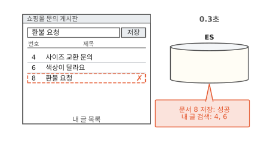
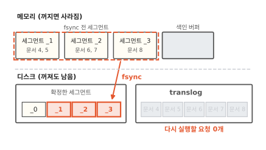
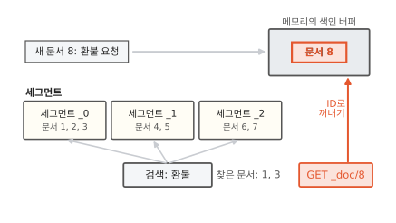
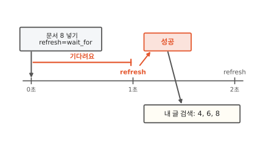

# refresh: 저장한 글이 1초 늦게 검색되는 이유

쇼핑몰 게시판에 "환불 요청"이라는 글을 쓰고 저장을 눌렀어요. 저장은 성공했다는데 곧장 열어 본 "내 글" 목록에는 그 글이 없어요. 목록을 다시 불러오면 1초쯤 지나서야 나타나요. 이 글을 읽고 나면 그 1초 동안 글이 어디에 있었는지 알게 돼요. ES가 일부러 1초씩 모았다가 내놓는 이유도 보여요. 이걸 알면 방금 쓴 글을 곧장 보여 줘야 하는 화면을 어떻게 만들지 고를 수 있어요.

!!! abstract "이 글에서 알게 되는 것"
    1. ES는 새 문서를 메모리에 모았다가 1초마다 작은 역색인으로 만들어 검색에 내놓아요. 이 일을 refresh라고 해요. 저장한 글은 이 refresh가 지나야 검색에 나와요.
    2. 꺼져도 문서를 잃지 않게 하는 일은 refresh와 따로 돌아요. ES는 요청을 translog라는 기록 파일에 먼저 적어 두고 "성공"이라고 답해요.
    3. 방금 넣은 문서를 곧장 봐야 하면 ID로 꺼내거나 그 요청에만 refresh를 기다리게 해요. 간격을 줄이면 모든 문서가 부담을 떠안아요.

## 1. 새 문서는 용어 사전에 끼워 넣지 않고 따로 만들어요

처음 장면을 그림으로 옮겼어요. ES의 말풍선에 적힌 두 줄을 보세요.

**그림 1.** 저장하고 0.3초 뒤에 검색하면 성공이라고 답한 문서 8이 결과에 없어요.
{ .fig-cap }

게시판 글 하나는 ES에서 문서 하나예요([3편](03-routing.md)). "환불 요청"은 문서 8이에요. ES는 문서 8을 받고 성공이라고 답했어요. 그런데 검색에는 4번과 6번만 나와요. 이 틈을 알려면 문서가 역색인에 들어가는 길부터 봐야 해요.

[1편](01-inverted-index.md)에서 본 역색인은 두 부분으로 되어 있어요. 낱말을 가나다순으로 늘어놓은 용어 사전과 낱말마다 그 낱말이 든 문서 번호를 적은 포스팅 목록이에요. 새 문서의 번호는 늘 가장 크니까 포스팅 목록에는 끝에 붙이기만 하면 돼요. 걸리는 건 가나다순으로 늘어선 용어 사전이에요.

문서 8의 낱말 "환불"과 "요청"은 이미 사전에 있어서 이 문제가 드러나지 않아요. 그래서 앞서 들어온 문서 4 "사이즈 교환 문의"로 해 볼게요. 아래 그림에서 "교환"이 들어갈 자리를 보세요.

**그림 2.** "교환"을 감사와 배송 사이에 끼우면 그 자리부터 끝까지 일곱 칸을 다시 써야 해요.
{ .fig-cap }

"교환"은 "감사"와 "배송" 사이에 들어가요. 그러면 "배송"부터 끝까지 모든 칸이 한 칸씩 밀려요. 실제 용어 사전은 압축해서 저장하기 때문에 한 칸만 바뀌어도 압축한 덩어리를 통째로 다시 만들어야 해요([6편](06-terms-postings.md)). 문서가 들어올 때마다 이 일을 하면 큰 사전을 계속 새로 쓰게 돼요.

ES 안에서 역색인을 만들고 찾는 부품은 Lucene이에요.[^lucene] Lucene은 이미 만든 역색인을 고치지 않아요. 새로 들어온 문서 4와 5만으로 작은 역색인을 하나 더 만들어요. 아래 그림에서 검색이 어디를 찾는지 보세요.

**그림 3.** 검색은 옛 사전과 새로 만든 사전을 둘 다 찾아서 결과를 합쳐요.
{ .fig-cap }

이 작은 역색인이 1편에서 본 세그먼트예요. 세그먼트는 한 번 만들고 나면 다시 고치지 않아요. [3편](03-routing.md)에서 본 샤드 하나는 세그먼트 여러 개로 되어 있어요. 고치지 않으니 좋은 점도 있어요. 여러 검색이 같은 세그먼트를 동시에 읽어도 서로 기다릴 일이 없어요.

## 2. 새 문서는 버퍼에 모았다가 1초마다 세그먼트로 만들어요

앞 절에서 새 문서로 작은 역색인을 새로 만든다고 했어요. 그런데 문서 하나가 올 때마다 세그먼트를 하나씩 만들면 문서 1만 개에 세그먼트도 1만 개가 생겨요. 검색은 세그먼트마다 따로 찾아서 합치니까 한 번 검색할 때 1만 번을 찾아야 해요.

그래서 ES는 들어온 문서를 메모리에 잠시 모아요. 메모리는 컴퓨터가 지금 하는 일을 올려 두는 빠른 작업 공간이에요. 문서를 모아 두는 이 자리를 색인 버퍼라고 해요.

아래 그림은 문서 8이 막 색인 버퍼에 들어간 때예요. 문서 1부터 7까지는 이미 세그먼트 셋에 나뉘어 있어요. "환불"을 검색한 화살표가 어디로 가는지 보세요.

**그림 4.** 검색은 세그먼트만 찾아서 버퍼 속 문서 8은 결과에 없어요.
{ .fig-cap }

화살표는 세그먼트 셋으로만 가요. 문서 1과 3은 나오고 버퍼 속 문서 8은 안 나와요. 처음 장면에서 목록에 8번이 없던 때가 이때예요.

ES는 정해진 간격마다 버퍼에 모인 문서로 세그먼트를 만들어서 검색에 내놓아요. 이 일이 1편에서 잠깐 본 **refresh**예요. 간격은 기본 1초예요.[^nrt] 아래 그림에서 refresh가 지난 뒤를 보세요.

**그림 5.** refresh가 버퍼를 세그먼트 _3으로 만들자 검색에 문서 8이 나와요.
{ .fig-cap }

이제 "환불"로 문서 8도 나와요. 처음 장면의 1초는 문서 8이 버퍼에서 다음 refresh를 기다린 시간이에요.

## 3. 꺼져도 남게 하는 일은 translog가 맡아요

색인 버퍼는 메모리에 있어요. 메모리에 든 것은 전원이 꺼지면 사라져요. 그런데 ES가 "성공"이라고 답한 문서는 서버가 갑자기 꺼져도 남아 있어야 해요.

refresh로 만든 세그먼트도 아직 안전하지 않아요. 디스크는 전원이 꺼져도 내용이 남는 저장 장치예요. 세그먼트는 파일로 쓰지만 곧장 디스크에 닿지는 않아요. 운영체제가 파일에 쓴 내용을 잠시 메모리에 들고 있다가 나중에 디스크로 옮기거든요. 운영체제는 컴퓨터의 부품을 관리하는 바탕 프로그램이에요.

파일 내용을 지금 당장 디스크에 쓰라고 운영체제에 시킬 수는 있어요. 이 일을 fsync라고 해요. fsync는 디스크에 다 쓸 때까지 기다려야 해서 느려요. 세그먼트 파일은 여러 개이고 크기도 커서 1초마다 모두 fsync 하기에는 너무 무거워요.

그래서 ES는 기록 파일을 하나 따로 둬요. 요청이 올 때마다 그 요청을 파일 끝에 덧붙여 적어요. 이 기록 파일을 **translog**라고 해요. 아래 그림에서 문서 8을 넣는 요청이 어디로 가는지 보세요.

**그림 6.** 문서 8은 버퍼에 들어가고 같은 요청이 translog 끝에도 적혀요.
{ .fig-cap }

기본 설정에서 ES는 translog를 fsync 한 뒤에야 "성공"이라고 답해요. 덧붙인 짧은 기록만 디스크에 쓰면 되니 세그먼트를 쓰는 것보다 훨씬 가벼워요.

이 상태에서 전원이 꺼지면 버퍼 속 문서 8은 사라져요. 운영체제가 들고 있던 세그먼트 _1과 _2도 잃을 수 있어요. 하지만 문서를 넣은 요청은 디스크의 translog에 남아 있어요. 다시 켰을 때 ES가 하는 일을 그림의 번호 순서대로 보세요.

**그림 7.** 다시 켜면 확정한 세그먼트를 읽고 translog에 남은 요청을 다시 실행해요.
{ .fig-cap }

ES는 먼저 디스크에 확정해 둔 세그먼트 _0을 읽어요. 확정은 fsync까지 끝내서 꺼져도 남게 했다는 뜻이에요. 그다음 translog에서 그 세그먼트에 없는 요청을 차례로 다시 실행해요. 그림에서는 문서 4부터 8까지예요. 그러면 꺼지기 전 상태로 돌아가요.

refresh와 translog는 서로 따로 돌아요. 검색에 보이게 하는 일은 refresh가 하고 꺼져도 남게 하는 일은 translog가 해요. 그래서 translog에 적힌 문서도 검색에는 아직 안 보여요.

## 4. flush가 translog를 비워요

translog에는 요청이 계속 쌓여요. 그림 7에서도 다시 실행할 요청이 벌써 5개였어요. 쌓인 요청이 많을수록 다시 켜는 시간이 길어져요.

그래서 ES는 가끔 세그먼트를 확정해요. 먼저 버퍼에 남은 문서를 세그먼트로 만들어요. 그다음 메모리에 있던 세그먼트를 모두 fsync 해요. 아래 그림에서 디스크로 내려간 세그먼트와 translog를 보세요.

**그림 8.** 세그먼트를 모두 확정하면 translog의 요청은 다시 실행할 필요가 없어져요.
{ .fig-cap }

문서 4부터 8까지는 이제 확정한 세그먼트 안에 들어 있어요. 다시 켜도 그 요청들은 실행할 필요가 없어요. 이 일을 flush라고 해요.[^flush] flush는 translog가 정해 둔 크기를 넘는 때처럼 조건이 차면 ES가 알아서 해요.

지금까지 나온 세 가지 일을 표로 모았어요.

| 일 | 하는 일 | 언제 |
|---|---|---|
| refresh | 버퍼를 세그먼트로 만들어 검색에 보이게 함 | 기본 1초마다 |
| translog 기록 | 요청을 파일 끝에 적고 fsync | 요청마다 |
| flush | 세그먼트를 디스크에 확정해서 translog 요청을 다시 실행하지 않아도 되게 함 | 조건이 차면 ES가 알아서 |

## 5. 곧장 보여야 하는 곳에만 GET이나 wait_for를 써요

이제 처음 장면의 게시판을 고쳐 볼게요. 먼저 refresh 간격을 0.1초로 줄이자는 생각이 들 거예요. 그러면 문서가 계속 들어오는 동안 세그먼트가 1초에 열 개씩 생겨요. 세그먼트를 만드는 일이 열 배로 늘고 검색이 찾아야 할 세그먼트도 그만큼 빨리 늘어요. 이 부담은 누가 쓴 문서든 똑같이 생겨요. 그런데 문제가 된 건 방금 글을 쓴 한 사람의 화면뿐이에요.

방금 쓴 글 하나를 다시 보여 주는 화면이라면 검색 대신 ID로 꺼내요. 문서마다 붙는 ID로 문서 하나를 꺼내는 요청을 GET이라고 해요. `GET board/_doc/8`처럼 써요. 아래 그림은 문서 8이 아직 버퍼에 있는 때예요. 검색 화살표와 GET 화살표가 각각 어디로 가는지 보세요.

**그림 9.** 같은 때 검색은 문서 8을 못 찾지만 GET은 ID로 문서 8을 꺼내 와요.
{ .fig-cap }

GET은 refresh 전에도 문서를 찾아요. GET이 찾을 문서는 ID가 정해진 하나뿐이라서 ES가 그 문서만 따로 챙겨 오는 길을 마련해 뒀어요.[^get] 낱말 검색은 사정이 달라요. "환불"이 든 문서를 모두 찾으려면 그 문서들이 용어 사전에 올라 있어야 하고 용어 사전은 세그먼트에만 있어요.

"내 글" 목록처럼 검색 결과에 꼭 들어 있어야 하면 그 글을 넣는 요청에만 `refresh=wait_for`를 붙여요. 아래 시간 줄에서 "성공"이 언제 나오는지 보세요.

**그림 10.** wait_for를 붙인 요청은 다음 refresh가 끝난 뒤에 성공을 받아요.
{ .fig-cap }

0초에 들어온 요청은 답을 받지 않고 1초의 refresh가 끝날 때까지 기다려요. 그다음에 성공이라고 답해요. 그 답을 받은 뒤에 목록을 검색하면 방금 쓴 8번 글이 들어 있어요. 기다리는 건 그 요청 하나뿐이고 다른 문서의 refresh 간격은 그대로예요.

그 자리에서 곧장 refresh 하는 `refresh=true`도 있어요. 요청마다 이걸 붙이면 문서마다 세그먼트가 하나씩 생겨요. 2절 첫머리에서 피하려던 일이 다시 일어나요.

## 6. 한꺼번에 옮길 때는 refresh를 꺼 둬요

반대로 넣는 속도가 더 중요한 때도 있어요. 옛 게시판 글 수백만 개를 새 인덱스로 한꺼번에 옮기는 동안에는 아무도 그 인덱스를 검색하지 않아요. 그래도 refresh는 1초마다 작은 세그먼트를 만들어요.

이럴 때는 옮기는 동안 refresh를 꺼 둬요. 인덱스 설정에서 `refresh_interval`을 `-1`로 바꾸면 돼요. 버퍼가 차면 세그먼트를 만들기는 하지만 그 횟수가 훨씬 적어서 넣는 속도가 빨라져요. 다 옮긴 뒤에는 원래 간격으로 돌려놓아요.[^idle]

refresh를 꺼 둬도 서버가 꺼질 때 잃는 문서는 늘지 않아요. 꺼져도 남게 하는 일은 translog가 따로 맡고 있으니까요.

## 정리

ES에 넣은 문서는 먼저 메모리의 색인 버퍼에 모여요. 검색은 세그먼트만 찾기 때문에 버퍼 속 문서는 아직 보이지 않아요. refresh가 기본 1초마다 버퍼를 세그먼트로 만들어 내놓아야 검색에 나와요. 저장한 "환불 요청"이 1초쯤 늦게 목록에 나온 건 이 refresh를 기다렸기 때문이에요.

ES가 refresh 전에도 "성공"이라고 답할 수 있는 건 translog 덕분이에요. 요청을 translog 끝에 적고 fsync 한 뒤에 답하니까 전원이 꺼져도 다시 켜서 되살릴 수 있어요. translog가 길어지면 flush가 세그먼트를 확정해서 다시 실행할 요청을 없애요.

방금 쓴 글을 곧장 보여 줘야 할 때도 간격은 줄이지 않아요. 글 하나면 ID로 꺼내고 목록 검색이면 그 요청에만 `refresh=wait_for`를 붙여요.

refresh가 돌 때마다 세그먼트는 하나씩 늘어나요. 늘어난 세그먼트를 ES가 어떻게 줄이는지는 [5편](05-merge.md)에서 볼게요.

### 새로 나온 말

- **색인 버퍼**: 세그먼트로 만들기 전에 새 문서를 모아 두는 메모리 자리. 저장 직후의 문서 8이 여기 있었어요.
- **refresh**: 버퍼에 모인 문서로 세그먼트를 만들어 검색에 내놓는 일. 기본 1초마다 돌아요.
- **fsync**: 파일 내용을 지금 당장 디스크에 쓰라고 운영체제에 시키는 일.
- **translog**: 요청을 끝에 덧붙여 적고 fsync 하는 기록 파일. 전원이 꺼진 뒤 문서 4~8을 되살렸어요.
- **flush**: 세그먼트를 디스크에 확정해서 translog의 요청을 다시 실행하지 않아도 되게 하는 일.
- **GET**: ID로 문서 하나를 꺼내는 요청. refresh를 기다리지 않아요.
- **refresh=wait_for**: 다음 refresh가 끝난 뒤에 성공이라고 답하게 하는 표시.

[^lucene]: ES는 역색인을 만들고 찾는 일을 공개 라이브러리 Lucene에 맡겨요. 샤드 하나가 Lucene 인덱스 하나예요.
[^nrt]: 그래서 Elastic 문서는 ES 검색을 "거의 실시간"(near real-time)이라고 불러요. <https://www.elastic.co/guide/en/elasticsearch/reference/current/near-real-time.html>
[^flush]: 이름이 헷갈리는 곳이에요. Lucene에서 flush는 버퍼를 세그먼트로 내보내는 일이에요. ES의 flush는 Lucene의 커밋(`IndexWriter.commit`)이에요. flush가 도는 translog 크기 기준은 ES 8.8에서 바뀌었어요.
[^get]: 그림 9는 화살표가 버퍼 속 문서 8로 곧장 가게 줄여 그렸어요. 실제로는 첫 GET이 버퍼의 문서로 세그먼트를 만들어 거기서 읽어요. 이 세그먼트는 다음 refresh 전까지 검색에는 안 보여요. 첫 GET 뒤에 들어온 문서는 그다음 GET부터 translog에서 읽어요. GET에 `realtime=false`를 주면 검색처럼 refresh된 것만 봐요.
[^idle]: ES 7.0부터는 샤드가 30초 동안 검색을 받지 않으면 refresh를 알아서 건너뛰어요. 하지만 옮기는 동안 누가 한 번이라도 검색하면 다시 1초마다 돌아요. 넣는 속도를 확실히 지키려면 꺼 두는 편이 나아요.
