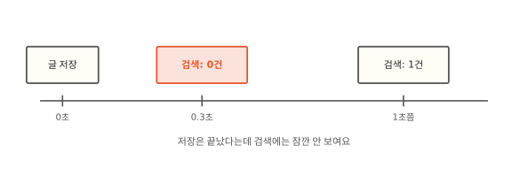
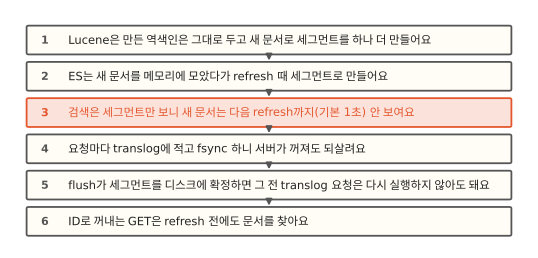
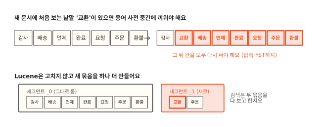
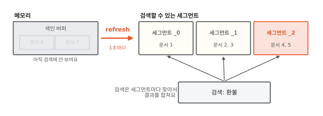
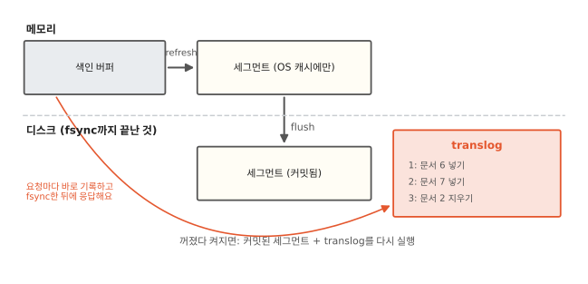

# 저장했는데 왜 바로 검색이 안 될까요?

## 방금 쓴 글이 목록에 없어요



게시판에 글을 쓰면 ES에 문서를 넣고 화면은 곧바로 "내 글" 목록을 검색해서 보여 줘요. 그런데 방금 쓴 글이 목록에 없어요. 새로고침하면 그제야 나와요. 테스트 코드에서도 같은 일이 생겨요. 문서를 넣고 바로 검색하는 테스트가 어떤 때는 통과하고 어떤 때는 0건으로 실패해요.

ES는 문서를 넣는 요청에 성공으로 답했어요. 그런데도 검색에는 1초쯤 뒤에야 나와요. 그 1초 동안 문서는 어디에 있는 걸까요?

## 고치기 어려운 역색인에서 꺼져도 남는 기록까지



먼저 [1편](01-inverted-index.md)의 역색인에 문서 하나를 더하는 일이 왜 비싼지 봐요. 그래서 Lucene은 문서를 모아 새 역색인을 따로 만들어요. 그걸 언제 검색에 내놓느냐에 따라 처음 장면의 1초가 생겨요. 끝으로 `_id`로 꺼내는 요청은 왜 바로 되는지, 그리고 아직 디스크에 다 쓰지 않은 문서는 서버가 꺼져도 어떻게 살아남는지 봐요.

## 정렬된 역색인은 고치기 비싸요



새 문서는 늘 가장 큰 번호를 받으니 포스팅 목록에서는 끝에 붙이면 돼요. 문제는 용어 사전이에요. 1편에서 용어 사전은 가나다순으로 정렬돼 있다고 했어요. 새 문서에 처음 보는 낱말 "교환"이 있으면 "감사"와 "배송" 사이에 끼워야 하고 그 뒤를 모두 밀어 다시 써야 해요. 실제 용어 사전과 포스팅 목록은 압축까지 돼 있어서(6편) 끝에 붙이는 일조차 압축 블록을 다시 써야 해요. 낱말이 30개인 문서 하나를 넣을 때마다 이런 일이 낱말 30개만큼 생겨요.

그래서 Lucene은 이미 만든 역색인을 고치지 않아요. 새 문서들로 작은 역색인을 따로 하나 더 만들어요. 이렇게 한 번 만들면 바꾸지 않는 역색인 하나를 **세그먼트**(segment)라고 해요. 이 갈래에서는 앞으로 이 이름만 써요. 샤드 하나(3편)는 세그먼트 여러 개로 되어 있고 검색은 세그먼트마다 찾아서 결과를 합쳐요.

바꾸지 않는다는 성질은 다른 데서도 이득이에요. 여러 검색이 같은 세그먼트를 잠금 없이 동시에 읽을 수 있고 운영체제가 세그먼트 파일을 메모리에 캐시해 두면 그 캐시가 깨질 일이 없어요. 문서를 지우거나 고치는 일은 5편에서 봐요.

## 새 문서는 모았다가 세그먼트로 만들어요



문서 하나마다 세그먼트를 하나씩 만들면 세그먼트가 문서 수만큼 생겨요. 검색은 세그먼트마다 따로 찾아야 하니 그러면 검색이 끝없이 느려져요. 그래서 ES는 들어온 문서를 메모리의 색인 버퍼에 잠시 모아요. 그리고 일정한 간격으로 버퍼에 모인 문서를 세그먼트 하나로 만들어 검색에 보이게 해요. 이 일을 **refresh**라고 불러요.

refresh 간격은 기본 1초예요. 처음 장면의 문서는 그 1초 동안 색인 버퍼에 있었고 검색은 세그먼트만 보니 버퍼 안의 문서를 몰랐어요. 그래서 ES의 검색은 실시간에 가깝다는 뜻으로 near real-time이라고 불러요.

자동 refresh를 끄고 문서 하나를 넣으면 바로 검색해서 0건이고 `_refresh`를 부른 뒤에는 1건이에요. 문서를 두 번 더 넣고 그때마다 refresh 하면 세그먼트가 `_0`, `_1`, `_2` 셋으로 늘어나요.[^lab]

??? info "동료용 심화: refresh가 실제로 하는 일과 search idle"
    refresh는 Lucene의 `IndexWriter`가 버퍼를 새 세그먼트로 내보내고 ES가 새 `IndexReader`를 열어 검색에 쓰게 하는 일이에요. 이때 세그먼트 파일은 운영체제 파일 캐시에 쓰일 뿐 디스크에 확실히 쓰는 fsync는 하지 않아요. 그 일은 아래의 flush가 해요. 이름이 헷갈리는데 Lucene에서 flush는 버퍼를 세그먼트로 내보내는 일(ES의 refresh 쪽)이고 ES의 flush는 Lucene의 커밋(`IndexWriter.commit`)이에요.

    ES 7.0부터는 search idle이 있어요. 샤드가 `index.search.idle.after`(기본 30초) 동안 검색이나 GET을 받지 않으면 예약된 refresh를 건너뛰어요. 건너뛴 refresh가 있는 샤드에 검색이 오면 그 검색은 refresh를 부르고 끝날 때까지 기다렸다가 결과를 줘요. 색인만 몰리는 시간에 쓸데없는 refresh를 줄이려는 장치예요. `refresh_interval`을 명시적으로 주면 이 동작은 꺼져요. 한동안 조용하던 인덱스의 첫 검색이 유난히 느리다면 이것 때문일 수 있어요.

    문서를 넣는 요청에 `?refresh=true`를 주면 그 자리에서 refresh를 부르고 `?refresh=wait_for`를 주면 다음 refresh가 올 때까지 응답을 미뤄요. 로컬에서 `wait_for`는 1초쯤 걸렸어요. 샤드마다 기다릴 수 있는 요청 수(`index.max_refresh_listeners`, 기본 1,000)를 넘으면 기다리지 않고 refresh를 강제하고 응답에 `forced_refresh: true`가 붙어요. 문서 하나씩 넣는 요청마다 `true`를 쓰면 작은 세그먼트가 문서 수만큼 생겨서 위에서 말한 문제가 그대로 돌아와요. bulk 요청이라면 요청 하나에 refresh 한 번이에요.

    refresh는 캐시에도 영향을 줘요. 샤드 요청 캐시는 refresh 때 바뀐 샤드에서 무효가 되고 terms 집계가 쓰는 global ordinals도 세그먼트가 바뀌면 다시 만들어요. 그래서 `refresh_interval`을 늘리면 색인만 빨라지는 게 아니라 집계 캐시도 오래 살아요.

## _id로 꺼내는 GET은 바로 보여요

검색은 1초를 기다려야 하지만 `GET board/_doc/1`처럼 `_id`로 꺼내는 요청은 refresh 전에도 문서를 찾아요. 로컬에서 자동 refresh를 끈 채 문서를 넣자마자 GET 해 봐도 `found: true`가 나와요.

GET은 `_id` 하나로 문서 하나를 꺼내는 일이에요. ES는 샤드마다 아직 refresh 되지 않은 `_id`를 기억해 두고 있어서 GET이 오면 그걸 알아보고 따로 꺼내 줘요. 그래서 "방금 쓴 글 다시 보여 주기"처럼 `_id`를 아는 경우에는 검색 대신 GET을 쓰면 1초를 기다리지 않아도 돼요.

??? info "동료용 심화: 실시간 GET은 어떻게 최신 문서를 찾을까"
    ES는 샤드마다 `_id`에서 버전·순번·translog 위치로 가는 메모리 표(LiveVersionMap)를 둬요. 문서 내용은 이 표에 없어요. refresh 전에 GET이 오면 이 표로 "아직 검색기에 없는 문서"임을 알고 검색에는 쓰지 않는 내부 refresh를 따로 돌려 세그먼트에서 읽어요. 로컬에서 GET을 하자 검색에는 안 보이는(`searchable=false`) 세그먼트 `_0`이 생긴 것이 그 흔적이에요. 7.17.26과 9.2.0 둘 다 같은 모습이었어요. 그래서 refresh 안 된 `_id`로 GET을 자주 하면 작은 세그먼트가 늘어날 수 있어요.

    이 표는 GET 전용이 아니에요. 같은 `_id`로 다시 쓸 때 버전을 확인하는 데도 쓰고 refresh 때마다 새 표로 갈아 끼워요. 지운 문서의 흔적은 `index.gc_deletes`(기본 60초) 동안 표에 남아서 그 사이 늦게 도착한 옛 버전 쓰기를 막아요. `realtime=false`를 주면 이 기능을 끄고 검색처럼 refresh된 것만 봐요.

## 꺼져도 남게: translog와 flush



남은 걱정은 서버가 꺼질 때예요. 색인 버퍼는 메모리이고 refresh로 만든 세그먼트는 파일로 쓰긴 했지만 운영체제가 아직 메모리(파일 캐시)에 들고 있을 수 있어요. 디스크에 확실히 쓰였다는 보장이 없어요. 그 사이 서버가 꺼지면 ES가 "성공"이라고 답한 문서가 사라질 수 있어요.

세그먼트를 디스크에 확실히 쓰는 일(fsync)은 비싸서 1초마다 할 수 없어요. 대신 ES는 요청이 올 때마다 그 요청을 **translog**라는 파일 끝에 덧붙여 적고 이 파일만 fsync 한 뒤에 성공을 답해요. 뒤에 덧붙이기만 하는 파일이라 fsync가 싸요. 서버가 꺼졌다 켜지면 디스크에 확실히 남은 세그먼트를 읽고 translog에 적힌 작업 중 마지막 커밋 뒤의 것을 차례로 다시 실행해서 꺼지기 전 상태로 돌아가요.

translog가 끝없이 길어지면 다시 실행하는 데도 오래 걸려요. 그래서 ES는 때때로 메모리와 파일 캐시의 세그먼트를 모두 디스크에 fsync 해서 확정하고(Lucene에서는 이걸 커밋이라고 해요) 그 앞까지의 translog를 더는 다시 실행하지 않아도 되게 해요. ES는 이 일을 flush라고 불러요. `_flush`를 부르면 세그먼트 셋이 모두 `committed: true`가 되고 translog의 커밋 안 된 작업이 0이 됐어요.

| 일 | 하는 일 | 언제 |
|---|---|---|
| refresh | 버퍼를 세그먼트로 만들어 검색에 보이게 함 | 기본 1초마다 |
| translog 기록 | 요청을 파일 끝에 적고 fsync | 요청마다 |
| flush | 세그먼트를 디스크에 fsync, 그 앞 translog는 다시 실행할 필요가 없어짐 | translog가 커지는 등 조건이 차면 ES가 알아서 |

??? info "동료용 심화: translog 설정과 잃을 수 있는 범위"
    `index.translog.durability` 기본값은 `request`라서 요청마다 translog를 fsync한 뒤에 답해요. `request`라도 fsync는 bulk 요청 하나에 샤드마다 한 번이라서 bulk가 클수록 싸요. `async`로 바꾸면 `index.translog.sync_interval`(기본 5초)마다 모아서 fsync해요. 쓰기 처리량은 오르지만 서버가 꺼지면 마지막 몇 초의 성공 응답한 문서를 잃을 수 있어요. 복제본(14편)이 있으면 한 노드가 꺼져도 다른 노드에 남지만 모든 노드가 한꺼번에 꺼지는 전원 사고에는 소용없어요.

    flush가 언제 도는지는 translog 크기 기준(`index.translog.flush_threshold_size`) 같은 조건으로 ES가 정해요. 기본값은 7.17이 512mb, 최근 문서는 10gb예요. flush 뒤에도 옛 translog 파일이 바로 지워지지는 않아요. 새 파일(generation)로 넘어가고 옛 것은 복구에 더 필요 없을 때 지워요. 직접 `_flush`를 부를 일은 거의 없어요. 노드를 재시작하기 전에 부르면 재시작 뒤 translog를 다시 실행하는 시간이 줄어요(7.x 초반까지 쓰던 synced flush는 8.0에서 없어졌어요).

## 정리

- 세그먼트: 한 번 만들면 바꾸지 않는 작은 역색인이에요. 샤드는 세그먼트 여러 개로 되어 있고 검색은 모든 세그먼트를 봐요.
- refresh: 메모리에 모인 문서를 세그먼트로 만들어 검색에 보이게 하는 일이에요. 기본 1초마다 해서 검색은 1초쯤 늦어요.
- translog: 요청마다 덧붙여 적고 fsync하는 기록이에요. 서버가 꺼져도 이걸로 되살려요.
- `_id`로 꺼내는 GET은 refresh를 기다리지 않아요.

## 직접 해 보기

[lab/es/04_es.sh](https://github.com/oya150/bedrock/blob/main/lab/es/04_es.sh)는 자동 refresh를 끈 인덱스를 만들고 문서를 넣으며 검색 결과, GET 결과, 세그먼트, translog를 차례로 보여 줘요. 세그먼트는 이 요청으로 봐요.

```bash
curl 'localhost:9200/_cat/segments/nrt?v&h=segment,docs.count,committed,searchable'
```

`searchable`은 검색에 보이는지, `committed`는 flush로 디스크에 커밋됐는지를 뜻해요. refresh 전후와 flush 전후로 두 칸이 어떻게 바뀌는지 보세요.

## 확인 문제

??? question "1. 1초 안에 두 번 검색"
    refresh 간격이 1초인 인덱스에 문서를 넣고 0.2초 뒤와 0.5초 뒤에 같은 검색을 했어요. 두 검색 결과가 다를 수 있을까요?

    **풀이** 달라질 수 있어요. 문서를 넣은 시점과 다음 refresh 사이에 따라 달라요. 검색이 계속 오는 샤드에서 0.3초쯤에 refresh가 돌았다면 0.2초 검색에는 없고 0.5초 검색에는 있어요. refresh는 문서를 넣은 시점과 상관없이 정해진 간격으로 돌아요.

??? question "2. refresh를 꺼 버리면"
    대량으로 처음 문서를 넣을 때 `refresh_interval`을 `-1`로 꺼 두라는 조언이 있어요. 왜 빨라질까요? 끝나면 무엇을 해야 할까요?

    **풀이** refresh를 끄면 1초마다 작은 세그먼트를 만들고 새 검색기를 여는 일이 사라져요. 문서는 버퍼가 찰 때마다 큰 세그먼트로 나가니 나중에 합칠 세그먼트도 적어요(5편). 다 넣은 뒤에는 `refresh_interval`을 원래대로 돌려놓아야 해요. 그대로 두면 `_refresh`를 직접 부르기 전까지 새 문서가 검색에 안 보이고 `wait_for`를 쓰는 요청은 응답을 끝없이 기다려요.

??? question "3. 성공이라고 했는데 사라졌어요"
    `index.translog.durability`를 `async`로 바꾼 클러스터에서 정전으로 모든 노드가 한꺼번에 꺼졌어요. 다시 켜 보니 정전 직전 몇 초 동안 성공 응답을 받은 문서가 없어요. 왜일까요?

    **풀이** `async`에서는 translog를 요청마다 fsync하지 않고 몇 초마다 모아서 해요. 정전 직전 몇 초의 기록은 아직 운영체제 캐시에만 있다가 사라졌어요. 기본값 `request`였다면 응답 전에 translog를 fsync했으니 남아 있었을 거예요.

## 업무 판단 연습

??? question "글 쓰고 바로 목록 보여 주기"
    게시판 화면이 글을 쓰자마자 "내 글" 목록을 검색해서 보여 주는데 방금 쓴 글이 가끔 빠진다는 문의가 와요. `refresh_interval`을 100ms로 줄이자는 제안이 나왔어요. 어떻게 할까요?

    **풀이** refresh 간격을 줄이면 모든 문서 모든 사용자에게 작은 세그먼트가 더 자주 생기고 색인과 검색이 같이 느려져요. 문제는 방금 쓴 사람 한 명의 화면이에요. 글 쓰기 요청에만 `refresh=wait_for`를 주면 그 요청은 다음 refresh까지(최대 1초쯤) 기다렸다가 답하니 화면이 목록을 다시 검색할 때 글이 들어 있어요. 아니면 방금 쓴 글은 응답이나 GET으로 받은 내용을 목록 맨 위에 직접 붙여 보여 줘요.

??? question "통합 테스트가 가끔 실패해요"
    문서를 넣고 바로 검색해서 결과를 확인하는 통합 테스트가 CI에서 가끔 실패해요. 어떻게 고칠까요?

    **풀이** 넣은 뒤 검색 전에 `_refresh`를 부르거나, 넣는 요청에 `refresh=true`(테스트에서는 괜찮아요)나 `wait_for`를 줘요. `sleep(1)`로 기다리면 CI 서버가 바쁠 때 refresh가 늦어져 1초 뒤에도 아직 안 돌았을 수 있어서 여전히 가끔 실패해요.

[^lab]: [lab/es/04_es.sh](https://github.com/oya150/bedrock/blob/main/lab/es/04_es.sh). ES 7.17.26(도커)과 9.2.0(로컬 설치)에서 같은 결과를 확인했어요.
