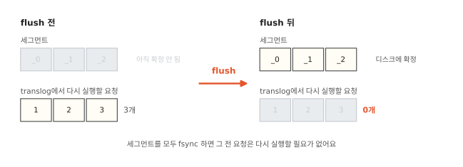
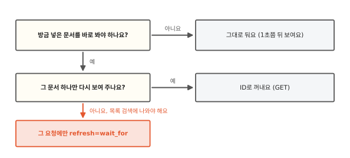
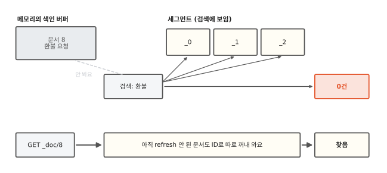

# 저장했는데 왜 바로 검색이 안 될까요?

## 방금 쓴 글이 목록에 없어요

쇼핑몰 게시판에 "환불 요청"이라는 글을 썼어요. 저장을 누르면 글은 ES에 들어가요. 화면은 곧바로 "내 글" 목록을 검색해서 보여 줘요. 그런데 방금 쓴 글이 목록에 없어요. 새로고침하면 그제야 나와요.

게시판 글 하나가 ES에서는 문서 하나예요(3편). ES는 이 문서를 넣는 요청에 "성공"이라고 답했어요. 그런데도 검색에는 1초쯤 지나서야 나와요. 그 1초 동안 문서는 어디에 있었을까요?

답은 역색인(1편)에 문서 하나를 더하는 일에서 시작해요.

## 정렬된 용어 사전에는 끼워 넣기가 비싸요

1편에서 본 역색인은 용어 사전과 포스팅 목록으로 되어 있어요. 용어 사전은 낱말을 가나다순으로 늘어놓은 표예요. 포스팅 목록은 낱말마다 그 낱말이 든 문서의 순번을 적은 줄이에요. 1편에서 글 번호라고 부른 그 번호예요.

순번은 Lucene이 문서가 들어온 차례대로 매겨요. 3편의 ID와는 따로 붙는 번호예요. 그래서 새 문서의 순번은 늘 가장 커요. 포스팅 목록에는 끝에 붙이기만 하면 돼요. 문제는 용어 사전이에요. 새 문서에 처음 보는 낱말 "교환"이 있다고 해 봐요. "교환"은 "감사"와 "배송" 사이에 들어가야 해요. 그러려면 "배송"부터 끝까지 모든 칸을 한 칸씩 밀어서 다시 써야 해요.

실제 용어 사전은 압축까지 해서 저장해요(6편). 그래서 한 칸만 바뀌어도 압축한 덩어리를 다시 만들어야 해요. 문서마다 이 일을 하면 문서를 넣을 때마다 큰 표를 새로 쓰게 돼요.

ES 안에서 역색인을 만들고 찾는 부품을 Lucene이라고 해요.[^lucene] Lucene은 이미 만든 역색인을 고치지 않아요. 새 문서들로 작은 역색인을 하나 더 만들어요. 검색할 때는 두 역색인을 다 찾아서 결과를 합쳐요.

이렇게 한 번 만들고 다시 고치지 않는 역색인을 **세그먼트**(segment)라고 해요. 샤드 하나(3편)는 세그먼트 여러 개로 되어 있어요. 고치지 않으니 좋은 점도 있어요. 여러 검색이 같은 세그먼트를 동시에 읽어도 서로 기다릴 일이 없어요.

## 새 문서는 모았다가 한꺼번에 세그먼트로 만들어요

새 문서가 올 때마다 세그먼트를 하나씩 만들면 어떻게 될까요? 문서 1만 개를 넣으면 세그먼트도 1만 개가 생겨요. 검색은 세그먼트마다 따로 찾아서 합쳐요. 세그먼트가 1만 개면 한 번 검색할 때 1만 번을 찾아야 해요.

그래서 ES는 들어온 문서를 메모리에 잠시 모아요. 메모리는 컴퓨터가 지금 하는 일을 올려 두는 빠른 작업 공간이에요. 문서를 모아 두는 이 자리를 색인 버퍼라고 해요.

ES는 정해진 간격마다 버퍼에 모인 문서로 세그먼트를 만들어요.[^dwpt] 그리고 그 세그먼트를 검색에 내놓아요. 이 일을 **refresh**라고 해요. refresh 간격은 기본 1초예요.[^nrt]

처음 장면으로 돌아가 봐요. "환불 요청" 문서는 처음 1초 동안 색인 버퍼에 있었어요. 검색은 세그먼트만 찾으니 버퍼 안의 문서를 몰랐어요. 다음 refresh가 돌자 문서가 세그먼트에 들어갔어요. 그때부터 검색에 나왔어요.

제 컴퓨터에 띄운 ES에서 자동 refresh를 끄고 문서 하나를 넣어 봤어요. 바로 검색하니 0건이었어요. refresh를 직접 부르자 1건이 됐어요. 문서를 두 번 더 넣고 그때마다 refresh를 부르니 세그먼트가 셋으로 늘었어요.[^lab]

그런데 색인 버퍼는 메모리에 있어요. 서버가 갑자기 꺼지면 버퍼 속 문서는 어떻게 될까요?

## 서버가 꺼지면 버퍼 속 문서는 어떻게 될까요?

ES가 "성공"이라고 답한 문서는 서버가 갑자기 꺼져도 남아 있어야 해요. 그런데 색인 버퍼는 메모리예요. 메모리에 든 것은 전원이 꺼지면 사라져요.

refresh로 만든 세그먼트도 아직 안전하지 않아요. 디스크는 전원이 꺼져도 내용이 남는 저장 장치예요. 세그먼트는 파일로 쓰이지만 곧바로 디스크에 닿지는 않아요. 운영체제가 파일에 쓴 내용을 잠시 메모리에 들고 있다가 나중에 디스크로 옮기기 때문이에요. 운영체제는 컴퓨터의 부품을 관리하는 바탕 프로그램이에요.

파일 내용을 지금 당장 디스크로 옮기라고 운영체제에 시킬 수는 있어요. 이 일을 fsync라고 해요. fsync는 디스크에 다 쓸 때까지 기다려야 해서 느려요. 세그먼트 파일은 여러 개이고 크기도 커요. 1초마다 세그먼트를 모두 fsync 하기에는 너무 무거워요.

그래서 ES는 요청이 올 때마다 그 요청을 기록 파일 하나의 끝에 덧붙여 적어요. 이 기록 파일을 **translog**라고 해요. 기본 설정에서 ES는 translog를 fsync 한 뒤에야 "성공"이라고 답해요. 덧붙인 짧은 기록만 디스크에 쓰면 되니 세그먼트를 쓰는 것보다 훨씬 가벼워요.

서버가 꺼지면 버퍼 속 문서는 사라져요. 하지만 그 문서를 넣은 요청은 translog에 남아 있어요. 다시 켜면 ES는 디스크에 확정해 둔 세그먼트를 먼저 읽어요. 확정은 fsync까지 끝내서 전원이 꺼져도 남게 했다는 뜻이에요. 그다음 translog에서 그 세그먼트에 없는 요청을 차례로 다시 실행해요. 그러면 꺼지기 전 상태로 돌아가요. 세그먼트를 언제 확정하는지는 다음 절에서 봐요.

??? info "심화: 요청마다 fsync 하면 느리지 않을까요?"
    문서를 아주 많이 넣는 앱에서 요청마다 디스크에 쓰는 비용이 걱정될 때 보는 칸이에요.

    `index.translog.durability` 기본값은 `request`예요. 요청마다 translog를 fsync 한 뒤에 답해요. 여러 문서를 한 요청에 묶는 bulk 요청이라면 fsync는 그 요청이 닿은 샤드마다 한 번이에요. 그래서 bulk가 클수록 문서 하나에 드는 fsync가 줄어요.

    `async`로 바꾸면 `index.translog.sync_interval`(기본 5초)마다 모아서 fsync 해요. 쓰기는 빨라지지만 서버가 꺼지면 마지막 몇 초 동안 성공이라고 답한 문서를 잃을 수 있어요.

    복제본(14편)이 있으면 한 노드가 꺼져도 다른 노드에 문서가 남아요. 하지만 모든 노드가 한꺼번에 꺼지는 정전에는 소용없어요.

## translog가 계속 길어지면 어떻게 할까요?

translog에는 요청이 계속 쌓여요. 쌓인 요청이 많을수록 서버를 다시 켤 때 다시 실행할 요청도 많아요. 그만큼 다시 켜는 시간이 길어져요.

그래서 ES는 가끔 버퍼에 남은 문서까지 세그먼트로 만들어요. 그리고 세그먼트를 모두 fsync 해서 디스크에 확정해요. 그러면 그때까지 들어온 요청은 모두 확정된 세그먼트에 들어 있어요. 이때 만든 세그먼트도 검색에 내놓는 일은 다음 refresh가 해요. 그 요청들은 다시 실행할 필요가 없어져요. 이 일을 flush라고 해요.[^flush]

flush는 ES가 알아서 해요. translog가 정해 둔 크기를 넘는 때처럼 조건이 차면 돌아요. 제 컴퓨터의 ES에서 flush를 직접 불러 봤어요. 세그먼트 셋이 모두 디스크에 확정된 것(`committed: true`)으로 바뀌었어요. translog에서 다시 실행할 요청은 0개가 됐어요.

| 일 | 하는 일 | 언제 |
|---|---|---|
| refresh | 버퍼를 세그먼트로 만들어 검색에 보이게 함 | 기본 1초마다 |
| translog 기록 | 요청을 파일 끝에 적고 fsync | 요청마다 |
| flush | 세그먼트를 디스크에 fsync, flush 전에 적힌 translog 요청은 다시 실행할 필요가 없어짐 | translog가 커지는 등 조건이 차면 ES가 알아서 |

refresh와 translog는 서로 따로 돌아요. 검색에 보이게 하는 일은 refresh가 하고 꺼져도 남게 하는 일은 translog가 해요. translog에 적힌 문서도 검색에는 아직 안 보여요. 처음 장면의 화면은 여전히 다음 refresh를 기다려요.

## 바로 보여야 할 때는 어떻게 할까요?

처음 장면의 게시판을 고쳐 봐요. refresh 간격을 0.1초로 줄이자는 생각이 먼저 들어요. 문서가 계속 들어오면 세그먼트가 1초에 열 개씩 생겨요. 세그먼트를 만드는 일이 열 배로 늘고 검색이 찾아야 할 세그먼트도 그만큼 빨리 늘어요. 이 부담은 누가 쓴 문서든 똑같이 생겨요. 그런데 문제는 방금 글을 쓴 한 사람의 화면뿐이에요.

방금 쓴 글 하나를 다시 보여 주는 화면이라면 검색 대신 ID로 꺼내요. 문서마다 붙는 ID(`_id`, 3편)로 문서 하나를 꺼내는 요청을 GET이라고 해요. 요청은 `GET board/_doc/8`처럼 써요. GET은 refresh 전에도 문서를 찾아요. 제 컴퓨터의 ES에서 자동 refresh를 끈 채 문서를 넣었어요. 검색은 0건이었는데 GET은 문서를 찾았어요.[^lab]

GET은 ID 하나로 문서 하나만 찾으면 돼요. 찾을 문서가 하나뿐이라 ES는 그 문서만 따로 챙겨 오면 돼요. 그래서 아직 refresh 안 된 문서도 ID로 꺼내는 길을 따로 마련해 뒀어요.

낱말 검색은 사정이 달라요. "환불"이 든 문서를 모두 찾아야 해요. 그러려면 그 문서들이 용어 사전에 올라 있어야 하고 용어 사전은 세그먼트에만 있어요. 그래서 ID를 아는 문서 하나는 바로 보이고 낱말로 찾는 문서는 refresh를 기다려요.

"내 글" 목록처럼 검색 결과에 꼭 들어 있어야 하면 그 글을 넣는 요청에만 `refresh=wait_for`를 붙여요. ES는 다음 refresh가 끝날 때까지 기다렸다가 성공이라고 답해요. 기본 간격이면 보통 1초 안쪽이에요. 그 응답을 받은 뒤에 목록을 검색하면 방금 쓴 글이 들어 있어요.

그 자리에서 곧바로 refresh 하는 `refresh=true`도 있어요. 요청마다 이걸 붙이면 문서마다 세그먼트가 하나씩 생겨요. 그러면 문서마다 세그먼트를 만들던 처음 문제로 돌아가요.[^wait]

??? info "심화: GET은 아직 refresh 안 된 문서를 어떻게 꺼낼까요?"
    방금 넣은 문서를 ID로 아주 자주 꺼내는 화면을 만들 때 ES가 감당할 수 있는지 궁금하면 보는 칸이에요.

    ID를 정해 넣은 문서라면 ES는 아직 refresh 안 된 문서의 ID를 샤드마다 메모리의 명단에 적어 둬요. 이 명단의 이름은 LiveVersionMap이에요. 문서 내용은 여기 없어요. 그래서 샤드의 첫 GET은 버퍼의 문서로 세그먼트를 만들어 거기서 읽어요.

    refresh는 세그먼트를 만드는 일과 검색에 내놓는 일을 한꺼번에 해요. 첫 GET은 이 가운데 만드는 일만 해요. 그래서 이 세그먼트는 다음 refresh가 내놓기 전까지 검색에는 안 보여요.

    첫 GET 뒤로 새로 들어오는 문서는 명단에 translog의 어느 자리에 있는지도 함께 적혀요. 그다음 GET은 그 자리를 보고 translog에서 바로 읽어요. 세그먼트를 다시 만들 필요가 없어요.

    제 컴퓨터의 ES에서 ID를 정한 문서를 하나 넣을 때마다 GET 하기를 20번 되풀이했어요. 20번 모두 문서를 찾았어요. 검색에는 안 보이는(`searchable=false`) 세그먼트는 `_0` 하나뿐이었어요. 7.17.26과 9.2.0 둘 다 같았어요.[^autoid]

    GET에 `realtime=false`를 주면 명단을 보지 않아요. 검색처럼 refresh된 것만 봐요.[^map]

## refresh를 늦춰도 될 때는 언제일까요?

반대로 넣는 속도가 더 중요한 때도 있어요. 예를 들어 옛 게시판 글 수백만 개를 새 인덱스로 한꺼번에 옮기는 동안에는 아무도 그 인덱스를 검색하지 않아요. 이럴 때는 refresh를 꺼 둘 수 있어요(`refresh_interval: -1`). 세그먼트를 자주 만드는 일이 없어져서 넣는 속도가 빨라져요. 다 옮긴 뒤에는 원래 간격으로 돌려놓아야 해요.

7.0부터는 검색이 30초 동안 없으면 ES가 refresh를 알아서 건너뛰어요. 하지만 옮기는 동안 누가 한 번이라도 검색하면 그 뒤 30초 동안은 다시 1초마다 돌아요. 넣는 속도를 확실히 지키려면 아예 꺼 두는 편이 나아요.

??? info "심화: 아무도 검색하지 않을 때도 1초마다 refresh 할까요?"
    문서는 계속 들어오는데 검색하는 사람이 없을 때 1초마다 세그먼트를 만드는 게 헛일은 아닌지 궁금할 때 보는 칸이에요.

    ES 7.0부터는 이런 샤드를 쉬게 해요. 샤드가 `index.search.idle.after`(기본 30초) 동안 검색을 받지 않으면 1초마다 돌던 refresh를 건너뛰어요. 이 상태를 search idle이라고 해요.

    쉬는 동안 refresh를 건너뛰었다면 다음 검색은 refresh부터 해요. 9.2.0은 검색이 refresh를 바로 부르고 7.17.26은 다음 1초 차례를 기다렸어요. 그래서 한동안 조용하던 인덱스의 첫 검색이 유난히 느릴 수 있어요.[^idle]

    `refresh_interval`을 설정에 직접 적어 두면 쉬는 동작은 꺼져요. 기본값 1초를 그대로 적어도 꺼져요.

refresh를 꺼 둬도 서버가 꺼질 때 잃는 문서는 늘지 않아요. 꺼져도 남게 하는 일은 translog가 따로 맡고 있으니까요.

평소처럼 refresh가 돌면 세그먼트는 refresh 때마다 새로 생겨요. 이렇게 늘어나는 세그먼트를 ES가 어떻게 줄이는지는 5편에서 이어 가요.

## 정리

이 편에서 새로 나온 말이에요.

- 세그먼트: 한 번 만들고 다시 고치지 않는 작은 역색인이에요. 샤드 하나는 세그먼트 여러 개로 되어 있어요.
- 색인 버퍼: 들어온 문서를 세그먼트로 만들기 전에 모아 두는 메모리 자리예요.
- refresh: 버퍼에 모인 문서로 세그먼트를 만들어 검색에 보이게 하는 일이에요. 기본 1초마다 해요.
- fsync: 파일 내용을 지금 당장 디스크에 쓰라고 운영체제에 시키는 일이에요.
- translog: 요청마다 끝에 덧붙여 적고 fsync 하는 기록 파일이에요. 서버가 꺼졌다 켜지면 이걸로 되살려요.
- flush: 세그먼트를 모두 디스크에 확정해서 그 전 translog 요청을 다시 실행할 필요가 없게 만드는 일이에요.
- GET: 문서 ID로 문서 하나를 꺼내는 요청이에요. refresh를 기다리지 않아요.

[^lucene]: ES는 역색인을 만들고 찾는 일을 공개 라이브러리 Lucene에 맡겨요. 샤드 하나가 Lucene 인덱스 하나예요.
[^nrt]: 그래서 Elastic 문서는 ES 검색을 "거의 실시간"(near real-time)이라고 불러요. <https://www.elastic.co/guide/en/elasticsearch/reference/current/near-real-time.html>
[^lab]: 제 컴퓨터에 띄운 ES 7.17.26과 9.2.0에서 샤드 1개, 복제본 0개, `refresh_interval: -1`인 인덱스로 확인했어요. 두 버전 결과가 같았어요.
[^flush]: 이름이 헷갈리는 곳이에요. Lucene에서 flush는 버퍼를 세그먼트로 내보내는 일이에요. ES의 flush는 Lucene의 커밋(`IndexWriter.commit`)이에요. flush가 도는 translog 크기 기준은 7.17.26이 512mb, 9.2.0이 10gb였어요. 8.8에서 기본값이 바뀌었어요. 노드를 재시작하기 전에 직접 `_flush`를 부르면 재시작이 빨라져요.
[^wait]: `wait_for`로 기다리는 요청이 샤드마다 1,000개를 넘으면 ES는 refresh를 바로 해요. bulk 요청에 `refresh=true`를 주면 그 요청이 닿은 샤드마다 refresh 한 번이에요. 문서를 넣고 바로 검색해서 확인하는 자동 검사 프로그램도 가끔 실패해요. 새 문서가 다음 refresh 전까지 검색에 안 보이기 때문이에요. 검색 전에 `_refresh`를 부르면 늘 통과해요.
[^dwpt]: 동시에 문서를 넣는 작업이 여럿이면 Lucene은 작업마다 버퍼를 따로 써요. 그래서 refresh 한 번에 세그먼트가 여러 개 생길 수 있어요. 8개 작업이 동시에 넣고 refresh를 한 번 하자 세그먼트가 8개였어요. 노드 전체 색인 버퍼에는 크기 한도가 있어요(`indices.memory.index_buffer_size`). 한도를 넘으면 ES는 refresh 전에도 세그먼트를 내보내요. 이 세그먼트도 다음 refresh 전까지 검색에는 안 보여요.
[^autoid]: ID를 주지 않고 넣어서 ES가 ID를 지어 준 문서는 넣는 속도를 위해 처음엔 명단에 적지 않아요. 첫 GET 때 명단에 적기 시작해요. 두 번째 GET 때 translog 자리를 적기 시작해요. 그래서 같은 실험에서 세그먼트를 두 번 만들었어요. GET 없이 refresh가 두 번 지나면 다시 적지 않는 상태로 돌아가요. 그러면 그다음 GET이 세그먼트를 한 번 더 만들어요. 노드를 다시 켜거나 샤드가 옮겨 가도 첫 GET의 일이 다시 생겨요. 사실 검토에서 7.17.26과 9.2.0으로 확인했어요.
[^map]: 이 명단은 같은 문서를 다시 쓸 때 버전을 확인하는 데도 써요. 지운 문서의 흔적은 `index.gc_deletes`(기본 60초) 동안 남아서 그 사이 늦게 도착한 옛 버전 쓰기를 막아요.
[^idle]: 한동안 아무것도 넣지 않다가 막 넣은 문서는 건너뛴 refresh가 아직 없어요. 다음 1초 차례 전에 검색하면 검색은 기다리지 않고 바로 답해요. 그래서 쉬던 인덱스에서도 넣자마자 검색하면 그 문서가 결과에 없을 수 있어요. 사실 검토에서 7.17.26과 9.2.0으로 확인했어요.
