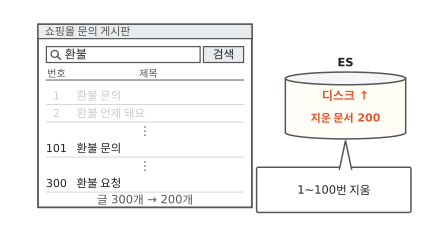
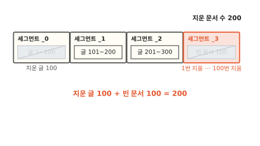
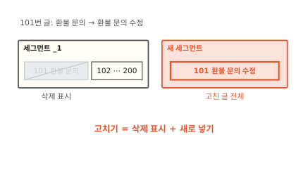
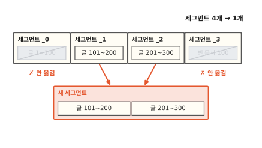
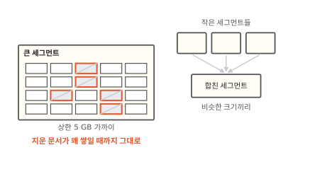

# 지운 문서가 사라지는 때: 삭제 표시와 병합

쇼핑몰 게시판에서 오래된 문의 글 100개를 지웠어요. 목록에서는 글이 사라졌는데 ES의 디스크는 줄지 않았어요. 이 글에서는 ES가 문서를 지울 때 하는 일과 지운 문서가 디스크에서 빠지는 때를 알아봐요. 이걸 알면 오래된 데이터를 지울 때 알맞은 방법을 고를 수 있어요.

!!! abstract "이 글에서 알게 되는 것"
    1. ES는 문서를 지울 때 세그먼트를 고치지 않고 "지웠다"는 표시만 해요. 지운 문서는 검색에서 빠지지만 디스크 자리는 그대로 차지해요.
    2. 글을 고치는 일도 옛 글에 표시하고 고친 글을 새로 넣는 일이에요. 지운 문서는 세그먼트를 합치는 병합 때 살아 있는 문서만 옮겨 적으면서 실제로 사라져요.
    3. 병합은 디스크를 잠시 더 쓰고 복제본에 보낼 기록은 합쳐도 남겨 둬요. 그래서 강제 병합은 더 쓰지 않을 인덱스에만 하고 기간 지난 데이터는 인덱스를 통째로 지워요.

## 1. 지우기는 표시만 해서 디스크가 줄지 않아요

쇼핑몰 문의 게시판에 환불 문의 글이 300개 있어요. 모든 글에 "환불"이 들어 있어요. 이 글을 ES에 넣은 다음 오래된 1~100번 글을 지웠어요. 아래 그림에서 ES 원통 안의 두 줄을 보세요.

**그림 1.** 글 100개를 지워도 디스크는 줄지 않고 지운 문서 수는 200으로 잡혀요.
{ .fig-cap }

목록은 200개로 줄어도 디스크는 줄지 않고 오히려 조금 늘어나요. ES가 따로 세는 지운 문서 수(`docs.deleted`)는 200이 돼요. 지운 문서가 아직 ES 안에 남아 있다는 뜻이에요.

실마리는 [4편](04-refresh.md)의 세그먼트에 있어요. 세그먼트는 문서를 모아 만든 작은 역색인이고 ES는 한 번 만든 세그먼트를 고치지 않아요. 이 예에서는 글을 100개씩 세 번 넣어서 세그먼트가 셋 생겼어요. `_0`에는 글 1~100, `_1`에는 101~200, `_2`에는 201~300이 들어 있어요.

역색인의 용어 사전과 포스팅 목록([1편](01-inverted-index.md))은 정렬한 채 압축해 둬요. 그래서 지운 문서 번호를 한 군데서 빼려 해도 큰 덩어리를 다시 써야 해요. ES는 그 대신 세그먼트마다 문서가 살아 있는지를 1과 0으로 적은 작은 표를 따로 둬요. 아래 그림에서 `_0`의 "살아 있나" 줄을 보세요.

**그림 2.** 1~100번을 지우면 "살아 있나" 표에서 그 자리만 0이 되고 글과 역색인은 그대로 남아요.
{ .fig-cap }

글은 세그먼트 안에 그대로 있고 표에만 0을 적었어요. 이렇게 문서를 남겨 둔 채 표에만 적는 일을 **삭제 표시**라고 해요. ES 7.0부터는 이 표 대신 문서마다 붙은 숨은 값에 적지만 하는 일은 같아요.

이제 "환불"을 검색해 볼게요. 아래 그림에서 포스팅 목록의 흐린 칸과 빨간 칸을 비교해 보세요.

**그림 3.** 검색은 1~100번을 건너뛰어 200건을 내놓지만 "환불"이 든 문서 수는 300이에요.
{ .fig-cap }

검색은 포스팅 목록을 훑다가 표가 0인 문서를 건너뛰어요. 그래서 결과는 200건이에요. 지운 문서는 결과에 안 나오지만 세그먼트 안의 자리는 계속 차지해요. 그래서 디스크가 줄지 않아요.

통계에도 남아요. "환불"이 든 문서 수는 지운 100개까지 세어 300이에요. 이 수는 검색 점수를 매길 때 써요([8편](08-bm25.md)). 그래서 지운 문서가 많으면 점수가 조금 어긋나요.

## 2. 지우기 요청도 빈 문서를 하나 남겨요

지운 글은 100개인데 지운 문서 수는 200이에요. 나머지 100개는 어디서 왔을까요? 아래 그림에서 오른쪽 끝 세그먼트를 보세요.

**그림 4.** 지우기 요청 100개가 새 세그먼트 `_3`에 빈 문서 100개를 남겨서 지운 문서가 200이 됐어요.
{ .fig-cap }

ES 7.0부터는 지우기 요청도 문서를 하나 남겨요. 내용 없이 "1번 문서를 지웠다"만 적은 빈 문서예요. 영어로는 묘비라는 뜻으로 tombstone이라고 불러요. 빈 문서는 처음부터 삭제 표시가 된 채 새 세그먼트에 들어가요. 디스크가 늘어난 것도 이 새 세그먼트 때문이에요.

내용 없는 문서를 남기는 까닭은 샤드의 복사본에 있어요. ES는 샤드를 통째로 복사해 다른 노드에 둘 수 있어요. 노드는 ES가 돌아가는 컴퓨터 한 대예요([3편](03-routing.md)).

샤드를 복사해 둔 것을 **복제본**이라고 해요([14편](14-replication.md)). 원래 샤드는 주 샤드예요. 복제본이 잠깐 끊겼다 돌아오면 ES는 그동안 놓친 작업만 골라 다시 보내요. "1번 문서를 지웠다"를 다시 보내려면 그 기록이 남아 있어야 하는데 빈 문서가 그 기록이에요.

지운 문서는 숨은 값으로 표시하고 지우기 요청은 빈 문서로 남기는 이 방식을 soft delete라고 해요. 8.0부터 만든 인덱스에서는 끌 수 없어요.

## 3. 글을 고치면 옛 글은 지운 문서로 남아요

이번에는 101번 글 "환불 문의"를 "환불 문의 수정"으로 고쳐 볼게요. 이 글은 세그먼트 `_1`에 있어요. 아래 그림에서 두 상자를 왼쪽부터 보세요.

**그림 5.** 고치기는 `_1`의 옛 글에 삭제 표시를 하고 고친 글 전체를 새 세그먼트에 넣는 일이에요.
{ .fig-cap }

세그먼트를 고치지 않으니 ES는 옛 글에 삭제 표시를 하고 고친 글 전체를 새 문서로 넣어요. 새 문서는 다음 refresh 때 새 세그먼트가 돼요(4편). 고친 글 자체가 기록이 돼서 이때는 빈 문서를 만들지 않아요.

필드 하나만 바꾸는 요청(`_update`)도 속은 같아요. ES가 옛 문서를 꺼내 바뀐 필드를 합친 다음 문서 전체를 다시 넣어요. 그래서 큰 문서에서 숫자 하나를 자주 바꾸면 생각보다 비싸요. 바꿀 때마다 큰 문서가 통째로 들어가고 옛 판은 지운 문서로 쌓이거든요.

## 4. 병합할 때 살아 있는 문서만 옮겨 적어요

이제 세그먼트는 넷이에요. `_0`에는 지운 글만, `_3`에는 빈 문서만 있어요. 이 지운 문서들은 세그먼트를 합칠 때 빠져요. 아래 그림에서 빨간 화살표가 어느 세그먼트에서 나오는지 보세요.

**그림 6.** 병합은 살아 있는 글 200개만 새 세그먼트로 옮기고 `_0`과 `_3`은 옮기지 않아요.
{ .fig-cap }

ES는 세그먼트 여러 개를 골라 살아 있는 문서만 새 세그먼트에 옮겨 적어요. 새 세그먼트가 다 만들어지면 검색은 새 세그먼트를 보고 옛 세그먼트 파일은 지워요. 이 일을 **병합**(merge)이라고 해요. 지운 문서는 이때 비로소 디스크에서 빠져요.

병합은 세그먼트 수도 줄여요. 4편에서 본 대로 refresh 때마다 세그먼트가 새로 생겨요. 그대로 두면 세그먼트가 끝없이 늘고 검색은 세그먼트마다 찾느라 느려져요.

그럼 늘 하나로 합쳐 두면 될까요? 병합은 세그먼트를 다 읽고 새로 써서 디스크와 CPU를 써요. 합치는 동안에는 옛 세그먼트와 새 세그먼트가 함께 있어 디스크도 잠시 더 들어요. 세그먼트가 클수록 부담이 커요.

그래서 ES는 크기가 비슷한 세그먼트끼리 합치고 세그먼트를 정해 둔 크기까지만 키워요. 일반 인덱스에서 그 상한은 5 GB예요. 아래 그림에서 왼쪽 큰 세그먼트의 빨간 테두리 칸을 보세요.

**그림 7.** 상한에 가까운 큰 세그먼트는 지운 문서가 꽤 쌓일 때까지 그대로 둬요.
{ .fig-cap }

지운 문서 몇 개를 빼자고 5 GB 가까운 세그먼트를 통째로 다시 쓰기는 아까워요. ES는 큰 세그먼트를 지운 문서가 꽤 쌓일 때까지 두고 봐요. 그래서 큰 인덱스에는 지운 문서가 늘 조금씩 남아 있어요.

## 5. 복제본에 보낼 기록은 합쳐도 남겨요

병합을 직접 시킬 수도 있어요. 이 요청을 **강제 병합**(`_forcemerge`)이라고 해요. 글 100개를 지운 직후에 세그먼트 하나로 강제 병합해 볼게요. 아래 그림에서 합친 세그먼트 안의 회색 칸을 보세요.

**그림 8.** 지운 직후 바로 합치면 세그먼트는 하나가 되지만 지운 글과 빈 문서가 그 안에 그대로 남아요.
{ .fig-cap }

지운 문서 200개가 그대로 옮겨 왔어요. 조금 기다렸다가 다시 합쳐 볼게요.

**그림 9.** 조금 뒤 다시 합치자 지운 문서가 모두 빠지고 살아 있는 글 200개만 남았어요.
{ .fig-cap }

처음에 남은 까닭은 2절의 복제본에 있어요. 복제본에 놓친 작업을 다시 보내려면 넣은 글과 빈 문서 같은 작업 기록이 있어야 해요. 그래서 ES는 아직 쓰일 수 있는 기록은 병합해도 버리지 않아요. 언제까지 붙들지는 두 가지가 정해요.

첫째는 책갈피예요. ES는 복제본마다 "작업을 여기까지 받아 갔어요"라는 표시를 꽂아 둬요. 이 표시를 **보존 표시**(retention lease)라고 해요. 표시보다 나중에 들어온 작업의 기록은 병합해도 남겨요. 종이 책갈피와 달리 이 표시는 ES가 30초마다 앞으로 옮겨요.

둘째는 커밋이에요. 커밋은 4편의 flush로 세그먼트를 디스크에 확정해 두는 일이에요. 새로 붙는 복제본에는 마지막 커밋의 파일을 복사해 주고 그 다음 작업은 따로 보내요. 그래서 커밋에 담기지 않은 작업의 기록도 남겨 둬요.

지운 직후에는 커밋이 한 번도 없었고 보존 표시도 빈 문서 앞에 있었어요. 강제 병합은 끝에 커밋을 남기고 기다리는 동안 보존 표시도 앞으로 옮겨 갔어요. 그래서 두 번째 병합에서 지운 문서가 모두 빠졌어요.

복제본이 끊긴 채 돌아오지 않으면 그 보존 표시는 떠난 자리에 머물러요. 그동안은 몇 번을 합쳐도 지운 문서가 남아요. 기본 설정에서는 늦어도 12시간이 지나면 그 표시가 사라져요.

## 6. 강제 병합은 더 쓰지 않을 인덱스에만 해요

그럼 강제 병합을 자주 해 두면 좋을까요? 계속 쓰는 인덱스라면 오히려 손해예요.

샤드를 세그먼트 하나로 강제 병합하면 그 세그먼트는 5 GB를 훌쩍 넘을 수 있어요. 이 인덱스에서 글을 계속 고치면 옛 판이 큰 세그먼트 안에 쌓여요. 평소 병합은 큰 세그먼트를 오래 건드리지 않다가(4절) 결국 통째로 다시 쓰는 무거운 병합을 한꺼번에 해요. ES를 만드는 Elastic의 공식 문서도 쓰기를 끝낸 인덱스에만 강제 병합을 하라고 권해요.[^force]

아래 갈림길에서 "예"로 가는 빨간 길부터 보세요.

**그림 10.** 더 쓰는 인덱스는 병합을 ES에 맡기고 더 쓰지 않을 인덱스만 강제 병합해요.
{ .fig-cap }

지난달 가계부 기록처럼 읽기만 하는 인덱스에는 지운 문서가 더 생기지 않아요. 세그먼트 하나로 합쳐 두면 찾을 세그먼트가 줄어 검색이 빨라져요. 지운 문서도 빠져서 디스크가 줄어요.

오래된 데이터를 정기적으로 지워야 한다면 지우는 단위를 바꾸는 편이 나아요. 가계부 기록을 달마다 다른 인덱스(`budget-2026-09`, `budget-2026-10`)에 넣어 두는 거예요. 1년 지난 기록은 그 달의 인덱스를 통째로 지워요. 인덱스를 지우면 ES는 그 파일을 곧바로 지워서 삭제 표시도 빈 문서도 병합도 필요 없어요.[^index]

## 정리

처음 게시판으로 돌아가 볼게요. 1~100번 글을 지우자 ES는 `_0`의 "살아 있나" 표에 0만 적었고 글은 세그먼트 안에 남았어요. 지우기 요청은 복제본에 보낼 기록으로 빈 문서 100개를 남겼어요. 그래서 지운 문서가 200이 되고 디스크는 오히려 늘어요. 글을 고칠 때도 옛 글은 지운 문서로 남아요.

지운 문서는 병합이 살아 있는 문서만 옮겨 적을 때 빠져요. 다만 큰 세그먼트는 늦게 합치고 복제본에 보낼 기록은 보존 표시와 커밋이 놓아줄 때까지 남아요. 그래서 강제 병합은 더 쓰지 않을 인덱스에만 하고 기간 지난 데이터는 기간별 인덱스째 지워요.

[6편](06-terms-postings.md)에서는 세그먼트 안의 용어 사전과 포스팅 목록을 작게 담는 방법을 봐요.

### 새로 나온 말

- **삭제 표시**: 세그먼트는 두고 문서가 지워졌다고만 적는 일. 1~100번의 "살아 있나" 자리가 0이 됐어요.
- **빈 문서**(tombstone): 지우기 요청이 남기는 "몇 번 지움" 문서. 세그먼트 `_3`에 100개가 생겼어요.
- **복제본**: 샤드를 통째로 복사해 다른 노드에 둔 것. 빈 문서는 복제본에 지우기를 다시 보내려고 남겨요.
- **병합**: 세그먼트 여러 개를 합치며 살아 있는 문서만 옮겨 적는 일. 세그먼트 넷이 글 200개짜리 하나가 됐어요.
- **강제 병합**: 병합을 직접 시키는 요청(`_forcemerge`). 지운 직후에 하면 지운 문서가 남기도 해요.
- **보존 표시**(retention lease): 복제본이 작업을 어디까지 받아 갔는지 꽂아 두는 책갈피. 그보다 나중 작업의 기록은 남겨요.

[^force]: Elasticsearch 문서, "Force merge API". <https://www.elastic.co/guide/en/elasticsearch/reference/current/indices-forcemerge.html>
[^index]: Elasticsearch 문서, "Size your shards"의 "Delete indices, not documents". <https://www.elastic.co/guide/en/elasticsearch/reference/current/size-your-shards.html>
