# 지운 문서는 언제 실제로 사라질까요?

## 글 3분의 1을 지웠는데 디스크가 오히려 늘었어요

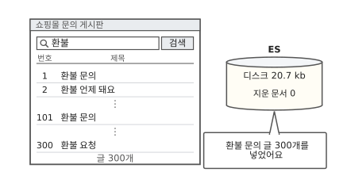

쇼핑몰 게시판에 환불 문의 글이 300개 쌓였어요. 모든 글에 "환불"이라는 낱말이 들어 있어요. 제 컴퓨터에 띄운 ES에 이 글을 넣었더니 인덱스는 20.7 kb였어요.[^lab] 이제 오래된 글을 지워 볼게요.

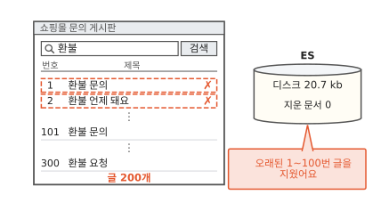

오래된 글 100개를 지웠어요. 게시판 목록은 200개로 줄었어요. 디스크도 줄었을까요?

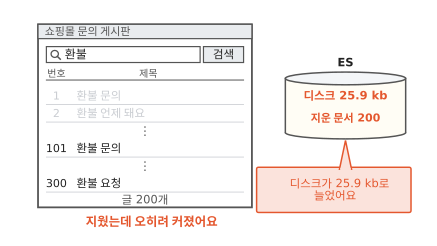

100개를 지우고 나니 25.9 kb가 됐어요. 지웠는데 오히려 커졌어요.

인덱스 상태에는 지운 문서 수를 따로 세는 숫자(`docs.deleted`)가 있어요. 이 숫자는 200이었어요. 지운 문서가 아직 어딘가에 남아 있다는 뜻이에요. 지운 문서는 어디에 남아 있고 언제 실제로 사라질까요? 실마리는 4편의 세그먼트에 있어요.

## 지우기는 표시만 해요

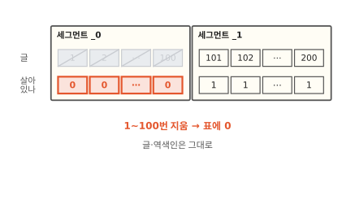

4편에서 세그먼트는 한 번 만들면 고치지 않는 역색인이라고 했어요. 실험에서는 글을 100개씩 세 번 넣었어요. 그래서 세그먼트가 셋 생겼고 그림의 `_0`에 글 1~100이, `_1`에 글 101~200이 들어 있어요.

역색인은 낱말을 늘어놓은 용어 사전과 낱말마다 문서 번호를 적은 포스팅 목록(1편)으로 되어 있어요. 둘 다 정렬된 채 압축돼 있어서 한 군데만 바꿔도 큰 덩어리를 다시 써야 해요. 지운 문서의 번호를 포스팅 목록 곳곳에서 빼는 일도 마찬가지예요. 그럼 ES는 문서를 어떻게 지울까요?

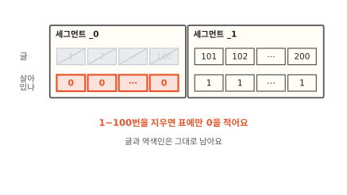

ES는 세그먼트를 고치지 않아요. 세그먼트마다 문서가 살아 있는지를 1과 0으로 적은 작은 표가 있어요. 1~100번을 지우면 이 표에서 그 문서 자리만 0으로 바꿔요. 7.0부터는 이 표 대신 문서마다 붙은 숨은 값에 적지만 하는 일은 같아요. 이렇게 지운 문서를 남겨 둔 채 표에만 적는 일을 **삭제 표시**라고 해요. 이때 "환불"을 찾으면 어떻게 될까요?

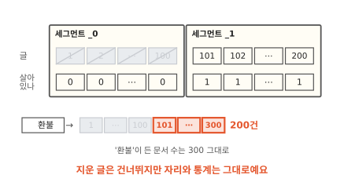

검색은 포스팅 목록을 훑다가 0인 문서를 만나면 건너뛰어요. 그래서 "환불" 검색은 200건이었어요. 지운 문서는 검색 결과에는 안 나와요. 하지만 세그먼트 안의 자리는 그대로 차지해요. 그래서 디스크가 줄지 않아요.

통계에도 그대로 남아요. "환불"이 든 문서 수로 적힌 값은 300 그대로였어요. 지운 100개까지 세었기 때문이에요. 이 값은 검색 점수를 계산할 때 쓰여요(8편). 지운 문서가 많은 인덱스에서는 점수가 조금 어긋나요.

## 지우기도 문서를 하나 남겨요

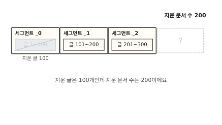

처음 장면에서 100개를 지웠어요. 그림처럼 `_0`의 지운 글은 100개예요. 그런데 지운 문서 수는 왜 200이었을까요?

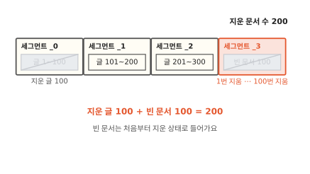

ES 7.0부터는 기본으로 지우기 요청도 문서를 하나 남겨요. 내용 없이 "몇 번 문서를 지웠다"만 적은 빈 문서(tombstone)예요. 이 빈 문서는 처음부터 삭제 표시가 된 채로 새 세그먼트에 들어가요. 실험에서는 새 세그먼트 `_3`에 빈 문서 100개가 들어왔어요. 디스크가 오히려 늘어난 것도 주로 이 새 세그먼트 때문이에요. 내용도 없는 문서를 왜 남길까요?

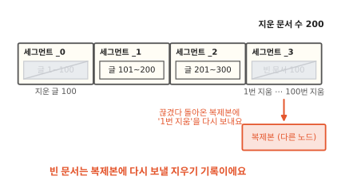

빈 문서를 남기는 까닭은 샤드의 복사본에 있어요. ES는 샤드를 통째로 복사해 ES가 돌아가는 다른 컴퓨터(노드, 3편)에 둘 수 있어요. 이 복사본을 복제본이라고 해요(14편). 원래 샤드는 주 샤드예요.

복제본이 잠깐 끊겼다 돌아오면 ES는 그동안 있었던 작업만 골라 다시 보낼 수 있어요. "1번 문서를 지웠다"는 작업을 다시 보내려면 그 기록이 남아 있어야 해요. 빈 문서가 그 기록이에요.

7.0부터 ES는 지우기를 이렇게 처리해요. 지운 문서는 숨은 값으로 표시하고 지우기 요청은 빈 문서로 남겨요. 이 방식을 soft delete라고 해요. 8.0부터 만든 인덱스는 끌 수 없어요.

??? info "심화: 삭제 표시는 실제로 어디에 적을까요?"
    "세그먼트를 고치지 않는다면서 표는 어떻게 바꾸지?" 하고 궁금할 때 보는 칸이에요.

    본문 그림의 "살아 있나" 표는 Lucene이 세그먼트 옆에 따로 두는 작은 파일(`.liv`)이에요. Lucene은 ES 안에서 역색인을 만드는 부품이에요(4편). 세그먼트 본체는 그대로 두고 이 파일만 새로 써요.

    soft delete에서는 이 파일 대신 문서마다 붙은 숨은 값(`__soft_deletes`)에 삭제 표시를 적어요. 이 값도 세그먼트 본체를 고치지 않고 옆에 작은 파일을 더해서 적어요. 검색에 쓰는 읽기 도구(reader)를 새로 열 때 이 값을 보고 살아 있는 문서를 계산해요. `.liv` 파일은 색인하다 실패한 문서처럼 드문 경우에만 써요.

지우기가 이렇다면 글을 고칠 때는 어떨까요?

## 고치기는 지우고 새로 넣기예요

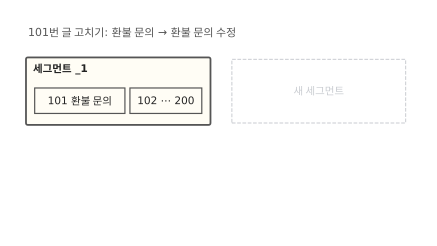

글을 고칠 때도 세그먼트를 고치지 않아요. 실험에서 101번 글 "환불 문의"를 "환불 문의 수정"으로 고쳐 봤어요. 이 글은 세그먼트 `_1`에 있어요. ES는 먼저 무엇을 할까요?

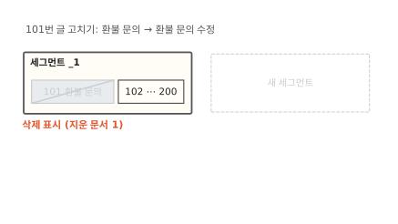

옛 글에 삭제 표시를 해요. `_1`의 지운 문서가 1이 됐어요. 그럼 고친 글은 어디로 갈까요?

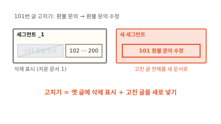

고친 글 전체를 새 문서로 넣어요. 새 문서는 색인 버퍼에 들어갔다가 다음 refresh 때 새 세그먼트가 돼요(4편). 고칠 때는 빈 문서를 남기지 않아요. 고친 글 자체가 새 문서로 남기 때문이에요.

필드 하나만 바꾸는 요청(`_update`)도 속은 같아요. ES가 옛 문서를 꺼내 바꾼 필드를 합쳐요. 그리고 합친 문서 전체를 다시 넣어요.[^noop] 그래서 큰 문서에서 숫자 하나를 자주 바꾸면 생각보다 비싸요. 바꿀 때마다 큰 문서가 통째로 새로 들어가고 옛 판은 지운 문서로 쌓여요.

## 지운 문서는 병합 때 빠져요

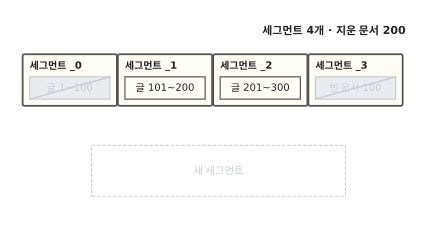

다시 글 300개를 넣고 1~100번을 지운 인덱스로 돌아왔어요. 세그먼트는 넷이고 그중 `_0`과 `_3`에는 지운 문서만 들어 있어요. 지운 문서는 언제 실제로 사라질까요?

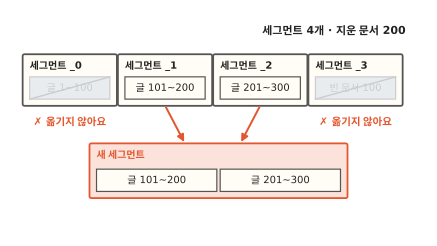

세그먼트를 합칠 때예요. ES는 세그먼트 여러 개를 골라 하나로 합쳐요. 합칠 때 살아 있는 문서만 새 세그먼트에 옮겨 적어요. 삭제 표시된 문서는 옮기지 않아요. 이 일을 **병합**(merge)이라고 해요. 다 옮겨 적은 뒤 옛 세그먼트는 어떻게 될까요?

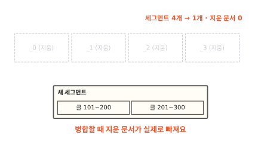

새 세그먼트가 다 만들어지면 검색은 새 세그먼트를 봐요. 옛 세그먼트 파일은 더 쓰는 곳이 없어지면 지워요.[^files] 그림에서 세그먼트 4개가 1개가 됐고 지운 문서는 0이 됐어요. 그림은 복제본에 보낼 기록을 붙들 일이 끝난 뒤에 합친 모습이에요. 지운 직후 바로 합치면 지운 문서가 남기도 해요. 이 이야기는 셋째 절에서 해요.

ES가 병합을 하는 까닭은 하나 더 있어요. 4편에서 refresh 때마다 세그먼트가 새로 생긴다고 했어요. 그대로 두면 세그먼트가 끝없이 늘고 검색은 세그먼트마다 찾느라 점점 느려져요. 병합은 지운 문서를 치우면서 세그먼트 수도 함께 줄여요. 그렇다면 ES는 왜 세그먼트를 늘 하나로 합쳐 두지 않을까요?

## 병합에 따라오는 것

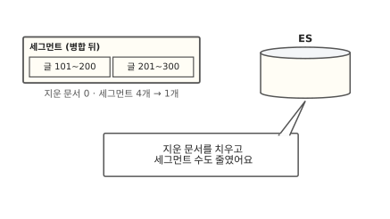

병합으로 지운 문서를 치우고 세그먼트 수도 줄였어요.

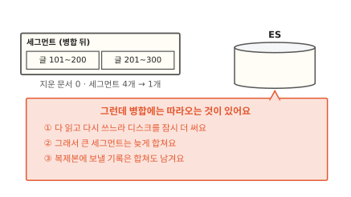

그런데 병합에는 따라오는 것이 있어요. 그림에 적은 세 가지예요. 첫째부터 볼게요.

### 첫째, 합치는 동안 디스크를 더 써요

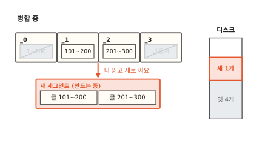

병합은 합칠 세그먼트를 처음부터 끝까지 읽고 새로 써요. 디스크 읽기·쓰기와 CPU가 들어요. 합치는 동안에는 그림의 디스크 막대처럼 옛 세그먼트와 새 세그먼트가 디스크에 함께 있어요.[^busy] 다 만들고 나면 어떻게 될까요?

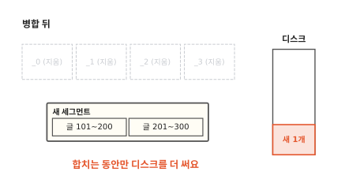

옛 세그먼트를 지우면 새 세그먼트만 남아요. 그래도 큰 세그먼트를 합칠수록 이 부담이 커져요. 그래서 ES는 세그먼트를 정해 둔 크기까지만 키워요.

### 둘째, 큰 세그먼트는 늦게 합쳐요

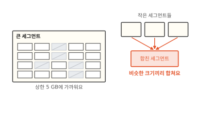

ES는 크기가 비슷한 세그먼트끼리 골라 합쳐요. 일반 인덱스에서 세그먼트 크기의 상한은 5 GB예요. 한 장에 5 MB인 휴대폰 사진 1천 장쯤이에요. 상한에 가까운 큰 세그먼트에 지운 문서가 생기면 어떻게 될까요?

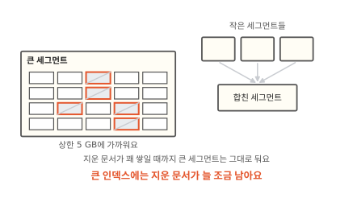

그 크기에 가까운 큰 세그먼트는 지운 문서가 꽤 쌓일 때까지 다시 합치지 않아요. 그래서 큰 인덱스에는 지운 문서가 늘 어느 정도 남아 있어요.[^time]

??? info "심화: ES는 무엇을 언제 합칠까요?"
    ES가 합칠 세그먼트를 어떻게 고르는지 궁금할 때 보는 칸이에요. 큰 인덱스에서 지운 문서가 왜 0으로 안 떨어지는지도 이 고르는 규칙에서 나와요.

    일반 인덱스의 기본 병합 규칙은 TieredMergePolicy예요. Lucene(4편)이 정한 규칙이에요. 크기가 비슷한 세그먼트끼리 한 층으로 묶어요. 한 층에 세그먼트가 10개(`segments_per_tier`)를 넘으면 병합을 시작해요. 한 번에 합치는 수도 10개(`max_merge_at_once`)까지예요. 2 MB(`floor_segment`)보다 작은 세그먼트는 모두 같은 크기로 쳐요. 합칠 묶음을 고를 때는 크기가 비슷할수록, 결과가 작을수록, 치울 지운 문서가 많을수록 먼저 골라요.

    크기 상한(`max_merged_segment`)의 절반을 넘은 세그먼트는 지운 문서 비율이 `deletes_pct_allowed`를 넘어야 다시 합칠 후보가 돼요. 그 세그먼트의 비율과 인덱스 전체의 비율이 모두 넘어야 해요. 인덱스 전체 비율이 낮으면 지운 문서가 많은 큰 세그먼트도 그대로 둬요. 기본값은 7.17에서 33%였고 8.7부터 20%예요.

### 셋째, 복제본에 보낼 기록은 합쳐도 남겨요

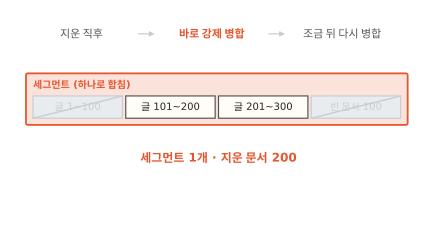

지운 문서를 당장 치우고 싶으면 병합을 직접 시킬 수 있어요. 이 요청을 강제 병합(`_forcemerge`)이라고 해요. 그림은 실험에서 글을 지운 직후예요. 여기서 세그먼트 하나로 강제 병합하면 어떻게 될까요?

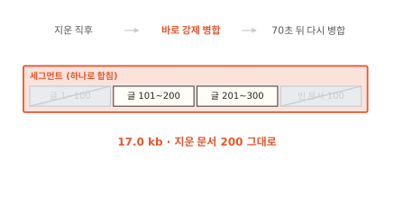

세그먼트는 하나가 됐고 인덱스는 17.0 kb로 줄었어요. 세그먼트마다 문서 수와 상관없이 붙는 파일 머리말 같은 몫이 줄어든 덕이에요. 아주 작은 인덱스라 이 몫이 커요. 그런데 지운 문서 200개는 합친 세그먼트 안에 그대로 남았어요. 조금 기다렸다 다시 합치면 어떨까요?

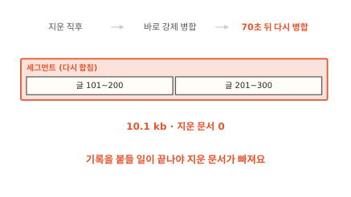

70초를 기다려 다시 합치자 그제야 지운 문서가 0개가 됐고 인덱스는 10.1 kb가 됐어요. 이 흐름은 7.17.26과 9.2.0이 같았어요.

처음 합칠 때 지운 문서가 남은 것은 복제본 때문이에요. 복제본에 작업을 다시 보내려면 그 작업의 기록이 남아 있어야 해요. 넣은 글과 빈 문서가 그 기록이에요. 그래서 ES는 기록을 곧바로 버리지 않아요. 정해 둔 두 조건이 갖춰질 때까지 남겨 둬요. 첫 조건은 잠깐 끊겼다 돌아오는 복제본 쪽이에요.

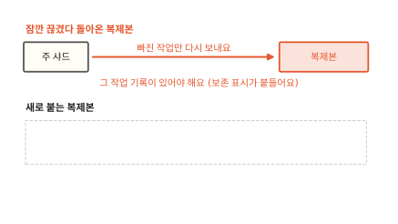

책에 꽂는 책갈피를 떠올려 봐요. ES는 복제본마다 "작업을 여기까지 받아 갔어요"라는 책갈피를 꽂아 둬요. 이 표시를 **보존 표시**(retention lease)라고 해요. 책갈피보다 뒤에 있는 기록은 병합해도 버리지 않아요. 책갈피와 달리 이 표시는 ES가 30초마다 앞으로 옮겨요.

복제본이 없는 실험 인덱스에도 보존 표시가 하나 있었어요. 주 샤드 몫의 표시예요. 나중에 새 복제본을 붙이면 ES가 이 표시를 복사해 그 복제본 몫으로 써요. 이 표시도 30초마다 주 샤드와 복제본이 모두 받아 간 마지막 작업 뒤로 옮겨 가요. 복제본이 없으면 그때까지 들어온 마지막 작업 뒤예요. 다른 조건 하나는 새로 붙는 복제본 쪽이에요.

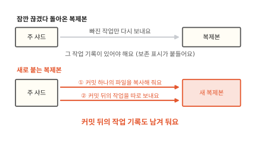

그 기록까지 담아 디스크에 확정한 커밋(4편의 flush)이 있어야 해요. 새로 붙는 복제본에는 ES가 파일을 복사해 줘요. 이때 커밋 하나의 파일을 보내요. 그 커밋 뒤에 들어온 작업은 파일에 없으니 따로 보내야 해요. 그래서 커밋 뒤의 기록도 남겨 둬요.

실험에서는 글을 넣은 뒤로 커밋이 한 번도 없었어요. 강제 병합은 끝에 커밋을 남겨요. 그리고 70초 사이에 보존 표시도 옮겨 갔어요. 그래서 두 번째 병합에서 지운 문서가 모두 빠졌어요.

복제본이 끊긴 채 돌아오지 않으면 그 복제본 몫의 보존 표시는 떠난 지점에 머물러요. 그동안은 병합해도 지운 문서가 남아 있어요. 복제본이 돌아오지 않으면 기본 설정에서는 늦어도 12시간(`index.soft_deletes.retention_lease.period`) 안에 표시가 사라져요. 그 뒤에 돌아온 복제본은 파일을 다시 받아요.

??? info "심화: 보존 표시는 정확히 무엇을 붙들까요?"
    실험에서 지운 문서 200개가 남은 까닭을 번호로 따라가 보고 싶을 때 보는 칸이에요.

    ES는 샤드에 들어오는 작업마다 차례대로 번호를 붙여요. 이 번호를 시퀀스 번호라고 해요. 문서마다 자기를 넣은 작업의 번호가 붙어 있어요. 실험에서 글 1~100은 작업 1~100으로 들어왔어요. 지우기 요청 100개는 작업 301~400이었고 빈 문서마다 그 번호가 붙었어요.[^seq]

    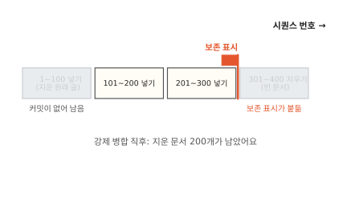

    본문의 보존 표시는 이 번호 줄 위에 꽂혀요. 주 샤드와 복제본마다 하나씩 있어요. 표시보다 뒤 번호를 단 지운 문서는 병합해도 버리지 않아요. ES는 30초마다 표시를 주 샤드와 복제본이 모두 받아 간 마지막 번호 뒤로 옮겨요.

    실험에서는 지우기 전에 30초가 지나서 보존 표시가 300번 뒤에 와 있었어요. 그래서 빈 문서 100개를 붙들었어요. 원래 글 100개는 커밋 조건 때문에 남았어요. 글을 담은 커밋이 아직 없어서 1번부터 모두 남겨야 했어요. 첫 강제 병합이 커밋을 남긴 다음에는 어떻게 될까요?

    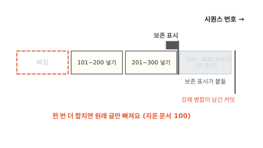

    첫 강제 병합 직후 기다리지 않고 한 번 더 합치면 지운 문서가 100개로 줄어요. 원래 글만 빠지는 거예요. 빈 문서는 언제 빠질까요?

    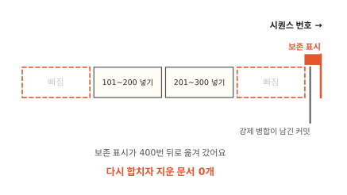

    보존 표시가 400번 뒤로 옮겨 가자 다시 합칠 때 빈 문서도 빠졌어요.

그렇다면 강제 병합은 언제 해야 할까요?

## 강제 병합은 언제 쓸모 있을까요?

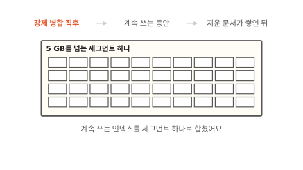

샤드 하나는 세그먼트 여러 개로 되어 있어요(4편). 일반 인덱스에서 샤드가 5 GB보다 크면 강제 병합으로 만든 세그먼트 하나도 5 GB를 훌쩍 넘어요. 이 인덱스에 계속 글을 쓰면 어떻게 될까요?

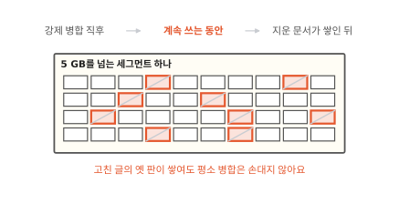

평소 병합은 이런 큰 세그먼트를 지운 문서가 꽤 쌓일 때까지 건드리지 않아요. 그래서 고친 글의 옛 판이 그 큰 세그먼트 안에 지운 문서로 오래 쌓여요. 쌓이고 쌓이면 무슨 일이 생길까요?

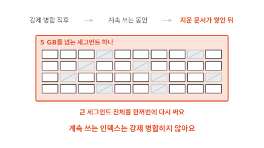

결국 큰 세그먼트를 통째로 다시 쓰는 무거운 병합이 한꺼번에 일어나요. ES를 만드는 Elastic의 공식 문서도 쓰기를 끝낸 인덱스에만 강제 병합을 하라고 해요.[^force]

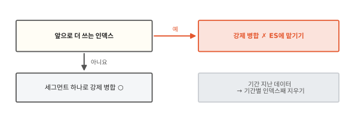

다시 쓰지 않을 인덱스라면 사정이 달라요. 지난달 가계부 기록처럼 읽기만 하는 인덱스는 지운 문서가 더 생기지 않아요. 세그먼트 하나로 합쳐 두면 찾을 세그먼트가 줄어 검색이 빨라지고 지운 문서도 빠져 디스크가 줄어요.

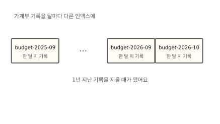

오래된 데이터를 정기적으로 지울 때는 지우는 단위를 바꾸는 편이 나아요. 가계부 기록을 달마다 다른 인덱스(`budget-2026-09`, `budget-2026-10`)에 넣어 두는 거예요. 1년 지난 기록은 어떻게 지울까요?

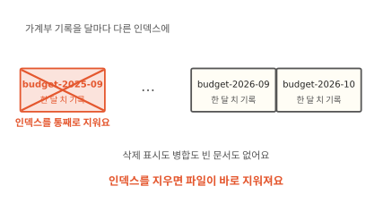

그 달의 인덱스를 통째로 지워요. 2026년 10월이라면 `budget-2025-09`를 지우는 식이에요. 인덱스를 지우면 ES는 그 파일을 바로 지워요. 삭제 표시도 병합도 빈 문서도 필요 없어요.[^index]

## 다시 지운 글 100개를 볼게요

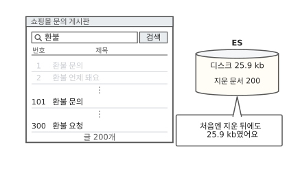

처음 장면의 게시판으로 돌아왔어요. 1~100번 글을 지운 뒤에도 디스크는 25.9 kb였고 지운 문서는 200개였어요.

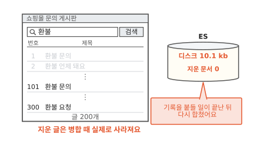

이번에는 커밋이 남고 보존 표시가 옮겨 간 뒤에 다시 합쳤어요. 병합이 살아 있는 글 200개만 옮겨 적자 지운 문서는 0이 됐고 디스크는 10.1 kb로 줄었어요.

글이 300개든 3억 개든 문서를 하나씩 지우면 병합이 그 문서를 빼고 옮겨 적은 뒤에야 디스크에서 사라져요.

### 이 편에서 줄여 그린 것

그림을 쉽게 하려고 실제와 다르게 줄인 곳이 네 군데 있어요.

1. "살아 있나" 표를 세그먼트 안의 1·0 줄로 그렸어요. 7.0부터는 문서마다 붙은 숨은 값(`__soft_deletes`)에 적고 세그먼트 본체 옆에 작은 파일을 더해 적어요. 이 편 첫 심화 칸에서 다뤄요.
2. 세그먼트 칸 하나에 글 100개를 묶어 그렸어요. 실제 세그먼트 안에는 글이 하나씩 따로 들어 있고 용어 사전과 포스팅 목록도 함께 있어요(1편, 4편).
3. 병합 그림에서 세그먼트 넷을 한 번에 하나로 합쳤어요. 평소 병합은 크기가 비슷한 세그먼트가 한 층에 10개를 넘어야 시작해요. 넷을 하나로 합친 것은 실험의 강제 병합이에요. 지운 문서가 0이 된 것은 70초를 기다려 다시 합친 두 번째 병합 때였어요.
4. 시퀀스 번호를 1부터 셌어요. 실제로는 0부터 매겨요.

### 이 편에서 새로 나온 말

![낱말 카드 여덟 장, 두 장씩 네 줄. 삭제 표시: 회색 줄 그은 글 1, 2 아래 빨간 0, 0, 세그먼트는 두고 살아 있나 표에 0을 적기. 빈 문서 (tombstone): 빨간 1번 지움, 지우기 요청이 남기는 '몇 번 지움' 문서. soft delete: 회색 줄 그은 글 1과 빨간 1번 지움, 지운 문서는 숨은 값으로, 지우기는 빈 문서로. 병합: 회색 칸과 흰 칸에서 빨간 화살표로 빨간 상자, 살아 있는 문서만 새 세그먼트에 옮겨 적기. 강제 병합: 작은 상자 넷에서 빨간 화살표로 빨간 상자 하나, 병합을 직접 시키는 요청 (_forcemerge). 복제본: 주 샤드에서 빨간 화살표로 빨간 복제본, 샤드를 통째로 복사해 다른 노드에 둔 것. 보존 표시: 번호 줄 점 세 개, 300, 301, 점 세 개의 300과 301 사이에 빨간 깃발, 복제본이 받아 간 곳에 꽂는 책갈피, 뒤 기록은 남겨요. 시퀀스 번호: 빨간 1, 2, 3과 점 세 개, 400, 샤드에 들어온 작업마다 붙는 차례 번호.](img/05/es05-cards.svg)

[^lab]: 제 컴퓨터에 띄운 ES 7.17.26과 9.2.0에서 샤드 1개, 복제본 0개, `refresh_interval: -1`인 인덱스로 확인했어요. 글 300개를 100개씩 세 번 넣고 그때마다 refresh 했어요. 1~100번을 지우고 refresh 했어요. 인덱스 크기 통계는 10초마다 다시 계산돼서 잴 때마다 11초를 기다렸어요. 크기 숫자는 7.17.26 기준이에요. 9.2.0은 24.2 kb, 29.7 kb, 18.6 kb, 11.6 kb였어요. 글 고치기는 따로 해 봤어요.
[^noop]: 바꾼 결과가 원래 문서와 똑같으면 ES는 다시 넣지 않아요(`detect_noop`, 기본 켜짐).
[^files]: 옛 세그먼트 파일은 두 가지를 기다려요. 그걸 읽던 검색이 끝나야 해요. 그리고 ES가 남겨 둔 커밋(4편의 flush)이 다른 세그먼트를 가리켜야 해요. 그 뒤에 지워져요. 그래서 병합 직후 디스크가 바로 줄지 않기도 해요.
[^busy]: 병합이 색인을 못 따라가면 ES는 그 샤드의 색인 요청을 한 번에 하나씩만 처리해 늦춰요. 이때 로그에 `now throttling indexing`이 찍혀요. 8.19와 9.0.3부터는 디스크 사용량이 `indices.merge.disk.watermark.high`를 넘으면 새 병합을 시작하지 않고 기다려요. 기본값은 디스크가 거의 가득 찬 수준(flood stage)을 따라가요. 디스크가 95% 차는 때와 남은 공간이 100 GB로 줄어드는 때 가운데 나중 쪽이에요. 새 병합이 이 문턱을 넘길 만큼 크면 시작하지 않고 기다려요. 이미 돌고 있는 병합은 끝까지 가요. 이때는 다른 인덱스를 지우거나 노드를 늘려 여유 공간부터 만들어야 해요.
[^time]: 8.8부터 `@timestamp` 날짜 필드가 있는 인덱스는 LogByteSizeMergePolicy를 써요. 들어온 순서로 이웃한 세그먼트끼리만 합치고 상한은 100 GB예요. 9.2.0에서 인덱스 설정 기본값을 읽으면 병합 규칙 종류가 `UNSET`, 상한이 `0b`로 나와요. 어느 규칙을 쓸지 ES가 인덱스마다 정한다는 뜻이고 상한은 노드 설정(일반 5 GB, 날짜 인덱스 100 GB)에서 가져와요.
[^seq]: 시퀀스 번호는 실제로 0부터 매기지만 본문과 그림은 1부터 셌어요. 보존 표시 위치와 커밋 조건은 사실 검토에서 7.17.26과 9.2.0으로 확인했어요. 보존 표시는 복제본이 붙어 있는 동안 계속 갱신되고 복제본이 떠나면 늦어도 12시간 뒤에는 사라져요. 다른 노드에 대신할 복제본이 다 붙으면 바로 사라져요. 붙든 기록이 너무 많으면 더 일찍 지우기도 해요.
[^force]: Elasticsearch 문서, "Force merge API". 5 GB보다 큰 세그먼트는 평소 병합 대상에서 빠진다고 적혀 있어요. 세그먼트 하나로 합치는 동안 디스크가 최대 3배까지 들 수 있다는 경고도 있어요. <https://www.elastic.co/guide/en/elasticsearch/reference/current/indices-forcemerge.html>
[^index]: Elasticsearch 문서, "Size your shards"의 "Delete indices, not documents". <https://www.elastic.co/guide/en/elasticsearch/reference/current/size-your-shards.html>
