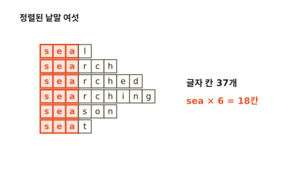
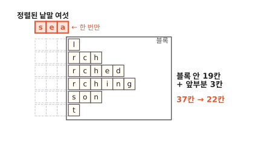
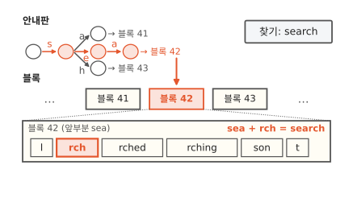
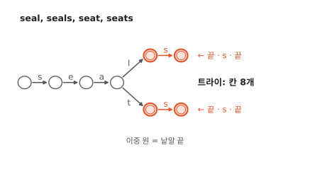
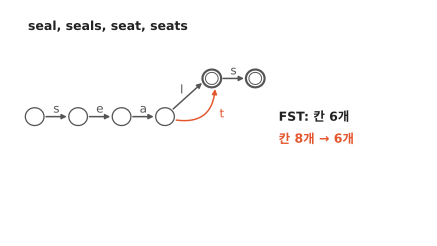
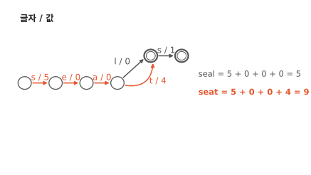
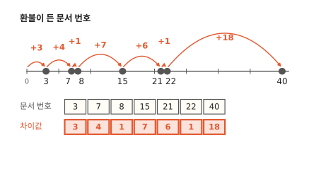
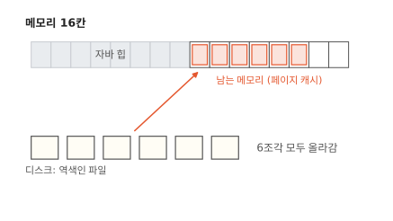

# 역색인을 작게 담는 법: 앞부분 나눠 쓰기와 차이값

[1편](01-inverted-index.md)의 쇼핑몰 게시판에는 글이 백만 개 있었어요. 열 개 중 하나꼴로 "환불"이 들어 있다면 "환불" 줄에만 문서 번호가 10만 개 붙어요. 낱말도 수십만 개라서 역색인을 그대로 적으면 꽤 클 것 같죠. 이 글을 읽고 나면 ES가 낱말 목록과 문서 번호 줄을 어떻게 작게 줄여 담는지 알게 돼요. 작게 담을수록 메모리에 더 많이 올라가서 검색이 디스크를 덜 읽어요.

!!! abstract "이 글에서 알게 되는 것"
    1. 용어 사전은 정렬된 낱말을 블록으로 묶고 같은 앞부분을 블록마다 한 번만 적어요. 찾을 때는 작은 안내판으로 읽을 블록 하나를 골라요.
    2. 낱말 전체를 메모리에 들어야 할 때는 앞부분과 꼬리가 같은 칸을 모두 합친 FST에 담아요.
    3. 포스팅 목록은 앞 번호와의 차이만 적고 128개 묶음마다 필요한 비트 수로 꽉 채워 담아요. 작게 담은 파일은 남는 메모리에 더 많이 올라가요.

## 1. 용어 사전은 같은 앞부분을 블록마다 한 번만 적어요

역색인은 두 부분으로 되어 있어요([1편](01-inverted-index.md)). 낱말을 정렬해 늘어놓은 용어 사전과 낱말마다 문서 번호를 적은 포스팅 목록이에요. 먼저 용어 사전부터 줄여 볼게요.

여기서는 영어 낱말로 볼게요. 알파벳은 글자 하나가 칸 하나라서 칸을 세기 쉽거든요. 용어 사전은 낱말을 알파벳순으로 정렬해 둬요. 정렬하면 앞부분이 같은 낱말끼리 이웃해요. 아래 그림에서 여섯 낱말의 앞 세 칸을 보세요.

**그림 1.** 여섯 낱말이 모두 sea로 시작해서 같은 세 글자가 여섯 번, 18칸이 되풀이돼요.
{ .fig-cap }

같은 글자를 낱말마다 다시 적을 까닭은 없어요. 그래서 ES는 정렬된 낱말을 수십 개씩 모아 디스크에 적어요. 이 덩어리를 **블록**이라고 해요. 블록이 함께 쓰는 앞부분 sea는 블록 밖에 한 번만 적고 블록 안에는 낱말마다 나머지 글자만 적어요. 아래 그림에서 칸 수가 어떻게 바뀌었는지 보세요.

**그림 2.** 앞부분 sea를 한 번만 적으니 37칸이 22칸으로 줄었어요.
{ .fig-cap }

블록에는 낱말마다 그 낱말이 든 문서 수와 포스팅 목록이 디스크 어디에 있는지도 함께 적어요. 이런 값이 붙어도 낱말이 많을수록 겹치는 앞부분이 많아서 아끼는 몫이 커요.

거꾸로 앞부분이 겹치지 않는 값은 이렇게 줄지 않아요. 주문마다 무작위로 붙이는 32글자 번호가 그래요. 정렬해도 이웃끼리 나눠 쓸 앞부분이 거의 없어서 글자를 그대로 늘어놓은 만큼 커요. 이런 필드로 찾을 일이 없다면 필드 설정에 `"index": false`를 붙여 역색인을 만들지 않게 할 수 있어요. 넣은 글의 원본에는 값이 그대로 남아서 검색 결과에는 보여 줄 수 있어요.

## 2. 안내판으로 읽을 블록 하나를 골라요

블록은 낱말 수에 따라 수천 개가 될 수 있어요. 낱말 하나를 찾으려고 블록을 다 열어 보면 느리겠죠.

종이 사전은 옆면의 ㄱ, ㄴ, ㄷ 표시로 먼저 자리를 잡아요. ES도 블록마다 앞부분을 모아 작은 안내판을 따로 만들어요. "sa로 시작하면 블록 41, sea로 시작하면 블록 42"처럼 적어 둔 것이에요. 이 안내판을 용어 색인(term index)이라고 해요.

안내판에 적힌 앞부분도 서로 겹쳐요. sa, sea, sh는 모두 s로 시작해요. 그래서 안내판도 s 칸 하나에서 a, e, h 칸으로 갈라지는 나무 모양으로 적어요. 아래 그림에서 search를 찾아가는 빨간 길을 따라가 보세요.

**그림 3.** 안내판을 s, e, a로 따라가 블록 42를 고르고 그 블록만 읽어서 sea + rch로 search를 찾아요.
{ .fig-cap }

그림의 동그라미 하나가 칸 하나이고 글자는 칸 사이 화살표에 적혀요. 낱말 글자를 하나씩 따라 칸을 내려가면 블록 번호가 나와요. 이렇게 앞부분을 나눠 쓰는 나무를 **트라이**(trie)라고 해요.

블록 42를 고르면 디스크에서 그 블록 하나만 읽어 와 차례로 훑어요. 블록 하나에는 낱말이 수십 개뿐이라서 금방 끝나요.

## 3. 꼬리가 같은 칸까지 합치면 FST가 돼요

안내판에는 블록마다의 앞부분만 들어서 원래 작아요. 그런데 낱말 전체를 메모리에 들고 있어야 할 때도 있어요. 검색창에 sea까지만 쳐도 이어질 낱말을 띄워 주는 자동완성이 그래요. 낱말 전체를 트라이로 그리면 앞부분은 나눠 써도 칸이 아주 많아져요.

아래 그림은 seal, seals, seat, seats 네 낱말을 트라이로 그린 모습이에요. 위 줄과 아래 줄의 끝을 비교해 보세요.

**그림 4.** l 뒤와 t 뒤에 "끝, s, 또 끝"이라는 같은 꼬리가 두 번 있어요.
{ .fig-cap }

l 다음 칸과 t 다음 칸은 둘 다 낱말이 끝나는 칸이에요. 두 칸 모두 s가 붙으면 또 낱말이 끝나요. 낱말은 끝도 자주 겹쳐요. 영어라면 -ing, -ed, -s 같은 꼬리가 수많은 낱말에 붙어요.

그래서 꼬리가 같은 칸들도 하나로 합쳐요. 두 칸을 합치려면 그 칸에서 끝나는 낱말이 있는지가 같아야 해요. 그 칸에서 나가는 글자와 도착하는 칸도 모두 같아야 하고요. 그림의 아래 줄은 위 줄과 모양이 같아서 아래 줄을 지우고 t 화살표를 위 줄 칸으로 돌려요.

**그림 5.** seal로 가는 길과 seat로 가는 길이 같은 칸으로 모여서 칸 8개가 6개가 됐어요.
{ .fig-cap }

칸을 합쳐도 찾는 낱말은 그대로예요. s, e, a, t, s를 따라가면 끝 칸에 닿으니 seats는 있어요. s, e, a, t, l로는 갈 화살표가 없으니 없는 낱말이에요.

여기에 값을 붙이면 쓸모가 커져요. 안내판이라면 블록 위치가, 자동완성이라면 낱말을 보여 줄 순서가 낱말에 딸린 값이에요. 그래서 화살표마다 값을 하나씩 붙여요. 아래 그림에서 seat 길의 값을 더해 보세요.

**그림 6.** seal은 5, seat은 9예요. 끝 칸을 함께 써도 갈라지는 t 화살표의 4가 두 값을 갈라요.
{ .fig-cap }

길을 따라 내려가며 지나는 화살표의 값을 더하면 낱말 끝에서 그 낱말의 값이 나와요. 앞부분과 꼬리를 함께 나눠 쓰고 길을 따라 값을 내는 이 구조를 **FST**라고 해요. finite state transducer의 머리글자예요.

ES의 자동완성 전용 필드(`completion`)는 낱말 전체를 FST에 담아요. 한국어 문장을 낱말로 자르는 nori([2편](02-analyzer.md))도 안에 든 낱말 사전을 FST로 담아요. 안내판은 버전마다 달라요. ES 7.17의 안내판은 FST로 만들어서 꼬리를 일부 합치고 ES 9.2의 안내판은 꼬리를 합치지 않는 트라이 모양이에요.[^tip]

## 4. 포스팅 목록은 앞 번호와의 차이만 적어요

용어 사전은 이렇게 줄여요. 이제 낱말마다 달린 포스팅 목록을 줄여 볼게요. 처음 이야기한 "환불"로 돌아가요. 게시판 글 하나가 ES에서는 문서 하나예요([3편](03-routing.md)). 문서 백만 개 가운데 열 개 중 하나꼴로 "환불"이 있으면 포스팅 목록에 문서 번호가 10만 개 적혀요.

문서 번호 하나를 4바이트로 적으면 10만 개에 40만 바이트예요. 4바이트로는 40억이 넘는 수까지 적을 수 있어요. 이 게시판의 문서 번호는 백만을 넘지 않으니 자리가 많이 남아요.

포스팅 목록은 번호순으로 정렬돼 있어요. 그래서 번호를 그대로 적는 대신 앞 번호와의 차이만 적어도 돼요. 아래 그림에서 번호 사이를 뛰는 빨간 화살표의 숫자를 보세요.

**그림 7.** 문서 번호 3, 7, 8, 15가 차이값 3, 4, 1, 7이 돼요. 번호는 40까지 커져도 차이는 18이 가장 커요.
{ .fig-cap }

첫 번호는 0과의 차이로 쳐요. 앞에서부터 차이를 더해 가면 원래 번호가 다시 나와요. 이렇게 차이만 적는 방법을 **델타 인코딩**(delta encoding)이라고 해요.

번호가 백만까지 커져도 차이는 작아요. 열 개 중 하나꼴로 나오는 낱말이면 차이가 평균 10쯤이에요. 자주 나오는 낱말일수록 차이가 더 작아요. 이렇게 작은 수를 4바이트씩 적으면 자리가 아까워요.

## 5. 차이값은 묶음마다 필요한 비트만큼만 써요

컴퓨터는 수를 0과 1로 적어요. 0이나 1 하나를 적는 자리가 1비트이고 8비트가 1바이트예요. 4바이트는 32비트예요. 그런데 18은 0과 1로 10010이라서 5비트면 적을 수 있어요.

ES는 차이값을 128개씩 묶어요. 묶음 안에서 가장 큰 차이가 들어갈 만큼만 비트 수를 정해요. 그리고 128개를 모두 그 비트 수로 빈틈없이 이어 적어요. 아래 그림에서 위 줄 32칸과 아래 줄 5칸씩을 비교해 보세요.

**그림 8.** 가장 큰 차이가 18인 묶음은 128개를 5비트씩 적어서 512바이트가 80바이트가 돼요.
{ .fig-cap }

이렇게 비트 수를 맞춰 꽉 채워 담는 일을 **비트 패킹**(bit packing)이라고 해요. 묶음마다 가장 큰 차이가 달라서 비트 수도 달라요. 가장 큰 차이가 33인 묶음은 6비트씩 써서 96바이트예요.

값마다 비트 수를 따로 정하면 더 작아질 때도 있어요. 하지만 그러면 값마다 길이를 함께 적어야 하고 풀 때도 값 하나하나의 길이를 따져야 해요. 묶음 안에서는 비트 수가 같아서 같은 계산으로 128개를 한꺼번에 풀어요. 그래서 하나씩 따질 때보다 빨라요.

드물게 나오는 낱말은 덜 줄어요. 천 개 중 하나꼴로 나오는 낱말이면 차이가 평균 천쯤이라서 값마다 10비트 넘게 들거든요. 그래도 32비트보다는 작아요.

## 6. 작게 담을수록 메모리에 더 많이 올라가요

이렇게 줄여서 좋은 점은 저장 공간만이 아니에요. 디스크에서 읽는 일은 메모리에서 읽는 일보다 훨씬 느려요. 검색할 때마다 블록과 포스팅 목록을 디스크에서 읽으면 검색도 느려져요.

운영체제는 윈도나 macOS처럼 컴퓨터 전체를 관리하는 프로그램이에요. 운영체제는 아무도 쓰지 않는 메모리에 방금 읽은 파일을 놓아둬요. 같은 파일을 다시 읽으면 디스크까지 가지 않고 메모리에서 꺼내요. 이렇게 파일을 놓아두는 메모리를 **페이지 캐시**(page cache)라고 해요.

ES는 용어 사전, 안내판, 포스팅 목록 파일을 페이지 캐시에 맡겨요. 아래 그림에서 디스크의 역색인 파일 조각이 메모리의 어느 쪽으로 올라가는지 보세요.

**그림 9.** 역색인 파일은 자바 힙 바깥의 남는 메모리에 올라가요. 파일이 작을수록 더 많이 올라가요.
{ .fig-cap }

파일이 작을수록 남는 메모리에 더 많이 올라가고 그만큼 디스크를 덜 읽어요.

그림의 회색 칸은 ES가 시작할 때 자기만 쓰려고 정해 두는 메모리예요. 문서 수를 세거나 합계를 내는 일에 써요. ES는 자바로 만든 프로그램이라 이 메모리를 자바 힙(heap)이라고 해요. 용어 사전과 포스팅 목록은 힙에 올리지 않아요.[^heap] 그래서 힙을 크게 잡는다고 낱말 찾기가 빨라지지 않아요. 오히려 남는 메모리가 줄어 페이지 캐시 자리가 좁아져요. ES를 만드는 회사 Elastic도 힙을 메모리의 절반 넘게 잡지 말라고 권해요.[^half]

## 정리

용어 사전은 정렬된 낱말을 수십 개씩 블록으로 묶어요. 블록이 함께 쓰는 앞부분 sea는 한 번만 적고 블록에는 l, rch, son 같은 나머지 글자만 적어요. 찾을 때는 앞부분을 나무 모양으로 적은 안내판을 s, e, a로 따라가 블록 하나만 읽어요.

자동완성처럼 낱말 전체를 메모리에 들어야 할 때는 꼬리가 같은 칸까지 합친 FST에 담아요. seal과 seat이 끝 칸을 함께 써도 길을 따라 더한 값은 5와 9로 갈려요.

포스팅 목록은 3, 7, 8, 15 대신 차이 3, 4, 1, 7을 적어요. 차이값은 128개씩 묶어 가장 큰 값에 맞춘 비트 수로 꽉 채워 담아요. 이렇게 작게 담은 파일은 운영체제의 페이지 캐시에 더 많이 올라가서 검색이 디스크를 덜 읽어요.

[7편](07-intersection.md)에서는 "환불"과 "신청"을 함께 찾을 때 포스팅 목록 둘을 어떻게 빨리 겹치는지 봐요.

### 새로 나온 말

- **블록**: 정렬된 낱말을 수십 개씩 묶어 디스크에 적은 덩어리. 앞부분 sea는 한 번만 적고 l, rch, son, t만 블록에 적었어요.
- **안내판(용어 색인)**: 어느 블록을 읽을지 고르는 작은 길잡이. s, e, a를 따라가 블록 42를 골랐어요.
- **트라이**: 같은 앞부분을 한 번만 적고 가지처럼 갈라지는 나무. sa, sea, sh가 s 칸 하나를 함께 썼어요.
- **FST**: 앞부분과 꼬리가 같은 칸까지 합치고 길을 따라 값을 더하는 구조. seal과 seat이 끝 칸을 함께 쓰고 값은 5와 9였어요.
- **델타 인코딩**: 문서 번호 대신 앞 번호와의 차이를 적는 방법. 3, 7, 8, 15를 3, 4, 1, 7로 적었어요.
- **비트 패킹**: 묶음에서 가장 큰 값에 맞춘 비트 수로 꽉 채워 담기. 가장 큰 차이 18에 맞춰 128개를 5비트씩 적었어요.
- **페이지 캐시**: 운영체제가 남는 메모리에 읽은 파일을 놓아두는 곳. 역색인 파일이 여기에 올라가요.
- **자바 힙**: ES가 시작할 때 자기만 쓰려고 정해 두는 메모리. 용어 사전과 포스팅 목록은 여기에 올리지 않아요.

[^tip]: ES 7.17이 쓰는 Lucene 8.11은 안내판을 FST로 만들고 나가는 화살표가 하나뿐인 칸만 합칠 후보로 봐요. Lucene 9.9부터 안내판의 꼬리 합치기를 껐어요(변경 기록 GITHUB#12702). ES 9.2에서 새로 만든 일반 인덱스는 Lucene 10.3 포맷을 써서 안내판이 전용 트라이예요. <https://github.com/apache/lucene/blob/releases/lucene/10.3.1/lucene/CHANGES.txt>
[^heap]: 옛 버전은 안내판을 힙에 올렸어요. ES 7.7부터는 안내판을 힙 밖에 둬요. 자동완성 전용 필드의 FST는 예외로 힙에 올려요.
[^half]: Elasticsearch 문서 "Heap size settings". 힙은 메모리의 50%를 넘지 않게 잡으라고 해요. <https://www.elastic.co/docs/reference/elasticsearch/jvm-settings>
