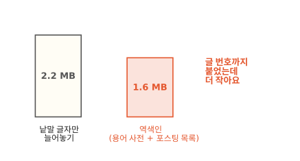
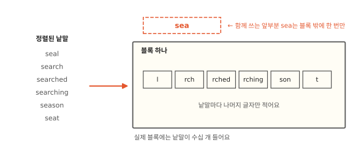
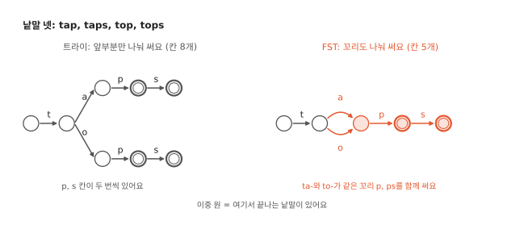
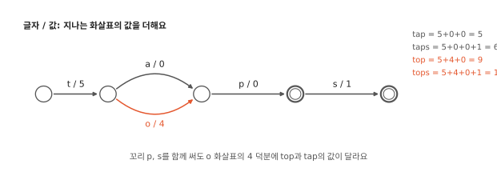
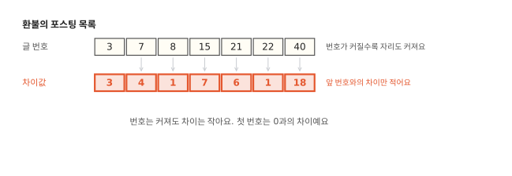
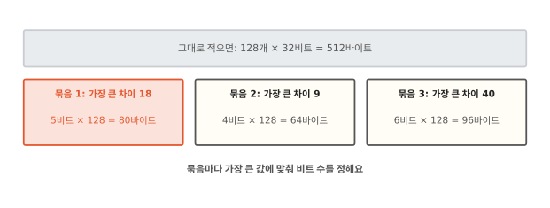
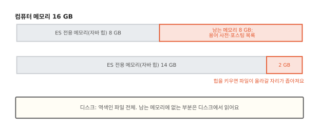
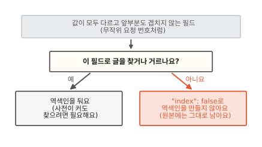
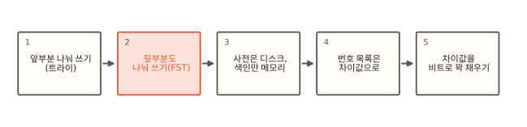

# 낱말이 수십만 개여도 역색인은 왜 작을까요?

## 낱말 글자보다 역색인이 더 작았어요

영어 사전에 실린 낱말 23만 개를 ES에 넣어 봤어요. 글 하나에 낱말 하나씩 넣었으니 글도 23만 개예요. 낱말의 글자 수를 모두 더하면 225만 글자예요. 영어 글자 하나는 1바이트라서 2.2 MB예요. 휴대폰 사진 한 장보다 조금 작은 크기예요.

ES는 이 글들로 역색인을 만들어요. 역색인은 두 부분으로 되어 있어요(1편). 낱말을 정렬해 늘어놓은 용어 사전과 낱말마다 글 번호를 적은 포스팅 목록이에요. 제 컴퓨터에 띄운 ES 7.17에서 이 역색인은 1.6 MB였어요.[^lab] 낱말마다 글 번호까지 붙었는데 낱말 글자만 늘어놓은 것보다 작았어요.

ES는 어떻게 이렇게 작게 담을까요? 먼저 용어 사전부터 봐요.

## 같은 앞부분은 한 번만 적어요

용어 사전은 낱말을 알파벳순으로 정렬해 둬요. 정렬하면 앞부분이 같은 낱말끼리 이웃해요. 그림의 seal부터 seat까지는 나란히 놓이고 모두 "sea"로 시작해요. 이 세 글자를 낱말마다 적을 필요는 없어요.

그래서 ES는 정렬된 낱말을 수십 개씩 모아 디스크에 적어요. 이 덩어리를 블록이라고 해요. 함께 쓰는 앞부분 "sea"는 블록에 적지 않아요. 블록마다 한 번만 따로 적어 둬요. 어디에 적는지는 바로 다음에 봐요. 블록에는 "l", "rch", "rched"처럼 낱말마다 나머지 글자만 적어요.

낱말마다 그 낱말이 든 글이 몇 개인지와 포스팅 목록이 디스크 어디에 있는지도 함께 적어요. 이런 값까지 붙었는데도 처음 실험의 블록은 낱말 글자를 그대로 늘어놓은 것보다 작았어요. 영어 낱말은 앞부분이 많이 겹쳐서 한 번만 적어 아낀 몫이 컸어요.

그런데 블록이 수천 개면 낱말 하나를 찾으려고 블록을 다 읽어야 할까요?

## 블록은 작은 안내판으로 찾아요

책 사전은 옆면의 ㄱ·ㄴ·ㄷ 표시로 먼저 자리를 잡아요. ES도 블록마다 앞부분을 모아 작은 안내판을 따로 만들어요. "sa로 시작하면 블록 41, sea로 시작하면 블록 42"처럼 적은 것이에요. 블록이 함께 쓰는 앞부분은 여기에 한 번 적혀요. 1편에서 본 용어 색인(term index)이 이 안내판이에요.

안내판에 적힌 앞부분도 서로 겹쳐요. "sa", "sea", "sh"는 모두 s로 시작해요. 그래서 안내판도 같은 앞부분을 한 번만 적어요. s 칸 하나에서 a, e, h 칸으로 갈라지는 나무 모양이에요. 그림의 동그라미 하나가 칸 하나이고 글자는 칸 사이 화살표에 적혀요. 낱말 글자를 하나씩 따라 칸을 내려가면 블록 번호가 나와요. 이렇게 앞부분을 나눠 쓴 나무를 **트라이**(trie)라고 해요.

"search"를 찾는다면 안내판을 s, e, a로 따라가 블록 42를 골라요. 그다음 디스크에서 블록 42 하나만 읽어 와 차례로 훑어요. 블록 하나에는 낱말이 수십 개뿐이라 금방 끝나요.

??? info "심화: 블록과 안내판 파일은 실제로 어떻게 생겼을까요?"
    낱말이 아주 많아져서 한 앞부분 아래 블록이 넘칠 때 ES가 어떻게 하는지 알고 싶을 때 보는 칸이에요.

    ES 안에서 역색인을 실제로 만드는 부품은 Lucene이에요(4편). Lucene은 이 구조를 BlockTree 용어 사전이라고 불러요. 블록 하나에는 기본값으로 낱말 25~48개를 담아요. 블록 안에는 낱말마다 나머지 글자, 통계, 포스팅 목록의 파일 위치를 구역을 나눠 적어요. 통계는 그 낱말이 든 글 수예요. 글 안에서 몇 번 나왔는지 세는 필드라면 모두 합쳐 몇 번 나왔는지도 적어요. `keyword` 필드는 처음부터 글 안 횟수를 세지 않게 정해져 있어서 이 값이 없어요. 나머지 글자 구역은 한 번 더 압축하기도 해요. 같은 글자 덩어리가 되풀이되면 앞에 나온 자리만 가리키는 압축(LZ4)이나 소문자 영어 전용 압축이에요. 줄어드는 양이 충분할 때만 써요.

    한 앞부분 아래 낱말이 48개를 넘으면 더 긴 앞부분으로 다시 나눠요. 예를 들어 se 아래가 넘치면 sea, sec, see처럼 나눠 블록을 따로 만들어요. 그러면 se 블록 안의 항목 하나가 sea 블록을 가리켜요. 블록 아래에 블록이 달려요. 안내판은 이 블록들의 앞부분을 모두 적어 둬요. 더 긴 앞부분으로 나누기 어려우면 다음 글자의 범위로 블록을 쪼개요. sea 아래가 넘칠 때 a~m으로 시작하는 쪽과 n~z로 시작하는 쪽으로 나누는 식이에요(floor block). 파일은 셋이에요. 블록은 `.tim`, 안내판은 `.tip`, 필드별 요약은 `.tmd`에 적어요.

안내판에는 블록마다의 앞부분만 들어서 원래 작아요. 그런데 낱말 전체를 메모리에 들고 있어야 하는 곳도 있어요. 검색창에 "sea"까지만 쳐도 이어질 낱말을 띄워 주는 자동완성이 그래요. 23만 낱말 전부를 트라이로 그려 봤더니 칸이 76만 개였어요. 낱말 글자 225만 개의 3분의 1이에요. 낱말 전체를 담을 때 이보다 더 줄일 수는 없을까요?

## 꼬리가 같은 칸도 합칠 수 있어요

그림 왼쪽은 tap, taps, top, tops 넷을 트라이로 그린 모습이에요. 위쪽 줄과 아래쪽 줄 끝에 똑같은 "p, s"가 두 번 있어요. 낱말은 끝도 자주 겹쳐요. 영어라면 -ing, -ed, -s 같은 꼬리가 수만 낱말에 붙어요.

그래서 꼬리가 같은 칸들도 하나로 합쳐요. 두 칸을 합쳐도 되는 조건은 두 가지예요. 그 칸에서 끝나는 낱말이 있는지가 같아야 해요. 그 칸에서 이어지는 글자와 도착 칸도 모두 같아야 해요. 그림 오른쪽에서는 ta-에서 온 길과 to-에서 온 길이 같은 칸으로 모여요. 그리고 p, s 꼬리를 함께 써요.

23만 낱말로 해 보니 칸이 12만 4천 개로 줄었어요. 트라이 칸의 6분의 1쯤이에요. 실험에서는 칸을 합친 뒤에도 23만 낱말을 모두 찾아냈어요. 사전에 없는 말 수천 개로 찾아 봤더니 하나도 찾아내지 않았어요.

여기에 값을 붙이면 쓸모가 커져요. 낱말마다 딸린 값이 필요할 때가 많아요. 안내판이라면 블록 위치가, 자동완성이라면 그 낱말을 보여 줄 순서가 그 값이에요. 그래서 화살표마다 값을 하나씩 붙여요. 길을 따라 내려가며 지나는 화살표의 값을 더하면 낱말 끝에서 그 낱말의 값이 나와요. 그림에서 tap은 5+0+0으로 5이고 top은 5+4+0으로 9예요. 두 낱말은 꼬리 p를 함께 써요. 갈라지는 o 화살표에 붙은 4가 두 값을 갈라 줘요.

앞부분과 꼬리를 함께 나눠 쓰고 길을 따라 값을 내는 이 구조를 **FST**라고 해요. finite state transducer의 머리글자예요.

필드는 글 하나 안에서 제목, 본문처럼 값을 따로 담는 항목이에요. ES에는 자동완성 전용 필드(`completion`)가 있어요. 이 필드는 FST에 낱말 전체를 담아요. 한국어 문장을 낱말로 자르는 nori(2편)도 안에 든 낱말 사전을 FST로 담아요. 이 둘은 7.17과 9.2가 같아요. 안내판은 버전마다 달라요. ES 7.17의 안내판은 FST로 만들어 꼬리를 일부 합쳐요. ES 9.2의 안내판은 꼬리를 합치지 않는 트라이 모양이에요.[^tip]

??? info "심화: FST는 어떻게 만들까요?"
    자동완성처럼 낱말을 수십만 개 담는 FST를 만드는 데 시간이 얼마나 드는지 짐작하고 싶을 때 보는 칸이에요.

    본문의 칸을 표준 용어로는 상태(state)라고 해요. FST 이름의 state가 이 말이에요.

    Lucene은 정렬된 낱말을 한 번만 훑으면서 FST를 만들어요. 새 낱말이 들어오면 앞 낱말과 공통 앞부분을 찾아요. 앞 낱말에서 그 앞부분을 뺀 꼬리는 정렬 순서상 더 바뀌지 않아요. 그래서 그 꼬리 칸들을 이미 만든 칸들과 비교해 같은 모양이면 합쳐요. 이미 만든 칸은 모양별로 표에 적어 두고 이 표에서 같은 모양을 찾아요. Daciuk 외(2000)가 낸 방법이에요. 이 편의 칸 수도 같은 방법으로 셌어요.

    값은 본문 그림처럼 화살표에 나눠 붙여요. 여러 낱말이 함께 지나는 앞부분 화살표에 공통 값을 몰아 두고 갈라지는 화살표에 차이만 붙여요. 이렇게 하면 낱말마다 값이 다른데도 꼬리 칸을 대부분 합칠 수 있어요. 꼬리 화살표에 붙은 값이 서로 다른 칸끼리는 합치지 못해요. 이 때문에 값 없이 그린 FST보다 칸이 조금 늘어요. 본문의 12만 4천 칸은 값 없이 센 수예요.

    안내판의 값은 블록 위치를 적은 바이트 줄이에요. 수를 더하는 대신 화살표마다 붙은 바이트 조각을 차례로 이어 붙여요. 다 이으면 그 낱말의 블록 위치가 돼요.

    Lucene 9.9부터는 안내판을 만들 때 꼬리 합치기를 아예 꺼요. 안내판을 디스크에 더 빨리 적으려는 변경이에요. 대신 안내판이 조금 커져요. 자동완성처럼 낱말 전체를 담는 FST는 그대로 꼬리를 합치되 같은 꼬리를 찾는 표에 메모리 한도를 둬요. 아주 큰 입력에서는 이 한도 때문에 합칠 수 있는 칸을 몇 개 놓치기도 해요. 7.17이 쓰는 Lucene 8.11은 안내판을 만들 때 나가는 화살표가 하나뿐인 칸만 합칠 후보로 봐요. Lucene 소스는 갈래가 여러 개인 칸까지 비교하면 만드는 동안 CPU와 메모리가 더 든다고 적어요. 그래서 7.17의 안내판은 꼬리를 일부만 합쳐요.

용어 사전은 이렇게 줄여요. 낱말마다 달린 포스팅 목록은 어떻게 줄일까요?

## 번호 줄은 앞 번호와의 차이만 적어요

처음 실험의 낱말은 글 하나에만 들어 있어서 글 번호도 하나뿐이에요. 긴 포스팅 목록을 보려면 여러 글에 나오는 낱말이 필요해요. 그래서 1편의 쇼핑몰 게시판으로 돌아가요. 글 100만 개 가운데 10개 중 1개꼴로 "환불"이 들어 있다고 해 봐요. "환불"의 포스팅 목록에는 글 번호가 10만 개 적혀요.

글 번호 하나를 4바이트로 적으면 40만 바이트예요. 4바이트로는 40억이 넘는 수까지 적을 수 있어요. 이 게시판의 글 번호는 100만을 넘지 않으니 자리가 많이 남아요.

포스팅 목록은 번호순으로 정렬돼 있어요. 번호 그대로 적는 대신 앞 번호와의 차이만 적어도 돼요. 3, 7, 8, 15는 3, 4, 1, 7이 돼요. 첫 번호는 0과의 차이로 쳐요. 앞에서부터 차이를 더해 가면 원래 번호가 다시 나와요. 이렇게 차이만 적는 방법을 델타 인코딩(delta encoding)이라고 해요.

번호는 100만까지 커져도 차이는 작아요. 10개 중 1개꼴로 나오는 낱말이면 차이가 평균 10쯤이에요. 더 자주 나오는 낱말일수록 차이가 더 작아요. 이렇게 작은 수를 4바이트씩 적는 건 낭비예요.

??? info "심화: 낱말 순서까지 맞춰 찾는 검색은 무엇을 더 읽을까요?"
    "환불 요청"처럼 낱말 순서까지 맞춰 찾을 때 포스팅 목록에서 무엇을 더 읽는지 알고 싶을 때 보는 칸이에요.

    포스팅 목록에는 글 번호 말고 두 가지를 더 적을 수 있어요. 그 글에 낱말이 몇 번 나오는지가 빈도예요. 글 안 몇 번째 자리에 나오는지가 위치예요. 파일도 나뉘어 있어요. 글 번호와 빈도는 `.doc`, 위치는 `.pos`, 그 밖의 덧붙임 값은 `.pay`에 적어요. 낱말 하나짜리 검색은 `.pos`를 읽지 않아요. 위치는 낱말 순서를 맞춰야 하는 검색(`match_phrase` 같은)이 읽어요. `keyword` 필드는 처음부터 글 번호만 적어요.

## 차이값은 필요한 비트만큼만 써요

컴퓨터는 수를 0과 1로 적어요. 0이나 1 하나를 적는 자리가 1비트이고 8비트가 1바이트예요. 4바이트는 32비트예요. 그런데 18은 10010으로 5비트면 적을 수 있어요.

ES는 차이값을 128개씩 묶어요. 묶음 안에서 가장 큰 차이가 들어갈 만큼만 비트 수를 정해요. 그리고 128개를 모두 그 비트 수로 빈틈없이 이어 적어요. 가장 큰 차이가 18인 묶음이면 128개를 5비트씩 적어 80바이트예요. 그대로 적으면 512바이트였어요. 이렇게 비트 수를 맞춰 꽉 채워 담는 일을 **비트 패킹**(bit packing)이라고 해요.

값마다 비트 수를 따로 정하면 더 작아질 수도 있어요. 하지만 그러면 값마다 길이를 함께 적어야 해요. 풀 때도 값 하나하나의 길이를 따져야 해요. 묶음 안에서는 비트 수가 같아서 같은 계산으로 128개를 한꺼번에 풀어요. 하나씩 따지는 것보다 빨라요.

실험에서도 많이 줄었어요. 글 100만 개에서 10개에 1개꼴로 나오는 낱말은 40만 바이트가 7만 1천 바이트가 됐어요. 5분의 1이 안 돼요. 1천 개 중 1개꼴로 나오는 드문 낱말은 4천 바이트가 1,692바이트가 됐어요. 절반 가까이 남았어요. 드문 낱말은 차이가 평균 1천쯤이라 값마다 10비트 넘게 들어요.

??? info "심화: 차이값 묶음은 실제로 어떻게 적힐까요?"
    번호가 128개로 딱 나눠지지 않거나 아주 적거나 아주 촘촘할 때는 어떻게 적는지 알고 싶을 때 보는 칸이에요.

    글 번호 차이는 본문처럼 128개 묶음에 같은 비트 수로 담아요(FOR). 빈도와 위치는 큰 값 몇 개만 따로 빼서 적고 나머지를 비트 수에 맞춰 담아요(PFOR). 128개가 안 되는 끝자락은 작은 수일수록 바이트를 덜 쓰는 가변 길이 정수로 적어요. 글 하나에만 나오는 낱말은 포스팅 목록 없이 용어 사전의 그 낱말 자리에 글 번호를 바로 적어요. 처음 실험의 낱말들이 이 경우예요.

    Lucene 10.2부터는 글이 촘촘하게 몰린 묶음을 차이값 대신 글마다 1비트씩 쓰는 비트 줄로 적기도 해요. 그쪽이 더 작거나 비슷할 때 써요. ES 9.2에서 새로 만든 보통 인덱스가 이 방식을 써요. 로그나 시계열 전용으로 만든 인덱스는 빼고요.[^post]

그런데 이렇게 작게 담으면 무엇이 좋을까요?

## 작게 담으면 메모리에 더 많이 올라가요

디스크에서 읽는 일은 메모리에서 읽는 일보다 훨씬 느려요. 검색할 때마다 블록과 포스팅 목록을 디스크에서 읽으면 검색도 느려져요.

운영체제는 윈도나 macOS처럼 컴퓨터 전체를 관리하는 프로그램이에요. 운영체제는 아무도 쓰지 않는 메모리에 방금 읽은 파일을 놓아둬요. 같은 파일을 다시 읽으면 디스크까지 가지 않고 메모리에서 꺼내요. 이렇게 파일을 놓아두는 메모리를 페이지 캐시(page cache)라고 해요.

ES는 용어 사전과 포스팅 목록 파일을 페이지 캐시에 맡겨요. 안내판도 페이지 캐시에 올라와요. 블록과 안내판, 포스팅 목록이 작을수록 남는 메모리에 더 많이 올라가요. 그만큼 디스크를 덜 읽어요.

ES는 시작할 때 자기만 쓸 메모리도 정해 둬요. 글 수를 세거나 합계를 내는 집계 같은 일에 쓰는 메모리예요. ES는 자바로 만든 프로그램이라 이 메모리를 자바 힙(heap)이라고 해요. 7.17과 9.2 모두 용어 사전과 포스팅 목록을 힙에 올리지 않아요.[^heap] 힙을 크게 잡는다고 사전 찾기가 빨라지지 않아요. 오히려 남는 메모리가 줄어 페이지 캐시 자리가 좁아져요. ES를 만드는 회사 Elastic도 힙을 메모리의 절반 넘게 잡지 말라고 권해요.[^half]

작게 담을수록 남는 메모리를 아껴요. 그런데 어떤 필드는 아무리 해도 작게 담기지 않아요.

## 값이 모두 다른 필드의 역색인은 언제 쓸모 있을까요?

어떤 필드는 값이 글마다 모두 달라요. 쇼핑몰이 주문 요청마다 무작위로 붙이는 32글자 번호가 그래요. 값이 모두 다르니 낱말 수가 글 수만큼 늘어요. 무작위라서 앞부분도 거의 겹치지 않아요. 그러면 블록과 안내판이 나눠 쓸 앞부분이 없어요. 용어 사전이 글자를 그대로 늘어놓은 만큼 커져요.

그 필드로 글을 찾거나 거를 일이 있으면 역색인을 둬요. 크기가 커지더라도 번호로 빨리 찾으려면 용어 사전이 있어야 해요.[^noidx] 화면에 보여 주기만 하는 필드라면 역색인을 만들지 않아도 돼요. 필드 설정에 `"index": false`를 붙이면 ES는 그 필드의 용어 사전과 포스팅 목록을 만들지 않아요. 넣은 글의 원본에는 값이 그대로 남아서 검색 결과에 함께 보여 줄 수 있어요.

ES는 글마다 이름표(`_id`)를 붙여요. 포스팅 목록의 글 번호와는 달라요. 세그먼트는 ES가 새 글을 모아 따로 만드는 작은 역색인이에요(4편). 글 번호는 세그먼트마다 0, 1, 2로 매겨서 세그먼트를 합치면 바뀌어요. `_id`는 사람이 글을 꺼낼 때 쓰는 바뀌지 않는 글자 이름이에요. `_id`도 낱말처럼 용어 사전에 들어가는데 이건 끌 수 없어요. 대신 `_id`를 ES에 맡기면 앞부분이 잘 겹치는 이름을 만들어 줘요.[^id] 무작위 이름을 따로 만들어 `_id`로 넣으면 그 이점을 잃어요.

두 낱말을 함께 찾을 때 포스팅 목록 둘을 어떻게 겹치는지는 7편에서 이어 가요.

## 정리

이 편에서 새로 나온 말이에요.

- 블록: 정렬된 낱말을 수십 개씩 묶어 디스크에 적은 덩어리예요. 함께 쓰는 앞부분은 한 번만 있어요.
- 안내판(용어 색인): 어느 블록을 읽을지 고르는 작은 길잡이예요.
- 트라이: 같은 앞부분을 한 번만 적어 가지처럼 갈라지게 그린 나무예요.
- FST: 앞부분과 꼬리를 모두 나눠 쓰고 길을 따라가면 낱말에 딸린 값이 나오는 그림이에요.
- 차이값(델타 인코딩): 포스팅 목록에 번호 대신 적는 앞 번호와의 차이예요.
- 비트 패킹: 차이값을 128개씩 묶어 가장 큰 값에 맞춘 비트 수로 꽉 채워 담는 일이에요.
- 페이지 캐시: 운영체제가 남는 메모리에 읽은 파일을 놓아두는 곳이에요.
- 자바 힙: ES가 시작할 때 자기만 쓰려고 정해 두는 메모리예요.

[^lab]: 제 컴퓨터에 띄운 ES 7.17.26과 9.2.0에서 샤드 1개, 복제본 0개인 인덱스로 확인했어요. 낱말 목록은 macOS에 들어 있는 `/usr/share/dict/words`(web2)의 235,976줄을 소문자로 바꿔 겹친 것을 뺀 234,456개를 썼어요. 필드는 `keyword` 하나이고 세그먼트 하나로 병합한 뒤 `_disk_usage`로 쟀어요. 필드의 역색인은 7.17.26에서 1,585,505바이트, 9.2.0에서 1,624,653바이트였어요. 포스팅 목록 실험은 글 100만 개로 같은 방법으로 7.17.26에서 했어요. 트라이와 FST의 칸 수는 같은 낱말 목록을 파이썬으로 그려 셌어요.
[^tip]: ES 7.17이 쓰는 Lucene 8.11은 안내판을 FST로 만들고 나가는 화살표가 하나뿐인 칸만 합쳐요. Lucene 9.9부터 안내판의 꼬리 합치기를 껐어요(변경 기록 GITHUB#12702). ES 9.2에서 새로 만든 일반 인덱스는 Lucene 10.3 포맷을 써서 안내판이 전용 트라이예요(`Lucene103BlockTreeTermsWriter`, `TrieBuilder` 사용). `logsdb`·`time_series` 인덱스와 9.2 전에 만든 인덱스는 ES 자체 포맷(ES812)을 써요. 이 포맷은 안내판을 FST 형식으로 적어요. 하지만 꼬리 합치기를 꺼 둬서 모양은 트라이와 같아요(ES 소스 `Lucene90BlockTreeTermsWriter`의 `suffixRAMLimitMB(0d)`). <https://github.com/apache/lucene/blob/releases/lucene/10.3.1/lucene/CHANGES.txt>
[^post]: Lucene 10.2.0 변경 기록 GITHUB#14133(촘촘한 묶음을 비트 줄로), Lucene 10.3.1 소스 `Lucene103PostingsWriter`. 묶음 크기 128은 7.17의 Lucene 8.11과 9.2의 Lucene 10.3, ES812 포맷이 모두 같아요. <https://github.com/apache/lucene/blob/releases/lucene/10.3.1/lucene/CHANGES.txt>
[^heap]: 옛 버전은 안내판을 힙에 올렸어요. ES 7.7부터는 모든 필드의 안내판을 힙 밖에 둬요(1편). 7.17은 힙에 올린 용어 사전 크기를 `terms_memory_in_bytes` 통계로 보여 줘요. 처음 실험에서 512바이트였어요. 9.x는 이 통계를 늘 0으로 줘요. 자동완성 전용 필드의 FST는 예외로 힙에 올려요.
[^half]: Elasticsearch 문서, "Heap size settings". 힙은 메모리의 50%를 넘지 않게 잡으라고 해요. 그리고 자바가 객체 주소를 짧게 쓰는 한계(대략 26~30 GB) 아래로 두라고 해요. 7.11부터는 힙을 정하지 않으면 ES가 노드 메모리를 보고 알아서 정해요. <https://www.elastic.co/docs/reference/elasticsearch/jvm-settings>
[^id]: Elasticsearch 소스 `TimeBasedUUIDGenerator` 주석. 시각, 일련번호, 기계 주소로 만들어요. 블록 하나(25~48개)만큼의 번호가 앞부분을 함께 쓰도록 바이트 순서를 짰다고 적혀 있어요. 9.2의 일반 인덱스도 같은 생성기를 써요. 처음 실험에서 ES가 붙인 `_id` 23만 개의 역색인은 7.17.26에서 1.1~1.2 MB였어요. 번호가 실행마다 달라서 크기도 조금씩 달라요. 20글자짜리 번호 23만 개를 글자 그대로 적은 469만 바이트의 4분의 1쯤이에요. 용어 사전에는 20글자를 풀어 15바이트로 넣으니 그 기준으로는 3분의 1쯤이에요. 9.2의 `logsdb`·`time_series` 인덱스는 `_id`를 다른 방식으로 만들어요.
[^noidx]: 역색인을 끈 `keyword` 필드로 찾으면 7.17은 오류를 내요(`Cannot search on field ... since it is not indexed`). 9.2는 정렬·집계용으로 따로 적어 두는 값(doc values, 10편)이 있으면 그걸 하나씩 훑어 느리게 찾아요. 보여 주기만 하는 필드라면 `"doc_values": false`도 함께 꺼서 자리를 더 아낄 수 있어요.
