# AND 검색은 어떻게 빨리 겹치는 걸 찾을까요?

## 긴 목록을 끝까지 걸어야 할까요

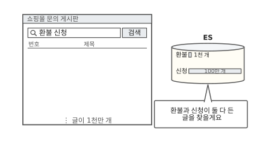

쇼핑몰 문의 게시판에 글이 1천만 개 쌓였어요. 검색창에 "환불 신청"을 치면 두 낱말이 둘 다 든 글을 찾아요. "환불"은 글 1천 개에만 나오고 "신청"은 100만 개에 나와요. ES는 두 낱말의 목록을 어떻게 겹칠까요?

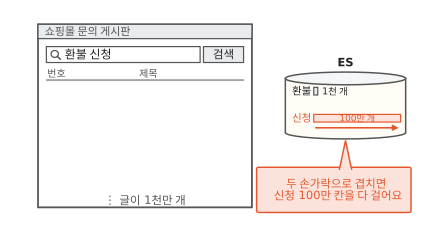

[1편](01-inverted-index.md)에서 본 두 손가락 방법이라면 두 목록을 한 번씩 훑어요. 그러면 "신청" 쪽 100만 칸을 다 걸어야 해요.

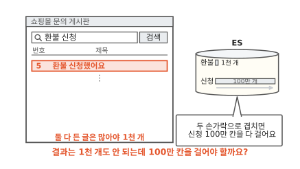

그런데 결과는 기껏해야 1천 개를 넘지 못해요. "환불"이 든 글이 1천 개뿐이니까요.

실제 ES는 짧은 목록의 번호 수만큼, 곧 1천 번 안팎의 건너뛰기로 이 검색을 끝내요. 짧은 목록 쪽 번호만 따라가고 긴 목록은 건너뛰어요. 먼저 두 손가락 방법이 왜 긴 목록을 다 걷는지 볼게요.

## 두 손가락은 긴 목록을 다 걸어요

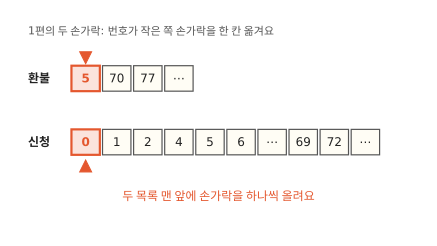

1편의 두 손가락 방법은 번호가 작은 쪽 손가락을 한 칸 옮겨요. 그림처럼 "환불"이 5, 70, 77이고 "신청"은 0부터 촘촘하다고 해 봐요. 두 손가락은 각 목록 맨 앞에서 시작해요.

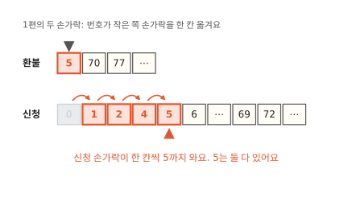

"환불" 손가락이 5에 있으니 "신청" 손가락은 0, 1, 2, 4… 한 칸씩 5까지 와요. 5는 두 목록에 다 있어서 결과에 넣어요. 다음 번호 70까지는 어떻게 갈까요?

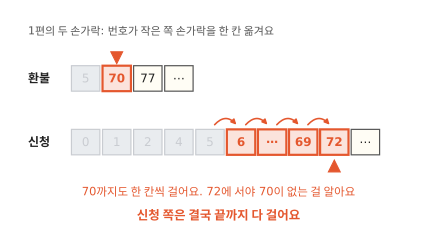

70까지도 한 칸씩이에요. 72에 서고 나서야 "신청"에는 70이 없다는 걸 알아요. 이렇게 가면 "신청" 쪽은 결국 끝까지 다 걸어요.

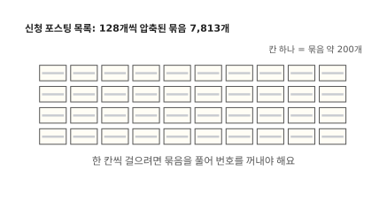

[6편](06-terms-postings.md)에서 포스팅 목록은 128개씩 묶음으로 압축돼 있다고 했어요. "신청" 목록은 묶음 7,813개예요. 한 칸씩 걸으면 이 가운데 몇 개를 풀어야 할까요?

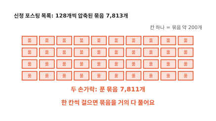

한 칸씩 걸으려면 묶음을 풀어 번호를 꺼내야 해요. 파이썬으로 같은 상황을 만들어 세 보니 7,813개 중 7,811개를 풀었어요.[^lab]

## 짧은 목록이 앞장서요

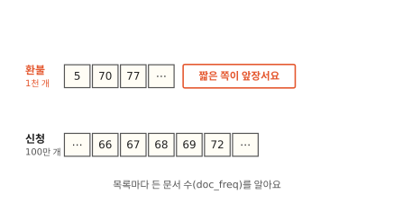

일을 줄이는 첫 번째 생각은 짧은 목록을 앞장세우는 거예요. 어느 목록이 짧은지는 Lucene이 알아서 골라요. 낱말마다 그 낱말이 든 문서 수를 알고 있거든요. 이 수를 doc_freq라고 해요. 가장 적은 쪽이 앞장서고 검색어를 쓴 순서와는 상관없어요.

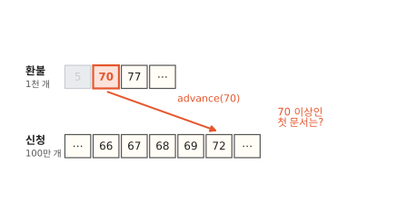

답은 반드시 짧은 목록 안에 있어요. 그래서 짧은 목록의 번호를 하나씩 꺼내고 긴 목록에는 "이 번호 이상인 첫 문서로 가 줘"라고만 물어요. "환불"의 70을 꺼내면 "신청"에 70 이상인 첫 문서를 물어요.

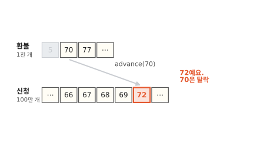

답이 70이면 둘 다 있는 문서예요. 그림처럼 72가 오면 70은 탈락이에요. 그다음엔 무엇을 할까요?

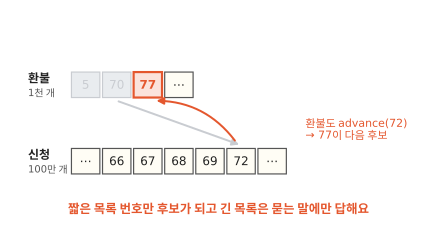

이번엔 "환불"에서 72 이상인 첫 문서로 가요. 77이 다음 후보가 돼요.

이렇게 "이 번호 이상인 첫 문서로 가기"를 Lucene에서는 **advance**라고 불러요. 두 손가락 방법의 한 칸 가기는 `next`예요(Lucene에서는 `nextDoc`). 이 방법은 긴 목록에 `advance`를 써요. 그림처럼 앞장선 짧은 목록도 다음 후보로 갈 때는 `advance`를 써요. 그런데 `advance`가 속으로 한 칸씩 걷는다면 달라진 게 없어요. 긴 목록은 어떻게 정말로 건너뛸까요?

## 건너뛰기 표로 껑충 뛰어요

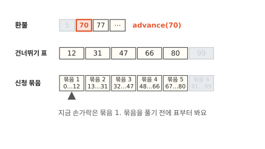

긴 목록 옆에는 묶음마다 마지막 문서 번호를 적은 작은 표가 따로 있어요. 이 표를 **건너뛰기 표**(skip data)라고 할게요. `advance(70)`이 오면 묶음을 풀어 보기 전에 이 표부터 봐요.

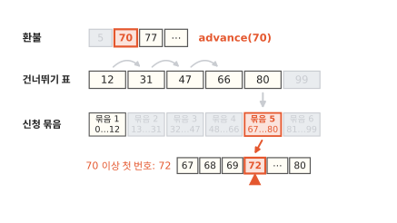

묶음 2의 끝이 31, 묶음 3의 끝이 47, 묶음 4의 끝이 66이에요. 셋 다 70보다 작으니 열어 볼 필요도 없어요. 그럼 70은 어느 묶음에 있을까요?

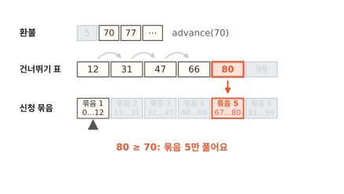

묶음 5의 끝이 80이라 70은 이 묶음 안에 있거나 아예 없어요. 그래서 묶음 5 하나만 풀어요.

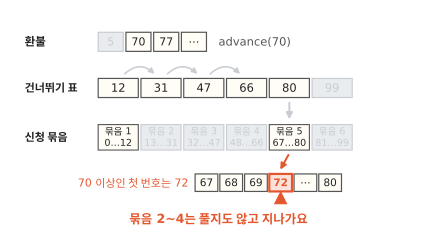

풀어 보니 70은 없고 70 이상인 첫 번호는 72예요. 앞 절에서 "신청"이 돌려준 72가 이렇게 나와요. 손가락은 묶음 1에서 72로 단번에 옮겨 갔어요.

표 자체도 길어지면 그 위에 또 표를 얹어요. 묶음 여러 개마다 하나씩 적은 윗층을 둬요. 아주 멀리 갈 때는 윗층에서 크게 뛰고 아래층에서 조금 뛰어요. [알고리즘 11편](../algorithms/11-btree.md)의 B-트리가 안내 상자를 층층이 두는 것과 같은 생각이에요. 다만 건너뛰기 표는 한 번 만들면 고치지 않아요. 그래서 B-트리처럼 끼워 넣거나 나누는 일이 없고 층마다 간격이 정해져 있어요.

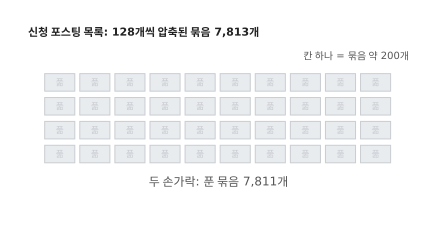

이제 처음 상황으로 다시 세 볼게요. 두 손가락 방법은 "신청" 묶음 7,811개를 풀었어요.

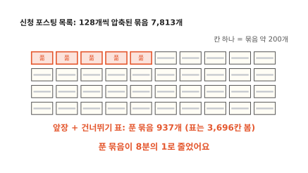

짧은 목록이 앞장서고 건너뛰기 표를 쓰면 "신청" 쪽 묶음을 937개만 풀었어요. 처음의 7,811개에서 8분의 1로 줄었어요. 건너뛰기 표는 3,696칸을 봤어요. 표의 한 칸은 숫자 하나라 묶음 하나를 푸는 것보다 훨씬 가벼워요. 두 목록의 길이 차이가 클수록 아끼는 묶음도 많아져요.

??? info "심화: 실제 AND 실행 (ConjunctionDISI)"
    Lucene 안에서 AND를 맡는 부품이 어떻게 움직이는지 궁금할 때 보는 칸이에요.

    Lucene에서 AND는 ConjunctionDISI가 맡아요. 여러 문서 반복자를 묶은 것이고 반복자의 이름은 `DocIdSetIterator`예요. 각 반복자는 대략 몇 개의 문서를 낼지 `cost()`로 알려 줘요. 낱말이면 doc_freq예요. ConjunctionDISI는 비용이 가장 작은 반복자를 앞장세워요. 앞장선 반복자가 `nextDoc()`으로 후보를 내면 나머지는 차례로 `advance(후보)`를 해요. 누군가 후보보다 큰 번호에 서면 그 번호가 새 후보가 돼요. 앞장선 반복자는 거기로 `advance`해요. 모두가 같은 번호에 서면 그 문서를 내보내요. 이 주고받기를 leapfrog라고 불러요.

    건너뛰기 표의 생김새는 버전마다 달라요. 7.17이 쓰는 Lucene 8.11은 포스팅 파일 안에 여러 층짜리 건너뛰기 목록을 따로 둬요. 128개 묶음마다 한 칸이고 위층은 8칸마다 한 칸이에요. 읽는 쪽은 `Lucene84SkipReader`이고 `MultiLevelSkipListReader`를 이어받아요. 9.2가 쓰는 Lucene 10.3의 포스팅 형식은 `Lucene103PostingsFormat`이에요. 여기에는 전용 건너뛰기 읽기 클래스가 없어요. 128개 묶음 사이사이에 건너뛰기 정보를 끼워 넣고 윗층은 묶음 32개마다 둬요. 문서로 치면 4,096개마다예요(`LEVEL1_FACTOR`). `MultiLevelSkipListReader` 클래스는 10.3 jar에도 있지만 옛 포맷을 읽는 데만 써요. 두 jar의 클래스와 상수로 확인했어요. 두 버전 사이 어느 Lucene에서 바뀌었는지는 확인하지 못했어요. 8.x 후반을 쓰면 `GET /` 응답의 `lucene_version`부터 보세요. 어느 쪽이든 "묶음을 풀기 전에 마지막 번호로 건너뛴다"는 생각은 같아요. 건너뛰기 정보에는 묶음별 최고 점수 재료(impacts)도 함께 들어 있어요. 9편의 WAND가 그걸 써요.

## ES에서 세어 보기

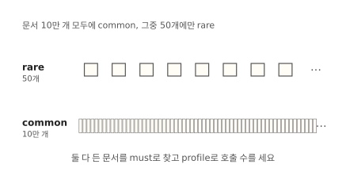

ES의 `profile` 옵션을 켜면 검색이 낱말마다 `next`와 `advance`를 몇 번 불렀는지 보여 줘요. 문서 10만 개 모두에 "common"을 넣었어요. 그중 50개에만 "rare"를 넣고 세그먼트를 하나로 합쳤어요. 그리고 둘 다 든 문서를 점수를 매기는 `must`로 찾아봤어요.

```json
{"profile": true, "query": {"bool": {"must": [
  {"term": {"body": "rare"}}, {"term": {"body": "common"}}]}}}
```

| | rare | common |
|---|---|---|
| ES 7.17.26 | next 0번, advance 51번 | next 0번, advance 50번 |
| ES 9.2.0 | next 0번, advance 51번 | next 0번, advance 50번 |

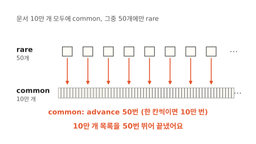

문서 10만 개가 든 "common" 목록은 50번 건너뛰고 끝났어요. 한 칸씩 걸었다면 10만 번이었을 거예요. 앞장선 "rare"는 다음 후보로 51번 넘어갔어요. 마지막 한 번은 끝을 확인하는 호출이에요.

점수를 매기는 경로에서는 앞장선 목록도 "다음 후보 번호 이상으로 가기"로 움직여요. 그래서 `advance`로 찍혀요. 점수가 필요 없는 `filter`로 물으면 7.17에서는 "rare"가 `next` 50번, "common"이 `advance` 51번으로 찍혀요. 앞장선 쪽이 더 또렷이 보여요. 표의 두 낱말 칸은 두 버전이 같았어요. 둘을 묶은 bool 칸은 조금 달랐어요. 7.17은 `next` 50·`advance` 1이고 9.2는 `next` 51·`advance` 0이었어요. 세그먼트가 여럿이면 세그먼트마다 따로 세서 끝 확인이 그만큼 늘어요.

앞장서기와 건너뛰기 표로 AND는 이렇게 빨라졌어요. 그럼 건너뛰기만으로 모든 검색이 끝날까요?

??? info "심화: profile이 0을 보여 줄 때"
    같은 질의인데 버전에 따라 호출 수 칸이 비어 보이는 까닭이 궁금할 때 보는 칸이에요.

    같은 질의를 `filter`에 넣고 `size: 0`, `track_total_hits: true`로 물어봤어요. 9.2에서는 `next_doc`, `advance`가 모두 0으로 나왔어요. 7.17은 같은 질의에서 호출 수가 나왔어요. rare `next_doc` 50, common `advance` 51이에요. 9.2의 profile에는 `count_weight_count` 1이 찍히고 `build_scorer_count`가 0이에요. 9.2는 건수만 필요한 질의를 따로 센 거예요. 문서를 하나씩 내보내는 scorer를 만들지 않는 길이고 이름은 `Weight#count`예요. 그래서 반복자 호출 칸이 비어요. 실행 경로를 비교하려면 이 편처럼 `must`와 `size > 0`으로 실제로 문서를 꺼내게 해야 해요. 그래야 두 버전을 같은 조건으로 볼 수 있어요.

## 건너뛰기만으로 끝나지 않는 검색

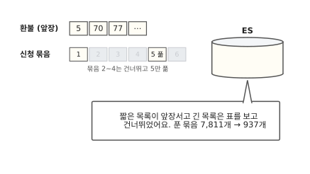

여기까지 "환불 신청"은 짧은 목록이 앞장서고 긴 목록은 표를 보고 건너뛰었어요. 푼 묶음은 7,811개에서 937개로 줄었어요.

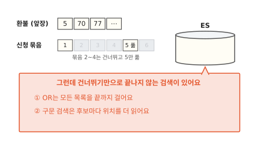

그런데 건너뛰기만으로 끝나지 않는 검색이 둘 있어요. 하나만 맞아도 되는 OR 검색은 모든 목록을 끝까지 걸어요. 붙은 말을 찾는 구문 검색은 후보마다 위치를 더 읽어요. 첫째부터 볼게요.

### 첫째, OR는 모든 목록을 끝까지 걸어요

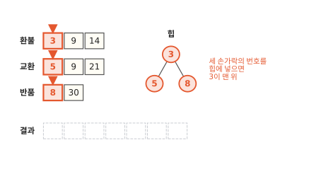

"환불 또는 교환 또는 반품"에 맞는 문서를 빠짐없이 다 모아야 할 때예요. 답이 어느 목록에서 나올지 모르니 짧은 목록을 앞장세울 수 없어요. 세 손가락이 가리키는 번호 중 가장 작은 것을 계속 꺼내야 해요. 이 일에 [알고리즘 10편](../algorithms/10-heap.md)의 힙을 써요. 힙은 가장 작은 값을 늘 맨 위에 두는 나무예요.

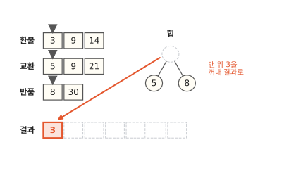

힙 맨 위에서 가장 작은 번호 3을 꺼내 결과로 내요. 3을 낸 "환불" 목록은 어떻게 할까요?

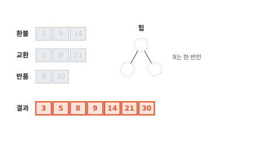

그 목록의 손가락을 한 칸 옮겨 9를 힙에 다시 넣어요. 힙 맨 위는 이제 5예요.

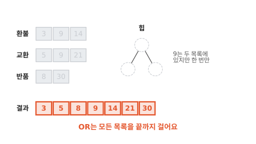

꺼내고 다시 넣기를 목록이 다 끝날 때까지 해요. 9는 두 목록에 있지만 결과에는 한 번만 내요. 모든 결과에 점수를 매겨야 할 때는 Lucene이 번호 구간마다 칸 배열에 점수를 모으기도 해요. 그래도 모든 목록을 끝까지 걷는다는 점은 같아요.

그래서 OR는 AND보다 일이 많아요. 흔한 낱말이 섞인 OR로 맞는 문서를 다 세려면 그 낱말의 목록을 다 걸어요. 상위 10개처럼 점수가 높은 몇 개만 필요하다면 점수로 건너뛰는 방법이 있어요. 그건 9편에서 다뤄요.

### 둘째, 구문 검색은 후보마다 위치를 더 읽어요

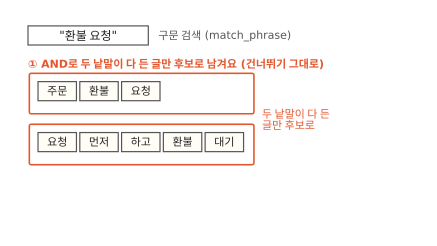

"환불 요청"처럼 붙어 나온 낱말을 찾는 구문 검색(`match_phrase`)은 두 단계로 해요. 먼저 AND처럼 두 낱말이 다 든 문서를 앞에서 본 방법으로 찾아요. 그림의 두 글이 그렇게 남은 후보예요.

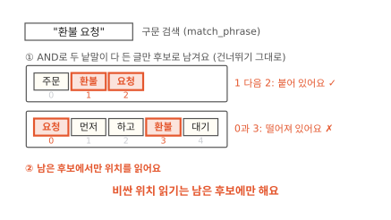

그렇게 걸러진 후보에서만 1편의 위치 정보(positions)를 읽어요. 그리고 두 낱말이 바로 붙어 있는지 확인해요. "주문 환불 요청"은 위치 1 다음이 2라서 남아요. 다른 글은 두 낱말이 0과 3에 떨어져 있어서 빠져요. 위치를 읽는 일은 비싸요. 싼 검사로 후보를 먼저 줄여 두면 비싼 일을 할 문서가 적어져요.

??? info "심화: 두 단계 반복(TwoPhaseIterator)"
    구문 검색 말고도 확인이 비싼 질의를 Lucene이 어떻게 다루는지 궁금할 때 보는 칸이에요.

    문서가 맞는지 확인하는 데 비싼 일이 드는 질의는 Lucene의 TwoPhaseIterator를 써요. 첫 단계(approximation)는 싸게 후보를 내는 반복자예요. 둘째 단계 `matches()`가 그 후보를 비싸게 확인해요. AND 안에 구문 검색과 다른 조건이 섞여 있을 때도 있어요. 그러면 ConjunctionDISI는 모든 조건의 첫 단계로 먼저 교집합을 구해요. 살아남은 후보에만 `matches()`를 불러요. 여러 `matches()`가 있으면 `matchCost()`가 싼 것부터 불러요. 스크립트 질의나 위치를 보는 span 질의도 같은 틀을 써요.

## 건너뛰기는 언제 쓸모 있을까요?

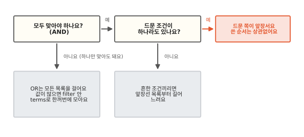

AND 안에 드문 조건이 하나라도 있으면 빨라요. 쇼핑몰 상품을 거르는 `filter`에 `status: active`와 `shop_id: 123`을 넣는다고 해 봐요. 앞쪽은 문서 90%에 맞고 뒤쪽은 0.01%에 맞아요. 드문 조건을 먼저 써야 빠르다며 순서를 바꾸자는 말이 나올 수 있어요. 바꿀 필요가 없어요. Lucene은 질의에 적힌 순서와 상관없이 각 조건이 낼 문서 수(cost)를 봐요. 그리고 가장 적은 쪽을 앞장세워요. `shop_id: 123`이 알아서 앞장서고 `status: active`는 advance만 해요. 흔한 조건만 여러 개 AND 하면 앞장설 목록부터 길어서 느려요.

하나만 맞아도 되는 조건은 다르게 넣어요. 상품 검색에 "브랜드가 A, B, C 중 하나"라는 조건을 넣는데 브랜드가 300개까지 들어온다고 해 봐요. 이걸 점수를 매기는 `should` 300개로 OR 하면 무거워요. 점수가 필요 없는 조건이니 `filter` 안에 `terms` 질의로 넣어요. `terms` 질의는 값이 많으면 해당 문서 번호를 비트셋에 한꺼번에 모아 둬요. 비트셋은 문서마다 1비트씩 켜고 끄는 표예요. 그 비트셋을 하나의 목록처럼 써요. 몇 개부터 이렇게 하는지는 버전마다 달라요. 문서가 적은 값을 OR로 남기는지도 버전마다 달라요. Lucene 8.11은 16개를 넘으면 비트셋을 써요. 같은 필터가 자주 오고 세그먼트가 충분히 크면 결과가 캐시되기도 해요.

문서마다 점수를 어떻게 매기는지는 8편에서 이어 가요.

## 다시 "환불 신청"을 찾아 볼게요

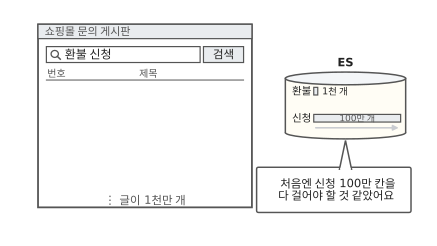

처음 장면의 게시판으로 돌아왔어요. 그때는 두 손가락으로 겹치면 "신청" 100만 칸을 다 걸어야 할 것 같았어요.

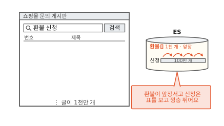

이번에는 doc_freq가 작은 "환불"이 앞장서요. "신청"은 건너뛰기 표를 보고 껑충 뛰며 "70 이상", "72 이상" 같은 물음에만 답해요.

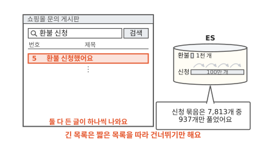

"환불" 1천 개를 따라가는 동안 둘 다 든 글이 하나씩 나와요. "신청" 묶음은 7,813개 중 937개만 풀었어요.

글이 1천만 개든 10억 개든 AND 검색이 내딛는 걸음은 가장 짧은 목록을 따라가요.

### 이 편에서 줄여 그린 것

그림을 쉽게 하려고 실제와 다르게 줄인 곳이 다섯 군데 있어요.

1. 묶음 하나에 문서 번호를 열몇 개만 그렸어요. 실제 묶음에는 번호가 128개씩 들어요([6편](06-terms-postings.md)).
2. 건너뛰기 표를 한 층으로 그렸어요. 실제로는 윗층이 있어요. 7.17은 아래층 8칸마다, 9.2는 묶음 32개마다 윗층에 한 칸을 둬요. "실제 AND 실행" 심화 칸에서 봐요.
3. 푼 묶음 그림은 칸 하나에 묶음 200개쯤을 담았어요. 묶음 7,813개를 칸 40개로, 937개를 칸 5개로 그렸어요.
4. OR를 힙 하나로 그렸어요. 모든 결과에 점수를 매길 때는 번호 구간마다 칸 배열에 점수를 모으기도 해요. 상위 몇 개만 필요하면 점수로 건너뛰어요([9편](09-top-k.md)).
5. 번호를 촘촘하게 그렸어요. 그림의 "환불"은 100 안에 번호가 3개이고 "신청"은 거의 모든 번호예요. 실제로는 본문 숫자대로 "환불"이 문서의 0.01%, "신청"이 10%에 나와요.

### 이 편에서 새로 나온 말


[^lab]: 파이썬 숫자는 Lucene의 생김새를 줄여 흉내 낸 코드로 셌어요. 문서 번호 범위는 1천만이고 문서 1천 개짜리 목록과 100만 개짜리 목록을 AND로 겹쳤어요. profile 숫자는 제 컴퓨터에 띄운 ES 7.17.26과 9.2.0에서 쟀어요.
