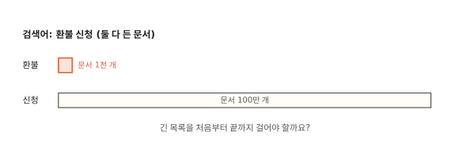
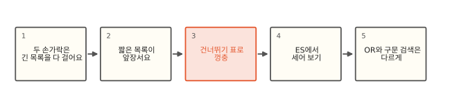
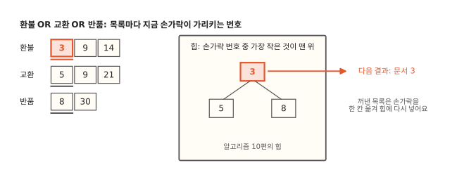

# AND 검색은 어떻게 빨리 겹치는 걸 찾을까요?

## 긴 목록을 끝까지 걸어야 할까요



고객 문의 1천만 건에서 "환불 신청"이 둘 다 든 문서를 찾아요. "환불"은 문서 1천 개에만 나오고 "신청"은 100만 개에 나와요. [1편](01-inverted-index.md)에서 본 두 손가락 방법이라면 두 목록을 한 번씩 훑으니 "신청" 쪽 100만 칸을 다 걸어야 해요. 결과는 기껏해야 1천 개를 넘지 못하는데 말이에요.

실제 ES는 짧은 목록의 번호 수만큼, 곧 1천 번 안팎의 건너뛰기로 이 검색을 끝내요. 짧은 목록 쪽 번호만 따라가고 긴 목록은 건너뛰어요. 그 건너뛰기가 어떻게 되는지가 이 편의 이야기예요.

## 두 손가락에서 OR와 구문 검색까지



먼저 두 손가락 방법이 왜 긴 목록을 다 걷는지 봐요. 그다음 짧은 목록이 앞장서고 긴 목록은 건너뛰는 방법, 그 건너뛰기를 가능하게 하는 표를 봐요. ES의 profile로 실제로 몇 번 건너뛰는지 센 뒤, OR 검색과 구문 검색은 어떻게 다른지 봐요.

## 두 손가락은 긴 목록을 다 걸어요

1편의 두 손가락 방법은 번호가 작은 쪽 손가락을 한 칸 옮겨요. "환불"이 5, 70, 77이고 "신청"이 0부터 100만까지 촘촘하다고 해 봐요. "환불" 손가락이 5에 있으면 "신청" 손가락은 0, 1, 2… 한 칸씩 5까지 와요. 다음 70까지도 한 칸씩이에요. 결국 "신청" 쪽은 끝까지 다 걸어요.

[6편](06-terms-postings.md)에서 포스팅 목록은 128개씩 묶음으로 압축돼 있다고 했어요. 한 칸씩 걸으려면 묶음을 하나도 빠짐없이 풀어야(압축을 풀어 번호를 꺼내야) 해요. 파이썬으로 같은 상황(문서 1천 개 AND 100만 개, 문서 번호 범위 1천만)을 만들어 세 보니 "신청" 쪽 묶음 7,813개 중 7,811개를 풀었어요.[^lab]

## 짧은 목록이 앞장서요

일을 줄이는 첫 번째 생각은 짧은 목록을 앞장세우는 거예요. 어느 목록이 짧은지는 Lucene이 알아서 골라요. 낱말마다 문서 수(1편의 doc_freq)를 알고 있으니 가장 적은 쪽을 앞장세워요. 검색어를 쓴 순서와는 상관없어요. 답은 반드시 짧은 목록 안에 있으니 짧은 목록의 번호를 하나씩 꺼내고 긴 목록에는 "이 번호 이상인 첫 문서로 가 줘"라고만 물어요. "환불"의 70을 꺼내면 "신청"에 70 이상인 첫 문서를 물어요. 답이 70이면 둘 다 있는 문서이고 72라면 70은 탈락이에요. 그다음엔 "환불"에서 72 이상인 첫 문서로 가요.

이렇게 "이 번호 이상인 첫 문서로 가기"를 Lucene에서는 **advance**라고 불러요. 두 손가락 방법이 쓰는 한 칸 가기는 `next`(Lucene에서는 `nextDoc`)라고 해요. 이 방법은 긴 목록에 `advance`를 써요. 그런데 `advance`가 속으로 한 칸씩 걷는다면 달라진 게 없어요. 긴 목록이 정말로 건너뛸 수 있어야 하고 그걸 가능하게 하는 표가 다음 절에 나와요.

## 건너뛰기 표로 껑충 뛰어요


긴 목록 옆에는 묶음마다 마지막 문서 번호를 적은 작은 표가 따로 있어요. 이 표를 **건너뛰기 표**(skip data)라고 할게요. `advance(70)`이 오면 묶음을 풀어 보기 전에 이 표부터 봐요. 묶음 2의 끝이 31, 묶음 3의 끝이 47, 묶음 4의 끝이 66이니 셋 다 70보다 작아서 열어 볼 필요도 없어요. 묶음 5의 끝이 80이라 70은 이 묶음 안에 있거나 아예 없어요. 그래서 묶음 5 하나만 풀어서 70 이상인 첫 번호를 찾아요.

표 자체도 길어지면 그 위에 또 표를 얹어요. 묶음 여러 개마다 하나씩 적은 윗층을 두면 아주 멀리 갈 때 윗층에서 크게 뛰고 아래층에서 조금 뛰어요. [알고리즘 11편](../algorithms/11-btree.md)의 B-트리가 안내 상자를 층층이 두는 것과 같은 생각이에요. 다만 건너뛰기 표는 한 번 만들면 고치지 않아서 B-트리처럼 끼워 넣거나 나누는 일이 없고 층마다 간격이 정해져 있어요.

그림은 묶음 하나를 문서 열몇 개로 줄여 그렸고 실제 묶음은 128개예요. 파이썬으로 다시 세 보니 짧은 목록이 앞장서고 건너뛰기 표를 쓰면 "신청" 쪽 묶음을 937개만 풀었어요. 처음의 7,811개에서 8분의 1로 줄었어요. 건너뛰기 표는 3,696칸을 봤지만 표의 한 칸은 숫자 하나라 묶음 하나를 푸는 것보다 훨씬 가벼워요. 두 목록의 길이 차이가 클수록 아끼는 묶음도 많아져요.

??? info "동료용 심화: 실제 AND 실행 (ConjunctionDISI)"
    Lucene에서 AND는 여러 문서 반복자(DocIdSetIterator)를 묶은 ConjunctionDISI가 맡아요. 각 반복자는 대략 몇 개의 문서를 낼지 `cost()`로 알려 주고(낱말이면 doc_freq), ConjunctionDISI는 비용이 가장 작은 반복자를 앞장세워요. 앞장선 반복자가 `nextDoc()`으로 후보를 내면 나머지는 차례로 `advance(후보)`를 해요. 누군가 후보보다 큰 번호에 서면 그 번호가 새 후보가 되고 앞장선 반복자가 거기로 `advance`해요. 모두가 같은 번호에 서면 그 문서를 내보내요. 이 주고받기를 leapfrog라고 불러요.

    건너뛰기 표의 생김새는 버전마다 달라요. 7.17이 쓰는 Lucene 8.11은 포스팅 파일 안에 여러 층짜리 건너뛰기 목록(`Lucene84SkipReader`가 `MultiLevelSkipListReader`를 이어받아 읽음, 128개 묶음마다 한 칸, 위층은 8칸마다 한 칸)을 따로 둬요. 9.2가 쓰는 Lucene 10.3의 포스팅 형식(`Lucene103PostingsFormat`)은 전용 건너뛰기 읽기 클래스 없이 128개 묶음 사이사이에 건너뛰기 정보를 끼워 넣고 윗층은 묶음 32개(문서 4,096개)마다 둬요(`LEVEL1_FACTOR`). `MultiLevelSkipListReader` 클래스는 10.3 jar에도 있지만 옛 포맷을 읽는 데만 써요(두 jar의 클래스와 상수로 확인). 두 버전 사이 어느 Lucene에서 바뀌었는지는 확인하지 못했으니 8.x 후반을 쓰면 `GET /` 응답의 `lucene_version`부터 보세요. 어느 쪽이든 "묶음을 풀기 전에 마지막 번호로 건너뛴다"는 생각은 같아요. 건너뛰기 정보에는 묶음별 최고 점수 재료(impacts)도 함께 들어 있는데 9편의 WAND가 그걸 써요.

## ES에서 세어 보기

ES의 `profile` 옵션을 켜면 검색이 낱말마다 `next`와 `advance`를 몇 번 불렀는지 보여 줘요. 문서 10만 개 모두에 "common"을, 그중 50개에만 "rare"를 넣고 세그먼트를 하나로 합친 뒤 둘 다 든 문서를 점수를 매기는 `must`로 찾아봤어요.

```json
{"profile": true, "query": {"bool": {"must": [
  {"term": {"body": "rare"}}, {"term": {"body": "common"}}]}}}
```

| | rare | common |
|---|---|---|
| ES 7.17.26 | next 0번, advance 51번 | next 0번, advance 50번 |
| ES 9.2.0 | next 0번, advance 51번 | next 0번, advance 50번 |

문서 10만 개가 든 "common" 목록은 50번 건너뛰고 끝났어요. 한 칸씩 걸었다면 10만 번이었을 거예요. 앞장선 "rare"는 다음 후보로 51번 넘어갔어요(마지막 한 번은 끝을 확인하는 호출). 점수를 매기는 경로에서는 앞장선 목록도 "다음 후보 번호 이상으로 가기"로 움직여서 `advance`로 찍혀요. 점수가 필요 없는 `filter`로 물으면 7.17에서는 "rare"가 `next` 50번, "common"이 `advance` 51번으로 찍혀서 앞장선 쪽이 더 또렷이 보여요. 표의 두 낱말 칸은 두 버전이 같았고 둘을 묶은 bool 칸은 7.17이 `next` 50·`advance` 1, 9.2가 `next` 51·`advance` 0으로 조금 달랐어요. 세그먼트가 여럿이면 세그먼트마다 따로 세서 끝 확인이 그만큼 늘어요.

??? info "동료용 심화: profile이 0을 보여 줄 때"
    같은 질의를 `filter`에 넣고 `size: 0`, `track_total_hits: true`로 물으면 9.2에서는 `next_doc`, `advance`가 모두 0으로 나왔어요. 7.17은 같은 질의에서 rare `next_doc` 50, common `advance` 51처럼 호출 수가 나왔어요. 9.2의 profile에는 `count_weight_count` 1이 찍히고 `build_scorer_count`가 0이에요. 건수만 필요한 질의를 문서를 하나씩 내보내는 scorer를 만들지 않는 길(`Weight#count`)로 센 거예요. 그래서 반복자 호출 칸이 비어요. 실행 경로를 비교하려면 이 편처럼 `must`와 `size > 0`으로 실제로 문서를 꺼내게 해야 두 버전을 같은 조건으로 볼 수 있어요.

## OR와 구문 검색은 다르게 해요



"환불 또는 교환 또는 반품"에 맞는 문서를 빠짐없이 다 모아야 할 때를 먼저 봐요. 답이 어느 목록에서 나올지 모르니 짧은 목록을 앞장세울 수 없고 모든 목록을 끝까지 걸어야 해요. 목록이 여러 개라면 지금 손가락들이 가리키는 번호 중 가장 작은 것을 계속 꺼내야 하는데 이 일에 [알고리즘 10편](../algorithms/10-heap.md)의 힙을 써요. 힙 맨 위에서 가장 작은 번호를 꺼내 결과로 내고 그 목록의 손가락을 한 칸 옮겨 힙에 다시 넣어요. 모든 결과에 점수를 매겨야 할 때는 Lucene이 번호 구간마다 칸 배열에 점수를 모으는 방식을 쓰기도 하지만 모든 목록을 끝까지 걷는다는 점은 같아요.

그래서 OR는 AND보다 일이 많아요. 흔한 낱말이 섞인 OR로 맞는 문서를 다 세려면 그 낱말의 목록을 다 걸어요. 상위 10개처럼 점수가 높은 몇 개만 필요하다면 점수로 건너뛰는 방법이 있고 9편에서 다뤄요.

"환불 요청"처럼 붙어 나온 낱말을 찾는 구문 검색(`match_phrase`)은 두 단계로 해요. 먼저 AND처럼 두 낱말이 다 든 문서를 위 방법으로 찾고 그렇게 걸러진 후보에서만 1편의 위치 정보(positions)를 읽어 두 낱말이 바로 붙어 있는지 확인해요. 위치를 읽는 일은 비싸서 싼 검사로 후보를 먼저 줄여 두면 비싼 일을 할 문서가 적어져요.

??? info "동료용 심화: 두 단계 반복(TwoPhaseIterator)"
    구문 검색처럼 "문서가 맞는지 확인하는 데 비싼 일"이 있는 질의는 Lucene의 TwoPhaseIterator를 써요. 첫 단계(approximation)는 싸게 후보를 내는 반복자이고 둘째 단계 `matches()`가 그 후보를 비싸게 확인해요. AND 안에 구문 검색과 다른 조건이 섞여 있으면 ConjunctionDISI는 모든 조건의 첫 단계로 먼저 교집합을 구하고 살아남은 후보에만 `matches()`를 불러요. 여러 `matches()`가 있으면 `matchCost()`가 싼 것부터 불러요. 스크립트 질의나 위치를 보는 span 질의도 같은 틀을 써요.

## 정리

- 두 손가락 방법은 긴 목록을 끝까지 걸어요. 묶음으로 압축된 목록이라면 모든 묶음을 풀어야 해요.
- advance: 목록에서 "이 번호 이상인 첫 문서"로 가는 일이에요. AND는 짧은 목록이 앞장서고 긴 목록은 advance만 해요.
- 건너뛰기 표: 묶음마다 마지막 번호를 적은 표예요. advance는 이 표로 묶음을 풀지 않고 지나가요.
- OR는 힙으로 가장 작은 번호를 꺼내며 모든 목록을 걸어요. 구문 검색은 AND로 후보를 줄인 뒤 위치를 확인해요.

## 직접 해 보기

[lab/es/07_intersect.py](https://github.com/oya150/bedrock/blob/main/lab/es/07_intersect.py)는 ES 없이 두 방법이 묶음을 몇 개 푸는지 세요. [lab/es/07_es.py](https://github.com/oya150/bedrock/blob/main/lab/es/07_es.py)는 ES에 문서 10만 개를 넣고 profile로 `next`와 `advance` 횟수를 보여 줘요.

```bash
ES=http://localhost:9200 python lab/es/07_es.py
```

"rare"를 넣는 문서 수를 늘려 보세요. "common"의 advance 횟수가 그만큼 늘어나요.

## 확인 문제

??? question "1. 앞장설 목록 고르기"
    "배송"(문서 50만 개), "지연"(문서 2만 개), "제주"(문서 3천 개)가 모두 든 문서를 찾아요. 어느 목록이 앞장서야 할까요? 왜일까요?

    **풀이** "제주"예요. 답은 세 목록 모두에 있어야 하니 가장 짧은 목록의 번호만 후보로 보면 돼요. 후보가 3천 개뿐이라 나머지 두 목록은 많아야 3천 번 advance 해요. "배송"이 앞장서면 후보가 50만 개라 다른 목록에 50만 번 물어야 해요.

??? question "2. 건너뛰기 표에서 바로 탈락"
    건너뛰기 표가 12, 31, 47, 66, 80, 99이고 지금 손가락이 묶음 1에 있어요. `advance(100)`을 부르면 무슨 일이 생길까요?

    **풀이** 이 그림처럼 묶음마다 끝 번호가 표에 다 있다면 모든 값이 100보다 작으니 어떤 묶음도 풀 필요 없이 "끝"을 돌려줘요. 실제로는 128개가 안 되는 마지막 꼬리는 표에 없어서 그 꼬리만 한 번 읽고 끝을 알아요. AND 전체도 여기서 끝나요.

??? question "3. OR가 느린 까닭"
    "환불 AND 신청"은 빠른데 "환불 OR 신청"은 훨씬 느려요. 왜일까요?

    **풀이** OR는 어느 쪽에라도 있는 문서를 다 내야 해서 "신청"의 100만 개를 하나도 건너뛸 수 없어요. 결과도 100만 개가 넘어요. AND는 답이 "환불" 1천 개 안에 있으니 "신청"을 건너뛸 수 있었어요.

## 업무 판단 연습

??? question "흔한 조건을 먼저 쓸까 나중에 쓸까"
    `bool` 질의의 `filter`에 `status: active`(문서 90%)와 `shop_id: 123`(문서 0.01%)을 넣어요. 동료가 "드문 조건을 먼저 써야 빠르니 순서를 바꾸자"고 해요. 바꿔야 할까요?

    **풀이** 바꿀 필요가 없어요. Lucene은 질의에 적힌 순서와 상관없이 각 조건이 낼 문서 수(cost)를 보고 가장 적은 쪽을 앞장세워요. `shop_id: 123`이 알아서 앞장서고 `status: active`는 advance만 해요. 드문 조건이 하나라도 있으면 빨라요. 흔한 조건만 여러 개 AND 하면 앞장설 목록부터 길어서 느려요.

??? question "여러 값 중 하나"
    상품 검색에 "브랜드가 A, B, C… 중 하나"라는 조건을 넣는데 브랜드가 300개까지 들어올 수 있어요. 이걸 `should` 300개로 OR 하면 느리다는 말을 들었어요. 어떻게 할까요?

    **풀이** 점수가 필요 없는 조건이니 `filter` 안에 `terms` 질의로 넣어요. `terms` 질의는 값이 많으면 해당 문서 번호를 비트셋(문서마다 1비트씩 켜고 끄는 표)에 한꺼번에 모아 두고 그 비트셋을 하나의 목록처럼 써요. 몇 개부터 이렇게 하는지와 문서가 적은 값을 OR로 남기는지는 버전마다 달라요(Lucene 8.11은 16개를 넘으면 비트셋). 점수를 매기는 `should` 300개보다 훨씬 가벼워요. 같은 필터가 자주 오고 세그먼트가 충분히 크면 결과가 캐시되기도 해요.

[^lab]: 재는 코드: [lab/es/07_intersect.py](https://github.com/oya150/bedrock/blob/main/lab/es/07_intersect.py), [lab/es/07_es.py](https://github.com/oya150/bedrock/blob/main/lab/es/07_es.py). 파이썬 쪽은 Lucene의 생김새를 줄여 흉내 낸 것이고 profile 숫자는 ES 7.17.26과 9.2.0에서 쟀어요.
