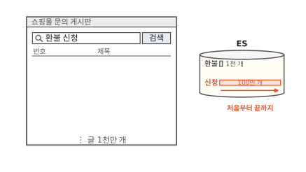
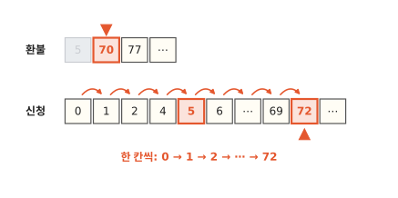
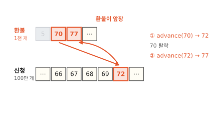
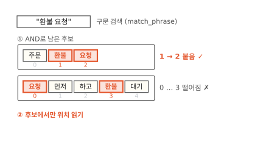

# AND 검색: 짧은 목록을 따라 건너뛰기

쇼핑몰 문의 게시판에서 "환불 신청"을 검색하면 두 낱말이 둘 다 든 문서가 나와요. 게시판에 글이 1천만 개 쌓여 있어도 결과는 금방 떠요. 이 글을 읽고 나면 ES가 두 낱말의 문서 번호 목록을 겹칠 때 긴 목록을 다 걷지 않고 건너뛰는 방법을 알게 돼요. 이걸 알면 조건을 어떤 순서로 써도 빠른 까닭과 OR 검색이 AND 검색보다 일이 많은 까닭이 보여요.

!!! abstract "이 글에서 알게 되는 것"
    1. 두 낱말이 다 든 문서는 짧은 목록 안에만 있어요. 그래서 문서 수가 적은 낱말이 앞장서고 긴 목록에는 "이 번호 이상인 첫 문서"이 무엇인지만 물어요.
    2. 긴 목록 옆에는 묶음마다 마지막 번호를 적은 건너뛰기 표가 있어요. 표만 보고 답이 없는 묶음은 풀지 않고 넘어가요.
    3. OR는 답이 어느 목록에서 나올지 몰라서 모든 목록을 끝까지 걸어요. 구문 검색은 AND로 후보를 먼저 줄인 뒤 남은 후보에서만 위치를 읽어요.

## 1. 두 손가락으로 겹치면 긴 목록을 끝까지 걸어요

게시판 글 하나는 ES에서 문서 하나예요([3편](03-routing.md)). [1편](01-inverted-index.md)에서 ES는 낱말마다 그 낱말이 든 문서 번호를 적은 목록을 만들어 둔다고 했어요. 이 목록이 포스팅 목록이에요. "환불 신청"을 찾으려면 "환불" 목록과 "신청" 목록에 함께 있는 번호를 찾으면 돼요.

게시판에 글이 1천만 개 있고 "환불"은 그중 1천 개에, "신청"은 100만 개에 나온다고 해 볼게요. 아래 그림에서 ES 안의 두 목록 길이를 보세요.

**그림 1.** "환불" 목록은 아주 짧고 "신청" 목록은 아주 길어요.
{ .fig-cap }

1편에서는 두 손가락 방법으로 목록을 겹쳤어요. 두 목록 맨 앞에 손가락을 하나씩 올리고 번호가 작은 쪽 손가락을 한 칸 옮겨요. 두 손가락이 같은 번호에 서면 그 문서를 결과에 넣어요. 아래 그림은 "환불"이 5, 70, 77…이고 "신청"이 0부터 촘촘할 때예요. "신청" 줄 위의 화살표를 따라가 보세요.

**그림 2.** "신청" 손가락은 70이 있는지 알려고 0부터 72까지 한 칸씩 걸어요.
{ .fig-cap }

"환불" 손가락이 5에 있으니 "신청" 손가락은 0, 1, 2, 4를 지나 5까지 와요. 5는 두 목록에 다 있어서 결과에 넣어요. 다음 "환불" 번호는 70이에요. "신청" 손가락은 6부터 또 한 칸씩 가다가 72에 서고 나서야 70이 없다는 걸 알아요. 이렇게 가면 "신청" 쪽 100만 칸을 결국 다 걸어요.

한 칸 걷는 일도 가볍지 않아요. [6편](06-terms-postings.md)에서 본 대로 포스팅 목록은 번호를 128개씩 묶어서 압축해 둬요. 한 칸씩 걸으려면 묶음을 하나하나 풀어서 번호를 꺼내야 해요. 그래서 두 손가락 방법은 "신청"의 묶음을 거의 다 풀어요.

그런데 결과는 많아야 1천 개예요. "환불"이 든 문서가 1천 개뿐이니까요. 결과 1천 개를 얻으려고 100만 칸을 걷는 건 아까워요.

## 2. 짧은 목록이 앞장서고 긴 목록은 묻는 말에만 답해요

1절에서 결과는 "환불" 목록 안에만 있다는 걸 봤어요. 그러면 긴 목록을 처음부터 걸을 까닭이 없어요. 짧은 목록의 번호를 하나씩 꺼내고 긴 목록에는 그 번호가 있는지만 물으면 돼요.

어느 목록이 짧은지는 ES가 알아요. ES는 낱말마다 그 낱말이 든 문서 수를 적어 둬요. 이 수를 **doc_freq**라고 해요. "환불"의 doc_freq는 1천이고 "신청"은 100만이에요. ES 안에서 검색을 맡은 Lucene은 doc_freq가 가장 작은 목록을 앞장세워요. 검색창에 "신청 환불"로 순서를 바꿔 쳐도 앞장서는 쪽은 "환불"이에요.

앞장선 "환불"에서 70을 꺼냈다고 해 볼게요. 이번엔 "신청"에 "70 이상인 첫 번호로 가 줘"라고 물어요. 아래 그림에서 빨간 화살표 두 개를 ①, ② 순서로 보세요.

**그림 3.** "신청"은 70을 물으면 72로 답하고 "환불"은 72를 받아 77로 가요.
{ .fig-cap }

"신청"이 70이라고 답했다면 70은 두 목록에 다 있는 문서예요. 그림처럼 72라고 답하면 "신청"에는 70이 없다는 뜻이라서 70은 탈락이에요. 그다음엔 "환불"이 "72 이상인 첫 번호"로 가요. 그게 77이에요. 이렇게 상대가 선 번호까지 가기를 서로 주고받다가 둘이 같은 번호에 서면 그 문서가 결과로 나와요.

"이 번호 이상인 첫 문서로 가기"를 Lucene에서는 **advance**라고 해요. 두 손가락 방법의 한 칸 가기는 `next`라고 해요.

여기서 이런 생각이 들 거예요. `advance(70)`이 속으로는 0부터 한 칸씩 걷는다면 달라진 게 없잖아요. 긴 목록이 정말로 건너뛰려면 무언가가 더 있어야 해요.

## 3. 건너뛰기 표를 보면 묶음을 풀지 않고 넘어가요

긴 목록 옆에는 작은 표가 하나 더 있어요. 묶음마다 그 묶음의 마지막 문서 번호를 적어 둔 표예요. 이 표를 **건너뛰기 표**(skip data)라고 할게요. `advance(70)`이 오면 묶음을 풀기 전에 이 표부터 봐요.

아래 그림은 "신청" 목록을 묶음 여섯 개로 줄여 그렸어요. 건너뛰기 표에는 묶음마다 끝 번호 12, 31, 47, 66, 80, 99가 적혀 있어요. 빨간 칸을 왼쪽부터 보세요.

**그림 4.** 표만 보고 묶음 2~4를 넘어가서 묶음 5를 골라요.
{ .fig-cap }

묶음 2의 끝은 31, 묶음 3은 47, 묶음 4는 66이에요. 셋 다 70보다 작으니 그 안에 70 이상인 번호는 없어요. 그래서 열어 보지 않고 넘어가요. 묶음 5의 끝은 80이에요. 70은 이 묶음 안에 있거나 아예 없어요. 이제 묶음 5 하나만 풀어요.

**그림 5.** 묶음 5를 풀어 보니 70 이상인 첫 번호는 72예요.
{ .fig-cap }

70은 없고 그다음 번호가 72예요. 2절에서 "신청"이 72라고 답한 건 이렇게 나온 거예요. 손가락은 묶음 1에서 72로 단번에 옮겨 갔고 묶음 2~4는 풀지 않았어요. 표의 한 칸은 숫자 하나라서 들여다보는 데 드는 일이 묶음 하나를 푸는 것보다 훨씬 적어요. 그림은 묶음 하나에 번호를 열몇 개만 그렸지만 실제 묶음에는 128개씩 들어요.

목록이 아주 길면 표도 길어져요. 그래서 표 위에 표를 하나 더 얹어요. 묶음 여러 개마다 한 칸씩 적은 윗층을 두고 멀리 갈 때는 윗층에서 크게 뛴 다음 아래층에서 조금 뛰어요. [알고리즘 11편](../algorithms/11-btree.md)의 B-트리가 안내 상자를 층층이 두는 것과 같은 생각이에요. 다만 건너뛰기 표는 한 번 만들면 고치지 않아서 B-트리처럼 끼워 넣거나 나누는 일이 없어요. 윗층을 몇 묶음마다 두는지는 ES 버전마다 달라요.

다시 "환불 신청"으로 돌아가 볼게요. "환불"에서 번호를 하나 꺼낼 때마다 "신청"은 표를 보고 껑충 뛰어서 묶음을 많아야 하나 풀어요. "환불"이 1천 개이니 "신청"에서 푸는 묶음도 1천 개를 넘지 않아요. 두 손가락 방법은 "신청"의 묶음을 거의 다 풀었어요. 두 목록의 길이 차이가 클수록 아끼는 묶음도 많아져요.

## 4. OR는 모든 목록을 끝까지 걸어요

AND는 짧은 목록을 따라 건너뛰었어요. 하나만 맞아도 되는 OR는 그렇게 못 해요. "환불 또는 교환 또는 반품"이 든 문서를 다 모은다고 해 볼게요. 답이 어느 목록에서 나올지 모르니 짧은 목록을 앞장세울 수가 없어요. 세 목록의 번호를 작은 것부터 빠짐없이 내야 해요.

세 손가락이 가리키는 번호 가운데 가장 작은 걸 계속 꺼내야 해요. 이 일에 [알고리즘 10편](../algorithms/10-heap.md)의 힙을 써요. 힙은 가장 작은 값을 늘 맨 위에 두는 나무예요. 아래 그림에서 힙 맨 위를 보세요.

**그림 6.** 세 목록의 맨 앞 번호 3, 5, 8을 힙에 넣으면 가장 작은 3이 맨 위에 와요.
{ .fig-cap }

맨 위의 3을 꺼내 결과로 내요. 3을 낸 "환불" 손가락은 한 칸 옮겨서 9를 힙에 넣어요.

**그림 7.** 3이 결과로 나가고 9가 들어와서 힙 맨 위는 이제 5예요.
{ .fig-cap }

꺼내고 다시 넣기를 세 목록이 다 끝날 때까지 되풀이해요.

**그림 8.** 세 목록을 끝까지 걸어서 결과 일곱 개가 번호 순서대로 나왔어요.
{ .fig-cap }

9는 "환불"과 "교환" 두 목록에 다 있지만 결과에는 한 번만 내요. 결과를 빠짐없이 모으려면 모든 목록의 모든 칸을 한 번씩은 거쳐야 해요. 그래서 흔한 낱말이 섞인 OR는 그 낱말의 긴 목록을 다 걸어요. 점수가 높은 10개처럼 몇 개만 필요할 때는 점수를 보고 건너뛰는 방법이 따로 있어요. 그 이야기는 [9편](09-top-k.md)에서 해요.

## 5. 구문 검색은 AND로 후보를 줄인 뒤 위치를 읽어요

이번엔 "환불 요청"처럼 두 낱말이 붙어 나온 문서만 찾는 구문 검색(`match_phrase`)이에요. 두 낱말이 붙어 있으려면 먼저 둘 다 들어 있어야 해요. 그래서 ES는 3절까지 본 AND로 두 낱말이 다 든 문서부터 찾아요. 이 단계는 건너뛰기를 그대로 써요.

역색인은 낱말마다 문서 번호만 적지 않고 그 낱말이 문서의 몇 번째 자리에 있는지도 적어 둬요. 이 자리 번호를 위치 정보라고 해요. ES는 AND로 남은 후보에서만 위치 정보를 읽어요. 아래 그림에서 낱말 칸 밑의 작은 숫자를 보세요.

**그림 9.** "주문 환불 요청"은 위치 1 다음이 2라서 남아요. 다른 문서는 두 낱말이 0과 3에 떨어져 있어서 빠져요.
{ .fig-cap }

위치를 읽는 일은 문서 번호만 보는 것보다 훨씬 무거워요. 가벼운 AND로 후보를 먼저 줄여 두면 무거운 일을 할 문서가 적어져요.

## 6. 드문 조건이 하나라도 있으면 AND가 빨라요

지금까지 본 걸 검색 조건을 정할 때 써 볼게요. 아래 갈림길을 왼쪽 위부터 따라가 보세요.

**그림 10.** AND 안에 드문 조건이 있으면 그 조건이 앞장서고 쓴 순서는 상관없어요.
{ .fig-cap }

쇼핑몰 상품을 거르는 조건에 "판매 중"과 "가게 번호 123"을 함께 넣는다고 해 볼게요. 판매 중인 상품은 거의 전부이고 가게 123의 상품은 아주 적어요. 드문 조건을 먼저 써야 빠르다며 순서를 바꾸자는 말이 나올 수 있어요. 바꾸지 않아도 돼요. Lucene은 쓴 순서와 상관없이 조건마다 맞는 문서 수를 보고 가장 적은 쪽을 앞장세워요. "가게 번호 123"이 알아서 앞장서고 "판매 중"은 묻는 말에만 답해요. 흔한 조건끼리만 AND 하면 앞장선 목록부터 길어서 느려요.

하나만 맞아도 되는 조건은 넣는 자리가 달라요. "브랜드가 A, B, C 가운데 하나"처럼 값이 수백 개 들어오는 조건이라고 해 볼게요. 이걸 점수를 매기는 OR(`should`) 수백 개로 넣으면 4절처럼 목록마다 손가락을 두고 힙을 돌려야 해서 무거워요. 점수가 필요 없는 조건이니 점수를 매기지 않는 `filter` 안에 `terms` 질의로 넣어요. 그러면 값이 많을 때 ES는 맞는 문서 번호를 비트셋에 한꺼번에 모아 둬요. 비트셋은 문서마다 1비트씩 켜고 끄는 표예요. 이 비트셋을 목록 하나처럼 써서 다른 조건과 AND 해요. 값이 몇 개부터 이렇게 모으는지는 버전마다 달라요.

## 정리

AND 검색에서 두 낱말이 다 든 문서는 짧은 목록 안에만 있어요. 그래서 doc_freq가 작은 "환불"이 앞장서고 긴 "신청"에는 `advance(70)`처럼 "이 번호 이상인 첫 문서"만 물어요. 조건을 어떤 순서로 쓰든 앞장설 쪽은 Lucene이 골라요.

"신청"은 건너뛰기 표에 적힌 묶음별 마지막 번호를 보고 답이 있을 수 없는 묶음을 풀지 않고 넘어가요. 그래서 AND 검색이 내딛는 걸음은 가장 짧은 목록의 길이를 따라가요. 게시판 글이 1천만 개든 그보다 훨씬 많든 마찬가지예요.

OR는 답이 어느 목록에서 나올지 몰라서 힙으로 모든 목록을 끝까지 걸어요. 구문 검색은 AND로 후보를 먼저 줄이고 남은 후보에서만 위치를 읽어요.

[8편](08-bm25.md)에서는 찾은 문서마다 점수를 매겨 순서를 정하는 방법을 봐요.

### 새로 나온 말

- **doc_freq**: 낱말이 든 문서 수. "환불"은 1천, "신청"은 100만이라서 "환불"이 앞장섰어요.
- **advance**: 목록에서 "이 번호 이상인 첫 문서"로 가기. `advance(70)`을 받은 "신청"은 72로 갔어요.
- **next**: 목록에서 한 칸 앞으로 가기. 두 손가락 방법은 "신청"을 `next`로 0부터 72까지 걸었어요.
- **건너뛰기 표**(skip data): 묶음마다 마지막 문서 번호를 적은 표. 31, 47, 66을 보고 묶음 2~4를 넘어갔어요.
- **비트셋**: 문서마다 1비트씩 켜고 끄는 표. `filter` 안 `terms`에 값이 많으면 맞는 문서 번호를 여기에 모아요.
